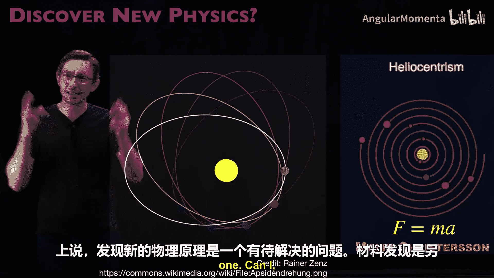
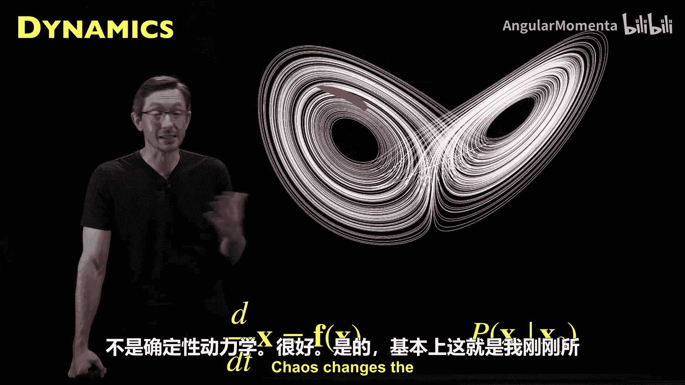
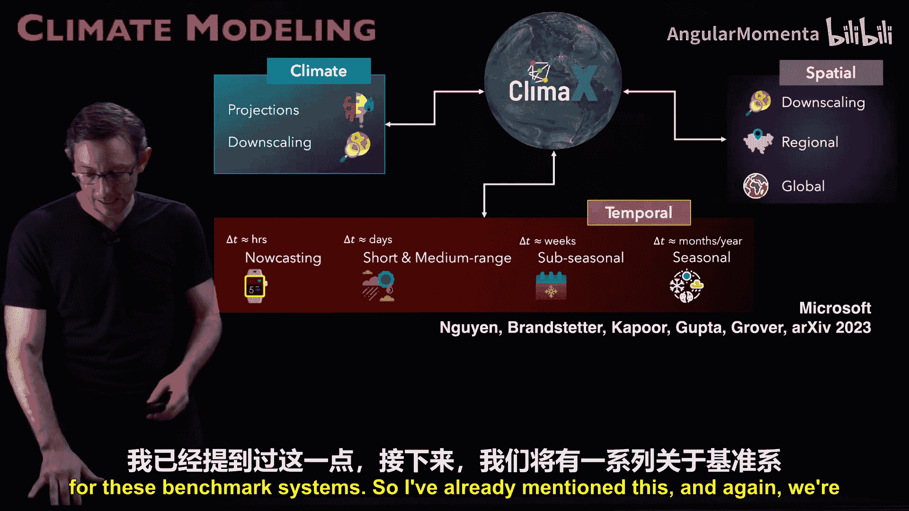
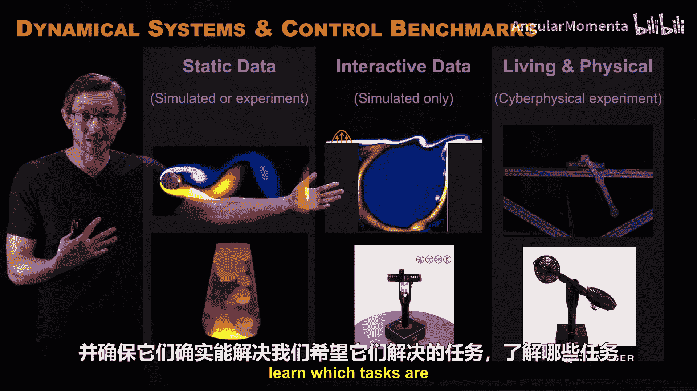
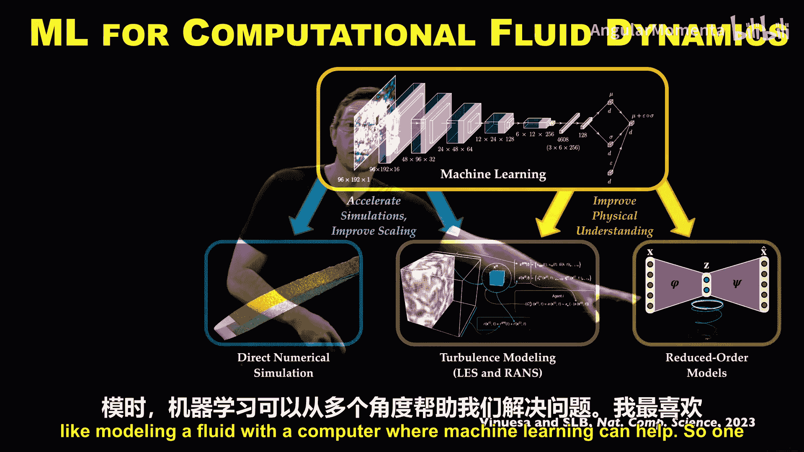
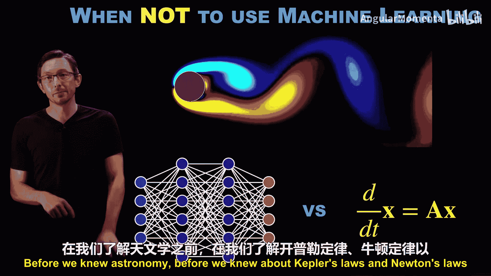

# 【精译】物理信息机器学习-p02-02-人工智能_机器学习+物理学-第1部分：选择建模对象--BV1c9uDzQEj8_p2-

Welcome back so we are just starting off this lecture series on physics informed machine learning。

 essentially how to improve machine learning when we know something about physics or how to learn physics from data using machine learning and in the last lecture we talked about how there are these five major stages of machine learning and all of them can benefit from embedding physics and we can actually use these stages to learn physics too so today's lecture is really just going to zoom in on this first stage of the machine learning process which is deciding on a problem what it is we're actually trying to model or what's our goal of our machine learning model。

You know， at first， I actually thought this was going to be the easiest video to make。

Because you know how complicated could it be， how much could I actually say about how important deciding on the problem is and where to embed physics。

 but it turns out I've actually been spending the last couple of hours thinking about this and every time I think I have figured it out。

 there's something new I want to tell you because this is actually maybe the most important out of all of these stages。

 this is where the scientific method really does still apply or the engineering process。

 the design process still applies in this phase one。

 even if you're going to use machine learning to build your model so this is you the most foundational step in any kind of model building process is deciding what it actually is you on a model what's the purpose of this model how are you going to use it and so I'm actually going to back up and talk about how this fits into these other stages before then again diving back in just this deciding on a problem stage one。

So you know， sometimes we have a pretty clear idea of the problem we're trying to solve。

 maybe I you know I'm doing turbulence modeling and I know that there is a closure problem。

 there are things like Reynolds stresses that I don't understand。

 I don't have a good mathematical model of how they behave。

 but I have a bunch of data and I know that I'm going to try to model those you know quantities better from my data。

But sometimes I don't know exactly what the problem is。

 I have a vague notion like I want to build a better race car or I want to build a better you know a better wing and that's not really a specific enough problem and so you have to go down the line and think okay well what data might I use to improve that process or to accomplish that big goal so you start breaking it down maybe you have a vague idea of the kinds of architectures that are good at those kinds of problems for the data you have but once you actually start know really looking at what data you have access to what data is cheap or expensive how much of it you have and the architectures。

 you might actually have to go back and refine the problem statement so very often we find ourselves going down this path even all the way down you you trained your model and you realize it doesn't do exactly what you wanted it to or it's not exactly the right performance or it's not useful in the way you thought but you learned a lot in that。

Process and you go back and you refine your problem statement now we know better the thing we're trying to model。

So again， I really really want to emphasize。In classic engineering and science。

 we're used to using experiments and numerical simulations to either design a new system like an iPhone or a race car or an aircraft。

 we're used to using simulations and experiments in that engineering design process。

And also in the scientific discovery process。This really isn't that different the same way you would design an experiment to answer some question that you need to know for some bigger goal it's exactly the same way that you would design this kind of machine learning experiment okay so you're going to have some hypothesis I think I can model this phenomena maybe the lift as a function of different wing shapes so I'm going to you know get the data I have actually build the model。

 see if it worked I might have to tweak that experiment I might have to refine the problem statement so you know all of your intuition for engineering design and scientific discovery from the laboratory and from numerical experiment a lot of those same principles apply here and there's a lot more I can say we're going to come back to this diagram at the end and we're going to revisit what are some of the lessons we learned what are some key themes on deciding on a good problem versus a bad problem okay but there is some trial and error it is a lot like you know building an experiment or building a simulation。

To start answering a question， but maybe we can do this better with data。Okay。

 so we're going to zoom in on deciding on the problem。And again， you know in my first video I said。

 well， if you are you know modeling some aspect of a physical system。

 you're kind of inherently doing this you intersection between physics and machine learning。

 your machine learning models should be capturing some of that physics， but that's a little vague。

 so I want to go a lot more in depth on the kinds of problems we might be looking at and some of their nuances of you know is learning evil pulling those problems at some kind of。

Lessons along the way about good ways of setting up these problem statements。

So I think data science in general is， in my view， the process of asking and answering questions from a data centric perspective。

 so a lot of the history of science has been driven by the data， the observations。

 and this really isn't that different。Okay， I really like this quote and I think it's extremely apt for this section on you know what we're modeling what is the problem statement。

 I actually got this slide from my friend Nathan Cotz who likes to give this in his academic seminars and I think it really is exactly what we need to be thinking about。

So often people look at machine learning as the solution to a problem。

And you a lot of times I see people just building machine learning models because they can。

And I think that is the wrong approach I think this Picasso quote really nails it。

 computers are useless， they can only give you answers and it's kind of the exact same story with learning data drivenriven models are useless。

 they can only you know model your data， you have to be the one to decide what is the right model。

 what is the right fidelity， what would be a useful model and how are you going to use it downstream。

 that's a human endeavor， and once you figured out that really important piece。

 then training the model you is not necessarily the challenging part。

So we're going to just go through some principles before we look at some examples。

 I just want to be thinking about why do we need a machine learning model in the first place okay again。

 it's going to be an expensive process， time consuming you know that data wasn't cheap training those models is often expensive and time consuming so you better understand why you need this machine learning model in the first place and how you're going to use it that's going to dramatically kind of impact all of the downstream decisions and again we're not just talking about any old machine learning model we're really talking about machine learning models at the intersection of applying this for engineering and physics systems。

 systems that are governed by physics you know like designing materials or aircraft or modeling turbulence。

 things like that。So first one of the areas where machine learning really is you know critically important and advancing our capabilities beyond where they are without machine learning is learning new physics。

 there are many， many systems where we have a pretty good understanding of how the system works。

 you know we understand how fluid flows work， we understand how penduula and mechanical systems work。

 we have lots of governing equations for systems。But there are tons of systems where we don't know the physics。

 so if I think about neuroscience， we don't actually have governing equations for the brain or an epidemiological system or even the climate system there are big missing chunks of physics that we don't know how to model as humans yet but we have tons of data and so maybe we can start using that data to improve and build on our first principles physics models to learn new physics that we've never been able to write down before。

 that's a huge opportunity for machine learning and then you know maybe you can use those models just like you would have used a physicsbased model。

 but you can apply this to a much more complicated system where humans haven't been able to you know discover that physics like F equals MA so actually a lot of the work that my lab does and our collaborators groups also is in this realm of discovering new physics with machine learning。

But that's just one of many uses of a machine learning model Another reason you might use a machine learning model or build a machine learning model is you know maybe there is some system or some physics that you actually do understand quite well we know how to simulate it or how to build experiments it's just really expensive so things like simulating fluid flows or simulating you know materials at all of the scales in principle you know we have the physics for that。

 maybe simulating protein folding or some you biochemical molecule we understand first principles physics we technically can simulate those but they're super super expensive so can we use machine learning to augment those models to help us build surrogate models that are faster and still accurate enough to do things like design and optimization and things like that。

 so can we accelerate drug discovery or materials design or fluid simulations。

Even when we know the physics because that physics is so expensive and I put a little third bullet point down here on the bottom。

 I think this is going to be really important later on in this lecture series。

 machine learning models are often not always but often kind of inherently automatically differentiable。

 meaning you can kind of compute the sensitivity of outputs to inputs and vice versa using back propagation。

 things that we use to train the neural networks and the models。😊。

You can often use that automatic differentiability of the machine learning model in classical engineering。

 design and optimization loops okay so if I want to do shape optimization of a wing or you know an automobile or something like that we might be able to use this automatic differentiation that we're already using to train things like neural networks。

 we might be able to use that to do better， faster。

 cheaper design optimization you're going to hear a lot more about this later。

 it's really really important and interesting。😊，Okay。

 so learning new physics that makes sense there's things we don't understand and maybe we can learn models encapsulating or capturing existing expensive physics totally makes sense that a machine learning model might help us do that better and there's this kind of in between what I'm going to call capturing multi physics interactions so a lot of times。

We are good at modeling you know single scale physics with single type of physics we're good at modeling a single fluid or a planetary system in orbit or you know a simple material。

 but when you start adding complexity if you have multi-phase flows or if you have you know you're simulating the motion of the planets but they have tidal forces and oceans and you know multi physicssics interactions。

 that becomes really complicated really quickly， one of my favorite examples of this actually I learned from Tapio Schneider's group at Caltech in climate science realm。

Is cloud physics。 So the way that clouds form the way that ice crystals and condensation and precipitation and all of these physical processes that go into a simple cloud。

 What we think of as just one thing。 It's an incredible multi scale multi physicss process that we aren't that close to knowing how to model using first principles。

 And so we have some， you know， existing models。 and there's some parts of the physics we don't know。

 capturing these multi physicssics interactions， this complexity that is beyond our。😊。

know at least our past or historical ability to capture with analytic methods or even simulations。

 that's something machine learning is actually helping us do okay。

 so simulating or building experiments for these really complex multiphysic systems has typically been out of our reach。

 machine learning offers some ways of helping。So some ways you might do this are you know if there's a multi physicssics interactions where you understand part of it。

 you might use that physics model where you understand part of it and you might model the discrepancy or the difference with machine learning again we'll talk a lot about all of these things later。

And then the last point is we often also have the opportunity with when we have machine learning models that we can update these models with new data。

 okay so F equals MA doesn't change right like when I model a pendulum in my lab。

 that equation doesn't really change but as that system that physical system ages over time。

 maybe the bearings get a little less lubricated， maybe you know there's a fan blowing one day and not the other。

 maybe it's you know the height of summer and the temperature is a little bit different。

If you're using machine learning， there is an opportunity to update those models with new data。

 with new information， and that's a really exciting opportunity for lots of things like data assimilation。

 digital twin modeling of systems that might actually change in time。

So all of these are just things that we should be keeping in mind。

 why do we need a machine learning model， is it because our physics is unknown， expensive。

 really really complicated or you changing， those are all things we want to think about。Good。

 so let's go into some examples of the kinds of things I'm talking about here and then look at some takeaways。

So one of the tasks that comes up a lot in the physical sciences is this task of super resolution。

 so super resolution is an idea from image sciences where you have a low res image and with kind of the statistical information you've collected over lots and lots of data。

 you might be able to learn how to fill in that low res image into a high res image。

This is super important for physics applications， this can help us improve experimental measurement techniques if I have limited experimental measurement fidelity I might be able to increase the resolution using these techniques it can accelerate numerical computations。

 maybe I can simulate things on a course grid and use ideas from super resolution to speed up high fidelity simulations and give you higher resolution people are using these ideas in climate simulations today and fluid simulations so this is you know one of the kinds of ideas of a physical type problem you might write down I would and the way you know I would think about this is if my task is to take lowres data and fill in highres details I already know that my training data I'm going to need lots of pairs of highres lowres data to train that model okay so I can't do that if I don't have the high res data for training。

Good and other things you should think about are。I know that this is a physical system， this is。

 a jet of fluid。Are there ways of doing the super resolution task that actually respect the physics that respect mass conservation or momentum conservation that if I took a little patch and I did my boundary element you know kind of conservation calculation it would actually make sense with physics Can I improve the super resolution by baking in that physics okay those are all questions that really honestly as a community we're still trying to figure out but it is pressing if I'm going to do super resolution and use this flow for you know some downstream task。

 I would like this flow to be actually solving the naer Stokes equations okay that would be important to me as an engineer。

Other tasks again we said discovering new physics that's a huge opportunity so if I took measurements of the night sky。

 you know the planets and things like that could I actually discover either Kepler's laws or even better Newton's second law f equals MA can I discover physics from observational data we're going to have a whole section on how to do this and how to discover interpretable models like this so a ton of information I'll probably put links either in the description or like clickable links above。

And you know it's not just rediscovering things we know like F equals MA。

 what if there is something that we can't explain in our data。

 can we start discovering new physics to explain discrepancies in our data？

And so this happened know in general relativity， right， there was this observation in the。

Transit of mercury， there was a small discrepancy that was not explained by f equals MA。

 but it is explained by you know these corrections given to us by relativity so there are lots of examples of that today where maybe I'm I'm dealing with a plasma in apherical you know fusion reactor and my models not perfect。

 but I have data can I discover the new physics that improves my model and allows me to do better control and design and things like that so discovering new physics is a problem statement in a sense。

😊，Materials discovery is another big one can do I want to accelerate the materials discovery process。

 do I want to characterize materials using machine learning， do I want to use machine learning to。

Find a better design space to parameterize this is a very。

 very high dimensional optimization space when you're designing a new material。

 there's lots of things you can tweak， so maybe machine learning can help us learn kind of low dimensional patterns that simplify our search as humans。

 lots of opportunities for machine learning and materials discovery。😊。

Another one I think is just super important and fascinating is in computational biochemistry or computational chemistry at large。

So things like understanding protein folding， drug design for better drug discovery。

 understanding combustion processes and other chemical reactions。

 computational chemistry and computational biochemistry in particular is an area that has been rapidly advanced with machine learning techniques。

So I don't know， there's a lot to unpack here。But but again there's some tasks that you should be thinking about what is the actual use of your machine learning model。

 oftentimes what researchers are trying to do is they're trying to accelerate existing high fidelity codes that they would use to simulate you know these big molecules over many。

 many time scales， really， really fast time scales， really really long timescales。

And they're using machine learning to essentially build surrogates to speed up those computations that can give us you know faster drug discovery。

 faster protein design and things like that， and there have been some pretty big success stories and things like developing the COVID vaccine。

 this is not a picture of COVID， but you know developing the COVID vaccine。

 that relied on these kind of accelerated computational frameworks。

So lots and lots of stuff there and again， you know we know that this system govern is governed by physics。

 there are conservation laws and quantum mechanics and rules that govern the physics。

 you want your machine learning models also to respect those physics。

Digital twins and discrepancy modeling， we're going to talk a lot about this in a lot of contexts。

 but again， if I have some physical asset I might want a digital representation of how it behaves for a lot of reasons maybe I want to control that object and I need some model that allows me to do model predictive control that would be a great use of a machine learning model。

 maybe I want to understand how that。How that asset ages over time and I want my model to be updated with data that's another great use of machine learning for this kind of digital twin discrepancy modeling is another one maybe I have a first principles physics model for this robot。

 but it seems to disagree sometimes because this robot has you know nonlinear bearing chatter。

 there's wind resistance there's all kinds of things that would cause small discrepancies between the actual device and your idealized physics model so we might be able to model that discrepancy and close the loop and make our digital our digital twin more accurate using a machine learning model。

Other things I think you know we're going to talk about a lot and are going to be really really important are things like shape optimization。

 shape optimization is a really important really hard engineering task in a ton of fields。

 you know building artificial hearts or surgical interventions for cardiovascular flows。

 designing you know a wing for an aircraft or you know the body of a Formula one race car。

Or you know， maybe you just want to make your shipping vessel that's going to go across the Pacific more fuel efficient so that we're burning less you know。

 less。Producing less carbon dioxide in many， many cases we're trying to optimize the shape of an object that's traveling through a fluid for some kind of an optimization goal you know maybe we're trying to maximize lift and minimize drag or you know maximize downfor。

 things like that sometimes our optimization goals are relatively straightforward and sometimes they're very。

 very complicated so you know this is an example of a really complicated multi- objectiveject optimization problem where again。

You might be thinking to yourself。Big picture， I want to design a better wing。Okay， well。

 what does better mean， list what you mean by better， more fuel efficient。you know， more flexible。

 whatever your criteria are， you need to define what you mean by better and then what is the thing that is challenging today about designing a wing is it because it's really expensive to simulate the fluid flow is there physics that's missing you know what is the thing that's holding us back today from doing this optimization that we want to do and that is a good place we can start focusing our machine learning models so for example。

 if we can build better faster fluid simulators， we can just take that module and plug it into this shape optimization design procedure。

There's a lot that we're going to unpack here， we're going to talk a lot more about this。

 but in general shape optimization is a huge huge problem in many， many industries。

 think about designing a wind turbine or you a bullet train。

 all of these are shape optimization problems at the end of the day。But again。

 it's not just shape optimization。 It's not just having high liftover drag。

 There's all of these other factors you need to think about。

 you need to think about what materials I actually have to build it， what would be its weight。

 How reliable is it is maintenance going to be you know easy or hard。

 So the real world we're dealing with multi- objectivejective optimization problems。 And again。

 that's something in principle machine learning can help us with。 I can build a model。

That spits out lots of figures of merit or quantities of interest and I can use that machine learning model as a surrogate to do this kind of complex multi-object optimization over and if my objective function changes。

 let's say five years from now the price of fuel is a lot different than it is today or we have a material that's a lot more performant in one dimension。

 you can tweak your objective function and you can still optimize over that machine learning surrogate model。

So this is essentially the idea of a digital twin okay， so we're going to talk a lot。

 we're going to have like a whole section on digital twin modeling using these physics and form machine learning models。

And the idea here is that the digital twin comprises a hierarchy of models at different fidelities some will be you know really crude simulations from a traditional you know simulation code some will be high fidelity models that are really really expensive and we might have these machine learning models kind of in the middle stitching together these different fidelities okay so we're going to have hybrid physics and machine learning models in the digital twin and that really means that your your machine learning models need to satisfy physics they need to be able to like actually work with physics models so again we're going to talk a lot more about this。

 but when we were talking about shape optimization and multi objective design optimization the digital twin gives you a lot of。

😊，flexibility in doing that and again， I want to point out this third bullet。

 it's a subtle point that people often miss， but it's one of the most important parts of bringing machine learning into this modeling process。

Is if we have a machine learning model， like a neural network to describe some piece of this digital twin。

The same kind of automatic differentiability of that neural network that we use to train the model to back propagate you loss function signals to tweak the parameters of that model。

 we can also use that in the actual optimization process if we're trying to optimize this aircraft or if I'm trying to optimize a wind turbine if my model of that is automatically differentiable。

 like most machine learning models are， I might be able to do this kind of adjointfr optimization easier optimization cheaper so we're going to talk a lot about that too but again you need to think about what your ultimate goal is is a design goal is it a modeling goal is it just to speed up your simulation for some downstream purpose all of those matter。

And we're going to talk about this in the next lecture on you know where the data actually comes from。

 kind of curating the data， but roughly speaking， if I'm actually designing a complex system like a new you aircraft weighing or an automobile or a wind turbine in reality I don't just have one data source I'm going to have lots of different fidelities that probably are more and more expensive as I go up this pyramid so I might have a lot of low fidelity simulations。

Less high fidelity simulations， even less expensive laboratory measurements。

 and eventually I'm actually going to build the thing and fly it or actually collect this in the field。

 and those are going to be the most expensive。So again， the goal of this digital twin。

 maybe maybe what I would want to do is build a surrogate model that takes in this data and can kind of predict how that system will behave in different use cases in different scenarios because then instead of spending a lot of money to actually tweak my system over here and do all of this testing。

 if my surrogate model is good enough， I might be able to do a lot of the optimization in this kind of virtual world so that's one of the things we might want to do with a machine learning model。

And kind of the picture of what the benefit of this would be is that。

 you have all of these different sources of data at different， you know。

 some are more expensive and more accurate， some are less expensive， but more error。

And you would hope that your surrogate machine learning model can take all of that data and build a model that's a little bit of the best of both worlds。

 you know low cost， lower cost and lower error， so that's the kind of thing that a good machine learning model can do for us okay。

And you can use this for things like shape optimization or materials， design， things like that。

Okay good so let's get a little more technical and a little more mathematical right so we are almost entirely going to be dealing with systems that vary in time that's not always the case you know in materials discovery maybe that's not a time varying process although to make a composite you have to bake it in an autoclave and that is a time varying dynamical process but if I'm using machine learning for example to simulate the climate or to simulate a turbulent fluid flow or the flow over a wing or an automobile at the end of the day it's a dynamical system it's a differential equation。

 there's some differential equation that probably governs that process this is just a cartoon of the Laent system with a little cube of initial conditions in red and as I propagate it you see that those initial conditions kind of spread out it's an illustration of chaos。

😊，And so if I'm trying to model this system again with machine learning。

 I have a lot of choices to make that we don't often talk about。

 you know am I trying to actually model the right hand side of a differential equation。

 maybe I can measure the state of the system you know the X， Y and Z coordinate in time。

 do I want my machine learning model to build a model representation of this function F of x so I can integrate that machine learning model and predict the future。

And do I want it to be in discrete time a continuous differential equation or do I want it to be a discrete time stepper so that if I have my point at time T or time K here I can build a machine learning model capital F that will step it forward one discrete delta T in the future and then another delta T and another delta T and another delta T so even that is a choice you have to make and there's a huge difference between these so the entire resnet architecture lives over here and the neural ODE architecture lives over here they're solving related but different problems okay learning the differential equation that governs your data is a machine learning problems so sometimes that's what we're trying to do。

Or you know maybe I know that this is a mechanical system， this one isn't。

 but maybe the system I'm modeling is a mechanical system。

 maybe I know that it's governed by you know F equals maA force equals mass times acceleration。

 so I know that my acceleration is minus the gradient of some potential function。

 maybe my measurement machine learning task is to learn that potential function V。😊。

So instead of learning the differential equation， maybe I'm learning the potential that describes the system you know in the computational chemistry。

 maybe I'm trying to learn a free energy potential or something like that okay maybe I'm trying to learn a Hamiltonian I know my system's Hamiltonian so I want to learn the Hamiltonian or I want to learn the Lagrangian all of those are problem statements that have unique advantages and disadvantages based on you know what we know about the physics okay and in this case I actually think this is a really good example modeling the system as it evolves forward in time。

😊，Might be useful， but because the system is chaotic if I have a small uncertainty in my initial condition。

 it's going to massively amplify in the future， so getting a deterministic prediction of the behavior of the system forward in time might be too much to ask for。

 maybe what I want is a probability of being at some location in a future time given some initial condition。

😊，So this again it's a lot like the weather versus climate if I want to model the weather。

 if I want to know what the weather is going to be like five days from now。

 that is one trajectory and I have to get that one trajectory right。

 but if I want to know what the climates going to be like 50 years from now。

 I'm looking at probabilities， distributions that go through this dynamical system。

So again we're going to talk about all of this more but these are really getting to questions like uncertainty quantification and chaotic dynamics need different descriptions and different models I might be trying to model probabilities instead of deterministic dynamics in some systems good so yeah I mean that's essentially what I just said chaos changes the kinds of problems you can and can't answer so if you know your system's chaos the way that you set up your problem statement predicting the exact trajectory of your system 100 years from now is a silly thing to try to model with any method with simulations with experiments or with machine learning instead maybe we should be trying to learn the probabilities or the distributions things like that so you got to think about you know knowledge of the physics of your system really does tell you a lot about how you can model it with a machine learning model。

Machine learning is not magic， it's not going to allow you to do things that are just mathematically impossible。

 like predict the future of a chaotic system well into the future deterministically。And again。

 you know climate modeling is a really good example。

 a ton of effort is going into using machine learning to improve climate modeling by speeding up the fluid simulations。

 by improving our uncertainty estimates， by propagating probability densities for there's lots and lots of different。

😊，Aspects to the climate modeling problem， I pulled this from the Cl X group at Microsoft。

 where you can kind of see there are all of these different tasks。 there's downscaling。

 there's now casting。 There's you know subsal predictions and all of these tasks have different data requirements。

 different architectures and different things you can ask your machine learning model to do。

 So knowing the physics of the system still matters a lot in getting。

 you know a good a good machine learning model。Which really points to the need for these benchmark systems。

 so I've already mentioned this and again we're going to have a longer series on benchmark systems。

 we need to have benchmark systems kind of like imagenet for image classification。

 we need similar benchmarks for dynamical systems for engineering systems for control systems so that we can test our machine learning models and make sure that they're actually solving the tasks we want them to be and to learn which tasks are good with which models and vice versa。

 what problems can we ask for a fluid or for a mechanical systems， things like that。

And you know I think a lot about fluid mechanics， it's my you know domain of expertise I wrote a paper with Ricardo and USAa from KTH。

 he took the lead on this which was essentially looking at how machine learning can help us with computational fluid mechanics so just like we were talking about you know we can accelerate simulations that's the kind of task we might want。

 we might want to improve turbulence modeling， things that we don't know how to model in turbulence。

 we might want to discover new physics or reduced order models。

 there are all of these different flavors of the ways that you can approach a problem like modeling a fluid with a computer where machine learning can help。

So one of my absolute favorite examples of this is this classic now， I mean。

 in machine learning a paper that's know eight years old is a classic classic paper by Julia Ling where and her collaborators where they are modeling turbulence closure problem。

 so there is a turbulence model called Reynolds average Naertokes it's here。

And these Reynolds stresses in yellow， we don't have really， really good models of those terms。

 we have to approximate them， that's the closure problem。

 we have to approximate them from things we can measure。And so， you know。

 Julia and her collaborators essentially realized this is a really good opportunity to use machine learning this is something that is hard to model。

 but we have a lot of data。And so we can start focusing our machine learning model to predict these quantities and kind of by construction。

 it is going to be a physical model because it's modeling something that we know physically how it enters an equation。

And they went a step further and actually constrained their architecture to make sure that their predictions are you know satisfy certain symmetries that the physics is known to satisfy。

 so this is one of my favorite papers and kind of the moral story here that I really like to relay to my students is。

😊，Turrbulence closure modeling， Reynolds average naer Stokes modeling is something where you we had a huge amount of progress up until know the 1970s and 80s。

 a lot of analytic first principles， physics progress of what these terms had to mean what symmetries they adhered to and at some point researchers hit a wall because these are really nasty functions to approximate and so that was difficult for years。

 you know people just with pencil and paper couldn't go any further。

That's a great example of a problem where machine learning could really be helpful where a lot of smart people got us to a certain point where we know a lot of partial knowledge of the physics。

 things like symmetries that need to be satisfied， so the actual expression was so nasty that they couldn't you know write them down in closed form with pencil and paper that's the perfect example of what machine learning is good at because it's essentially gives you this ability to approximate arbitrarily nasty functions with enough data。

 so these really nasty functions。 we can get a neural network representation that's very accurate and satisfies those symmetries So this is one of my favorite examples of the kind of thing you can do。

😊，And we already mentioned the super resolution problem。

 super resolution in principle can help you with faster turbulence modeling using things like large E simulations。

 which are a mainstay in high fidelity fluid simulations and climate simulations。Okay。

 as much as fun as it is to talk about examples of where this is you know machine learning is useful in solving these problems。

 it is as important or more important to talk about when you should not use machine learning to solve a problem。

I see this all the time， I'm not going to name names， and there's also no judgment or shame。

 like we all are guilty of this。But oftentimes we'll take a system。Where there is a perfectly good。

 easy， simple model， like I can model this fluid flow with a simple two dimensional linear system of equations using a really easy method like dynamic mode decomposition。

Which you could argue if that's machine learning or not。

 but simple machine learning can describe this system。

I've seen papers where researchers modeled the system using a massive deep neural network。

This thing you know might have a million free parameters it takes forever to train。

 you need tons of data like yes， it can model the evolution of this fluid flow but it's massive overkill okay it just doesn't make any sense to use that tool for this problem so it's really important also to ask yourself do I need machine learning for this problem I my physicsbased model good enough is there a simpler method with linear regression work if linear regression works please use linear regression。

Now I don't know if you get ads for like peloton exercise bikes or those new smart fitness centers that are powered by AI。

I don't want to you know be held to this， but my guess is that a lot of that powered by AI is actually just linear regression anyway。

 when to use and not use machine learning is as important as setting up the problem。And again。

 there's a lot of parallels here。

Before we knew astronomy， before we knew about Kepler's laws and Newton's laws and。

 you know Einstein's relativity， before we actually had physics that described astronomy。

 there was a lot of bad astrology，Essential， people were asking the wrong questions。

 They were trying to use their data to model things that couldn't be modeled to solve the wrong problem。

 Things like， you know， should I get married on this day or am I going to be unlucky。

 Should I stay at home like。Does the motion of the planets really affect those things I mean I don't really believe that now knowing about f equals MA but there absolutely are problems that the motion that the data we have does impact it does tell us when to launch a rocket to get to Mars it does tell us when is a good time to seww our crops so that we get maximum yield based on the seasons there are lots of useful problems that this data can model but there's a lot of silly problems that can model too so you don't want to be in the crystal energy group you want to be doing you know actual physics with your machine learning models。

Good， okay so that's essentially just the first layer of this， this is the tip of the iceberg。

 we haven't even gotten into the data， the architecture。

 the loss function or the optimization and it's already getting interesting but what you're going to find is that you know this deciding the problem might be the most important stage and even if you start with the problem and you start going down this pipeline you're probably going to have to go up and at least tweak the problem tweak the data this is not just a linear process there are couplings between all of these stages these two are you know surprisingly linked there's a lot of links between deciding on the problem and what data you have you might have to refine the problem depending on what data you have access to and vice versa。

But again， really， really important。You should be thinking about not throwing out everything we know about physics and engineering design。

 the same way we would try to solve a physical problem or to understand something we don't understand in physics。

 the same way we would design you know an engineering system。

 we need those same principles when we decide on a problem of what to model with machine learning okay。

 thank you。