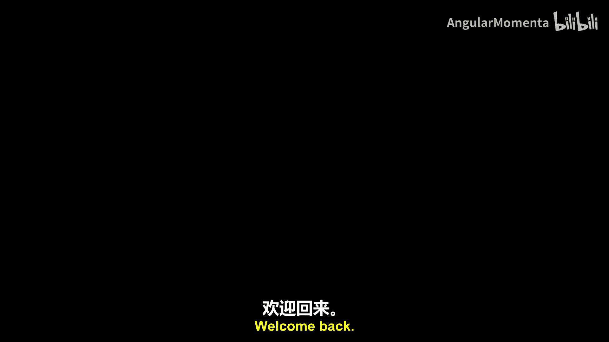
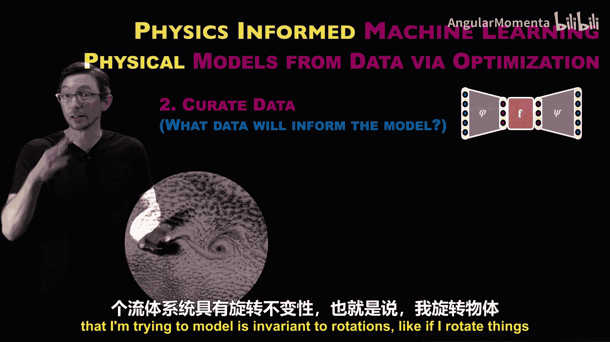
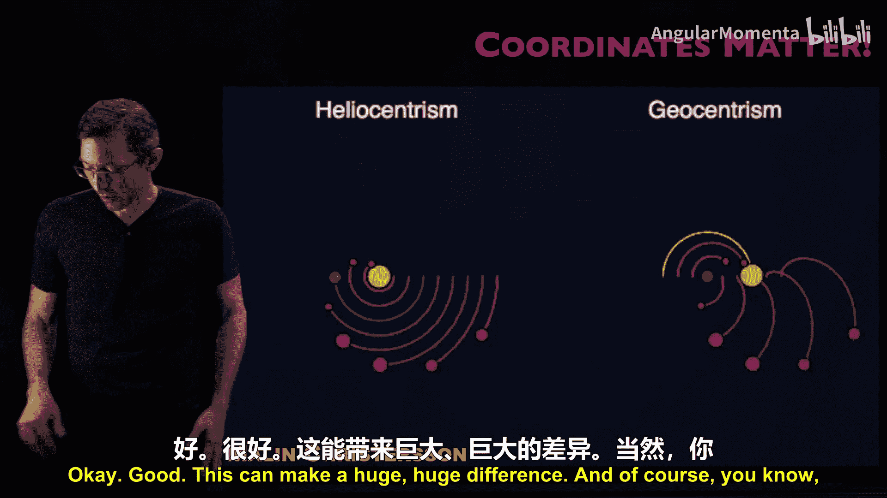
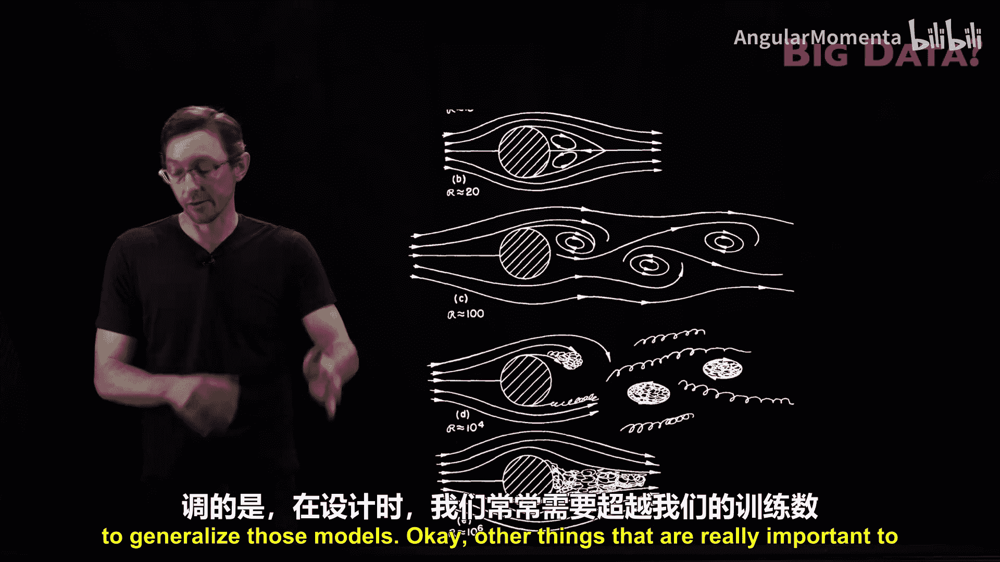
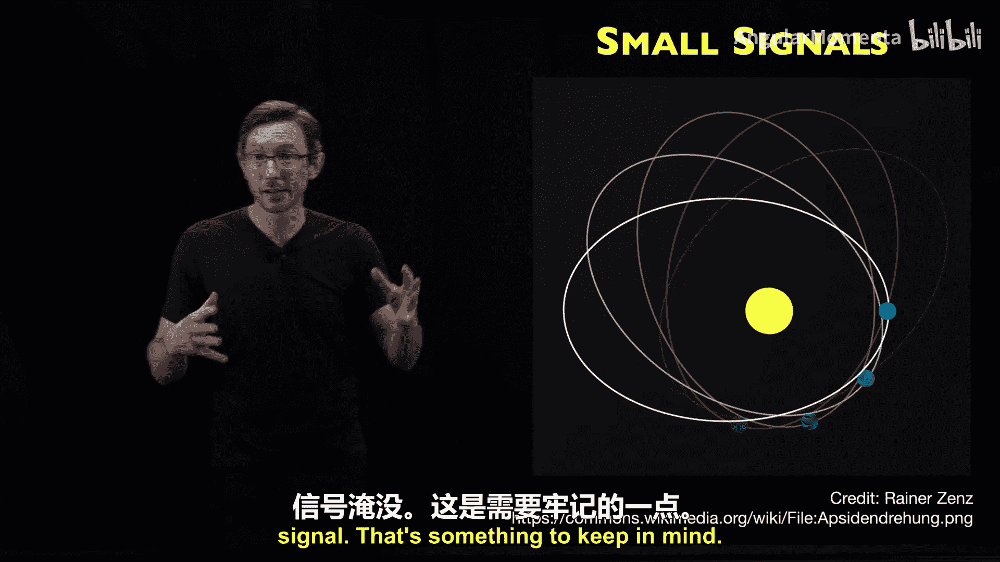
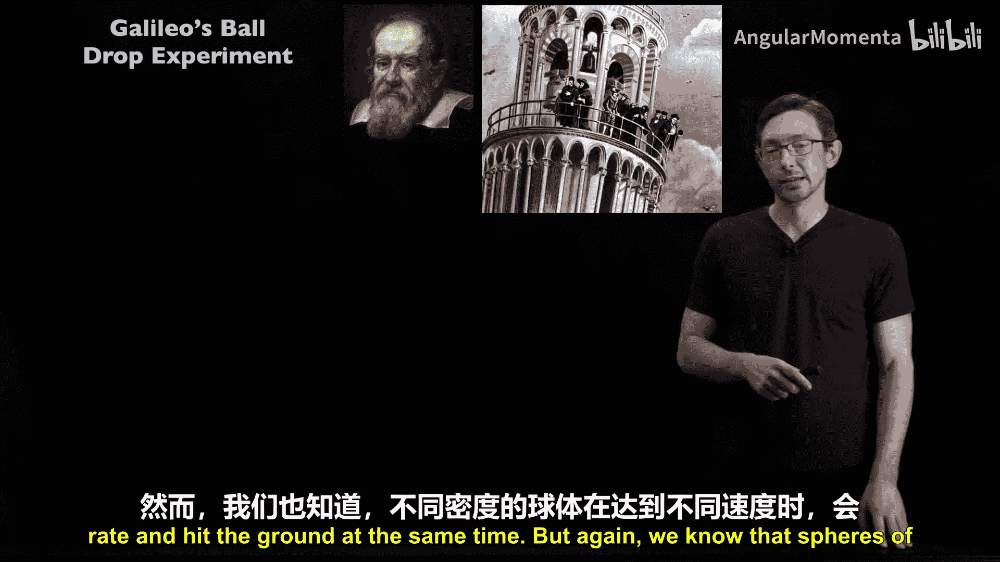
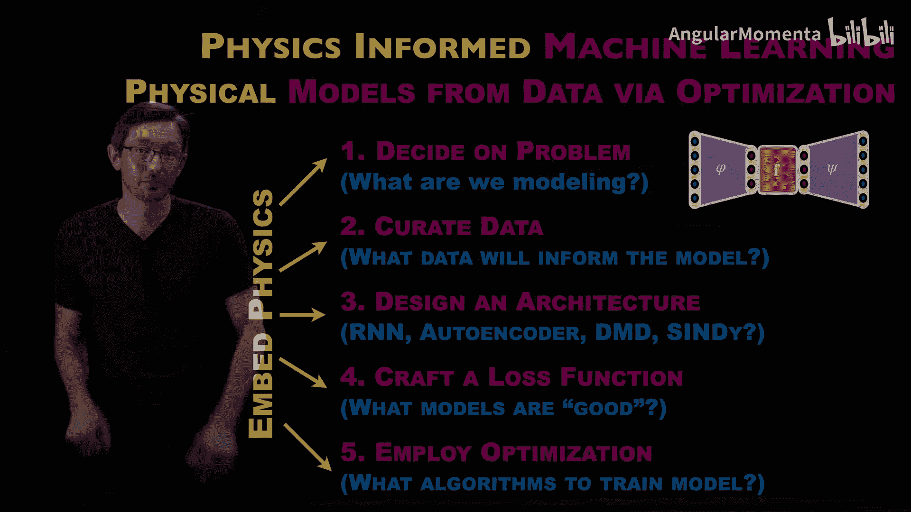

# 【精译】物理信息机器学习-p03-03-人工智能_机器学习+物理学-第二部分：训练数据遴选--BV1c9uDzQEj8_p3-

Welcome back so we're working through this introductory series on physics informed machine learning where we're essentially looking at the different opportunities and subtleties of incorporating physics into the machine learning process today we're going to talk about the second stage of curating the data or choosing the data that will inform the model。

So this is going to be a little bit of a shotgun of a lot of different topics because data is so diverse。

 there are so many aspects of the kinds of data you're going to be using to train your models and so many you know aspects of the problems you're going to be trying to solve and the ways you're going to solve them that there's not really just like a one size fits all thing I can say about how physics is built into the data collection process。

 so I'm just going to give you some kind of ideas that you can use and kind of ruminate on to think about how physics enters into this data curation process now I sometimes joke that this is the you know if you're going to build physics into your machine learning models or learn physics with machine learning you know step two is kind of the Google approach or the Microsoft approach that works really well for big companies that have nearly infinite amounts of data。

 if you have enough data of the world。Presumably you can learn models that actually incorporate some of the physics of that world you know in principle biological learning over a long。

 long time scale has happened that way by observing the world we somehow figured out。

 you know things like gravity and F equals MA and real physics through you observing the wealth of data that we are interacting with but that's a very。

 very expensive slow and kind of tedious process we can't wait for you know hundreds of millions of years of evolution with our machine learners。

 why don't we as you know human experts teach them the things we do know about physics and speed up that process so a couple of key things if we embed physics into our learning process we can often get away with a lot less data this is something I want to make sure to say upfront because I'm going to forget to say it later。

Let's say I'm working on a really expensive experiment， and it's very difficult to get data samples。

Well， machine learning needs lots of data to train models traditionally。

 a big neural network needs a lot of data to train that neural network。

If I can incorporate physics to constrain that neural network to reduce the search space in that neural network。

 I can often get away with much less data， so for lots of systems of physical interest and engineering interest where there's just not that many examples in the data to draw on。

 I need physics to allow myself to train those models with less data。

 so that's an important point we might come back to later。Good。

So we talked about this in the intro video， this idea that one thing you can do to bake physics into your machine learning model in this data curation stage is if there's some data I'm going to use to generate a machine learning model。

Often I know some prior physics like this system is translation invariant or rotation invariant。

 and so what I can do is I can augment my data with copies of the data that I pass through those different transformations so for example。

 if I think that this fluid system that I'm trying to model is invariant to rotations like if I rotate things nothing should change。

Then in principle I can augment my data to include rotated copies and that enriches my data and it stretches out my data so that less data can go further and train bigger better models so that's one way of building in you know symmetries invaris and things like that is just through data augmentation and you know we've been doing this for a long time in classic machine learning and in machine learning for physics and engineering systems okay good。

嗯。Another point I want to make and this is just absolutely critical is the coordinate system in which you measure your data really。

 really， really， really matters and that is an opportunity for your human expertise for your physical knowledge and intuition to play a huge role in this machine learning process so this is one of my favorite videos。

 it's an illustration by Molin Christen of kind of the heliocentric and geocentric views of our solar system。

 you know geocent centrism is where the Earth is at the center of our known universe。

 the heliocentric model is where the sun is at the center and everything else orbits around it。

And really important point。If I try to train a machine learning model to predict the motion of all of these colorful dots。

 if I do it in this coordinate system， that machine learning model is going to be working a lot harder。

 these are much more complicated curves， they require more terms to explain the physics is harder to explain in this coordinate system than this coordinate system so getting your measurements right and in the right coordinate system is a huge head start that you can give your machine learning model if you know something about the right coordinate system。

And again， just like everything I'm telling you in this physics inform machine learning there's kind of a dual or flip side to that which is sometimes I don't know the right coordinate system so I try different coordinate transformations and one of those machine learning models is going to train way faster with lower error that tells me something about maybe that's the right coordinate system so a lot you can do there and I think about systems where we don't know the answer like brain science so you know I talk to being br a lot about this about you know how do you take measurements from the brain and build models of new physics that we haven't written down for the brain when we don't even know the first thing about the right coordinate system。

 we don't know you know what's the right transformation of those variables so discovering those transforms discovering the right coordinate systems is an important dual problem but if you know something about the physics if you know that the physics is going to be simpler in the Fourier transform domain Fourier transform your data before you train your model good this gonna make a huge。

Huge difference。And of course， you know is your data coming from a simulation or an experiment dramatically changes aspects of your data and how that can be used in a machine learning model。

 so for example， oftentimes in simulations I have a lot more spatial information。

 I have high resolution spatial fields that are very hard to get in experiments。

 it's hard to get an experiment that gives you the full fluid flow field。😊。

But these are pretty expensive， it's hard to run these for a really。

 really really long time whereas if I had a wind tunnel experiment。

 I might not get the full fluid flow field， but I can run this thing for you know hours and hours and hours and days and days and days so experiments I can often get really long time series of you know less measurements。

 less spatial measurements maybe just a few points simulations I can often get exquisite high resolution detail。

 but I can't run them for as long or over as many parameters just because they're expensive to run。

Other things to think about， you often experiments have。

The real nitty gritty details that we don't understand。

 so usually these simulations are based on some physics principle f equals ma。

 navy or Stokes equation， something like that， and if I made an approximation if there was something I didn't understand about the physics。

 it's going to inherently kind of be in this simulation data。

 so simulation data is useful but the gold standard is still building experiments because that's where you're going to see if your assumptions broke。

 if your model was wrong， you know this pendulum here。

Doesn't perfectly match the you know Ouler lagge equation double pendulum because this one has aline friction。

line bearing chatter， nonlinear wind resistance， all kinds of little subtle things that are just very hard to put in that Euler lagge model。

 so if I had the exact same system simulated it would be less rich。

 and so oftentimes I want my data to be you know from an experiment if I can。

And a lot of times we're going to be having these hybrid setups where we have a lot of simulation data。

 but for a simplified physics， and we have limited experimental data。

 but it actually has more realistic physics， so lots of kind of in between areas where you might have multifidelity data sources or data from simulations and experiments。

And you know I learned this from my colleague Petros Kummetaks who we were writing this review paper with Barrentt Noak on machine learning for fluid dynamicss and Peros made the' really astute observation。

 that machine learning in some sense is almost a common data processing framework it's like a common set of algorithms for processing data that can help us stitch together data from simulations and experiments。

 different modalities of data， different fidelities。

 different you know spatial and temporal resolutions。

 we can start stitching those together better with machine learning models。

 so all things to be thinking about what data do you have and is it enough is it rich enough in time in space and parameters。

 is it realistic， are you trying to model something that's already been modeled and so you're already baking in those prejudices into your machine learning model really important to think about。

And there's some examples where the simulation in the experiment are almost perfectly matched。

 this is a cool example of a lab equipment by Quaner where they had gone through really painstaking detail updating their simulation model。

 their simulated physics， to more closely match the real experimental system。

And sometimes you can actually do that with machine learning。

 sometimes the way you improve your simulation is by learning you corrections from your experimental data。

 these little machine learning corrections。And you know oftentimes in my field of fluid mechanics。

 we have really， really big data sets so if I simulate a fluid flow at full resolution in 3D you know something complicated and turbulent。

 then that file that know a single snapshot of that flow field at one instant in time might be a gigabyte or all the way up to like petabytes。

 okay， some of these simulations are massive massive big data simulations。😊。

But you have to ask yourself， is that data useful， is it rich， do I have the time series。

 do I know how that data evolves in time？Do I have you know that flow over different parameters。

 different flow velocities， different you know skin frictions。

 different things that I actually need to vary in the real world to design you know some device or to understand this physics so sometimes we have really。

 really big data but it's only big in one dimension it's high spatial resolution but no parametric variation or no time series you know evolution so sometimes I have data where I have tons of time series but I don't have enough spatial information so again this is somewhere where your physical intuition tells you is that enough data for me to model something is that enough data for me to get intuition or to use that for design processes。

And again， you know， if we're using these models for building surrogate models that we can then do design optimization on。

 you would like for your training data to be somewhat representative of the cases you're going to want to eventually design your system to so if I'm trying to you know optimize a wing for know maximizing lift and minimizing drag。

I'm going to need training data that have different shapes and different lifts and different drags okay and so if I don't have that diversity of training data。

 it's kind of silly to think that I'm going to be able to you know design this radically new wing if I just don't have data that varies。

 you know the geometry and changes the lift and drag okay？Even more important。

 and this is a really important point I want you to think about。

 I think about this a lot in shape optimization， aerodynamic optimization。

 but this really applies to almost all of these physics problems and engineering problems。

A lot of times。We're trying to design a new device that has never been created before。

 so you know maybe I have a cooling fin， I have collaborators in Spain who are developing these cooling fins air flows over these hot fins and it's supposed to carry the heat away as fast as possible or you know I work with engineers at automobile companies and aircraft companies where you're trying to shape optimization。

 you're trying to change the shape of a Boeing wing to make it better performing than any you've ever seen before。

Well， that clearly that test case， that design objective is not in your training data。

 if it was in your training data， you wouldn't need to be designing that wing。

And if I think about this abstract space of， you know。

 let's say I have a twodial space you know where I can vary parameters of this wing。

 maybe the chamberber and the aspect or whatever I can vary some things about this wing。

 and each of those points has a different lift and drag a different performance。

 I'm trying to find designs that are kind of outside of the distribution I've tested in the past because those are going to be new cases that have better performance。

What this means essentially is that for design optimization。

 if I want to design something better than my training data， then I need my models。

 my machine learning models to generalize beyond my training data most machine learning models are excellent at interpolating between the training data that you've already seen so if I have five wing geometries that I've built before。

 it will tell you all of the wing geometries that are kind of between those so that's not going to give you a radically new design for that you need your machine learning model to be able to generalize to new you know shapes and sizes that maybe haven't been tested before。

😊，And this is not a blanket statement， but it's generally true。

The way you get your machine learning model to generalize beyond the training data。

 maybe for another case that you haven't seen before is by baking in physics into those models。

 make sure that your models have the right symmetries and conservation laws the things you know the physics should have that gives you a much better chance of them generalizing。

 make sure your machine learning models are parsimonious。

 they're as simple as possible to describe the data but no simpler so use sparsity promoting regularizing terms in your loss function。

 we'll talk about that a lot in a couple of lectures。So just to make this concrete。

 let's say I'm trying to design you know a super turbulent baseball or whatever。

 and I've only trained on these three these first three cases， and I've never seen this fourth case。

 which is the one I actually want。If I just use naive machine learning。

 it's only going to be able to interpolate between these behaviors and if it's never seen this before。

 it's never going to be able to predict that， but if I can bake machine learning physics into my machine learning process so that my solution satisfy naer stokes。

 for example， then with that machine learning model we can run the thought experiment of increasing the velocity and getting some prediction of what this behavior might be。

Okay， that's a big idea， but I really wanted to get that down that often for design。

 we need to go beyond our training data， we need physics to generalize those models。

Okay， other things that are really important to note is that oftentimes your data is super super expensive。

 think about you know CERN or LGO， these are billions of dollars experiments that give us a few data points okay you know again this data might be might be big in some dimensions。

 but it's very sparse in other dimensions very kind of expensive measurements and so again。😊。

This kind of data is often not big enough to build a deep neural network model。

 the kind that we would do for image classification where we have millions of images。

 this data is much more expensive， much harder to come by， much more limited。And so again。

 you have to be more clever about how you incorporate this data into a machine learning model。

 just like you know physicists， they design these experiments to be so specific that they can answer a really specific physics question with a couple of numbers that come out of these experiments。

 we need to be more clever about how we set up these machine learning architectures and problems to leverage this very expensive rare data。

Other things I think about a lot in the data aspect is data bias okay so when we think about drug discovery。

 material science discovery， there's a lot of bias in our data because typically our training data is only examples of things that actually worked you know maybe it's maybe our training data is a library of actual proteins you know DNA that actually generates real functional proteins but for every functional protein there's this almost infinite space of like garbage proteins that don't work at all and you don't see that in your training data so there's this massive data bias you're often you know kind of biased towards things that work or work。

in the traditional way when you train on this kind of data， so again。

 something you need to think about is what biases are in my data。

 if I'm trying to discover a new material I've never seen before or a new protein I've never seen before。

 you need to think really hard about what aspects do you need your training data to have or your architecture or your problem statement so that you can actually do that discovery process。

So data bias is a big big issue we think about rare events is another form of data bias if you think about it。

 so I have colleagues like thespssis at MIT who think about。

These extreme events in dynamical systems， so we all know know that there are waves in the ocean。

 sometimes they're know fun waves， sometimes they're catastrophic， destructive waves。And you know。

 we would like to build machine learning models of how likely these road waves are。

 how big they can get， maybe predict know when and where they will occur。

But the kind of difficulty here is these are inherently extremely rare outlier events。

 so if I have training data of ocean waves， you know， 99。999% of them are not。Rogue waves。

 kind of by definition， you know， the things that are anomalous。

 that are rare that I actually want to capture because they're the ones that are going to wipe out。

 you know， an oil rig。Those are extremely rare in the data。

 and so you have this massive data bias that the vast majority of your data is not the thing you actually want to be capturing。

 So if I build a machine learning model，And， 99。99% of that data is boring。And you one out of 10。

000 records is interesting。I can build an extremely accurate machine learning model just by focusing on this boring data here and just ignoring the existence of these rare events。

 whereas that's not what you want your machine learning model to do so there's a lot of work that we do either to balance the data to kind of like you know artificially increase the weight of these rare events so that they don't just get washed out in the training process。

And also， you know， again， incorporating physics at various stages in the machine learning process so the dynamics are being captured accurately so that you can run these models for long enough that you can actually see some of these rare events in those machine learning models。

 but you know rare events and that kind of data data bias really important to be aware of as well。

 if the thing you want to model is a needle in a haystack， you need to make it look more like。

A stack of needles for your machine learning model。

And along the same lines of rare events and expensive experiments are you know oftentimes the thing I need to model is a very small。

 very subtle signal， so this is a picture I found on wki you Wikipedia that illustrates the transit of Mercury so if you don't know this story you know Google transit of mercury essentially you have your classic Newtonian physics which predicts you know the motion of the planets and the moons and objects in the solar system pretty accurately right we have a pretty good understanding of how things actually move in the solar system with just F equals MA physics。

But there is this small。Disrepancy in the data of how mercury moves around the sun。

 a small discrepancy Newton's second law doesn't perfectly capture this motion。

And so this was actually one of the big success stories of relativity is in showing that if you add general relativity。

 essentially gravitational effects and warping that you can。Correct。

 f equals MA and much more accurately capture this motion of mercury。

So really big success story in physics， one of the kind of great modern success stories is this transit of mercury being explained by Einstein's relativity。

But if you think about it。If I just measure this data。

The effective Newton's second law explains like 99 or 99。9% of this motion。

 and Einstein's relativity is only required for capturing that tiny last little bit。

So if I'm training the machine learning model and it's just trying to minimize error or loss。

 it's almost certainly going to pick Newton's second lot。

 it's going to be very hard to get it to figure out that next big step because the signal of the thing that makes the difference is so small。

We as humans， through our logic and our induction and our scientific method。

Have created entire processes of science so that we can take very small signals and understand is that small signal real or is it measurement noise。

 and if it's real how do I start to really probe what is the physics that explains that discrepancy that's very hard to do in machine learning。

 but that's something that you know human guidance really is still important so you might have a system where there's something really important。

 really fundamental you need to model， but it's a small signal it's getting washed out by a much bigger signal that's something to keep in mind。

And this actually reminds me of one of my favorite stories in the history of science。

 this is something I've talked a lot about with my friend Nathan Cutz， we've written papers on this。

 so we all know about the famous Galileo ball drop experiment where he dropped two you spheres of different density and they fell at the same rate and hit the ground at the same time。

嗯。But again， we know that spheres of different density， as they reach different velocities。

 will have a lot of。Interesting fluid physics that is neglected in this kind of simplistic story。

 So Galileo was trying to show that there's a gravitational constant， a constant acceleration。

But if you really look closely at the data， if you really collect really good measurements of this and use wildly different densities of balls。

 beach balls and bowling balls， they will fall at different rates because there is extra physics here that's not being modeled by just simple constant gravity f equals MA。

 there's this extra fluid physics that isn't captured there。So this is a diagram， you know。

 I think I pulled from NASA which shows you the drag coefficient as a function of velocity is actually very complicated and that's entirely unmodelled you know in this simple balld drop experiment。

 presumably Galileo picked two densities that were dense enough that this could be kind of neglected and that was a very strategic human guided decision not to drop a beach ball but to drop denser object so that we could kind of ignore this detail in the data。

And really interesting， if you actually drop balls of different densities and you start to see these fluid effects。

 you'll actually find that the more classic and incorrect model of Aristotle。

That you know these balls， their kind of motion depends on their inertia or their density that actually fits the data better right。

 there's a reason that Aristotle came up with that model。

 it's because if you throw a wiffle ball versus you know a bass ball。

 they really do behave differently because of this extra fluid force。

Which you know this is just kind of a cautionary tale that when you're know when you're collecting data。

 you need to be thinking， what parts of it do I really want to model are there confounding factors that are not important。

 you know those extra complicated physics bits and maybe you actually want to model those maybe that's an opportunity for modeling with machine learning but you know humans throughout history have strategically chosen what parts of their data to ignore and what parts to focus on and we're just now starting to understand how that is going to impact the machine learning era machines don't ignore bits of the data unless you help them and guide them and what to look at。

Hidden variables， this is one of the things that is like。

Fundamental in engineering systems and physical systems， most of the systems we interact with。

 we don't have access to all of the variables that are important for that system and we have to build models on partial information okay so you know think about you're playing poker with someone you don't have all of the information and you have to make good decisions if I am you know measuring a brain and I'm trying to prevent seizures or something like that there's all kinds of hidden states in that brain that I'm not able to measure or access if I'm interacting with a fluid system if I have a wing going through a fluid at least as it's flying。

 I don't have access to measure all of the fluid flow field around that wing there's hidden variables in most systems and machine learning actually provides a really powerful opportunity to start filling in details in that hidden those hidden measurements so as an example again I have like a whole。

On this I'll put a link to it， this is like a whole lecture topic that we'll get into later。

 but if I want to model a physical system like this know Lorentz differential equation。

 this chaotic Lorenent system to actually model it as a differential equation。

 I would need access to all three states of the system， X， Y and Z。

But oftentimes I only have access to a single measurement， maybe just the x coordinate。

 so I only see the x coordinate as this thing's going around。

How can I use this partial information and machine learning to start filling in the gaps to start filling in this picture just from these partial measurements that's a really important problem we think about a lot is what can we do with partial data。

You know， can we recover something that is at least qualitatively similar to my original system from these partial measurements。

 so this is again something that we rely on dynamical systems theory and physics to tell us when this is possible and when this isn't possible okay that can guide when you do or don't use machine learning to try to fill in these states。

So this is just a tiny teaser， there will be a whole you know video on this paper。

 but you know we are finding that there actually are advanced machine learning architectures。

 deep neural networks that can start to fill in that missing data and actually give you the full state representation of your system。

So this is a teaser from that paper where again， you know in that Lorentz system we only measure the x coordinate。

 we didn't measure y or Z， but using a custom neural network。

 you can start to find a coordinate transformation that describes the full state of the system and you can start learning differential equations that describe the evolution of that new state。

 so this is an example of from a single measurement。

 a single scalar measurement of the x coordinate of this Lorentz system。

 we can start learning how to embed that through some neural network coordinate transformation in a way that we get a simple explanatory differential equation out。

Now you don't have to understand how all of this works， there will be a whole video on it。

 but the upshot is。Lots of times you don't get to measure everything you want to measure in your system。

 most of the time there are loads of hidden variables， hidden things that you can't measure。

 and you still need good models and good predictions and there's a lot of opportunities there with machine learning。

Okay， last thing we're going to talk about digital twin， you know， repeatedly。

 this is one of the big motivations， one of the big industrial engineering applications of physics and machine learning is actually starting to build digital models of physical assets so we can do improved optimization and design and control。

And again， it's always based on real world data， so the data you have is going to be the lifeblood of machine learning models。

 it's going to be the lifeblood of your digital twin and that's going to increasingly enable better engineering。

 design and optimization and control and things like that。

So you know when we think about a digital twin I think about having lots of diverse sources of data。

 kind of a multifidelity set of data sources， some are cheap and low fidelity some are very very expensive and rare but you need those for kind of ground truth。

 let's say I'm designing an aircraft， I'm going run a lot of low fidelity simulations to get you know rough and dirty design improvements then I might run some of those through a high fidelity simulation。

 you know I might run some laboratory tests to you know calibrate my high fidelity models and then eventually I'm actually going to build the thing and fly it okay and it just gets more expensive every time。

That data is going to be used， you know， that curated data is going to be used to build our machine learning models。

 which we're going to call our digital twin that we eventually want to do optimization over。Now。

What I've drawn here is a set of data going into the machine learning model。

 so the machine learning model is drawing on all of the data that we've collected。

But in the future design optimizations when I'm designing the next supermaterial super alloy or supercomposite。

 when I'm designing the next you know aircraft wing or or automobile geometry I don't just want to take all of the data I traditionally collect and feed it into a model。

 that's very expensive to collect this data of the old- fashionashed way。

 what I would love to do is have my machine learning model。

 my digital twin have an estimate of how much uncertainty that model has for different configurations for different design inputs so if I am trying to design wings that I would like my digital twin not just to give me an estimate of the lift and the drag for a particular wing geometry but to also tell me how uncertain or certain it is of that estimate and based on that uncertainty。

😊，Then we can actually design a tie back between that digital twin so that if it has a high uncertainty。

 but the design is promising， it can actually go back and collect more data and it can collect data at different fidelities based on its uncertainty so in a way this is kind of an optimal way of generating data through active learning through this kind of feedback between the digital twin machine learning model and the actual data generation。

😊，So this is an advanced concept again， we're going to go into this in depth in our digital twin module。

 but it's really important。Sometimes you just have a static data set。

 someone emailed you the data or you the person that was working on the project before you collected the data and now it's your job to model it。

 that's fine。But if you're really designing this new system to do better design optimization for an engineering system。

 it would be really nice if you actually had this tie back so you can actually query different fidelity simulations and experiments to inform that model。

 it's going to be way cheaper， way more efficient and faster and performant okay。

 so this is increasingly going to be how we design really complex systems in the future。😊，And again。

 it's going to give us the best of both worlds lower cost and lower error。

 so you know if these field measurements have low error but high cost and these low fidelity models have low cost but high error。

 can our machine learning model synthesize that into a model that is low cost and low error and then we design and optimize over that surrogate model。

Okay good， so that was you know the big picture mile high of this second stage of the process the curating the data again you know I'm not telling you how to curate your data this is a very subtle process it depends sometimes you have data and you have to decide on a problem that you can answer with that data sometimes you have a problem and you have to decide what is the data I could possibly use to solve that problem most of the time you're kind of in this middle ground where there's you know types of data you can get。

 some are cheap， some are expensive， there's types of problems you want to solve。

 some are more ambitious some are less ambitious and so you're going to spend a lot of time iterating in these two stages here。

Okay， coming up soon， architectures loss functions and optimizations。

 this is kind of the glamorous side of machine learning but it's also really neat there's a lot of innovation and cool you know architectures and things you can do in these next ones so I'm looking forward to that and I hope you are too all right。

 thank you。

