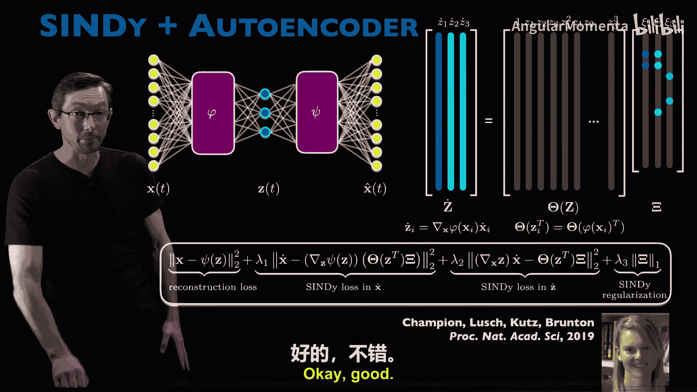
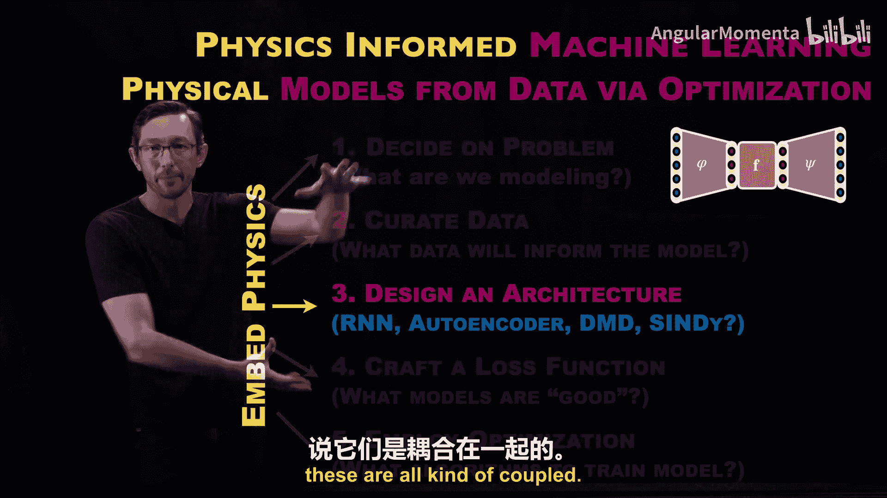

# 【精译】物理信息机器学习-p04-04-AI⧸ML+物理-第三部分：架构设计--BV1c9uDzQEj8_p4-

Welcome back so we are talking about physics informed machine learning。

 the process of building models from data that are either physical in nature or are discovering new physics or embedding physics into the machine learning process and today we're talking about stage three which is designing an architecture so this is one of my favorite parts of this entire machine learning pipeline I've been looking forward to making this video for a while actually spend a lot of time kind of thinking about the progression and we're going to have hours and hours and hours of you know material and lectures on various architectures that we can look at and use to discover physics using machine learning and to embed physics into machine learning so super super interesting important topic today and it's one of the kind of most popular areas。

People think about in physics and form machine learning。So this is the neuralural Network zoo。

 this is a figure in Nathan Cuz in my book Datadriven Science and Engineering inspired by a figure from the Isaac Asimov Institute。

 and this just gives a small overview of you know some of the many， many。

 many types of neural network architectures you can choose for a particular task in machine learning so you have things like autoencor networks。

 GNs， deeper current networks and many， many more， these are just kind of cartoon sketches of the various ways you can stitch together neural network building blocks into an architecture。

And so today we're going to talk about what is it， what do I mean by an architecture。

 what are the different types of architectures， what are ways that these are more or less physical。

 or that there are implicit assumptions built in to our choice of the architecture and again this figure is from five years ago。

 so this is already you know just a tiny corner of all of the types of architectures that people are playing around with and developing today。

A lot of what we're going to talk about in this this series on architectures is inspired by architectures in the brain。

 in neuroscience systems， so animals， including you know mammals， humans。

You know rodents fish right like insects have nervous systems and brains and the way that they interact with and process data from the real world to make decisions and move their bodies and things like that you know there are a lot of rich architectures in our brains and in our nervous systems So this is a great figure。

😊，I got from Bing Brenton， she pointed me towards this this is a picture。

 a hand sketch by Kahalal who drew these beautiful kind of hand drawnwn representations of neuronal architectures as observed in I believe microscope imaging this is a section of the hippocampus and you can see that this is a pretty complicated architecture it's multiscale。

 there's connections across different regions that are doing different types of computations and we're you know just scratching the surface of understanding in neuroscience。

 what all of these architectures are but a lot of that has inspired our neural network and machine learning architectures in the modern era so a lot of our convolutional neural networks and image processing is inspired by things we observe in the visual cortex。

And increasingly we're getting more and more kind of data about these neuronal architectures。

 and so these two fields are definitely evolving and growing together。

 both neuroscience and machine learning， so just an important thing to be aware of we're probably going to have some videos entirely on kind of neural inspired computing and architectures。

 so you know stay tuned for that later。In this you part of the class on physics and for machine learning we're going to cover a pretty broad range of different architectures。

 there are a lot of really important methods out there in literature that researchers are using today applying neural networks and machine learning to physical systems both to discover physics and to make their learning algorithms better by incorporating physics。

 so we're going to talk about things like ResNe residual networks。

 these kind of deep recurrent neural networks with jump connections we're going to talk about things like the UN architecture。

 this again has some implicit inductive bias in just the choice of this architecture kind of assumes that the world it's trying to model is multiscale in space and time。

 for example。We're going to talk about things like operator networks。

 this is the Fourier neural operator， very very popular modern architecture to analyze physical systems like partial differential equations。

Things like Cindy， the sparse identification of nonlinear dynamics。

 importantly this is not a neural network， this is a generalized linear regression to learn a differential equation from data and this is an architecture。

 is this parameters a space of functions you could use to model your system。

We're going to talk about pins， physics informed neural networks， again。

 huge field of modern physics informed machine learning research。

 you know and generally other operator methods and kind of architectures for PDEs and ODs and this is。

 you know， I don't know， maybe half，Of the topics I'm preparing in each of these we're going to have at least you know half an hour or an hour。

 maybe with code and examples and case studies。 Okay so we're going to go really into depth in a lot of these。

 I'm pretty sure I have like five hours of material on Cindy alone okay so you can do a deep dive in equation discovery if that's what you're interested in。

But today we're talking about architectures and not just generic architectures。

 but architectures that are good for physics that help us actually promote models that are more physical。

 that help us learn with less data because we've had these implicit biases that add structure and physics to these machine learning architectures。

So I'm going to talk about this a lot more in the next hours and hours of the material。

 but I wanted now to start really getting into what do I mean by physics。

 so we're talking about physics and for machine learning and I didn't even describe what I meant by physics。

I was at a NIps workshop about a month ago， and I was giving a talk about machine learning for scientific discovery。

And I decided I should probably， you know， Wikipedia。

 what is the definition of physics before I say that we're doing physics informed machine learning。

And you know， kind of the Wikipedia definition has something to do with matter and energy and change。

 and that's fine and good， but I don't like that as a working definition。

 so I am going to tell you what I mean by physics in the context of what we want our machine learning models to have as kind of their capabilities。

So one of the first important pieces we're going to highlight is physics historically。

 the kinds of physics that we you know and love like f equals MA， e equals MC square。

 things like that， these are somehow interpretable and generalizable。

 interpretable in the sense that they're usually very， very simple。

 out of you know all of the complicated things I could write down to describe the motion of a falling apple。

 F equals MA as a very simple interpretable description。

And it's very generalizable because the same physics that describes this apple also describes the physics of launching a rocket from the earth to the moon so generalizability is a hallmark feature of physics and our understanding of the physical world and again。

 I don't think that physics is just limited to matter and energy。

 I think that there is a physics of how the brain works and there's a physics for how you know a swarm or you know a colony of ants behaves。

 there are these generalizable interpretable kind of rules that govern complex systems and we might be able to learn those using machine learning and enforce some of those physics in our machine learning models interpretability and generalizability essential for me to be physical。

😊，嗯。Psimony and simplicity， these are related， but there's this other perspective that we use to promote physicality and models。

 so there's this great Einstein quote， "Everything should be made as simple as possible to describe the data。

 but not simpler。So in the machine learning era， we're looking for models that are as simple as possible to describe the data and no simpler。

This principle of simplicity or parsimony has been the gold standard in physics for 2000 years from Aristotle to Einstein。

 the models that are more beautiful， more parsimonious as simple as possible and no simpler。

 typically encapsulate the core bits of physics， and they also have this knock on effect that they're more interpretable because they're simple。

 and they tend to generalize because they're not overfitting。

 so we're going to talk about this later in the context of the history of science from astrology to astronomy。

 from alchemy to chemistry， every time we've made this huge kind of leap forward in our understanding of physics。

 things have actually gotten simpler， the descriptions have gotten simpler and more universal super important point。

And then the last area where I think we have a huge opportunity to capture essential physics in machine learning and to discover essential physics with machine learning are these notions of things that are symmetries。

 invaris and conservation laws。So almost all of our partial differential equations。

 mass conservation， momentum conservation， energy conservation。

 you know all of our partial differential equations come typically from the conservation of some quantity。

 okay， masses conserved， momentums conserved energies is conserved。And similarly。

 there are fundamental invaris in our universe and the way that things work that give rise to you know symmetries in the data。

 so symmetries and invaris and conservation laws are fundamental core principles in physics that we can leverage and either bake into machine learning algorithms or learn these symmetries and conservation with machine learning algorithms so really。

 really essential， like we know that you know if I have a pendulum physics。

 the physics doesn't change if I translate it you know in space and in principle this fluid flow shouldn't change if I rotate it okay there are these invaris in the laws of physics。

😊，Good， okay， so that's what I mean by what is physics now we're going to go through these architectures and think how can we either enforce or promote these ideas and then how can we also discover you symmetries and things like that with these architectures。

And it's really important we're talking today about。Choosing architectures to be more physical。

 but the same basic principles apply when we add loss functions to train our algorithms or when we add。

 you know when we do a constrained optimization to force our system to adhere to some symmetry or invariance so this idea of physics is important for architectures。

 it's important for loss functions， it's important for the optimization algorithm we use to train our machine learning algorithms。

Good。And I mean I guess you know the takeaway here is yes we want all of these， if we can。

 you know we would love for our machine learning models to be interpretable and generalizable。

 simple and parsimonious and actually you know enforce or promote the known symmetries and variances and conservation of the physical world。

 let's not forget you know the thousands of years of human experience we have learning physics。

 the old- fashionashed way， and you know let's make sure that we actually bake this into our machine learning models。

Good。Okay so let's just do a really really simple example。

 this is kind of what we talked about before in the overview lecture。

 let's say I have you know a physical system， this is a pendulum in my lab。

 this is a video so the representation the data is you know a time series of a very high dimensional vector which was this image reshaped into you know all of its pixels so this is maybe a megapixel image evolving in time and I can represent that either is a matrix or is a really tall vector if I just stack all the pixels on top of each other okay so it's data it's data it's high dimensional data but we know that this system has low dimensional meaning right if I look at this as a human I don't see a million things I need to keep track of there is one pendulum and it's moving according to one angle we are experts at pulling out those key features those key patterns and going from very high dimensional data to something low dimensional like angle theta and theta dot。

😊，So that's the kind of thing that a machine learning architecture would be chosen to do I as a human know that this high dimensionional data has low dimensionional variables that matter angle and angular velocity so I might choose an architecture that does this compression。

 this kind of information bottleneck， this autoencor network that will take this high dimensional data and try to find two variables that best represents that data this is a choice of architecture and I'm implicitly assuming that the physical thing I'm modeling is low dimensional。

Now there will be a loss function in the next lecture that we need。

 we need a custom loss function for this autoenr so they go kind of hand in hand。

 but here is an example of an architecture。We are using to promote low dimensionality。And moreover。

 I might want to actually get a differential equation out。

 I might want to learn some dynamics in that latent space， not just a compression to theta theta dot。

 but I might want to learn the differential equation that governs the evolution of theta and theta dot。

 something like this， you know kind of f equals ma for a pendulum。😊。

And so I can learn those differential equations again by choosing a machine learning architecture that's good at learning differential equations。

 something like this Cindy sparse identification of nonlinear dynamics， so again。

 this is not even a neural network， it's just， you know I build a library of things that could be on the right hand side。

And I use some kind of an optimization to find the fewest of those library elements that add up to describe the dynamics Okay again。

 so that is an architecture， this is an architecture。

 it's a space of functions that could describe my observed data。

And then there is some loss function and some optimization algorithm to find the best function in that search space。

 the best function in that kind of space of parameterized by this architecture。

So these are two architectures that get to physics， okay， one of them， for example。

 is this compression， we're assuming our physics is low dimensional。

And here we're going to use this Cindy library procedure to get the differential equation that's assuming our physics is kind of sparse or simple。

 that parsimonious idea okay， so this is just one example of you know a set of architectures that actually promotes physics。

😊，This was codified by a really nice paper written by Kathleen Champ when she was a PhD student here at University of Washington with Nathan Cuzson myself。

 where essentially she did exactly that she combined a deep neural network autoencor to learn a good coordinate system。

For the physics， a low dimensional coordinate system， and then also a Cindy model。

For how the dynamics evolved in that low dimensional coordinate system。

 there' is a really nice way of promoting things we know should be true in physics。

 namely that they're parsimonious or simple， low dimensional and sparse。

And this is a theme we're going to see over and over and over again。

 even when we choose an architecture to be physical。

 we still often need custom loss functions to train these architectures to find the best model in this space of functions parameterized by this architecture。

 so architectures usually have loss functions that are good to train those architectures。😊，Okay。

 good。

So I want to take a step back。 What do I mean again， by architecture。

 So there's lots and lots and lots of different types of architectures's you know。

Hundreds or thousands of different types of neural networks。

 there's plenty of machine learning that are not neural networks。

 things like know generalized linear regression， support vector machines， Gaussian mixture models。

 canine means clustering， like there's a huge variety of machine learning models。

At the end of the day， a machine learning model typically takes inputs X and tries to build some function that predicts an output of interest y。

And this function F that we're going to learn with， you， for example， a neural network。

 so in the case of a neural network， you the input here would be x， the output would be Y。

And theta are all of the parameters that you can tweak， for example。

 the weights of the neural network to tune or to fit this function to best fit y as a function of x。

Okay，In the case of this Cindy model procedure over here。

 you know the outputs that we're trying to predict are the time derivatives of some system state x dot。

 the you know architecture that we're parameterizing is a bunch of polynomials in this case that you're trying to add up to equal x dot and theta are the weights of those terms that again。

 add up to approximate your dynamics。So in all of our discussion about architectures。

 what we're really talking about is we're trying to constrain the space of functions F that we could use to describe this input output mapping。

Because if I go to kind of a mathematical description。Function spaces are usually really big。

 they're kind of infinite dimensional， very， very broad and inclusive lots of functions live in these function spaces。

 Think of a Hilbert space you know spanned by signss and cosines like a Fourier basis what most machine learning architectures do is they constrain the space of possible functions that could describe this input output relationship through a choice of architecture so this is a very simple feed forward neural network that has a little bit of an expansion and then a contraction that's different than the autoencoder network we talked about before that had this really aggressive bottleneck。

😊，And that's different than a Cindy architecture that's entirely different than a neural network。

But in all of these cases， your architecture is parameterized by some free parameters data and we're going to optimize those parameters using some loss function and some optimization algorithm to tune this function to fit data of the inputs and outputs data that we actually observed and collected so that's really I want you thinking in the back of your mind architectures they look cool everyone loves the pictures of know units and autoencoderrs and neural networks they look really cool but at the end of the day what these are doing is these are parameterizing functions and some parameterizations are more useful for some kinds of physics than others some of these function spaces allow me to enforce symmetries or enforce conservation laws or you know promote parsimony and simplicity things like that。

So I think that's everything I wanted to tell you here。

 but I want you thinking that these are architectures。

Define a space of functions we're searching over， and we find the function we want by tuning these free parameters data。

Good。So now let's just go through some examples I've got maybe I don't know five or 1 kind of of my favorite examples of just architectures that are interesting。

 we're going to have whole videos on each of these architectures you know you can download code and examples so this is just like the mile high thumbnail sketch this is one of my favorites this is actually a really early example 2016 this is right when people were starting to apply machine learning to really solve hard problems in physics and engineering where Julia Ling and her collaborators essentially built a deep neural network in panel B。

That can predict the Reynolds stresses that we need to build turbulence closure models。

 so when you're running like supercomputer simulations of fluid flow over a race car or you know a 787 weigh or some kind of know really big industrial fluid flow。

 usually we need some kind of a turbulence approximation because it's too expensive to simulate all of those fluid degrees of freedom。

And so oftentimes we use something like this Reynolds average naer Stokes equation。

 but predicting these Reynolds stresses is really hard that's been an open problem for five decades。

 how to accurately predict these actually more than five decades。

And this paper by Julia Ling and her collaborators uses a custom architecture in panel B that has this tensor input layer。

 and again we're going to have a whole video talking about how this works。

 but essentially through the choice of this architecture through the choice of this function space that we can use to model these Reynolds stresses。

They are able to make it so that these models buy construction just because they're in this architecture。

The models that are discovered have a property known as Galilean invariance。

 meaning the physics doesn't change in any inertial reference frame。

 so if I have a box of turbulence here or I have a box of turbulence moving at a constant velocity。

 the physics， the closure model terms， the physics shouldn't change in any inertial frame。

 that's what it means to be Galilean invariant。And Ling at all showed。

That threw a choice of this architecture with this custom tensor layer。

Enfors Galilean invariance by construction， all of the models represented in this function space are Galilean invariant that's super powerful and that's a way of building physics into the models。

 presumably you can train this with less data and it will generalize better because it has that physics built into it。

Really important idea， super cool paper。Other examples， the residual network。

 I mean this is one of the most powerful architectures in modern machine learning。

 this paper came out in 2015， I think by the time I made this video it's been cited at least 50。

000 times people use it all the time。It is a particular kind of deep architecture that has these jump or skip connections。

 and this architecture is designed approximately。So that the function of this block behaves kind of like a numerical integrator like an Euler integration scheme again。

 this is a choice of architecture that promotes something that we think might be physical like time stepping forward so this is really good for time series data and kind of you know data that evolves in time dynamical systems data。

The unit architecture， again， this is a super powerful architecture for super resolution。

 image segmentation， it's the basis of a lot of diffusion models。And it has this inductive。

 implicit bias， the structure of this really speaks to the fact that the things that we observe in the real world are multiscale okay they're multi scale in space so if I am looking at you know a picture of the real world it's going to have this multiscale structure in space and that's kind of implicitly built into this architecture。

 so this is good at parameterizing things like natural images or scenes you know of traffic or of a city or you things like that。

Physics informed neural networks， this is going to be one of the most important you know little deep dives that we're going to do。

 I'm going to have a pretty substantial lecture series on this and we're going to talk about it mostly in the context of the fourth stage of machine learning。

 crafting a loss function。But you'll notice again， these are always kind of inherently mixed architectures and loss functions usually go together。

 loss functions often rely on an architecture and architectures often have custom loss functions you use to train those models。

Pins are really， really interesting if you're trying to estimate something like you know a fluid velocity field。

 a spatial field， something like it has a U of V and a W component。

 maybe a pressure that varies in space and in time。

What you can do is you can take a normal feed forward network that you would use to kind of predict those quantities。

And then because of the automatic differentiability of these neural network environments like Pytorrch and TensorFlow and jackX。

 you can often compute these partial derivatives of these quantities without having to like hard code it。

And then you can add those outputs into a loss function that says that you actually have to satisfy the physics of the partial differential equation。

So again， mostly this is a loss function， but it is relying on an architecture where you actually are using things in the neural network to get these quantities that you need for your loss function。

 so I think of it as kind of you know a little bit of architecture， mostly loss function。😊。

Lagrangian neural networks and Hamiltonian neural networks are a really good example， again。

 very much at this interface of architecture and loss function。

 where if you know your system conserves energy or has this kind of mechanical structure that we know you know Lagrangian and Hamiltonian systems have。

 you can often bake that in both into the architecture and into a loss function to train the neural network architecture。

 okay this is one of my favorite areas really， really cool work in Lagrangian neural networks。😊。

Deep operator networks and operator networks in general， things like deep OEs， forier a operators。

Often use very custom architectures that accelerate the training with less data okay so again lots of physical。

 implicit assumptions going into these structures we're going to talk about this at length。

 a lot of these different operator networks。Forier neural operators is another really really popular architecture again。

 the way I think about it， it's based on the fact that。

Every example we have of the real world of physics in the real world is multiscale and typically very compactly and efficiently represented in the Fourier domain。

 so having these kind of Fourier layers in the Fourier neural operator is implicitly baking in some physics assumption about the multiscale nature of physics。

And again， we'll have a whole video talking about this later。

Graph neural networks are a super cool example， some of the neatest results in machine learning for physical systems are related to graph neural networks。

 things like you know discovering laws of planetary motion that generalize to multiplanet systems simulating fluid flows。

 GNNs are you know all about baking in some assumption of the structure of how things interact like endbody systems or molecular dynamics or rigid body systems。

 a lot of opportunities to bake physics into these graph neural networks。

 this is something I've been wanting to learn a lot more about myself。

 so I think we're actually going to learn about this together and I'm using this as an excuse to kind of dig into this topic。

And really some very powerful demonstrations of you know efficient accurate machine learning models to really simulate some pretty complicated physics。

 this is a super neat paper where they show that they can simulate lots of different types of fluids and elastics and just complicated partial differential equations using relatively simple ideas in graphph neuralural networks to kind of bake in some of the physics of that system。

And I think roughly speaking， it relies on the idea that。

The physics of one little parcel is probably similar to the physics of another little parcel。

 So instead of a huge neural network that takes in the entire know voxel movie。

 maybe there is a much smaller set of rules that determines locally what the physics interactions are so again。

 we'll dive into this a lot more。Good， that was kind of the big overview that's I would say about half of the topics we're going to talk about you know。

 at length in detail throughout the rest of the five or 10 or 15 hours of material and physics and form machine learning。

Something that I really， really want to convey， and so I'm going to talk about it here is this notion that symmetries are fundamentally important to physics and they're fundamentally important to how we encode physics into machine learning and discover physics with machine learning。

So symmetries and invariants are one of the most useful mathematical notions that we can use to improve machine learning for physical systems。

 We're going to again， this is going to be like a five hour minimum。😊。

Deep dive into what symmetries are， how to enforce them with machine learning。

 how to learn them with machine learning here I'm just going to give you the tiniest preview of what I mean by symmetries and invaris。

m and this is a huge area of research where people are working super hard to bake these ideas into machine learning。

So invariance means the following thing， so let's say I have some machine learning architecture。

 maybe it's a neural network that takes in an image of a dog or a cat and it spits out through this this function F you know is my neural network and the output it tells me if it's a dog or a cat so an image of a dog goes in。

 I get a label dog or cat out super simple you know neural network。

 you can train this easily yourself。Invariance means。

That we know that the notion of a dog shouldn't matter if that dog is translated in the image or rotated or scaled。

 so there are some transformations， typically this is quantified by something called a symmetry group or a lead group。

There are some transformations G that if I transform my data through G。

 and then I run that through my neural network。I should get the same output。 This is still a dog。

 even though it's rotated by 30 degrees so that's what we mean by invariance。

 we want our model F to be invariant to these transformations G that we think the physics is invariant to The physics of what it means to be a dog doesn't change if I rotate that dog。

So invariance means that my output doesn't change， even if I run it through those transformations。

 those rotations， translations， things like that okay。

 we understand this intuitively that's kind of what the word invariant means there is another notion in machine learning。

It's really in mathematics called Evariance， and it is subtly different than invaris。

 these are really important， both are important。Equivariance means that if I take my data and I transform it through some symmetry like a rotation。

 some symmetry operation。And then I run both of those through my neural network。

Then the output of my neural network is also run through that rotation or translation。

So it's a little different here we were talking about you know classification where the output should be identical here。

 maybe I'm building a neural network that does image segmentation。

 maybe it takes this picture of a dog and it segments it into you know pause and snout and it kind of you labels what the bottom of the dog is and the top of the dog is。

 that's the output why。And so equivaris means if I take my input and I rotate it or translate it。

 if I transform it。And then I run both of those copies through my machine learning architecture。

 the output should be also have that same rotation or translation。Mathematically what we mean。

 what we say is that。The function F， our kind of machine learning model and this symmetry operation G commute。

 I can do G then F or F then G， and I get the same answer that mathematically。

 this is called a commutative diagram and there's a ton of algebra of group theory。

 lead group theory that tells us when function F and a symmetry group G commute and how and things like that。

And so this is a really big idea， we know that convolutional neural networks promote this idea of translation invari。

It's now possible there are some really good research papers out there showing us how to build in general symmetry groups into things like autoencors and other neural network architectures。

 so we can start building our machine learning models to satisfy these symmetries。

 these rotation and translation invaris by construction。

And the upshot here is if I had to learn this by just augmenting my data。

 I would need a lot more data of rotated， translated copies of my data。

But if I can build my architecture to have this equivariance property by construction。

 because I know from physics that there's a symmetry。

I can dramatically reduce the amount of data I need to train that model and it's going to generalize way。

 way， way better， so there's excellent work by Maxwelling by test Schmidt by many others out there in the community talking about equivaris in machine learning models and so we're going to have a big section talking about how do you build these equivariant models。

 you know what kind of loss functions do you use， what kind of architectures。

 how much more efficient are they， how much better do they generalize but I just couldn't give this lecture on architectures without letting you know that know Evariance is one of the most important ways we promote physicality through architectural choices。

😊，Okay， good。So that is the kind of mile high lecture on stage three of machine learning。

 designing and architecture and opportunities for building in physics into that stage so next we're going to talk about loss functions and optimization again closely related these are all kind of coupled and then we're going dive into tons of cool examples and you know if there's an architecture you want to know about hopefully we are going to cover it All right thank you。

