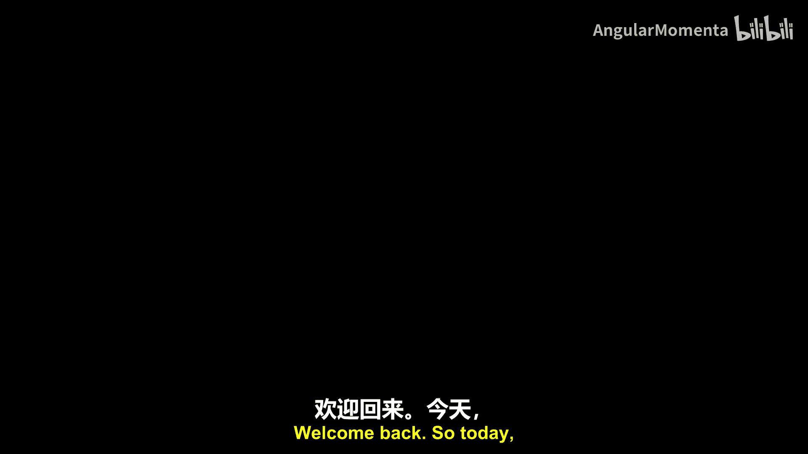
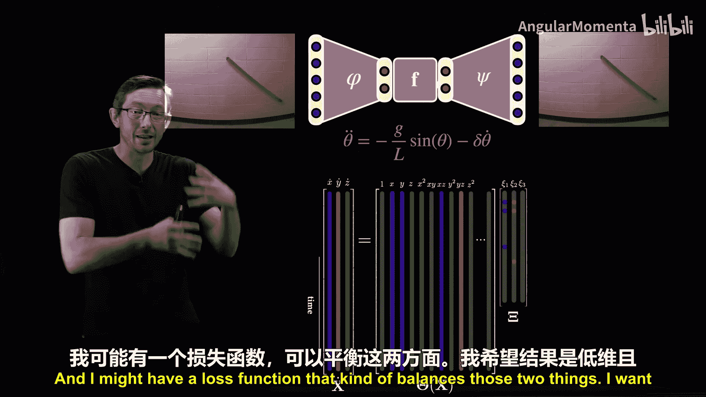
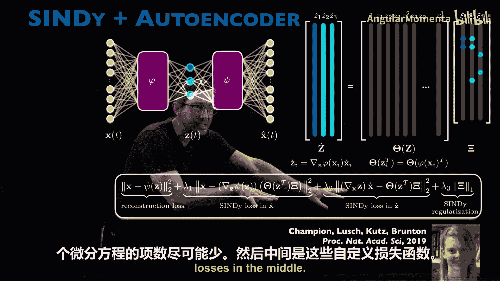
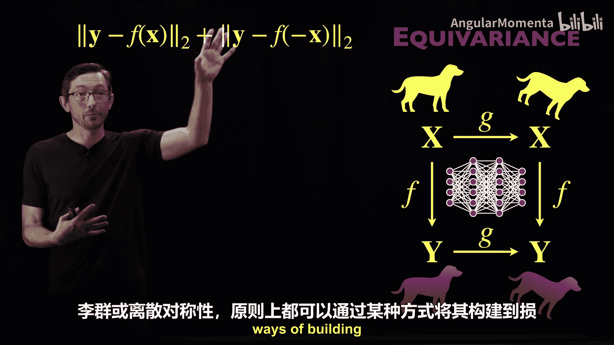

# 【精译】物理信息机器学习-p05-05-人工智能⧸机器学习+物理学-第4部分：构建损失函数--BV1c9uDzQEj8_p5-

Welcome back So today we're talking about physics and form machine learning。

 specifically the fourth kind of stage of machine learning， how do you craft a loss function？

So specifically in this pipeline of physics informed machine learning in this kind of five step procedure of how we build a machine learning model。

 today we're going to talk about how you can build a loss function that allows you to embed partial knowledge of your physics into the process this is one of the areas that's kind of most commonly used and it's one of the easiest ways of baking physics into a machine learning model which should improve its generalization capabilities its learning rates and efficiency。

 sample efficiency， lots of benefits and it's a relatively simple straightforward thing you can do to your machine learning model to make it more physical。

Good。Okay， so the first kind of example that I think is most natural to people when you think of adding a loss function to make something more physical is this notion of a physics physics informed neural network or a pin PINN developed by Ry peridichous and Careaocus in this should not I don't think be 2023。

 they introduce this method a few years ago， and I'll have links in the description for all of these。

 but the basic idea is if I'm trying to build a machine learning model to predict some physical quantity like a fluid velocity field。

 a fluid velocity field might have a component in the x direction， we call that U。

 a component in the V direction， we call that sorry the Y direction， we call that V。

 and a component in the Z direction we call that W。

 maybe it also has a pressure field and these fluid flow fields。Aary in space， X， Y， and z and time。

So the kind of naive approach to modeling this would just be to build a big deep feed for network where the inputs are spatial locations and the output is the fluid flow field at those space and time locations。

 and you could do this if you had enough data， but it would be very expensive and a very big model。

What pins， physics and neural networks do， that's really， really clever and interesting。

 so sorry before I get into what pinIs do。The traditional naive version of this neural network would just have a simple loss function。

 which is that the output prediction by the model should match an actual true velocity field on a big set of training data that's like a normal loss function we would use。

What pinINs does， what physics informed neural networks does that's very， very clever。

 is they add a second loss function， so because of the automatic differentiability of these modern machine learning environments。

 pitorrch， jacks， TensorFlow， so on， you can take these quantities， UVWP。

 and you can compute their partial derivatives with respect to space and time。😊。

So you can actually build， you know， essentially for free all of these partial derivatives that went into the partial differential equation that you think your system should be satisfying。

 so if for' working with a fluid flow field， these should be satisfying the navier Stokes equations。

 which is a partial differential equation in these purple variables。So pins adds a loss function。

 it adds an extra loss function here。Which essentially says how much is the governing physical equation。

 the partial differential equation that governs the physics， how accurate is it。

 how much is it violated you know on the data or on some virtual test points based on these purple quantities so let me say that one more time。

 so you build a feedfor network that you think can predict these flow field quantities。😊。

But in addition to the naive loss that's just the kind of data fit loss。

 you can compute partial derivatives of those outputs with respect to the inputs and you can add a loss term which is literally like the norm of the partial differential equation so if that partial differential equation is not satisfied it's not you know equal to zero or whatever then this error is going to be large and that means that you're not satisfying the physics well so this is a really clever loss that allows you to train models with way less data and they tend to be much more accurately representing the physics so one of my favorite conceptual ideas because it's so simple and it's you super widely adopted。

 tons and tons of people use this it's probably one of the most popular physics informed machine learning algorithms out there because all you have to do is add this loss function。

And your models become more physical。Now the downside just to be balanced is the downside is that by adding this physics as a term in the loss function is that you're never really going to exactly satisfy that this loss is zero。

 so an actual physical system， an actual fluid flow， this purple loss should be exactly zero。

 let's say mass conservation and momentum conservation。arere being you know captured here。

 We know that those should be exactly conserved。 This is only going to promote that they're conserved。

 It's going to suggest that that that term goes to zero。

 but you're always going to have a balance between these loss functions。

 So you're going to get something that's not perfectly physical。

 but it's more physical than if you did not add it。 if you only did the naive training。

 you'll get a worse model oftentimes than if you add this extra physics informed loss。So really。

 really cool idea， again， we're going to have a whole video you know， series on this。

There's a really cool example of this in a paper。By Wong and Rose Yu from a couple of years ago where we know。

 for example， that， again， fluid flows， fluid flows satisfy this incompressibility。

Partial differential equation U is a whole spatial velocity field。

 and we know that the divergence of u equals  zero for incompressible flows。

So essentially what you can do is you know I guess this is the ground truth fluid simulation。

 what you can do is you can take your naive kind of standard machine learning loss。

 your model prediction minus the data squared and you can add a loss term which is I want my estimated U to actually be divergence free because that's what the physics says has to be true。

So this is very similar to that physics informed neural network where you add a loss term。

That promotes that physics being satisfied。And I'm pretty sure that the TFNe is the actual one proposed by Wong and you that includes this custom loss function and it does a better job of capturing the fine scale structure and it's more conservative。

 it conserves mass better than if you didn't include that loss function。

 so really simple thing you can do to immediately kind of add that notion that you're promoting physics that is known if you know some conservation law or some partial differential equation。

 you can add it as a loss function and start promoting that physicality。

Now it may or may not be harder to train， it might make your optimization stiffer。

 it might make it find weird minima， like it's not like this is just a silver bullet。

 but it's a really clever idea that I like a lot okay。Good。Other examples。

 so we talked about this Lagrangian neural network。

 there's a whole class of Lagrangian neural networks and Hamiltonian neural networks。

 really clever architectures。And I talked about these in the context of architectures in the last lecture。

 where if you know that your system conserves energy。

 like it's a mechanical system like your double pendulum。

 we know that it does that by either having some Laangian structure。

 it satisfies the Euler Larrange equations or some Hamiltonian structure。

 it satisfies Hamilton's equations。And I said that that was a choice of architecture。But in reality。

 when you actually get under the hood of how you train this Lagrangian neural network。

 a lot of the special sauce is actually in the loss function。

 so you basically have this network that's trying to learn a Lagrangian， but the loss function is。

That if I compute the partial derivatives of that lagangian and I build my Euler lagge equations。

 this is essentially in the loss function， is that it actually satisfies the Euler lage equations。

So this is a point I'm going to make over and over again。

 architectures and loss functions really go hand in hand。Is an architecture。

 you are learning a Larangian with these inputs， that's an architecture。

But the thing that allows you to train this architecture and have it make sense and be Larangian is that you have this loss function that that architecture actually satisfies the Euler Lagrange equations that the L you learn satisfies this equation so that really is actually a loss function as well and I'm going to have a video on Hamiltonian networks and Lagrangian networks and talk about how you actually train this and set it up in JX and it's really cool。

 really cool paper they always make their code open and available so you can download this and try it yourself。

Good。Now。There are other ways we can add physics into our machine learning models through choices of loss functions and also choices of architecture。

I have I always talk about this because this is where my group's research goes and my collaborators。

 we think a lot about interpretable and generalizable physics models with machine learning。And so。

Essentially， I'm going to give some examples of this in a minute。

 We can promote models that are more lowdial with the two norm。

 and we'll show you how this goes into the loss function in a minute。

 and we can promote models that are simpler， have less terms describing them or are more sparse using the one norm and both of those concepts of low dimensionality and sparsity are mathematical ways that we make our machine learning models more interpretable and more generalizable。

 And I would argue that those are key features that make these models more physical。

 if you have a model that is as simple as possible。 let me you know not jump the gun here。

 So what do I mean by interpretable and generalizable。

 I mean things like Newton's second law F equals MA。 which is true for an apple falling on earth。

 and it's also true when we land humans on the moon that's super generalizable。

And it's very interpretable because it's simple， it only has a few terms in it。

So that is this principle of parsimony， I like this Einstein quote。

 You can replace everything with your machine learning model should be made as simple as possible to describe the data and no simpler。

This has been the gold standard of what is physics for 2000 years from Aristotle to Einstein。

 models that are interpretable and generalizable are typically the models that are as simple as possible to describe the data and no simpler。

Which going back to these norms， that's what we mean here if I have a machine learning model。

 I want it to be as low dimensional as possible， I want it to be as sparse as possible I want there to be as few。

Degrees of freedom as few describing parameters as I can possibly get away with to describe my system。

 and I'm going to do that with the two norm and the one norm in a strategic way okay so again we're talking about loss functions。

 these are the norms you put on your loss functions when you train your model。

This is just a cartoon of what these different norms look like the L2 norm measures distance in a typical Euclidean way it's just like the distance between two points as the crow flies。

 the L1 norm is a little bit of a different measure of distance。

 sometimes we call it the Manhattan norm or the taxiicab norm because it's not the straightest distance path it's kind of the you know if you had to take surface streets in a grid that's how you would measure the distance between two points。

I have a whole set of lectures on sparsity and L1 and L2。

 I'll point you to in the description and give a link。

 but essentially these norms quantify different notions of parsimony or simplicity in physical systems。

So going back to our pendulum example， again， if I had a video of a physical system。

 I might choose an auto encodecor neural network to choke down this high dimensional megapixel image space down to a couple of variables that are most descriptive。

And I would use an L2 norm to do that。 I would basically be measuring the two norm of the error across this network。

 and I'm trying to get low dimensionality in this latent space， so that's a norm。

And I might also want to learn the dynamics in that latent space。

 I I learn how those coordinates evolve in time， in which case I might use something like the sparse identification of nonlinear dynamics to find the fewest terms in a differential equation that add up to equal theta double dot。

😊，So that would be quantified by the L1 norm down here。

So you know I might use an L2 norm up here to quantify low dimensionality and a one norm down here to quantify sparsity。

 and I might have a loss function that kind of balances those two things。

 I want low dimensional and sparse。

There's a really cool paper by Kathleen Cha where that's exactly what she does。

 I talked about this already in the architectures lecture。

 kind of the third stage of machine learning because it is a choice of architecture where you have data and you're trying to learn a good low dimensional coordinate system like theta and Theta dot。

And you're trying to learn a differential equation that describes how those variables evolve in time。

But I want to point out here now this we are looking at the loss function。

 there was a very specific custom loss function that Kathleen had to cook up to allow this model to be trained to quantify what we mean by lowdial and sparse and this was not an easy loss function to come up with this took like months of trial and error figuring out how to actually craft the loss function to quantify what we meant by physical in this context so here this is the reconstruction loss that's literally the error of the autoencoder it's a two norm reconstruction loss all the way on the end here we have our Cindy L1 loss。

 that means we want this differential equation to have as few terms as possible。

And then there are these custom losses in the middle and again there's a whole video where Kathleen describes this。

 I'll put a link to it， but there are custom losses in the middle that essentially join these different parts。

 this kind of encoder， decoder part and the fact that we want our dynamics to be consistent throughout this model。

 so long story short architectural choices that promote physical models low dimensional and sparse models typically have custom loss functions that involve the two norm and the one norm to accomplish that task。

I like talking about Cindy because it's a really intuitive example of how just the choice of the norm makes a model more or less physical and it's a method that's pretty near and dear to our hearts。

 you know we develop this。Here in Seattle， myself， Josh Proter and Nathan Cutz。

 where if you have data from a physical system， you want to learn some physics。

 some differential equation， you want to learn the equations， but you just have data。

You can essentially build this library regression procedure。

 it's a machine learning model you're building a model from data where you're trying to fit the time derivatives of your state in terms of the fewest terms that could describe your differential equation now these could be polynomials or signs and cosines whatever。

 but I want the fewest columns of theta to add up to equal Xdot that's what I mean by sparse and those models will tend to be more interpretable and generalizable through this principle of parsimony。

Now。There are a ton of loss functions I can use to train this model。

 one loss function would just be least squares I could just do a least squares root of regression to find the weightings C that would add up these columns to equal x dot y dot and z dot。

But I'm going to get a physics model x dot that has 81 terms in the differential equation。

 Y dot's going to have 81 terms， z dot's going to have 81 terms。

You never open up a physics book and see， you know。

 a model that has 81 terms in the differential equation that just somehow doesn't。

Isn't consistent with the principle of parsimony that comes up over and over and over again in physics？

And so there's other norms we can look at， I can add other regularizing terms。

 I can add a two norm to this coefficient vector so that they are small I can add a one norm to this coefficient vector so that it's sparse。

 I could add both that's called the elastic net and we do something like that in the CIdi procedure。

 we do something you sometimes we do Lasso， sometimes we do elastic net。

 sometimes we add our own custom loss function or optimization algorithm。

 but we want sparse models where most of the coefficients in the model are zero。

 that's more physical in some scenarios。And so you know this is kind of the loss function we end up looking at。

 we have an L2 loss， I should put it a little2 here。

 we have an L2 loss which is just how good does our model fit the data。

 but then we also have this either L0 or L1 loss that says how sparse is our model so through the loss we're balancing accuracy and complexity which again complexity is a measure of how physical our model is。

😊，So in the kind of error versus complexity plot， you know， if I have。If I crank this term。

 this hyperparameter lambda way， way up， then I'm going to promote overly sparse models。

 basically models that don't have the right dynamics， those are going to be underfi。

If I don't have enough lambda， if lambda is zero and I don't have this regularizing term at all。

 I'm doing a simple least squares， I'm going to have models that are massively overfit。

 those are the models with 81 terms in them。And then there's going to be some family of models。

 you know， between these for different values of lambda。

And so this loss function that we're using to quantify the balance of error and complexity allows us to find a family of models。

 some more complex， some less complex， some more accurate， some less accurate。

And when you cross validate those models on a withhold data set or on a test data set。

 you'll actually find that at some values of complexity， you start to overfit if I start if I。

Don't penalize complexity enough， my models overfit。

And there is a sweet spot where you get these parsimonious。

 these kind of Einstein simplest models possible to describe the data。

 but no simpler the sweet spot Goldilocks zone is right here okay again。

L2 norm to get your model error， L1 norm or L0 norm to promote sparsity parsimony to penalize complexity。

 which you know again， open your physics textbook， we have been penalizing complexity for 2000 years。

A lot of good references here， I have a whole video on this。

 a whole like actually five hour video series on this though then I'll point you to。Okay。

 good last thing before I end， again， loss functions you know everywhere。

 easy to loss functions are how you shape your optimization landscape to train your model。

 it's like essential in machine learning。Equivariance again is there's this notion that symmetries are an important property of physics。

 certain physics is rotationally invariant， some it's translationally invariant。

 there's all of these symmetries and invariance in physics that we might want our models to adhere to here's just a cartoon of what I mean by equivariants I'll have a whole you know you can click through to find a video on equivariance later。

😊，But if you know that， for example， your system， so you have your model F of x， inputs are X。

 outputs are y， and your neural network， for example， is this model F。

If I know that my output should be the same， if I flip x， if I have minus x。

 so let's say I have mirror symmetry。I can always add that into the loss function。

 so instead of augmenting my data and duplicating the size of my data。

 which is going you know it's like could be more expensive to train my neural network。

 I could just add another loss function which says you know my model should be exactly the same if I flip X if I mirror X。

 nothing should change so this is kind of another way of augmenting your data。

 but virtually in your loss function。And I picked the simplest example of a mirror reflection symmetry。

 but you can also do this with rotations， translations。

 pretty much any lead group or discrete symmetries， you can， in principle。

 work through ways of building this into your loss function。

Okay， so at a mile high we were just talking about how this stage four of the machine learning process crafting a loss function gives lots of opportunities to embed physics so you could add your physics。

 your partial differential equation like a physics informed neural network。

You could add L2 and L1 penalties in strategic places to make your models more low dimensional or more sparse。

 which we know are going to be physical and you could also bake in things like symmetries and invaris and equivaris into the loss function Okay next we're going to talk about optimization again intimately related because optimization is how we're going to。

Tweak the parameters parameters of our architecture to minimize our loss function averaged over our data so next we're going to talk about optimization。

 I'm looking forward to that one because that gives us really rigorous ways of enforcing physics almost exactly Los functions promote physics。

 They suggest physics optimization， constrained optimization is often a way of like enforcing that your physics is satisfied that your symmetry or your conservation is satisfied。

 All right， that's all coming up。 Thank you。😊。