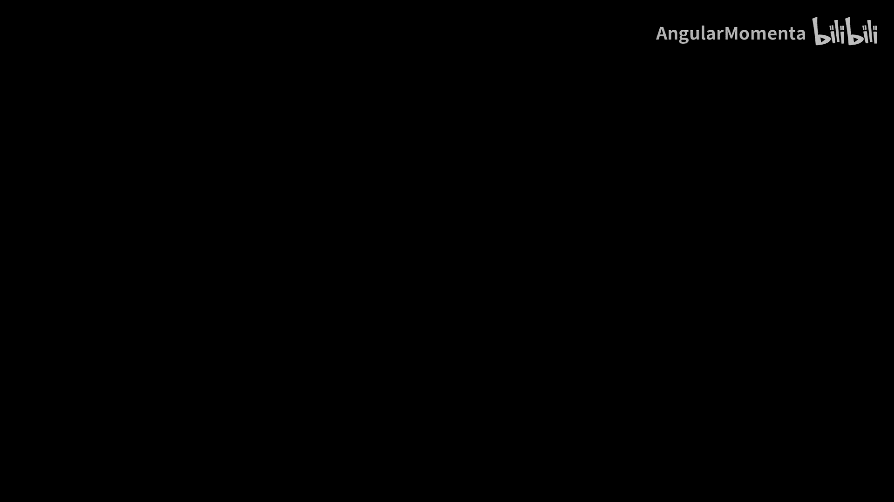
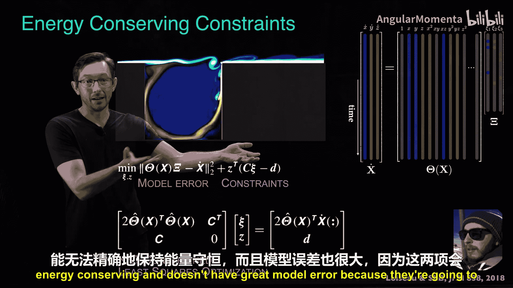
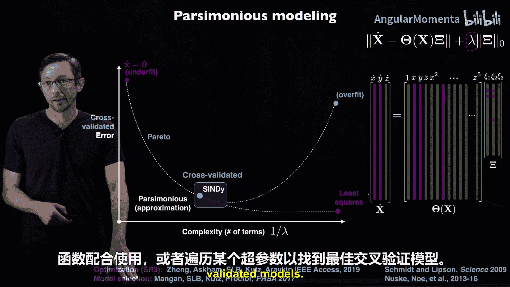

# 【精译】物理信息机器学习-p06-06-人工智能_机器学习+物理-第五部分：采用优化算法--BV1c9uDzQEj8_p6-

Welcome back。So we are in this intro sequence on physics informedform machine learning。

 this super important and exciting intersection between the physical sciences and this emerging set of machine learning optimizations and we've gone through the kind of five stages of machine learning and how each of these stages gives an opportunity for embedding physics into the process and today we're going to talk about this fifth stage actually employing an optimization algorithm to train the machine learning model so these are all pretty tightly coupled once you decide on what you're going model deciding on the problem and you've picked out some data you're going to use to train that model the next three stages are pretty tightly linked so you usually pick some kind of an architecture you think we' give you a good machine learning model。

 this could be a deep neural network architecture a generalized linear model there's a bunch of different architectures。

Then you craft a loss function that tells you if you did a good job or not if your model is good or bad based on its score on this loss function。

And then the last stage is actually employing an optimization algorithm to tune the parameters of the architecture to minimize the loss function averaged over the data。

So we're talking about all of the different opportunities to embed physics directly in this optimization step okay and this is。

You know， just an overview we're going to have more in-depth detailed follow on lectures so this is kind of the high level overview of this optimization stage here good。

 so the first example I want to give this is kind of my first introduction to how you can marry machine learning with physics constraints and constrained optimization and this is work by John Christsta Loazzo in Paris and we started collaborating a while ago actually back when he was a postdoc at KTH he reached out to me about this Cindy sparse model identification procedure so I'm going to give you kind of a short abbreviated story about how we can add constrained optimization to the machine learning process to make our models more physical。

So what JC realized was that when we're trying to develop a low order machine learning model of a complex system like this fluid flow。

 oftentimes we use this Cindy modeling procedure where we try to find the fewest columns of theta that add up to equal X dot Y dot and Z dot here。

And we do that by finding a sparse coefficient vector C using some sparse optimization procedure this is kind of now becoming a relatively standard procedure for reduced order modeling of things like fluids。

And in the naive， our standard approach to Cindy modeling of this fluid。

You would have some kind of a model error that you're trying to minimize you're going to minimize you know the error of your model。

 maybe you'll have some sparsity term in this loss function to promote sparsity of the coefficients in C。

 but this is kind of the standard naive way to do it。

And what JC realized and built into this procedure is that we know a ton about the physics of these incompressible fluid flows that we are kind of not including in just this loss function alone。

So instead of only trying to find the coefficients C that are sparse and give us low model error。

 what JC pointed out was because of the incompressibility of this fluid flow from first principles we can derive a set of constraint equations that have to be true for any model that we get of this incompressible fluid flow。

 these 10 constraint equations should be satisfied for energy conservation to hold so this is a really really important observation JC made is that you know any incompressible fluid flow we're working with。

 you're going to get this type of set of equality constraints and you can add those as terms in your loss function so you can have your model error and you can have terms that quantify your whether or not those constraints are being satisfied。

 whether or not your system is conserving energy。And remember。

 this lecture is about the optimization algorithms。

 the opportunity to bake physics into the optimization algorithms。

 so what JC did was he went one step farther and instead of just arriving the constraints and adding them to the loss function。

He showed that you can actually do a constrained least squares optimization so that you are exactly minimizing this error subject to these constraints so instead of just adding them to the loss function so that you're you know promoting those constraints being satisfied or suggesting that your model is energy conserving So what he does is through this Kk key Kkt constrained least squares he's able to exactly satisfy the constraints and minimize this model error so I think that's a way more powerful approach when you know exactly equality constraints and you're doing some kind of a least squares you know model error fitting this can be a really。

 really nice approach and we've built on this and extended this into lots of other fluid models and Cindy models and sparse models where you have these kinds of constraints so really。

 really important if we only added this。😊，As a term in the loss function。

 these two terms would be battling each other and you might get a model that's not exactly energy conserving and doesn't have great model error because they're going to be kind of fighting each other。

But when you do this constrained optimization procedure。

 when you build it directly into the optimization procedure。

 you are minimizing the error and exactly satisfying those constraints， really， really powerful idea。

 okay。Another area that has come up a lot in terms of changing the optimization algorithm to improve the machine learning procedure is in this physics informed dynamic mode decomposition developed by Peter Bou at all。

 and that should be a single L all， not。All y'all and so this is kind of a cool example。

 There's gonna I think there's a whole video already that Peter filmed about physics informed DD。

 so I'll put a link to it's you know you can watch the whole thing。

 I'm just going to give the thumbnail recap is that sometimes if you are trying to build a dynamical systems model of a particular data set from a known set of physics like in this case we're looking at you know quantum oscillations in a hexagonal potential。

😊，We know certain things about how those models should behave from the physics。

 just like JC showed us that we have these constraints that have to be true for energy conservation and a fluid。

 we know for example that this physics should be her mission there is a certain type of symmetry that these models should have just based on the form of the governing equations。

 so even if I'm doing a data-driven model a machine learning model。

 I still want that model to have those basic symmetries， I want this her mission symmetry。

And so there's a lot of ways of promoting this， actually Peter showed that you could add a term in the loss function to promote that kind of symmetry。

 but he also showed that in a lot of cases you can directly constrain the optimization to only be searching over the space of her mission models。

So this is the ground truth in the first row， these are kind of the eigen modes of this system。

 the naive or standard DMD approach that does not bake in this symmetry into the optimization is the bottom you can see it's pretty noisy and not that great and pi DMD physics informed DMD where Peter is directly constraining the optimization to search over her mission models。

 does a much， much better job of capturing the true eigenstructure of the system。

So baking in that symmetry directly into the optimization algorithm dramatically improves the model performance。

So classic DMD， this kind of bottom row here is also actually doing。

 you know it's adding some physics into the optimization algorithm itself。

 so if you look at what the DMD is doing， it's essentially trying to find a best fit linear model a that maps the state x to its derivatives x dot。

 so in this case y would be the time derivative of x x dot。😊，And we're doing this。

 you'll notice that the optimization is searching over rank R matrices。

 so all of the a matrices that DMD is searching over are constrained to have rank R a low rank structure and so this is already。

Adding some physics into that optimization procedure。

 we're constraining our optimization to search over a subset of models of matrices A。

What Peter Beou's physics informedform DMD does is it essentially changes the space of matrices that our algorithm is searching over and so this is a constrained optimization where we are essentially constraining our search to a particular manifold of matrices called curly M now this is kind of a mathematical topic we're going to get into what it means to have a matrix manifold and a constrained optimization like the actual algorithms later。

 but I wanted to show this parallel in case you're familiar with regular DMD。

 this isn't that different， we're just changing the kind of constrained optimization space。

And so Peter called that physics In DMD and there are a ton of types of symmetries and constraints that different physics have that we might want to incorporate into this pi DMD framework so some physics is selfajo。

 some physics is shift invariant meaning the physics is the same here， or if you translate it here。

 like lots of things are translationally invariant， there's conservative or unitary dynamics。

 and in each case。What you can do is you can come up with an exact optimization procedure to find the best matrix A。

 the best dynamical systems model a linear dynamics a。

 constrained to live in one of these spaces or you know matrix manifolds。

 so you can search over all self-ajoint matrices and minimize this cost function。

 or you can search over all tridiagonal matrices and minimize this cost function。

 and that's directly a constrained optimization because we're constraining our optimization to live on some either subspace or submanifold out of all of the spaces a possible matrices。

 there's a submanifold that are tridiagonal， there's a submanifold that are circulent or symmetric。

And so this essentially is a set of optimization algorithms that allows you to bake that physics directly into the procedure。

So there's these kind of nice takeaways here， you can incorporate known physics by constraining the model to a physics informed manifold。

And again， I think Peter's point in this paper was that you can actually solve these optimization problems exactly in a lot of cases。

 and when you can't solve them exactly， you can add a penalty to the loss function to promote that symmetry。

Kind of a cool thing again， you can watch this video that Peter made。

 but the mathematical optimization problem that allows us to restrict to these matrix manifolds is called a precrstice problem and this is actually based here's the optimization problem here。

 it's exactly what we wrote for the DMD case。And it's actually related to this kind of Greek myth of Procustes。

 there is essentially some you know victim that is being constrained to sleep on a bed of a particular length and so you know either if he's too long maybe his legs get caught off or if he's too short。

 maybe he gets stretched to fit the bed it's kind of a cartoon that we're going to basically be trying to warp these solutions to live on some kind of a manifold to live on this kind of a manifold anyway kind of a cool cartoon interesting history Peter explained it way better in his video。

But again， the idea here， remember we're talking about physics informed machine learning。

 what we're trying to do first is we interpret what we mean by physics as a mathematical expression okay and so that physics could be translation invariant shift invariant。

 it could be rotationally invariant， it could be some quantum mechanical symmetry that we have or something more general than that。

 it could be those energy conserving symmetries that JC wrote down。

So once you have this mathematical expression， you map that to a particular structure that your model has to satisfy。

 either being in a certain matrix manifold or satisfying these equality constraints。

 and then you design an optimization algorithm to solve the optimization constrained to satisfy this structure。

This is a super general idea， this is applicable to neural networks and all kinds of machine learning architectures。

Good， so we talked about equality constraints in Cindi to promote energy conservation。

 these physics informed constraints in DMD to promote all kinds of known physics。

And so what we talked about in the Cindy case where JC wrote down those tan equality constraints。

Essentially， what that amounts to is in this high dimensional search space of possible models。

 Remember our architecture， our machine learning architecture is a space of functions We're searching over to get a good model。

 A model is just an input output function， and we're searching over this space of models。

JC's equality constraints essentially gives us a subspace in that space of models where we want our models to live。

 so a set of the quality constraints defines a subspace and we want our models to live on that subspace。

Peter Baou's physics informed DMD oftentimes is constraining us to a submanifold。

 so out of all of the spaces of those matrices we're searching over。

 certain matrices that satisfy a symmetric property or a toptitz property or a tridiagonal property。

 those will form a curved submanifold in the subset of all functions or models。And so again。

 these are very， very general pictures， almost any constraint you can think of is either going to be a linear constraint or a manifold constraint。

Linear constraints often have easy exact closeform solutions like that KKT optimization。

 but actually in a lot of cases I didn't know this until Peter showed us you the percussti problem oftentimes submanifold constraints often also have exact solutions。

 so it's not out of the question that you could solve both of these。

 you know by designing an optimization algorithm to keep you on this submanifold or subspace。

Now you could add a loss term that's totally legit。

 you could just promote trying to be on the submanifold or subspace by adding a term to the loss function。

 so this is my you know typical L2 error loss function why hat is my machine learning prediction。

 Y is the true output from the training data set and I can just add a term here that basically computes the distance of my you know my model prediction to that model prediction projected onto this manifold so you can totally just add a loss function here to promote to kind of shrink wrap your solutions onto this manifold through this loss term。

But often there are directly ways of actually changing your minimization。

 your optimization algorithm directly to constrain yourself to live on that manifold or to constrain yourself to live on that subspace。

It is often more human intensive， it's more work to design a new optimization algorithm or to find an optimization algorithm that's custom designed for this particular constraint。

But this is generally speaking a much better way of promoting that physics。

 like you're guaranteed if you do it this way that your solution will live on this manifold。

 whereas if you just add this loss function， you're only promoting that you should get close to the manifold and you might not be exactly on it。

So with a loss function you're not exactly satisfying your constraints with constrained optimization。

 you are exactly satisfying your constraints so whenever I can I like to live down here and this is really something again I learned from you know Jean Ksov Lazo and Peter Baou and others that these you know constraint problems you can actually solve with optimization。

Good。And again， this idea of constraining your solution to live on a particular manifold comes up a ton when we think of symmetries so we already saw this in physics informed form DMD but this idea is much more general symmetry is one of the main ways that we encode known physics oftentimes physics is you know partial knowledge of the physics comes in the form of knowing some symmetry that your system must adhere to and even if I just observe my data sometimes I can see from looking at the data that there is some symmetry in the data again。

 that often gives me an idea of how to constrain my model like what space either subspace or submanifold does that symmetry constrained my model to live on so again this is just a cartoon and we're gonna to have like a whole section on symmetries and machine learning but this idea of constrained optimization is going to be critical when we think of enforcing symmetries。

😊，And Sam Otto， who at the moment of filming this lecture。

 is a postdoc at our AI Institute working with Nathan Cuzson myself。 Sam wrote a really cool paper。😊。

Essentially discussing how you can enforce， promote。

 and discover symmetries in machine learning models， so enforcing means through direct constraints。

 promoting means through adding loss functions and discovering means something different。

 sometimes you can discover symmetries you didn't know your system had。

And I'll put a link video to that paper， and I think Sam's going to make a bunch of videos on symmetry in machine learning。

Good， okay， so other areas where optimization comes up again this is just a high level topical overview so this is not exhausted。

 this is just things that came to my mind that I thought I could use to kind of give you a flavor of what it means to optimize and incorporate physics into that optimization procedure。

One of the really interesting areas of machine learning research。

 at least I think it's super interesting。Is called symbolic regression oftentimes in the past literature。

 it's called genetic programming or evolutionary algorithms。

 Pser is a symbolic regression package in Python developed by Miles Cranmer。

 and it's currently like the best state of the art version of genetic programming for model discovery。

So you can feed in data from experiments or simulations into this procedure and it will learn things like differential equations or conservation laws that will describe that data it's super cool。

 and the expressions are typically more interpretable than a neural network。

And people have been doing this for a while。Bonguard and Hanhn Libson and Schmidt and Lison and others have been using genetic programming and symbolic regression to discover models for you know。

 at least the last couple of decades， my point being。

Symbolic regression is kind of an architecture you're using compositional function trees to represent your function。

 so this is kind of the space of functions， your architecture。

 There is definitely a loss function you're minimizing to train these genetic programming trees。

But the way that you actually get the model is through this really interesting evolutionary optimization algorithm where you actually do kind of a guided trial and error search。

 you try a bunch of trees to represent your function， the ones that perform well。

 you kind of breed them or evolve them into future generations through things like crossover of genetic information。

 mutations， cloning， things like that， and so my point being that implicit to all of this genetic programming and genetic algorithms and symbolic regression。

Oftentimes is based on a really interesting and very different form of optimization than what we typically think of when we think of machine learning。

 we're used to thinking of things like least squares， stochastic gradient asscent， things like that。

 This is a whole different set of optimization algorithms that is you know designed to guide this architecture to find the right model。

 So again， we'll talk more about this later， but you know it just occurred to me this morning like。

 hey， this is actually you know you're baking physics into this optimization algorithm。😊，You know。

 by promoting these kind of functional blocks。Okay， good。

And I think this is the last segment in this optimization section because again we're going to go into lots of detail on this optimization。

 I think there's going to be a whole class， a whole boot camp on optimization。嗯。

Another notion of what is physics that we can incorporate into our machine learning model is that physics models。

 models that capture the essential physics of a system。

Tend to be as simple as possible to describe the data and no simpler， so that's this Einstein quote。

If you want your machine learning model to be interpretable and generalizable and kind of capture the physics of the system。

Typically， we achieve that by making our model as simple as possible to describe the data and no simpler。

This is the principle of parsimony in physics， and it's also a very important principle in machine learning。

And the way we do that is often through these two kind of ideas of I want my model to be low dimensional。

 I don't want it to have a ton of free parameters and I want it to be sparse。

If I'm writing down like a differential equation， if I'm machine learning。

 a differential equation to describe some time series data。

Then I would like that differential equation to only have a few terms to be as sparse as possible。

And these are quantified by the L2 norm and the L1 norm， and both of these norms。

 there are explicit optimization algorithms and procedures to minimize these norms。

 okay so that's kind of where I'm trying to get to is that this is another way we incorporate or promote physics in machine learning is through clever uses of low dimensionality and sparsity。

And low dimensionality and sparsity often have custom optimization algorithms to solve these problems。

So this is just a cartoon to show what these different norms look like， L2 norm and L1 norm。

 like I have a whole， I think chapter three of our textbook you know。

 talks a lot about these different norms and their geometry。

But there are optimization algorithms to find the minimum L1 norm solution or the minimum L2 norm solution of a problem and those are you know there's actually dozens of algorithms to find the minimum you know the most sparse solution to a problem we've come up with our own and you know there's a bunch of them out there and they have different properties。

 so that's important is the optimization actually plays a major role in solving these problems。

So for example， in the Cindy sparse model identification procedure。

 so this is something you know again I talk a lot about because it's something we think a lot about is one of our tasks in machine learning is to discover new physics and new differential equations from measurement data。

 so if I had measurement data， I could use this library regression procedure to discover a differential equation that describes the data。

And the optimization problem I would be trying to solve is。To find the fewest columns of theta。

 these are candidate terms that could be in my differential equation。

 and remember I want my differential equation to be sparse because I want the simplest model that describes the data a no simpler。

So I'm trying to find the fewest columns of theta that add up to equal x dot y dot and z dot。

And in this case， fewest columns of theta means I want this coefficient matrix C to be as sparse as possible。

 I wanted to have a really small either L0 norm or L1 norm。

And we have to use optimization to find that sparse model solution。Again， so argument of LX。

 if we're doing some， you know， if we have some loss function that quantifies that I want a good model fit and I want a sparse set of model coefficients。

I could， you know， I could solve for at least squares loss function。

 I could solve for a ridge regression loss function， I could solve for a Lassso or an elastic net。

 each of these have different custom optimization algorithms to solve for that solution。

So least squares actually has a known kind of closed form solution to this problem。

 I would compute the SVD of my matrix and do a pseudo inverse。

 like I know how to solve least squares problems。Sparrse solutions like LasSso are there are optimization algorithms to find the sparseest matrix C that gives me a good model error。

And we've come up with our own sparse optimization algorithms for this problem in particular。

 so you know this is kind of a cartoon of how the Lasso algorithm you know finds a sparse solution to a problem。

 this is supposed to represent the minimum L1 norm radius。And working with Pengzang， Travis Travis。

 Ashcomm， Nathan Kz and Sasha Aravkin， we essentially cooked up a new optimization algorithm that finds these sparse solutions more efficiently and more accurately。

 so I don't know if you can see these blue dots here。

 the blue dots indicate how many iterations of the optimization it has to go through before it finds the sparse solution。

Using traditional methods， you need a lot of optimization iterations to get to the solution using this new kind of SR3 algorithm。

 you almost immediately go to the optimal solution and it's better conditioned and so on。 Again。

 the details of this are not about this algorithm just that。

When you're solving for a sparse model in general under the hood kind of implicit in that statement is you're going to need some optimization algorithm to solve for that loss function。

 and it's not just going to be a stochastic gradient descent or at least squares。

 you're going to need like a custom algorithm sometimes for a custom term in the loss function。

 So we think about sparsity a lot。 And so we have custom optimization algorithms to promote sparsity。

 okay， I think that was the main point I want to get across。And you， in general。

 when we do something like Cindy or really any modeling procedure。

 this also works for the symbolic regression I showed you before。We're doing some optimization。

 I'm trying to sometimes optimize over hyperparameter。

 maybe this lambda is a knob I get to turn to get more or less sparse models。So for example。

 if I'm trying to find a sweet spot in terms of error and complexity for my machine learning model。

 remember the simplest model that describes the data a no simpler。

If I have lambmbda equals infinity then I'm going to get underfi models， models with no terms。

 really really bad error， if I have lambda zero， I'm going to have overfi models kind of way over there。

 very， very complex。And as I sweep through this hyperparameter Lada I'm going to find this Paredo curve of models。

 and if I cross validateate those models on a withhold or test data set。

 I'll find that I actually you know get this kind of typical learning curve that we're used to seeing and the models we want are kind of at this minimum of this validated error。

So again， at the end of the day， everything we're doing in machine learning， kind of all of it。

Boils down to an optimization problem， we are finding solutions that minimize a loss function that is an optimization problem。

 okay。Oftentimes that optimization problem， we can kind of take it for granted。

 it's a commodity algorithm like lease squares， you don't really have to think about what's happening in your computer when you do a lease squares a pseudo inverse。

 lease squares。When you train a neural network with something like atom。

 you know some stochastic gradient descent algorithm。

 usually we kind of offload or abstract that optimization because some really smart people made it work really well and I don't have to think about what's happening under the hood that much。

 but sometimes you'll actually need custom algorithms to promote oh yeah。

 some references here to these papers， sometimes you're going to need custom algorithms to promote a certain type of constraint or to work with a certain type of loss function like this L0 loss function or to sweep through a certain hyperparameter to find the best cross-valated models。

Okay， so that's really， I guess what I'm getting at here is that all of this procedure really rests at the end on finding a good optimization algorithm to actually minimize your loss function by tweaking the parameters of your architecture。

A lot of the time， sometimes the majority of the time you can kind of。

Abstract away that optimization step。 it's just， you know one line and it's kind of under the hood doing some fancy optimization or some really well characterized optimization。

 You don't have to worry about it， but sometimes it's actually the best way to you know incorporate physics through constrained optimization or you know physics or symmetry。

 things like that。And sometimes you actually have to develop a custom optimization algorithm because of some fancy loss function that you're trying to minimize。

 even not that fancy， like we want to you know promote sparsity through our loss function。

 we have custom optimization algorithms to promote sparsity。

 okay better because that's so important to us。Okay。

 lots of opportunities to embed physics in the optimization stage。

 this is typically the most human intensive， this could be like a whole PhD to come up with a new optimization algorithm。

 but it is oftentimes kind of the gold standard in inforcing physics so you know crafting a loss function you're promoting physics。

Employing an optimization to a constrained optimization， you're enforcing that physics。

 and that's like usually stringent a more stringent type of embedding physics。 Okay， thank you。

