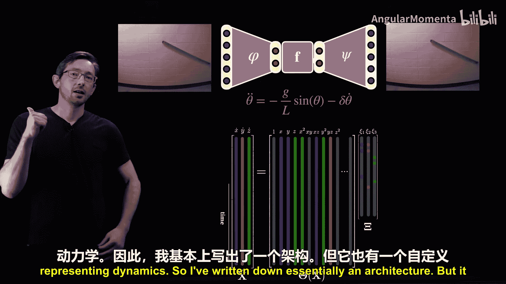
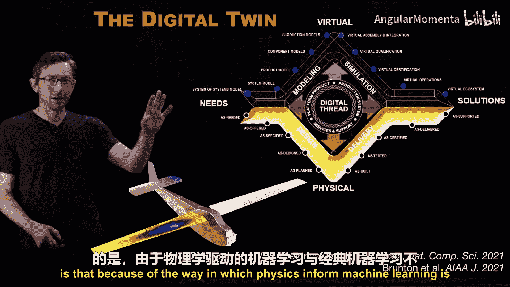
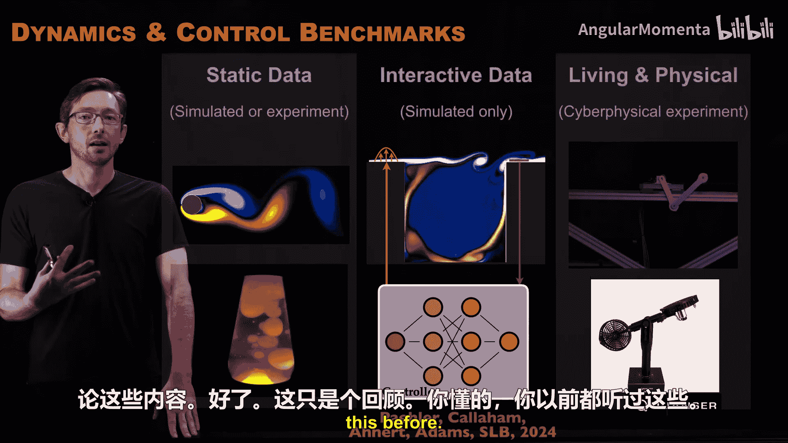

# 【精译】物理信息机器学习-p07-07-人工智能_机器学习+物理：回顾与总结--BV1c9uDzQEj8_p7-

Welcome back。So we've just gone through this lecture series on physics informed machine learning and I thought it would be good now that we've seen kind of the whole arc to do a quick recap before we go into these deeper dive topics so we're talking about physics informed machine learning which is specifically the process of building physical models from data using optimization so if I have a physical system like this maybe it's a video you know of a pendulum or some mechanical device or data from a brainwave or something like that so I have data from a physical system and I might want to learn some coordinates you know that would describe that system so some kind of an architecture that compresses and expands and then I might want to learn some dynamics in that coordinate system that describes my system so I think really important some notion of what we mean by physics is discovering good coordinates and discovering。

Equations， that's often what I mean， but that's not always what I mean。

And we went through these five big procedures that are true for that are kind of how we go about building any machine learning model。

 and then we talk about how to bake physics into each of those stages。So the five stages。

 the first one is deciding on the problem that we're going to model， you know。

 are we modeling the lift on an airfoil as a function of its geometry， things like that。

Curating the data is the second step， so how am I actually going to get the data to train this model am I going to actually build a bunch of wings with different geometries and test their lift you know to get that data。

 am I going to run a bunch of simulations， do I trust the simulations。

 all kinds of questions about data curation？Once you know what you're trying to solve and you have data you think you can use to build a model。

 the next step and this is kind of a fun step is designing an architecture。

So the architecture gives you a lot of flexibility and a lot of creativity for kind of designing the space of functions you're searching over to build the model of the thing you're trying to model。

So oftentimes that means some kind of a custom neural network like a recurrent neural network or an autoencoder。

 a convolutional neural network， but not all machine learning architectures are neural networks。

 there's lots of other models， there's linear models， generalized linear models。

 Gaussian mixture models， decision trees， there's a bunch of different architectures。

 and actually some of those architectures are particularly important when you add physics into the mix。

 some of them are easier to train when you have less data。

 some of our physical systems were only going to have limited access to data。Okay。

 so now we have an architecture， we are going to craft a loss function and that loss function essentially。

Should be small when your model is doing a good job at the problem you're trying to solve so if I'm trying to model you know the lift on an airfoil。

 given its geometry， then my loss function would have an error you between my predicted lift and the actual measure lift on my training data set I'm trying to minimize that loss function by tweaking the parameters of my architecture by literally taking my neural network weights and tuning them to minimize my loss function。

And we do that tuning or minimization process through optimization。

 so under the hood of all machine learning， whether you know it or not。

There is an optimization algorithm that you're using to tweak the parameters。

 there's free parameters in your architecture， your optimization algorithm is tuning those free parameters to minimize the loss function average over your data and if you get a sufficiently small loss function。

 hopefully you're solving the problem you set out to solve and it's a useful model。And again。

 at every stage here， there is an opportunity to embed physics into the process。

 so inherently by choosing to model something physical， like lift on a wing。

 we're already you embedding some notion of physics into that problem。Data curation。

 there's often ways of augmenting your data to make your models more physical。

 like if you know that there's some symmetry or some property that your system should adhere to。

 you can often augment your data in that way。But most of the time we spend our time down here when we're talking about physics informed machine learning。

 there are lots of custom architectures that are more likely to be physical or to give you physical models。

 there are extra special terms you can add to your loss function to promote your model being more physical。

 and oftentimes you can employ constrained optimization to constrain your models to have satisfy some constraints that you know your physical models like energy conservation or symmetry or something like that。

And you know， I thought in this recap video， I would just tell you a lot of the things that now that you've seen。

 I've had videos on every single one of these five stages， now going back and looking at it again。

 you know， now that we've seen all of that in detail。

There's just some things I want us to be thinking about and kind of synthesizing some of this knowledge so right off the top of my head one of the benefits。

 you know you might ask yourself why would we embed physics it sounds so difficult we just spent hours talking about all these things that's really mathematical Why not just build a really big neural network and it will learn the physics okay that's kind of the Google approach as I like to joke no knock on Google they're doing cool stuff like they are discovering physics but part of the reason is because they have so much training data。

 they have nearly infinite amounts of training data and they have the computational resources to train gigantic models in fact they can train。

So many models in parallel and kind of pick the model that has the right architecture that did the thing that they wanted to do。

That's not something we as scientists or more focused engineers often have the luxury of doing。So。

Especially the data aspect of this is one of the main reasons why we want to embed physics Oftentimes if I'm trying to design a new system。

 let's take my wing example a little farther。You know if I'm going to use simulations or wind tunnel tests to test different wing geometries。

 those are super expensive to get the physics right。

 wind tunnel tests over different airfoil geometries would be very。

 very expensive like literally it would cost a lot of time and money to do those experiments and the same is true for fluid simulations it might cost you know millions of dollars to test all of the geometries I would need to you know train a big neural network to be able to predict geometries。

And in reality， I might only have access to a very limited number of data points that I want to train my model on。

So embedding physics is one of the best ways of allowing you to train a model with less data。

 so you've got a better chance of training a good model with less data。

 if you're constraining that model space to a subset of models that are constrained by some known physics。

 whether it's symmetry， energy conservation， mass conservation， there's lots of ways of doing that。

 but by constraining your models by embedding physics into that machine learning process。

Oftentimes it dramatically decreases the amount of training data you need to train a good model。

Now the second point is oftentimes I want my models。

 if I'm an engineer and I want to use my machine learning model to design something new。

 I want that model to generalize beyond my training data Most machine learning algorithms。

 especially neural networks are really good at interpolation you can essentially take all of your training data and do a really clever interpolation kind of between the convex whole of your training data。

But if I want to design something new， I want to oftentimes push my design variables outside of where I had a lot of training data。

Now the only way to generalize typically is to capture the underlying physics of that system。

 and in fact I think that's a pretty good working definition of what physics means。

 it's the bits of the model that generalize。So again。

 if you can embed known physics or partially known physics into this process。

 your models have a better chance of generalizing and those models will be more useful oftentimes in the future。

So again， if I can bake in energy conservation to my fluid models。

 I've got a much better chance that they're going to be valid farther away from the training data than if I didn't bake that in。

Again， if I had nearly infinite amounts of data， you then the interpolation extrapolation line is blurred。

 so the way I like to think about it is if you're building an image。

 a neural network that classifies images and you have the Google image library。

Pretty much anything you're ever going to see is kind of inter interpolatable。

 it can be interpolated between things in that training data if the training data is big enough。

 your problem might be viewed as an interpolation problem but for us again with limited data of the real world of the physical world Oftentimes we need our models to extrapolate more and that means we need them to have more essential physics Those are just a couple examples。

 but again I wanted you to think about this in kind of a recap framework。

 why do you even want your models to be physical in the first place。I mean。

 they also can help us do scientific discovery， physical models can help with active learning。

 sometimes there will be a loop where you can actually go sample more data and if you have know physics in your model you can do hypotheses and you can do active learning and you can build these kind of digital twins and things like that。

Okay， so we're recapping I don't want to spend too much here and again。

 we're really focused on this intersection between you know established AI MLL algorithms in you know a lot of these are developed in image sciences。

 natural language processing， you know large language models， things like that。

 the intersection of that in physics， we don't want to forget the thousands of years of experience we have in physical systems。

And there's kind of two really big dual problems I mostly have been talking about enforcing physics in your machine learning algorithms to make them perform better。

But you can also sometimes use machine learning algorithms to discover new physics from your data。

 so if I have brainwa data， you know we're actually getting a lot of you know better ways of measuring brains and things like that。

And we don't have good equations that describe how they work。

 can we discover a partial differential equation you know like what we have for fluids and materials and physics。

 can we discover the new physics of complex systems like brain science or like collective you know motion of a school of fish or how a disease spreads like those are things that have rules and physics。

 we might be able to discover things that we couldn't discover before。Okay， so again。

 I mentioned that the bottom three tasks are where we often embed physics in practice。

 so through choice of the architecture， choice of the loss function and choice of the optimization algorithm。

And I've said this throughout all of these little kind of zoom in videos。

But the lines really do get blurry here so for example。

 most of the time that I have a custom architecture that I think is going to be more physical in some way that custom architecture needs a custom loss function to train it and oftentimes if I have a custom loss function。

 I can't just use an off the shelf you know stochastic gradient asscent or least squares。

 you know algorithm， you know whatever the。I can't just use a standard optimization algorithm。

 oftentimes I need a custom optimization algorithm for my custom loss function that I need to train my custom architecture。

 so these three are usually like pretty hard to disentangle so I try to kind of categorize different machine learning methods into these different you know three stages but really a lot of them cross over。

 there's a lot of overlap between these stages。So for example。

 one of the problems we tried to solve is discovering coordinate systems and dynamics。

 differential equations that describe how the system evolves in those coordinate systems。

 so if I have a video of a pendulum， I might try to learn a lowdial coordinate system cartoon represent the representation by these red nodes in the latent space in this cartoon。

 so I might try to find the coordinate system， and I try to find a differential equation for how the dynamics evolve in that coordinate system。

And so again， this is so I might use an auto encoder for the coordinates。

 and I might use a Cyndia sparse library regression for the dynamics。

That is clearly a choice of architecture， this is a neural network architecture that's good for compressing down to coordinates this is a generalized linear model architecture it's a space of functions that's good for representing dynamics。

So I've written down essentially an architecture。

But it also has a custom loss function， okay， so this is the custom loss function that Kathleen Champ had to write down to actually get that model those models to train。

So the custom loss function goes with this custom architecture and again。

 if you want to go even further under the hood， we don't necessarily use a vanilla。

 you know atom optimizer or stochastic gradient ascent optimizer to minimize this loss function。

 you know for our sparsity promoting term on the end。

 we might use something like a sparse relaxed regularized regression and SR3 like a custom regression algorithm。

😊，you know， optimization algorithm specifically for this loss function， so this is a really。

 really good example where you know we're hitting at least three of those those stages they're very tightly linked and we're kind of embedding physics into all three of those stages。

😊，If you wanted to， you could even say， you know， we're also embedding our physical knowledge in the problem statement by saying in the first place that I want coordinates and dynamics。

 that's a problem statement where we're building in some notion of what we mean by physics。And again。

 you know theres an actual optimization algorithm we had to cook up to train these kinds of models。

 so it's not just architecture， it's not just loss function。

 there's also custom optimization needed for these custom loss functions。

Another example of this that I've been thinking about just recently is this symbolic regression through genetic programming。

And there's a bunch of people doing this， Miles Cranmer does some really great work in this。

 Hod Libson and。Bonguard and Schmidt and others have done great work in symbolic regression for model discovery and again。

 it is clearly an architecture。 this is a function tree， a compositional function tree。

 this is an architecture， it's a space of functions that we can use to represent models。😊。

There are loss functions you would use to tell if you did a good job on these you know modeling tasks and then there is a custom optimization algorithm。

 this evolutionary algorithm where you breed you know these functions through mutations and crossovers so again it hits all three of those you are there's an architecture a loss function and a non-standard optimization algorithm that you would have to implement to make these to train these machine learning models I'm trying to get you to really see and think like that these lines are blurred。

 I broke this into five stages so we could categorize things。

 but the real world is a lot messier than that and that's kind of cool because it means that there's actually a lot of opportunities to enforce and promote physics through multiple means in a problem。

Another example， I think this is a really good one。

 actually this is another one by Miles Cranmer and collaborators is the Lagrangian neural Network。

So we know that lots of systems like mechanical systems have extra structure in their equations。

 they have symmetries and structure in the differential equations， you know， and this is deep。

 deep physics， right， Euler and LaGrange and Hamilton and you know Newton， deep physics。

So for example， if I have something like my double pendulum。

 I know that it conserves energy and that it has this lagangian structure。

 these euler lagge equations are going to help me preserve that energy。

And so the Lagrangian neural network again， it is kind of equal parts architecture and loss function。

 clearly we are making an architectural choice by choosing to model the Lagrangian in this way with these inputs and these outputs。

But the way you train this model is through a loss function to say， okay， given that architecture。

I'm going to compute all of the partial derivatives I need using essentially back propagation automatic differentiation。

 and then I'm going to build a loss function that says that that function L had better satisfy the Euler lagge equations。

So again it's equal part structure， there's a structure to this。

 but then there is also a custom loss function that promotes the physicality that promotes the physics the really well essentially a custom neural ODE that has the Flgrangian structure I think it's really really nice but again the lines are blurred we're building in physics in lots of different ways here。

Okay good， so you know again， we've talked about lot architecta have deep dones and we'll have you know hours on operator methods and pins。

 physics informed neural networks， we'll talk about you know ResNes and ODE nets and neural ODEs and things like that and each of these architectural choices we use to build in physics。

 there are custom loss functions we need to get them to train and oftentimes there are custom optimization algorithms we need to minimize those loss functions。

You know， symmmetries are a really good example of this also where we know that physics often manifests itself through these symmetries in the system and you can build those symmetries into the architecture。

 you can build those symmetries into the loss function。

 you can enforce that those symmetries are adhere to through constrained optimization。

 and sometimes you do multiple combinations of those。And in all of these cases。

 we're going to be looking at this in the context of applications in engineering。

 things like you know fluid mechanics， material science， robotics， autonomy。

 digital twins manufacturing things that you know nuts and bolts engineering processes typically that evolve in time。

 this is a static image of a static material， but to make this material there was aneling process to actually bake this alloy。

 you know， and then it might age over time， there's dynamics in all of these processes。

And what I'm trying to get to here is that in all of these engineering applications。

 there are subtle differences in what we mean by physics。The kinds of data we have access to。

 the tasks and stringent you criteria we have for how these models perform and how we're going to use them and all of those need to be taken into account when we think about building those machine learning models and incorporating physics into those models。

So if I remember correctly to get this super alloy。It's really expensive to test these， you know。

 tens of thousands of dollars to test a new alloy and the training data， you know。

 they might not have millions of examples。 So this gives you some idea that this problem of building a super alloy。

 It has a very particular， you know set of。Constraints and data and issues like that。

 those are different constraints than if you're building you know。

 new aircraft or if you're building an autonomous robot。

So we're going to dig in to case studies in all of these application domains and think about what does it mean to have physics in your machine learning model？

And a lot of this again， builds towards this notion of a digital twin because we're really thinking about physics and machine learning for engineering systems。

I also care about scientific discovery and things like discovering new you particle physics or new corrections to gravity and you like I'm interested in scientific discovery。

But one of the most useful aspects of these physics and machine learning models is for engineering。

 design and improving engineering processes and the digital twin is one of our best kind of new frameworks for incorporating machine learning models and physical models and data and using those models to design and optimize engineering systems so again。

 we'll have a deeper dive on this。😊，And the last thing I want to mention。Is that？

Because of the way in which physics informed machine learning is different than classic machine learning。

 we need different benchmarks， so the field of machine learning is driven primarily by an availability of data。

And algorithms and you know open source code and computational resources。

 but at the end of the day most of our advances in classic machine learning were accelerated and validated through benchmark data sets and benchmark problems and so if we're thinking that we are going to be moving these machine learning algorithms into science and engineering and discovery and design then we need new benchmark problems that get towards this this kind of applying machine learning to physical systems。

 so there's a lot of flavors of this， our AI Institute in dynamical systems we're coming up with a common task framework led by Nathan Cutz so that's you know a project we're pushing aggressively on and there's other examples like you can have these closed loop flow control environments。

 you can have laboratory hardware to test your algorithms you know and again we'll talk a lot more about those later。

Okay， so that is just a recap。 you know， you've heard all this before。

 I don't think it's bad for you to hear it again because it gives us a different context now that we know how all of these pieces work。

 and now we can start to see that sometimes the lines are blurred。

 sometimes there's multiple opportunities。 and we're going to go into case studies and deeper dives to understand this better。

 All right， thank you。

