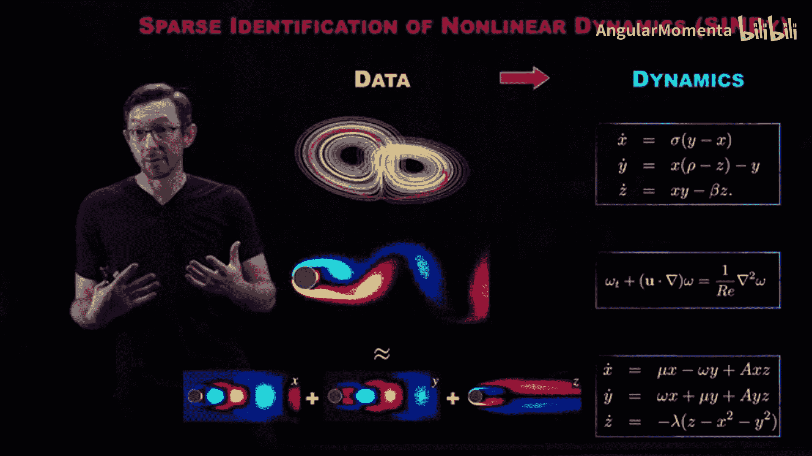
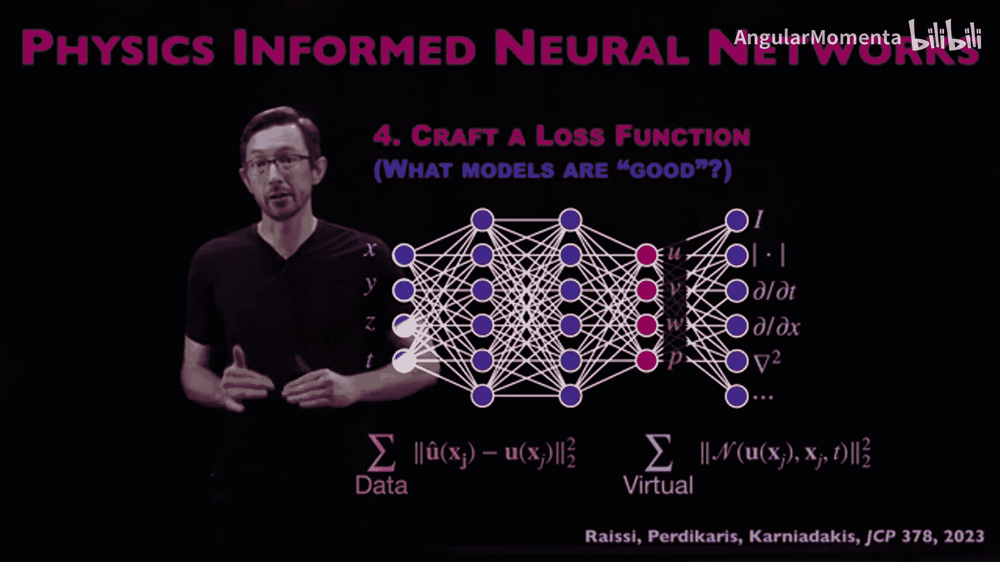
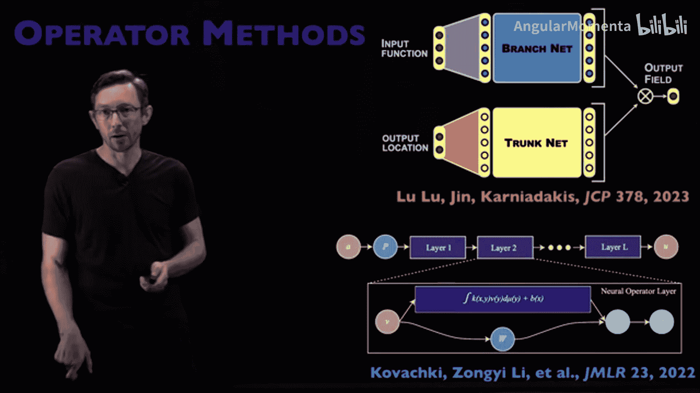
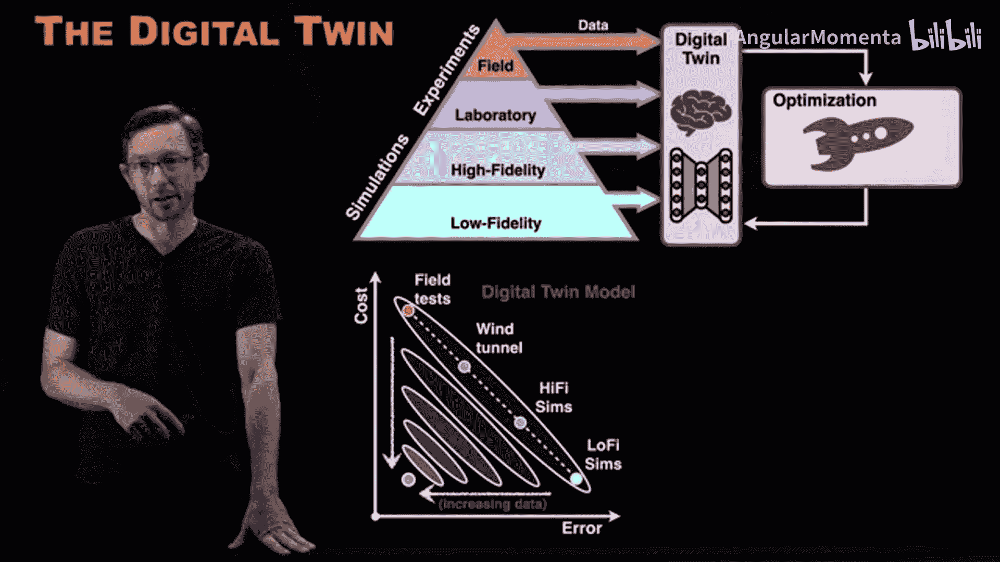

# 【精译】物理信息机器学习-p08-08-AI⧸ML+物理：即将推出的模块与训练营预览--BV1c9uDzQEj8_p8-

Welcome back。So we're nearly done with this kind of intro short boot camp on physics informed machine learning and I thought it would be nice to show you where this is going。

 so this is designed to be the intro， let's say four or five hours of a larger course on physics informed machine learning where you can kind of pick and choose different topics as you find interesting。

So the first kind of next deep dive section， so I'm going to lay out a bunch of kind of next modules that we're going to dive into and these will range anywhere from you know one hour to 10 hours。

 but let's say kind of ballpark four to five hours is kind of what I'm targeting。

So the first one in this physics informed machine learning larger course would be a little module on parsimonious models。

 how do you take data and with machine learning， discover differential equations that are interpretable and generalizable using the techniques we're talking about。

 different architectures， loss functions， optimization algorithms。

 how do you make these models more physical， if you apply them to things like mechanical systems or fluid systems。

Another module。We're going to talk about our pins， physics informedform neural networks。

 this is one of the most popular and kind of widely used types of physics informed machine learning algorithm。

 so we're going to talk about you know how these are designed， how to train them when they work。

 when they don't you know what are all the variants。

 there's a ton of different types of pins so I'm kind of excited about this because I've been meaning to you know dive deeper into the literature and learn more about it myself。

And kind of related are these operator methods， things like Fourier neural operators， deep OEs。

 neural implicit flow， lots of physics informed machine learning algorithms are really trying to get to learning these operators。

 these solution operators of differential equations。

 so we'll definitely spend a decent amount of time here in operator methods。

This one is pretty pretty near and dear to my heart will have a whole module kind of a deep dive on symmetry this might end up evolving into its own full course if I have enough time and you know enough time to do you know some more lectures and I also want to get some other folks to help out with this who are really you know some of the world's leading experts in symmetry and machine learning actually my like first lab I ever worked in kind of understanding symmetries in physical systems and mathematical modeling。

 computational modeling and so you know a lot of those ideas that were developed in the kind of computational and analytical physics era are now equally or more relevant in the machine learning era so a lot about symmetries really makes a big difference in machine learning algorithms and again this is kind of。

Exciting for me because this is stuff I you really fell in love with 20 years ago。

 so it's kind of fun to get a chance to know bring this back to life。Digital twins is a really。

 really important topic in engineering design， optimization in general and machine learning models that are physical play a central role in the digital twin of framework so reduced order modeling。

 discovering models from data， making sure those models have physics and you symmetries and respect the physics are really really critical to the digital twin kind of revolution of how we're going to design and optimize complex engineering systems in the future。

 so again this will be ideally at least five hours。

 but it could easily be 10 hours or even a whole course depending on how ambitious we are。

And then the last piece of this and I think there will be other pieces that I'm not mentioning here。

 these are just the six that I'm definitely planning right now will be case studies and benchmarks so we're going to spend a decent amount of time digging into actual physical examples like fluid mechanics。

 materials， discovery robots you know and how parsimonious models or you know dig into studies in particular engineering areas of and this won't into lots of experts have great case studies to contribute so that'll be kind of educate research level and along with case studies there are benchmarks we have this critical need for benchmark problems to test these physics informed machine learning algorithms and so'll also have like a good chunk of time dedicated to going through what benchmarks exist in the literature which ones are good for which types of problems what do we need you know five years from now in a benchmark problem。

So that'll also be in that kind of case studies and benchmark topic So each of these are going to be kind of deep dive modules。

 some longer， some shorter， some might be an entire course you know eventually that really get to this idea of how do you use some of these ideas in physics and form machine learning in you know actual engineering。

 actual scientific discovery， actual design and optimization so super exciting for me like a lot of this is stuff that I either you know used to like or do a lot of research in or want to learn more about so I you know hope this is really exciting for you as well。

Okay， good， so again， the overarching framework for this physics informed machine learning curriculum is based around this idea that machine learning is not magic。

 it's just the process of building models from data using optimization。

And there's some you know standard stages that go into building a machine learning process。

 a machine learning model， and you can embed physics in each of those stages。

 sometimes you can embed physics in multiple stages as we've seen in the past。And so again。

 those modules are really going to dig into different aspects of this， so when we talk about pins。

 you know we're really primarily talking about crafting a loss function。

 when we talk about operator networks， maybe we're getting more into the architecture design and things like that。

 you know but all of these are going to have some element。

 most of them are going to have multiple elements in this machine learning modeling process。Good。

 and again， when I'm talking about physics informed machine learning。

 we are mostly talking about these two dual problems of。

Baking in or enforcing partially known physics or known physics into machine learning algorithms。

 so if I know physics and that could mean a lot of things。

 maybe I know a partial differential equation， maybe I know a conservation law。

 maybe I know a symmetry or an invariant that my system has。

Then we can enforce that or promote that in our machine learning models and often get better models with less data and often those models will generalize better。

 which is really important when we're doing engineering design。

 if I want to design a new wing that's different than any wing I've ever seen before。

 I hope and if I want to use machine learning in that process， I hope that those models。

Generalize better and incorporate the known physics we know about fluid dynamics and things like that。

And then the dual side is oftentimes we're able to discover new physics for even more complex systems that we haven't been able to write down。

 you know F equals MA type physics， maybe we can discover new physics given our wealth of measurement data and these emerging machine learning tools so systems like neuroscience and know human metabolism like all kinds of examples where it's hard to write down governing physical equations and laws。

 maybe we can start discovering them with machine learning and again。

 we'll look at case studies and benchmark problems and all kinds of things that are really you focused on this kind of dual enforcing and discovering paradigm。

😊，A lot of this discussion is related to chapters in this book。

 Datadriven science and Engineering by myself and Nathan Cotz， not all of it。

 some of it will be in other lecture notes you and as those lecture notes get written。

 I'll put links in the description， but this is a good starting place if you're interested in getting started with some of these methods。

 a lot of the mathematical foundations are in this book。Okay。

 so that's you know the the mile high overview of things we're about to see these are all going to be deep dive modules and I'll just you know maybe give like one slide each on these because I you know think it's interesting and I'll give you a little bit more of a sneak preview you can always you know stop watching now and just go into these modules but I wanted to go a little deeper。

😊，So the parsimonious modeling and model discovery。

 what I really mean is that most dynamical systems。

 most systems that change in time here this is a fluid， but you know brains， financial markets。

 the climate， epidemiology， pretty much any complex system that you can think of， evolves in time。

 according to either ordinary or partial differential equations now they might be high dimensional。

 they might be stochastic， they might be- nonlinear。

 there's all these like elements of differential equations that capture the richness of the changing world around us。

But the module on parsimonious model and dynamical systems model modeling is really focused on how do you use this increasing wealth of data。

 measurement data from systems， and machine learning algorithms to learn differential equations purely from data。

 super exciting area， imagine you know if you had the planetary motion you know you had tables or data from the motion of the planets。

 could you learn Kepler's law， could you learn F equals MA。Could you learn the correction。

 Einstein's correction because of the discrepancies in the transit of mercury。

 these are the kinds of you know questions we can answer with data and machine learning now and then we can apply those principles to new problems where nobody knows the answer you know can we model plasma systems or granular material or neuroscience。

 can you build a model for the brain you know from the measurement data， super exciting topic。Okay。

 we already mentioned a whole module on pinINs， this idea that in addition to the kind of standard neural network loss function you would use to train a neural network。

If you know that your neural network is trying to predict or reconstruct a physical field。

 like a fluid velocity field or some other physical spatial field。

 a field that varies in space and time。

If you know that that field is governed by physics by a partial differential equation。

 you can often add another custom loss function that captures and encapsulates that physics in the training process and there's a ton of benefits to this it's really easy to add that physics informed loss。

It allows you to train oftentimes with less data and kind of really cool things like let's say I have a fusion reactor and I can only take point measurements on the surface of this fusion reactor because if I put them inside they'll melt or they'll disrupt the plasma。

If I have those measurements and I know the partial differential equation that governs that system I can have these kind of two loss functions and I can do a much better job of filling in what the plasma field。

 what the velocity field and electromagnetic field are even away from my measurements so really cool stuff you can do with pins and again we're going to dive into a lot of the modern types of pins and flavors and hopefully actually do some case studies and code this up and you look at examples。

😊，You know， another topic again I mentioned this briefly are things like operator networks。

 so neural networks are often。Viewed in the lens that they are universal function approators meaning that you can approximate kind of arbitrarily well you know any generic function with a big enough neural network and enough training data and there's this notion that instead of just modeling a function and input output function neural networks can also model operator that operate on functions So the solution of a differential equation is an operator that initial condition for pretty complicated physics So this is a deep ONe a deep operator network architecture。

 This is a Fourier neural operator and we're going to start getting into interpret do they fail for extrapolation。

 how much training data do they need you know what are generalizations and extensions and things like that but I expect that we're going to see an increase in operator methods you know in the next five or 10 years so I want you to know kind of what the standard ones are doing and how they work。

And symmetries again， I mentioned， you know symmetries are such a fundamental part of how we encode physics in the real world and so they are an incredibly important way to guide or bias or constrain your machine learning model to be more physical so we'll talk a lot about symmetries this is just a diagram that captures this notion called equivariance that you know if I have a neural network F that maps some data X to some data Y then that network is equivariant with respect to some symmetry group G if it doesn't matter if you apply G first and then F or if you apply f first and then G it's a very mathematical concept。

 but it also has super physical meaning like translational invariance。

 if my model should be invariant to translations or rotations that fits into this mathematical framework for very specific types of symmetry groups G so we'll dive into。

And it's super interesting math， there's manifold theory and lead groups and just a really。

 really beautiful math and it also a lot of。The history of math and mathematical physics is really built around symmetries。

 so you know Einstein thought a ton about symmetries。

 Em Nother gave us this incredible you know theorem about symmetries and invaris and reduction that we can use today in machine learning。

And digital twins， you know this is where the rubber hits the road in at least engineering design is how do you build models of models some of those models might be physics based。

 some of those models are machine learning， some are hybrid and how do you update those models with new data how do you use those models to design and optimize new engineering systems how do you build an active learning and uncertainty quantification into those models so that you can tell if your twin you know is should be agreeing with your physical asset or if it might be you know disagreeing So this is you know really really important topic in how you apply machine learning to engineering systems and again if we're applying machine learning to engineering systems like designing an aircraft I sure hope that physics is built into those machine learning models if I'm going to get on you know in an automobile that was designed with machine learning I want those machine learning。

Any models to have our best knowledge of the physics when we're designing them。And again。

 it gives us a lot of ideas on how you can take multifidelity data again we're talking about how do you actually do design and engineering in the real world where you have multifidelity data and how do you build these surrogate models that you can optimize over and how do you get the best of both worlds of all of these different data sources in terms of lower cost and lower error which should allow us as engineers to have faster design cycles。

 lower cost design cycles know design actual better materials and rocket ships and wind turbines and aircraft for cheaper and so it's really exciting。

 this is going to change how we do engineering and a lot of it's built on this physics informed machine learning。

And then a case， of course I want to go into depth in case studies。

 I want you not just to get the kind of theory of symmetries and the theory of pins。

 I want us to see how this actually changes for a robotic system or for a material system or a fluid system or a manufacturing system。

 so we're going to look at case studies throughout about kind of how these different approaches matter。

 what are the subtleties and the subtle differences in the data types and qualities and quantity。

 what do I mean by physics in these different scenarios。

 you know which ones are appropriate for digital twin modeling and which ones aren't。

And along the same lines， we're going to be looking at benchmark systems along the way to test these different algorithms and see how they work。

Okay， so that is the sneak peak of this kind of larger class on physics and For machine learning。

We just finished the intro module， the overview module and now you know hopefully soon there are going to be these deep dive modules and short courses on these super interesting topics probably there will be more than this you know I hope so these are the ones that kind of you know are already in the works and being planned All right I'm super excited to walk through this with you and to learn a lot of this with you I hope you're excited to so yeah thank you and I'll see you soon。

