# 【精译】物理信息机器学习-p09-09-深度学习探索动力学坐标--BV1c9uDzQEj8_p9-

🎼，Welcome back So today I'm really excited to tell you about a new kind of emerging field of machine learning where we are essentially learning coordinate systems and dynamics at the same time for complex systems。

So especially I'm going to talk about deep learning to discover coordinate systems where you can get simple or parsimonious representations of the dynamics in those coordinates。

😊，Okay， so in particular， I'm going to mostly be talking about autoencor networks。

 so here you might have some highdiional state X that describes your system， maybe this is a video。

 you're recording your system and you're trying to learn the dynamics。

 maybe of a pendulum swinging or some phenomena you're trying to observe。And with deep learning。

 we're going to essentially discover a coordinate embedding Phi and a decoder Psi so that you can map into a latent space Z that has kind of the minimal essential information that you need to describe your system。

And specifically， we're going to try to learn these auto encoder networks so that we can represent the dynamics in that latent space very efficiently or simply。

 Okay， so in this latent space， Z。Again， that's like the minimal description of your system through this autoencoder network。

 we're looking for a dynamical system Z dot equals F of Z， where F is as simple as possible。

And so this is really an important dual problem。 so on the one hand。

 you have the coordinate system discovery， the P and Psi coordinates。

 and on the other hand you have the dynamical systems discovery。

 We're trying to learn this efficient model F that accurately describes how this system evolves in time。

So I'm going to walk you through a number of key architectures for how you can do this with deep learning。

 what restrictions we can put on F and Phi and psi。

 and also tie this a little bit to kind of the history of coordinate discovery and dynamical systems。

 Okay， good。

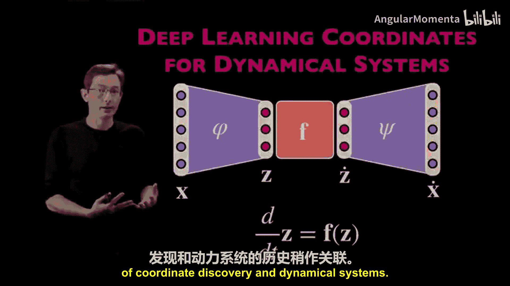

And I think this is a good example kind of motivating what we would like to do。

So maybe we have a video of some complex system， in this case， this is just a pendulum in my lab。

And what you would like to be able to do is from this movie or this megapixel image that's evolving in time。

 you would like to be able to discover automatically without a human expert in the loop that there is a key variable theta that describes the system。

 the kind of minimal descriptive variable for the motion of this pendulum is the angle theta。

 and you'd also like to discover that the dynamical system governing the motion of this pendulum。

 the evolution of theta is given by a simple differential equation here。

So that's kind of at a very high level what we'd like to be able to do。

 My colleague Nathan Cutz calls this GoPro physics sometimes。

 so you'd like to be able to have you know just a movie watching the world learning the physics。

 learning you know how clouds are evolving， learning how penduula swing， things like that。

 learning how balls drop， according to F equals MA。Okay， so that's kind of what we want to do。

 But this is a difficult task to learn these coordinates and to learn these dynamics。

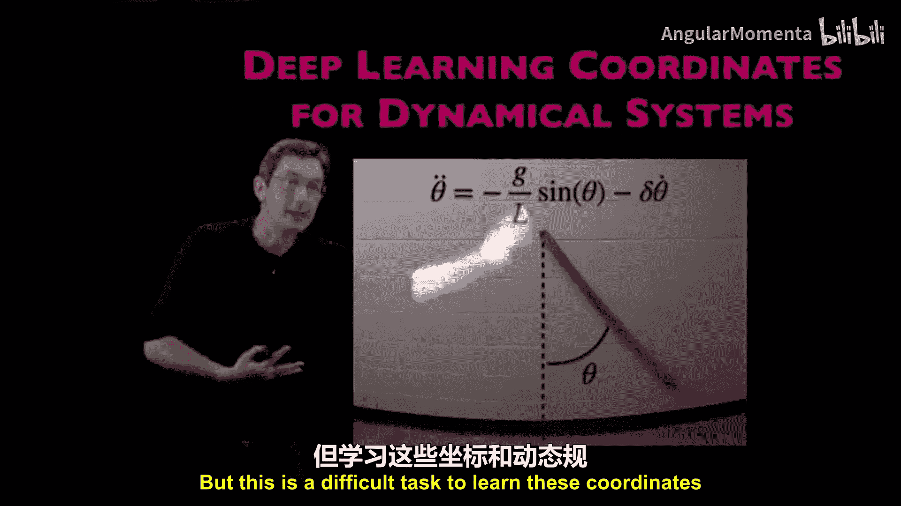

And so， you know I'm going to zoom out a little bit and talk about just kind of general challenges we have when we model dynamical systems x dot equals f of x again。

 most of the world around us is dynamic， it's evolving in time and in space。

 whether you're thinking about a fluid flow or an autonomous vehicle， the state of your brain。

 you know your collection of neurons， a weather system or a disease model。

 these are all dynamical systems that change in time， according to some rules on the right hand side。

 some physics， F of X。And so the big challenges that we have。

 one of them is often we don't know this model F of X。 we don't have a good model for the dynamic。

 So we need to discover that model in the case of the brain。 That's a good example。

Nonlineity is another key challenge， so even a small amount of nonlinearity really hampers our ability to simulate。

 estimate， predict and control these systems in the real world from limited measurements。And again。

 this is somewhere where finding good coordinate transformations can make a big difference in simplifying nonlinear dynamics。

And the third challenge we very， very frequently face in the real world is high dimensionality。

 Oftentimes， you know， we do have this camera， this movie of a very high dimensional pixel space。

 or we have a simulation or a measurement of a fluid flow with you know thousands or millions of degrees of freedom。

😊，And so we want to essentially leverage the fact that patterns exist in that data to find those low dimensional representations。

 those kind of autoenr coordinates I showed you so that we can discover the dynamics and maybe even handle some of the nonlinearity Okay so that's kind of a very high level overview of some of the things we want to do with these autoencoder networks。

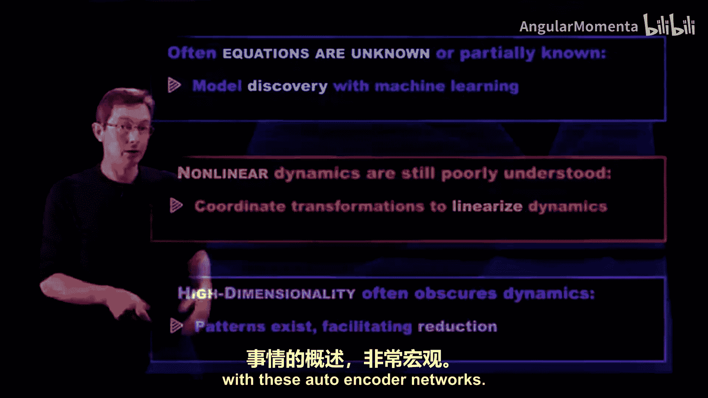

Okay， and again， you know， I'm going to use the example of fluids， It's one of my favorite examples。

 we know that even in very， very high dimensional systems like weather systems or you know more classical fluid flows。

 even though we would require hundreds of thousands。

 millions or billions of degrees of freedom to represent these in a computer or with our satellite images。

 we know that there are lowdial patterns and a few degrees of freedom that matter。😊。

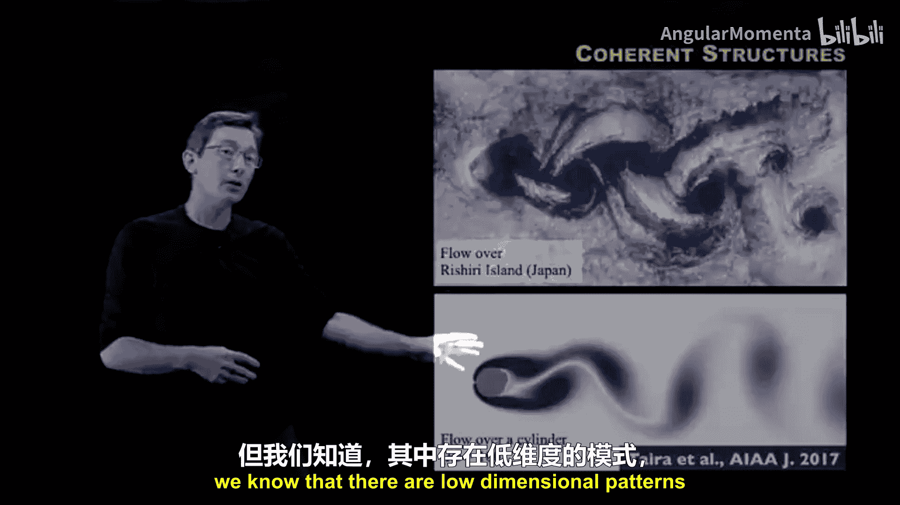

I really like this video here that shows kind of this low dimensional pattern in this very high dimensional system。

And so I'm going to motivate these deep auto encoder networks more classically through the singular value decomposition Okay。

 so this goes by many， many names in different fields， singular value decomposition。

 principal components analysis， proper orthogonal decomposition。😊。

But if you have some complex system that you believe has lowdial patterns。

 you can essentially compute the singular value decomposition of a data matrix and you can decompose this movie into a linear combination of a very small number of modes or kind of eigenstates that capture most of the energy or variance of this system。

And the way I like to think about this， this is a data driven generalization of the Fourier transform。

 This is essentially a Fourier transform that's tailored to this very specific problem。

 You're looking at this specific data that you've collected。Now。

 in the lens of modern kind of neural networks， you can look at the SVD or the principal components analysis as a shallow。

 linear autoender network where you have a high dimensional state X that might be my whole flow field stacked into a column vector and what I'm trying to do is I'm trying to find some latent representation some minimal set of variable Z so that if I compress down to Z。

 I can lift back up to the original state and recover as much information about that high- dimensional state as possible。

So this is literally the U and the V matrices from the SVD。

And this latent space Z here would be the amplitudes of these modes， these POD modes。Now。

 in practice， I would not recommend actually using a neural network to compute the SVD。

 it's way more efficient to compute it using a QR factorization or some kind of classical numerical linear algebra technique。

 but as an abstraction， we can think of the SVD as a very， very simple neural network。

And so what we're going to do。Is generalize this linear coordinate embedding。 And again。

 this is a coordinate system to represent your dynamics。

 We're going to generalize this coordinate system by making it now a deep neural network。

 So instead of one latent space layer， now we're going to have many。

 many hidden layers for the encodeder， many hidden layers for the decoder。

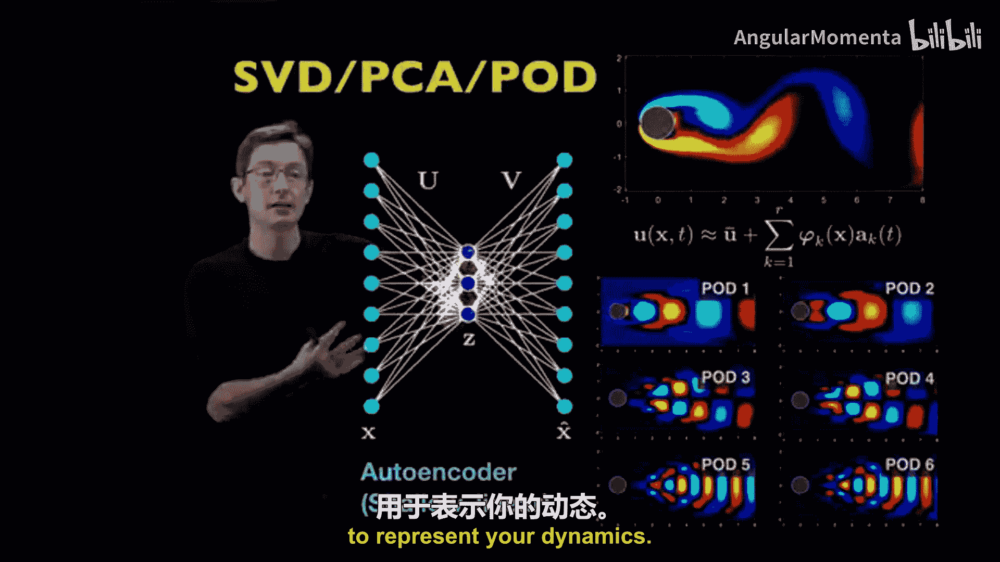

And our activation units， our nodes， are going to have nonlinear activation functions。

And so what this allows us to do。Is instead of learning a linear subspace where our data is efficiently represented。

 now we're able to learn a non linear manifold parameterized by these coordinate Z。

 where our data is efficiently represented。And often that means we can get a massive reduction in degrees of freedom needed to describe this latent space C。

Good。And so this is kind of what this abstract autoencoder network is trying to represent。

 Usually I have many， many hidden layers in Phi and in Psi。

 and I have nonlinear activation functions。 So the Z parameterizes a manifold。Okay， good。

 And we can learn these， essentially。By constructing this architecture。

 in Tensorflowlow or pytorrch or whatever neural network training framework you like and essentially cooking up a loss function so that we want the output minus the input to have the smallest error possible given that we've choked down the information to maybe three kind of latent variables in Z so you fix the number of latent variables。

 you fix the architecture and you train this so that it minimizes the error between the output and the input and it learns then the latent features of that input。

And so like I mentioned earlier， what we're going to do now is we're going to be training these autoencoder networks not just to represent the data in X efficiently。

 but also to be able to predict how the dynamics in that latent space evolve accurately and efficiently forward in time。

 So now we're going to be learning not just the encoder and the decoder。

 but we're going to be learning a representation of the dynamical system F that evolve the system forward in time。

And this is becoming a big deal in the machine learning community because now we're able to start understanding kind of the physics of how our movies or our high dimensional inputs are evolving in time。

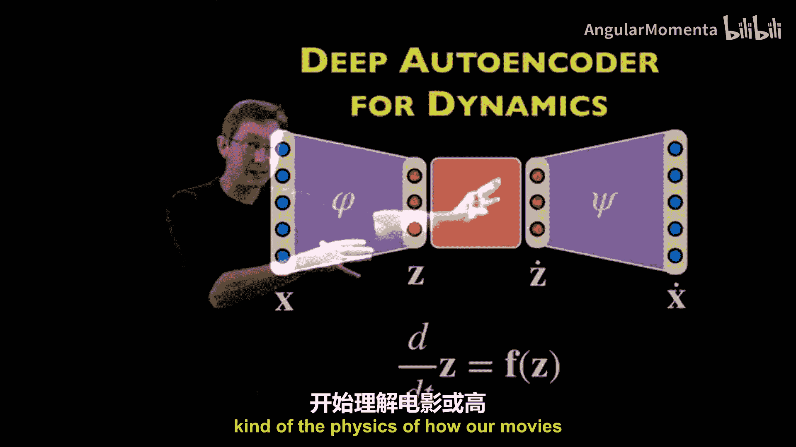

And I like to give this example， I think this is an extremely kind of motivating example where what you have here。

 this is a great visualization of the geocentric view of the solar system， so the blue dot is Earth。

 the yellow dot is the sun and the red dots are the other planets in the solar system。😊。

And if we have kind of a naive coordinate system where the earth is at the center of the solar system。

 then you see that you actually get extremely complex dynamics， these are really。

 really complicated circles on circles， and there's no obvious simple law that describes the motion of all of these bodies in this coordinate system。

But if we change our coordinates， so now we put the sun at the center of the solar system and every other planet is going around the sun。

 now this becomes a much， much simpler dynamical system。

 and this is amenable to discovering the basic laws of physics。

 F equals M Kepler's laws of motion And so I think that this is an extremely motivating example that shows that when you have the right coordinate system。

 you have some hope of learning a dynamics F that's simple。

 I could try to learn a dynamical system that describes this evolution here。

 but that differential equation is going to be much more complicated。

 harder to interpret and understand and generalize。

 So getting the right coordinate systems is often essential to learning the right dynamics。

 and that's been born true over and over throughout the history of physics。

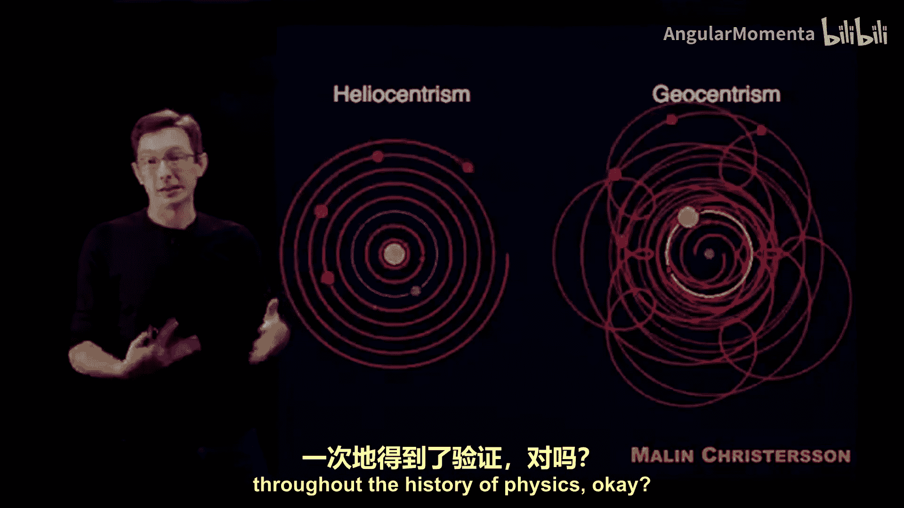

Good， so that's what we're trying to do here。 We're going learn the coordinate system that simplifies the dynamics。

 And now I'm going to walk you through a few examples of how we've been doing this and what some of the challenges and opportunities are。

😊。

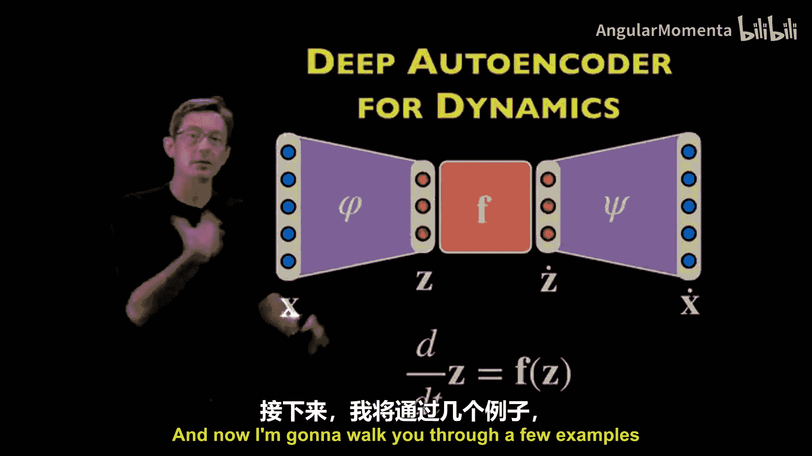

So one of my favorite networks here is one that was developed by Kathleen Champion when she was a PhD student with Nathan and me。

 and this is essentially combining Cindy or the sparse identification of nonlinear dynamics to learn a dynamical system in the latent space of an autoencoder。

And I think this is a really clever network design。 So essentially。

 what Kathleen is doing is she's learning these encoder and decoder networks。 These are big。

 deep neural networks。And there's additional loss functions that we use in our neural network training so that the dynamics in Z are essentially a sparse linear combination of candidate nonlinearities in a library。

 so we basically build this big library of the possible terms that could describe the dynamics in Z。

 and then we essentially try to find the fewest， the sparse combination of those terms that describe Z1 do Z2 do z3 dot in the latent space。

And so to do this， Kathleen had to introduce a number of extra loss functions to make this Cdi autoencoder converge to the right solution。

Essential， there's the original reconstruction loss。 If you just remove the dynamics in the middle。

 you still want your autoencoder to faithfully capture your data to find a good latent space。

 But then we have these additional Cindy losses and the Cindi regularization。

 So the L1 term at the end tries to make this set of column vectors as sparse as possible。

 So we have as few terms in the dynamics as possible。

 that makes it so that our dynamical system is interpretable and simple。

 it's more like f equals MA than some big complicated expression。

And then essentially these additional two loss functions take different parts of this network and make sure that if I compute X dot here。

 it's the same as if I took Z dot here and mapped it out and things like that。

 So essentially you can compute chain rules on different sub networkss and make sure that the dynamics。

 the time derivatives across those different pieces of the network are consistent that essentially make sure that you don't get into weird issues where you just try to shrink the Z as small as possible。

 which would in principle， also make C small。So this is a really cool network that Kathleen developed。

 She was able to learn lots of very， very sparse， parsimonious dynamical systems in these latent spaces for complex systems。

 and one of her systems was actually a movie of a pendulum， a synthetic movie of a pendulum。😊。

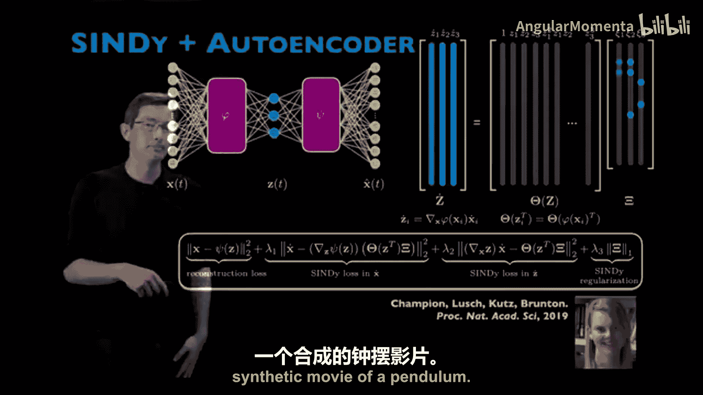

Okay， so this is a really nice way to learn kind of those dynamics and and coordinates。😊。

But what if we want to do more than just learn a sparse nonlinear model？

What if we actually want to try to find a coordinate system that actually linearizes our dynamics。

 So we know from Kman operator theory that this is often possible now there's lots of caveats。

 but there are often these special coordinate systems phi that if I take my original dynamics and I map it into the latent space through Z。

 I might even be able to expect a linear dynamical systems Z dot equals L of Z。

Now why would I want this？Linear dynamics are kind of， you know。

 generically solvable with textbook methods。 We can get optimal linear estimators and controllers with。

 you know， one line of Matlab or Python。 So anytime we can make our system linear。

 we gain a tremendous amount in doing so。😊，Now the big， big， big caveat here。

Is that this puts a tremendous amount of strain on the encoder and decoder networks。

 So finding a coordinate system like in the Cindiiato encodeder， where we have sparse dynamics。

 that's not that bad for the coordinate system to do。

 We can find a coordinate system where there's a few sparse nonlinear terms。

 This is related to normal forms from dynamical systems theory。😊。

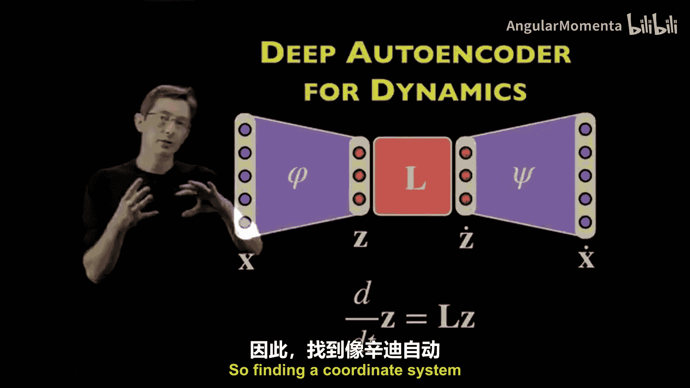

But if we want to actually remove all of those nonlinear terms and make the system truly linear。

 that's a much， much stronger set of constraints that we're putting on this encoder and decoder network。

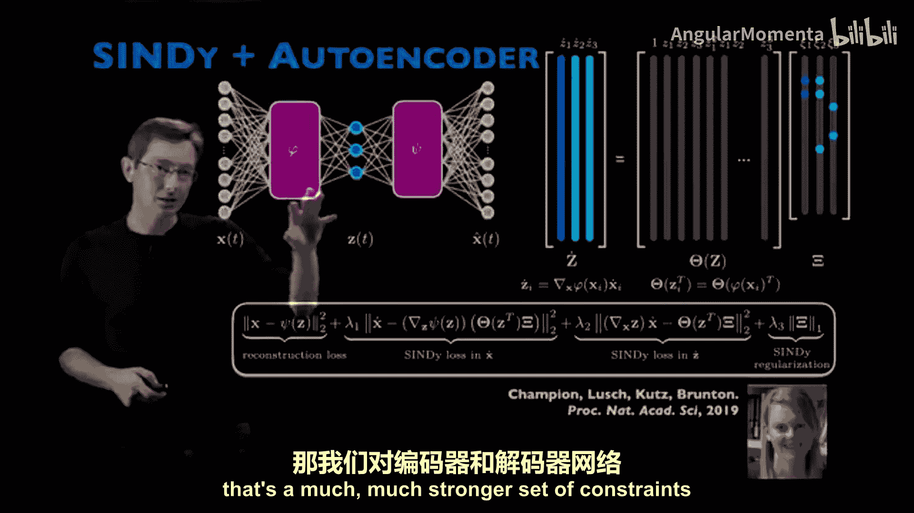

So generally speaking these are much harder to train。

 much more expensive and these might be much nastier functions fee to get these linear dynamics。

 but the good thing is just like most of neural network training。

 this is a very big expensive offline training cost。

 but once you've found these coordinate systems you can use them forever online in a very fast and efficient way you can do optimal estimation and control in this latent space。

 once you've put in the upfront cost of learning fee。Now， again。

 this could be a deep neural network with nonlinear activation functions。

 but it could also be a shallow neural network with linear activation functions。

 in which case this kind of linear dynamics， autoencoder would represent the dynamic mode decomposition so if phi and Psi were shallow with linear activation units。

 this would essentially encode the dynamic mode decomposition。

 So DMD has been used at length in fluid mechanics and many other fields to get linear representations of nonlinear systems like these periodic fluid flows。

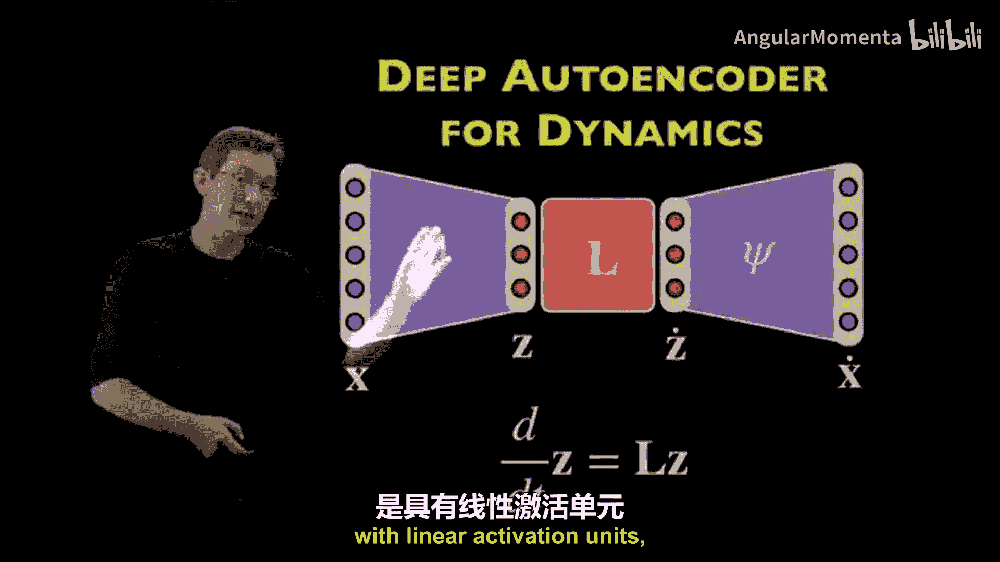

And essentially， DMD is finding some kind of a linear regression model on those SVD coordinates I talked about earlier。

 and there's another cool paper here that connects it to Coopman operator theory。

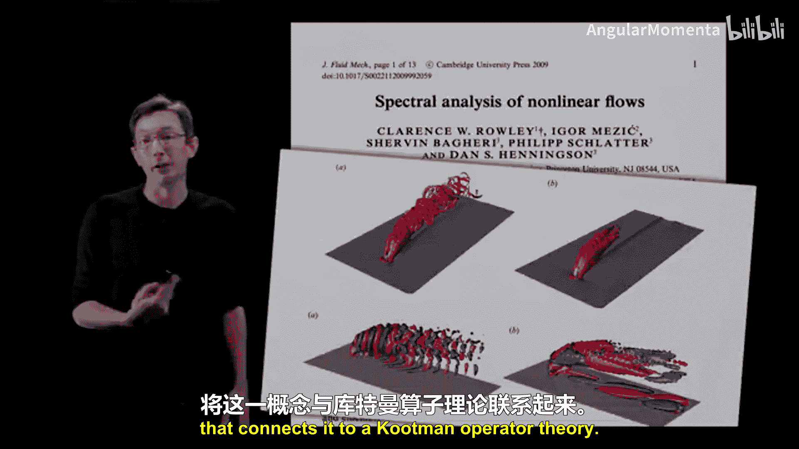

So if you take that idea of the dynamic mode decomposition， which is an extremely popular。

 useful kind of general purpose linear modeling technique。

 and you take this neural network representation and you make those encoders and decoders。

 deep neural networks with nonlinear activation functions。

 what we're essentially doing is learning a nonlinear analog of the dynamic mode decomposition。

 We're learning a nonlinear coordinate system that'll take an original nonlinear system and make it look linear。

😊。

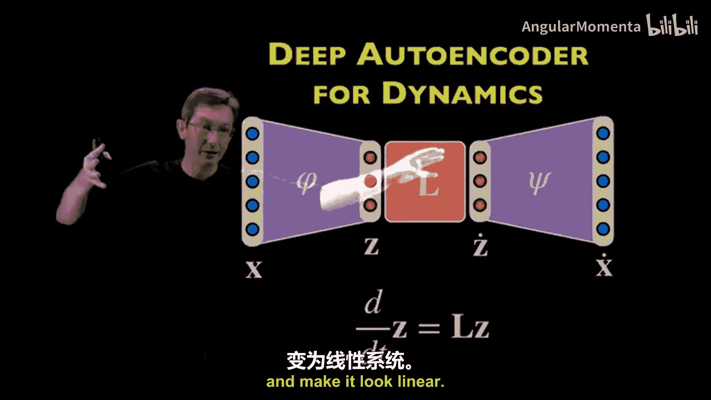

And so that's exactly what many， many groups in the community have done in the last few years。

 so I'm showing you worked by Bethany Lush who is a postdoc with Nathan Cuzson myself this is her deep coman autoencor where she takes her input and essentially through some some hidden layers。

 learns a coordinate system and encoder where she can get linear dynamical systems again。

 she looked at systems like like a pendulum or flow past a cylinder where there is a continuous eigenvalue spectrum so she needed to kind of add a few innovations to this network to parameterize these linear dynamics by the frequency of the system。

There have been many， many other groups that have developed similar deep Kman。

 auto encoder networks that essentially learn these coordinates where your dynamics can be simply or linearly represented。

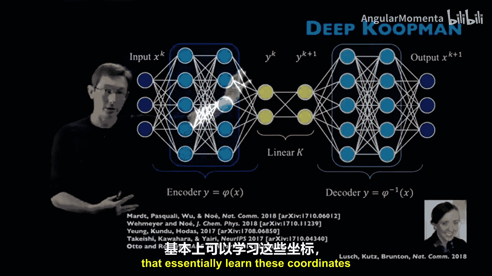

And I want to point out that those different approaches to these kind of coopman networks or theseline analogs of dynamic mode decomposition come in many shapes and sizes and we talk about this in a recent review paper we wrote on the Coopman operator theory。

 this is kind of a beast of a paper it's about 100 pages and it's all about how you find these coordinate systems with neural networks and with other approaches。

And there's kind of two big philosophies that the community has arrived at One of them is the kind of constrictive autoencor that I showed you before where you have a high dimensional state。

 you choke it down to a lower dimensional latent space where you can model the dynamics linearly。

 and then you can you know kind of decode that latent space to your original state X。

But what many people in the community have also done。

Is take your your system state and actually lift it to a higher dimensional latetnt variable Z。

 so you can take， you know even if you have a high dimensional state X。

 you can lift it to an even higher dimensional state。

 try to model the evolution in that higher dimensional state with linear dynamics given by this matrix K。

 and then you can always map back down to x。And these are two very。

 very different philosophies of how you can get embeddings that give you linear representations of your dynamics。

Now I'll point out。This bottom approach here is actually much， you know。

 this is reminiscent of lots of things that people do in machine learning already。

 like pooling and lifting kernel methods。 often if you operate in a very high dimensional space。

 nonlinear processes can look more linear。 So this is very consistent with， know。

 existing machine learning literature。But I will point out oftentimes these kind of constrictive autoenrs are more consistent with our physical intuition that even in these very high dimensional systems。

 there might be a few dominant coherent structures or patterns that we really care about。

 and we want to find out how those behave and evolve linearly。

 So these constrictive autoenrs might be more interpretable。

 you might be able to tease out relationships when you are working in a lowdial latent space Z。

 Both are valid approaches， and I just wanted to point out that you know lots of methods explore both of these architectures。

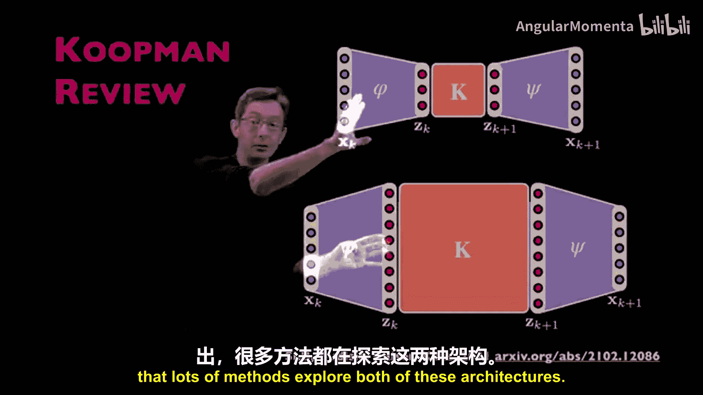

And since I'm already here talking about this Coopman review paper。

 I'll just kind of give a couple of teasers。 There's lots and lots of stuff we talk about here。

 So the basic idea of Coopman is that if you have some original dynamical system like this Duffing oscillator with three fixed points。

You can essentially find new coordinate systems or coordinate transformations where you expand the region of linear validity。

 you kind of expand where linearization is valid through a nonlinear coordinate system。 So here。

 for example， I might take my local linearization around this third fixed point。

 and I might find a local coordinate system where all of the dynamics in this pink region are approximately linear。

Another perspective of these systems， there are global coordinates that appear linear like the Hamiltonian energy of this Duffing oscillator。

 so this phase portrait is given by a particle in this potential well here。

 this double well potential。And the actual energy level of the particle is itself one of these eigenfunctions。

 It's a Hamiltonian that behaves linearly in time。 The time derivative of the Hamiltonian is0 times the Hamiltonian。

 that's linear dynamics。And this fourth perspective here， I think is really cool。

 and we're still exploring this。😊，You can also rescale space and time so that nonlinear oscillators like this oscillator here appear to be more like linear oscillators like just sine and cosine pairs。

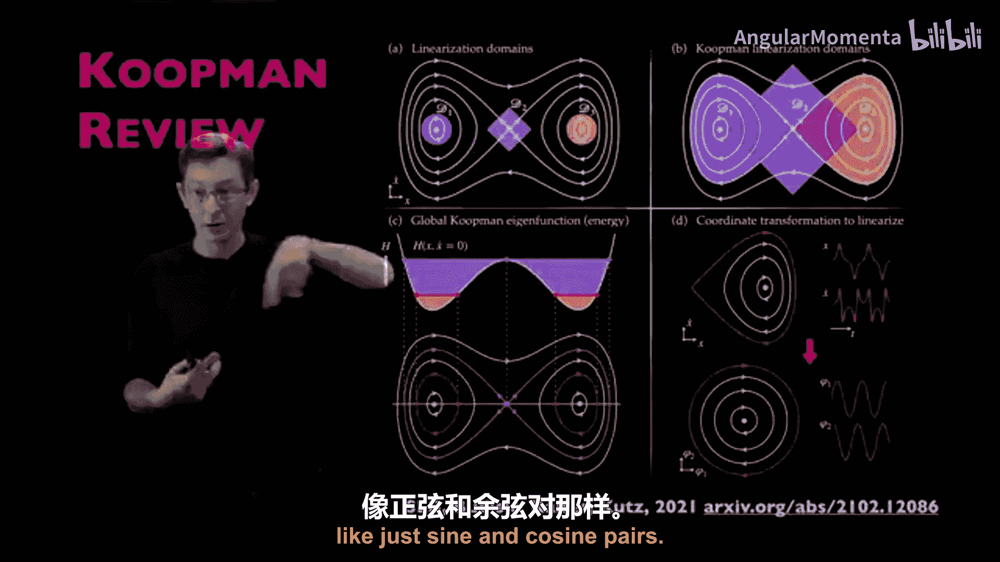

And that is something that Hening Lang has recently looked into is essentially building deep neural networks that can rescale kind of time and space to make your nonlinear oscillators look like a single linear oscillator。

And in very complex examples like this sheer layer fluid flow， he's been able to find really。

 really simple low dimensional representations that very accurately represent this nonlinear oscillator system。

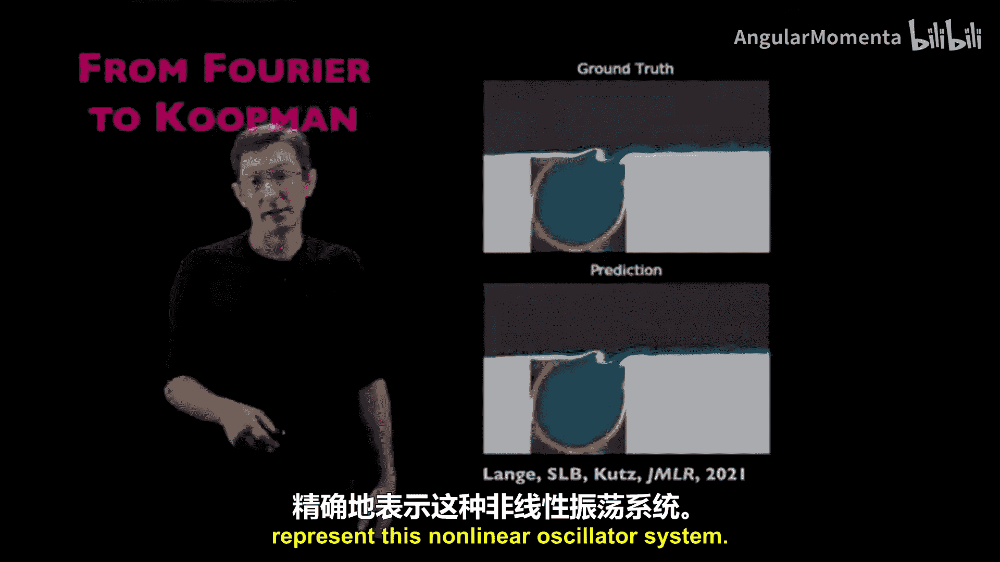

Okay， a couple of other examples before I conclude。

 so those deep coopman neural networks I was telling you about for ordinary differential equations。

 Craig Gin and Bethany Lush recently extended that to partial differential equations。

 so we know that even for spatial temporal evolving systems that are often coordinate systems that will make them look approximately linear。

So for example， in the nonlinear burgergers equation。

 which describes the evolution and formation of shock waves in fluid systems。

There is the classic coal hop transformation that transforms the nonlinear burger's equation into the linear heat equation。

And with our Coupman network applied to partial differential equations。

 we can essentially learn that linearizing transform in an automated way without knowing any kind of first principles。

 physics or having even having access of the governing equations， so just from data。

 we can learn these linearizing transforms in PDEs。😊。

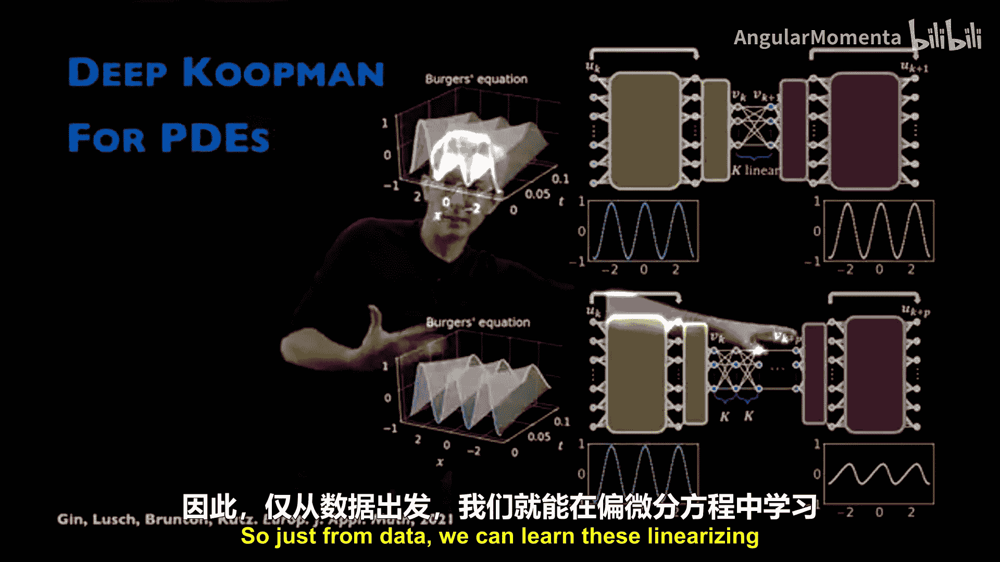

We also have a method this is with Craig Jen and Dan Shea。

 essentially to find these deep embeddings to discoverline analogs of greens functions and greens functions are very。

 very useful for linear boundary value problems in partial differential equations and essentially what we can do is through a very similar nonlinear autoenr network。

 we can learn these nonlinear analogs of greens functions。

 which would have lots of applications and like nonlinear beam theory or aircraft wings that can deform massively past where the linear approximation is valid。

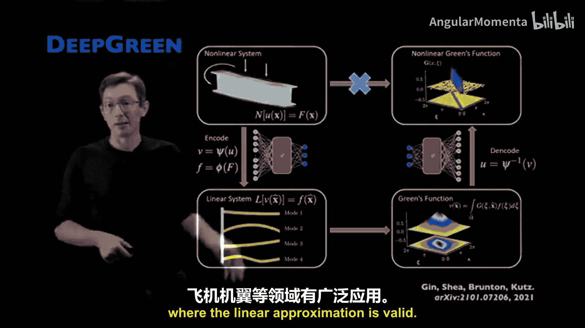

Okay， so I want to just kind of tie this up and conclude here。

 so we've talked about how there is this joint problem。Of learning coordinates and dynamics。

 This is one of the most exciting areas of machine learning research for physics。

 informed machine learning or for physics discovery with machine learning， where oftentimes。

 you know， if I don't know what the right coordinate system is to measure my system。

 maybe I'm looking at the brain or you know， the climate system or a disease system。

 I don't know what the right coordinate system is to get a simple law， you know。

 like F equals M A or E equals m C squared。 And so we can set up this dual optimization problem where we're simultaneously trying to learn the coordinate embedding fee to find a latent space Z。

 where the dynamics in that latent space are as simple as possible。 I've shown you two examples。

 one is where F is sparse and nonlinear using our Cyndi approach。

 Another perspective is where you try to find a coordinate embedding where F is actually linear。

 This is a matrix。😊，And both of those are you know getting widely explored in the literature。

 Lots and lots of networks are being developed to learn those embeddings for lots of complex systems。

 So I encourage you to try it out and to think of what other constraints you might put on F and Phi and Psi。

 for example， maybe you have symmetries in your system and you want these embeddings to respect those symmetries or you have some conservation law that you know is going to be satisfied like conservation of momentum or energy you know。

 colleagues are already building these networks that have those baked in。

 And so there's tons of opportunity to put partially known we didn't know before。 All right。

 thank you very much。😊。

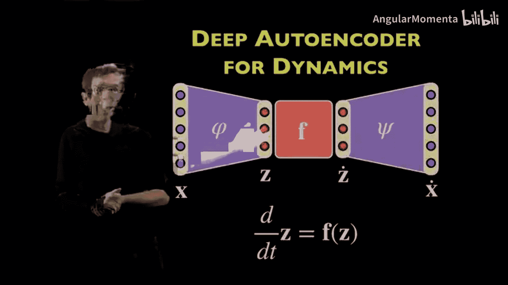