# 【精译】物理信息机器学习-p10-10-非线性动力学的稀疏辨识--BV1c9uDzQEj8_p10-

🎼，🎼，Welcome back so I'm really excited to start a brief video series on the Sprse identification of Nolinear dynamicsynas or Cindy algorithm it's been just about five years since we first published this the first Cindy paper and so in this video sequence I'm going to walk you through what we've learned since then about how to compute Cindy to learn models for complex systems and walk through tons of applications of how it's been used in the literature。

So I'm going to start with a brief overview， Cindy is a procedure of taking time series data and extracting interpretable and generalizable dynamical systems models that describe that data。

And I'll talk about what I mean by interpretable， generalizable later。

 but essentially you can think of this as a machine learning algorithm that extracts dynamical systems models from your time series data。

 and those dynamical systems models could take the form of an ordinary differential equation。

 x do equals f of x or a partial differential equation。

 partial u of T equals some nonlinear function of U。In this case。

 X would be the minimal state needed to describe your system， and you would be some kind of spatial。

 temporal field that's evolving in space and time。So to make this concrete。

 let's say your data was from this Lorentz system， you know this chaotic kind of mixing butterfly attractor。

 all you had was time series data of a trajectory or an ensemble of trajectories moving along this vector field you would want to discover a dynamical system of the form of the actual Lorentz equations。

 so that's what Cindy does from time series data out of all of the possible models that could describe it。

 it comes up with this kind of sparse minimalistic model that actually recapitulates the Lorentz model。

Similarly， if I add a movie of flowlow past a cylinder， of fluid flow。

 I might want to discover a partial differential equation like the navier Stokes equations that kind of has the minimal key ingredients needed to describe the balance in this case of velocity and vorticity in this field。

And this is kind of generally the philosophy we're going to take is that from this data we don't just want a model that fits that data。

 there's tons of machine learning algorithms that will give you accurate longterm forecasts of these dynamical systems but a lot of those are kind of opaque or black box models。

 we really put a premium on getting equations， dynamical systems models that are sparse that have as few degrees of freedom possible that describe the behavior so that's kind of what we're looking for here and this really rests on the idea that out of all of the possible dynamical systems that could have described this Lorentz system or this fluid flow these are actually quite simple the right- hand sidess or these differential equations only have a very few terms in the equations。

 the Lorentz equations have seven terms and likewise the naer Stokes equations are quite simple out of all of the possible differential equation terms that could describe them。

 these are both relatively。Spare， so that's what we mean by the sparse identification of nonlinear dynamics。

And there's a third interpretation that we'll talk about also。

 which is even if I have a spatial temporal system， a high dimensional system like this fluid flow。

 I think when I simulate this， I need approximately 100，000 degrees of freedom in the computer。

You can discover a partial differential equation， but you might also want to represent this as a lowdial combination of a few basis modes。

 so oftentimes you can take these spatial temporal fields like a fluid flow and decompose it into a few key variables in this case this combination of three modes with amplitudes X Y and Z。

 and you can derive a sparse differential equation model in terms of those mode amplitudes。

 and so this is a classic model from the literature by Bartt Noak and colleagues that we can discover using the Cindy algorithm purely from measurement data like this。

Okay that's the mile high view of what Cindy does， we introduced it in this PNAS paper in 2016 so this was work with Josh Proctor and Nathan Cutz。

 my close colleagues and collaborators where we kind of introduce this idea of trying to learn a dynamical system with as sparse of a representation as possible purely from data。

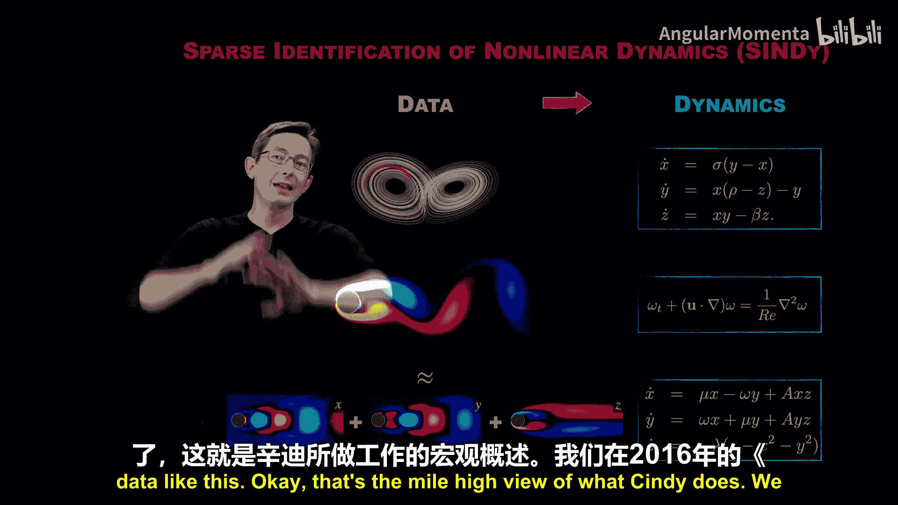

And we have kind of the schematic overview of how the algorithm works。

 I'll walk you through this in a minute， but the idea is in the last five years we've learned a ton about how to compute these CD models from data。

 from noisy data， from high dimensionsional systems， stochastic systems。

 and you know the capabilities of this have really dramatically improved since this first paper。😊。

So I thought it would be fun to kind of you know make a video five years later of everything we've learned。

 I get emails all the time of people you know trying this out on their data to learn their dynamical systems。

 and so I want to give you in this series of videos kind of insights into where are the pitfalls。

 how do you actually compute this and use this as a tool for scientific discovery good。

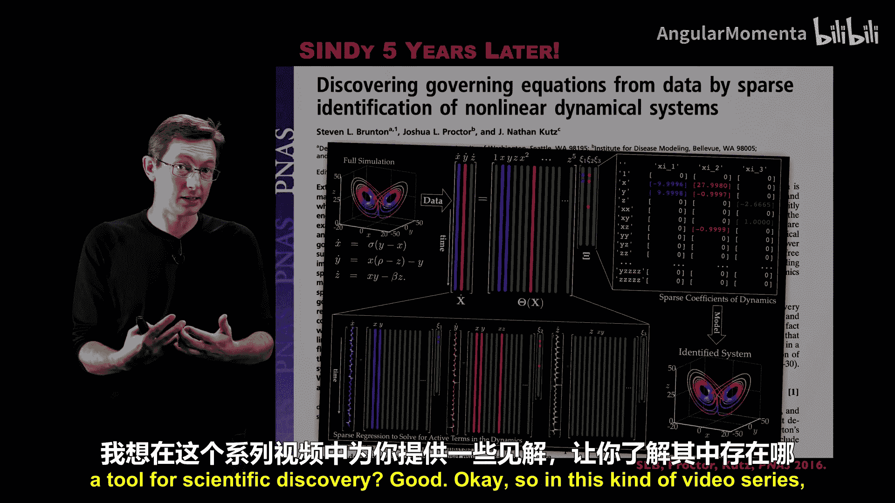

Okay， so in this kind of video series， what we're going to do is we're going to walk through the big picture algorithm。

 I'm going to tell you kind of all of the key steps that are involved in computing these models from data so that we can get these interpretable generalizable models。

😊。

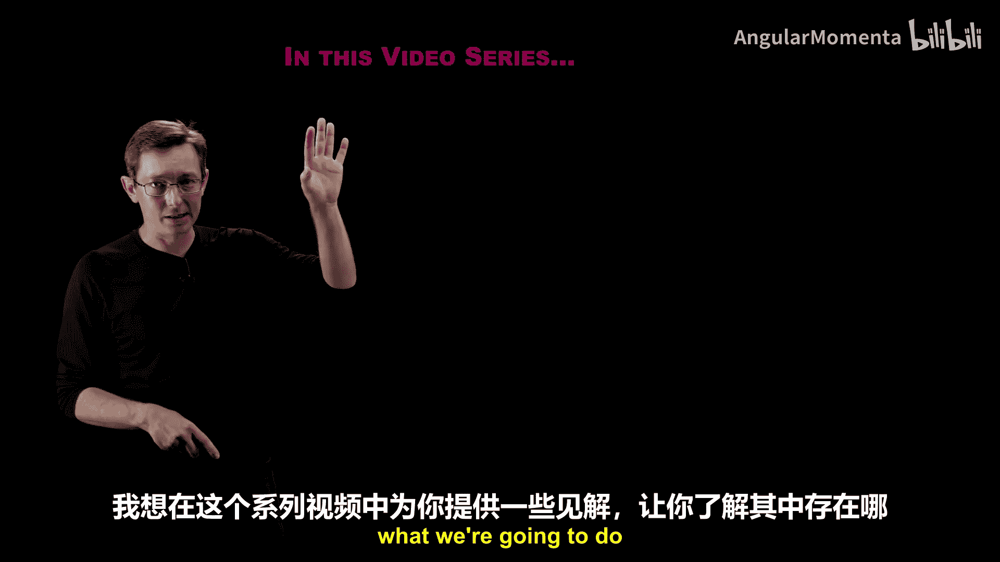

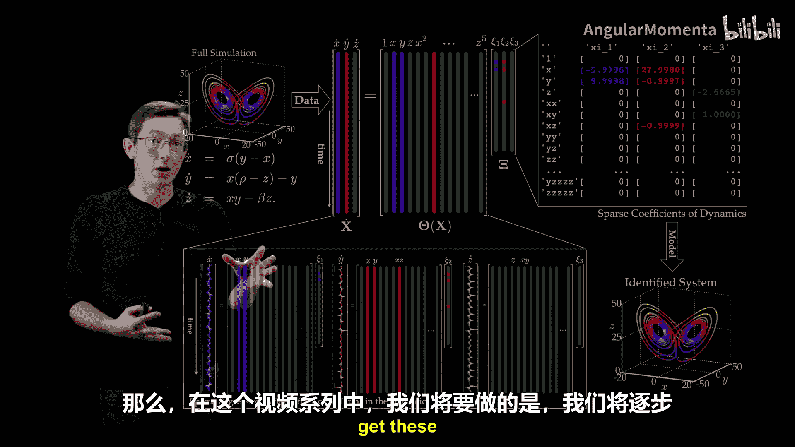

I'm specifically going to point out many of the common pitfalls that we run into or challenges that we face when we try to learn these models。

 what kind of data do you need， what coordinate systems are good to measure in how do you build the Cindy library of the candidate terms that you're selecting from and what optimization algorithms are most likely to give you kind of good physical Cindy models。

 so this I think will be multiple parts of the lecture series。

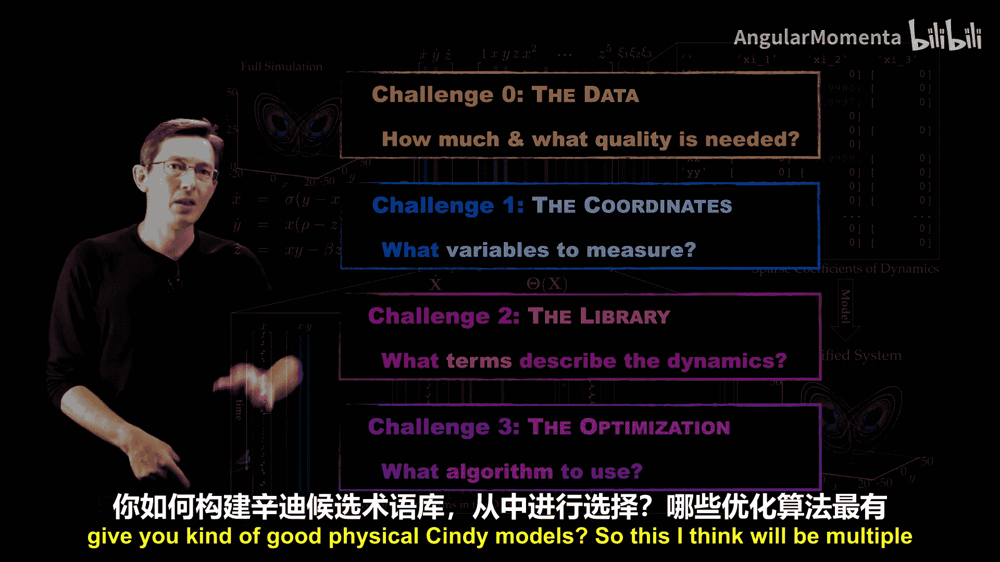

I'll have a whole video abstract on all of the cool sparseline fluids models that we've developed in my group and with my close collaborators over the last five years。

 so this is just a passion of mine I love modeling fluid flows and Cindy has turned out to be an extremely powerful method of getting kind of low-disional sparse interpretable representations of lots of complex systems from electroconvection to turbulent wakes。

 fusion reactors and many more， so this will be a whole video I'm really excited to share with you。

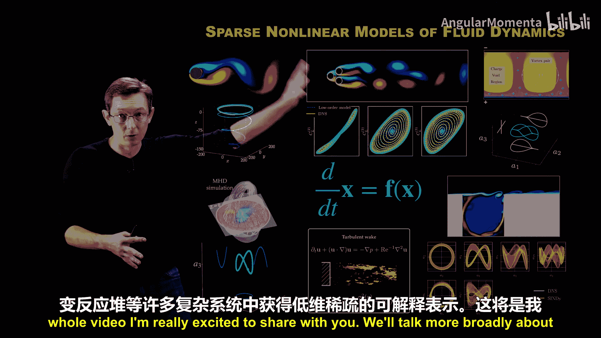

We'll talk more broadly about the other applications of Cindy。

 whether it's for modeling chemical kinetics in the human body， plasma dynamics。

Non nonlinear optic systems or mechanical systems， there's tons and tons of applications of these sparse nonlinear modeling procedure。

And in general， I just want us to be thinking， you know。

 there's so many dynamical systems in the world that we're interested in。

 most of the world around us is changing in time， it's constantly changing。

Some of the systems like this double pendulum I can write down the laws of physics you know from first principles and get a pretty good model I can use for control。

 but many other systems like the human brain or an ecological system， a disease modeling system。

 we don't have the governing equations and so these kinds of automated model discovery techniques can be really。

 really powerful in those systems and that's I hope what we do in the next five years is really cracks some of those big。

 big scientific discovery problems。

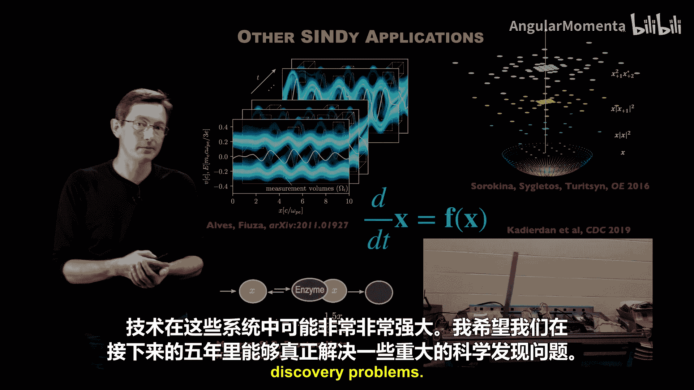

Okay good so that's what we're going to do， we're going to cover kind of the overview of the algorithm。

 major pitfalls and then get into some key applications that kind of motivate how and why you might use this and also set up some of the problems that we might want to study in the future。

And I'm going to walk through now an overview of the CID method。

 but I want to motivate why we want sparsity， why do we care about having minimalistic simplistic models？

And you've heard me say this before， I'm going to say it again， it's very important。

Kind of perspective in machine learning is that as we start。

 as we continue to design and develop and discover models from data， that's what machine learning is。

 we discover our models from data of dynamical systems。

 we have to put a premium on models that are interpretable and generalizable。

If we ever want to have these models be useful for safety critical control systems for autopilots。

 for autonomy， for robotic systems in the loop with humans。

 then we need our models to be interpretable， we need to understand what they mean and they need to generalize outside of the training data where we train them。

Instead of defining these two words， what I'm going to do is give you an example。

 so I think that the ultimate interpretable and generalizable model is Newton's F equals MA。

So it's interpretable in the sense that it has three terms， FM and A。

 and we can write these down for a problem of interest， we can analyze， explain， interpret。

 they have units。And it's generalizable in the sense that Newton can learn f equals MA from apples falling on Earth。

 that's how the story goes， and this law， f equals MA is still valid when we design space missions to the moon。

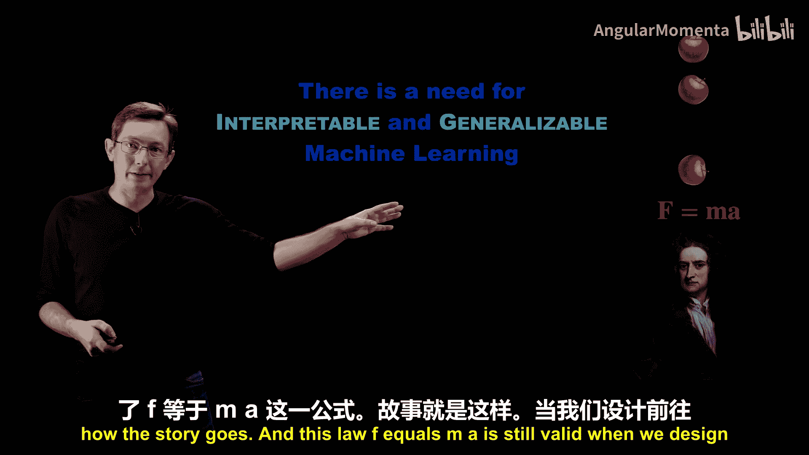

That's the ultimate generalizable model so I guarantee that you could take movies of apples falling data from Apples falling and you could train a deep neural network to make new movies of Apples falling or to predict the motion of those apples but that deep neural network is not going to be useful for space mission design unless you take a big step back and guarantee that you're enforcing interpretable and generalizable models so that's what we want we want models that are more like f equals MA unless like these big opaque neural networks。

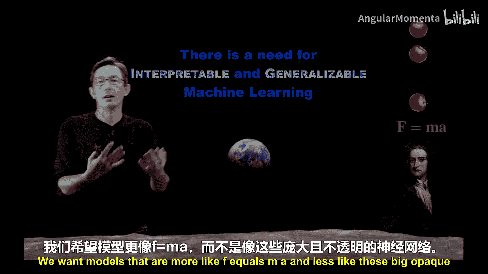

And this is a principle in physical modeling that's been around for thousands of years from Aristotle until now。

 that the kind of right physical model is typically the model that is as simple as possible。

 but no simpler， and that's a very elegant statement of this principle of parsimony。

 that you want the sparsest， the simplest model possible， but no sparser， no simpler。

And the way that we enforce this today with mathematical tools is by getting models that are lowdial that are described by as few degrees of freedom as possible。

 and models that are sparse that have as few terms in the dynamical system as are needed to describe the observed dynamics。

 and that's kind of the whole philosophy behind this Cindy algorithm as we want sparse models in terms of a few variables。

Now， if you fast forward from Newton until the present computational era。

 this starts to look a lot like the Lorenz 1963 model。

So the Lorenz 1963 model is describing this very， very rich turbulent chaotic convection that you observe in the atmosphere。

 and he does it in terms of this very， very simple three equation model。

 so it's in terms of a lowdial state X， Y， and Z， which represent the mode amplitudes of three important spatial modes。

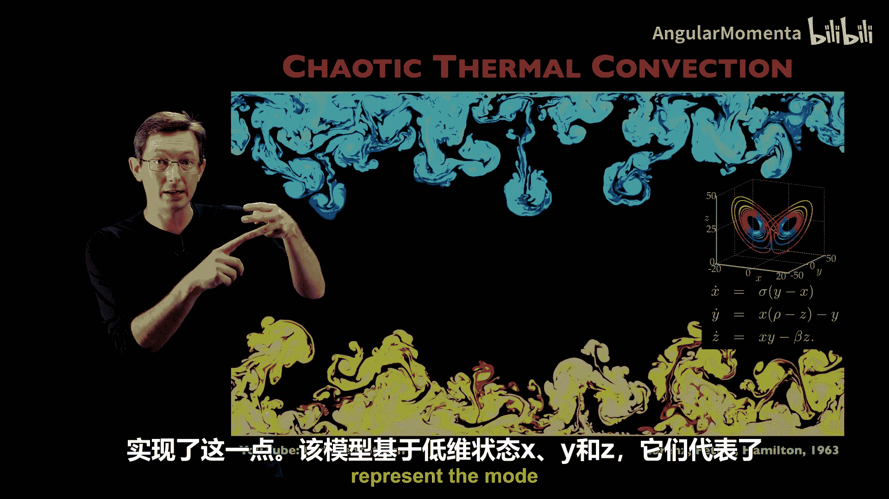

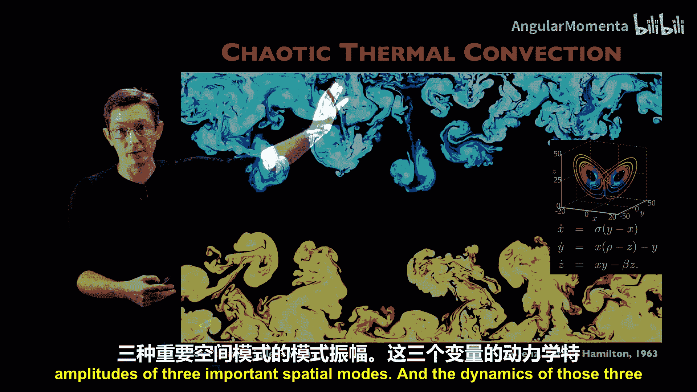

And the dynamics of those three variables are described in terms of a very simple ordinary differential equation with seven terms。

 most of them linear a few of them quadratic， so again。

 that's the kind of interpretable and generalizable model that we would like is something like this Lorentz model。

So that's how I'm going to illustrate the Cindy approach。

 our sparse identification of No nonlinear dynamics algorithm is on this Laren system。

 and again this is joint work with Nathan Cutz and Josh Proctor， we've had many。

 many extensions to this method together in the last five years。

And this is the warm up problem that we use to explain Cindy for the first time。

 So we're going to pretend that we have access only to data from the Larenent system。

 we know that there are governing equations， but we don't know what they are。

 We just measure x Y and z the state of the system in time。 So every row is a measurement in time。

 and we assume that we can compute the derivatives x do y dot and z dot。

 Now that's a big assumption and we're going to relax that assumption in a minute。

But assume you have access to measurements of the data in time。

Now the simplest thing that you could try。Would be to model this dynamical system using a linear model or a best fit 3 by 3 a matrix that best predicts the time derivatives from the measurement of the state now。

And this is what the dynamic mode decomposition or DMD would do is essentially it would give you a best fit three by three model that would best propagate that system forward in time。

But we know that a three by three linear model is not going to capture the rich dynamics of this Lorenent system。

 a simple a matrix has a single fixed point at the origin。

 it can't describe the multiple fixed points of the Larenent system。

 the unstable periodic orbits or the rich chaotic dynamics that we observe。So instead。

 what the Cindi algorithm does is it augments the right hand side of possible model terms to include nonlinear terms in addition to the state itself。

So in this case， for example， in addition to X， Y， and Z， we add terms x squared， X， Y， y squared。

 and all the way up in this case to fifth order polynomials。

So we augment our library to include more terms that could be used to describe the left hand side。

 the X dot， the Y dot and the Z dot。And notice that all of these gray columns in this theta library can be computed from the data that I measured in X。

 Y and z， if I have x， I can compute x squared， if I have x and y， I can compute x times y and so on。

So this is a computable matrix。And now the entire objective of the Cindi algorithm is to try to find the fewest terms in this library of candidate dynamics that describe the x dot equation that describe the y dot measurements and that describe the z dot measurements so for example。

 I'm trying to find the fewest columns of theta that add up to equal x dot that add up to equal y dot and that add up to equal z dot。

Now 20 years ago this would have been a combinatorial brute force search out of all possible sparse combinations of columns to find the best fit to Xdot Y dot and Z dot now that's a commodity algorithm and optimization there are dozens of sparse optimization algorithms that will give you the sparsest subset of theta that adds up to Xdot Y dot and Z dot we have our own favorite that I'll tell you about later。

 but there's lots of them like the Laso hard thresholdholding and so on and so forth。

And so when you do this sparse optimization in this library。

 you essentially learn the structure of your dynamical system and the parameters of what terms are active。

 so you learn that the x dot equation is linear in x and y。

 which is actually true in the Lorentz equations， the Y dot equation has a linear term in x and y and a nonlinearar xz term。

 and the z dot equations have a z and an Xy term， and in fact that is exactly what the true Lorentz equations are governed by。

 and we learn that purely from measurement data of our system。

So this is something that is true in almost every system we've looked at where we knew the answer is that by imposing this sparsity condition by trying to find the sparsest model possible that explains the observed data。

 we tend to discover the actual true dynamics that generated the data in the first place。

 and that's very promising because if we can rediscover dynamics that we know using the sparse algorithm。

Then hopefully we can discover new dynamical systems that we don't know and still have them be interpretable and generalizable like these models。

Okay， good。Now you can do this for ordinary differential equations like I've shown you。

 I'm going to show you all of the challenges later that you can run into in did we measure the right variables is this the right library what sparse optimization algorithm do I employ All of those are real challenges that we'll talk about in this video series。

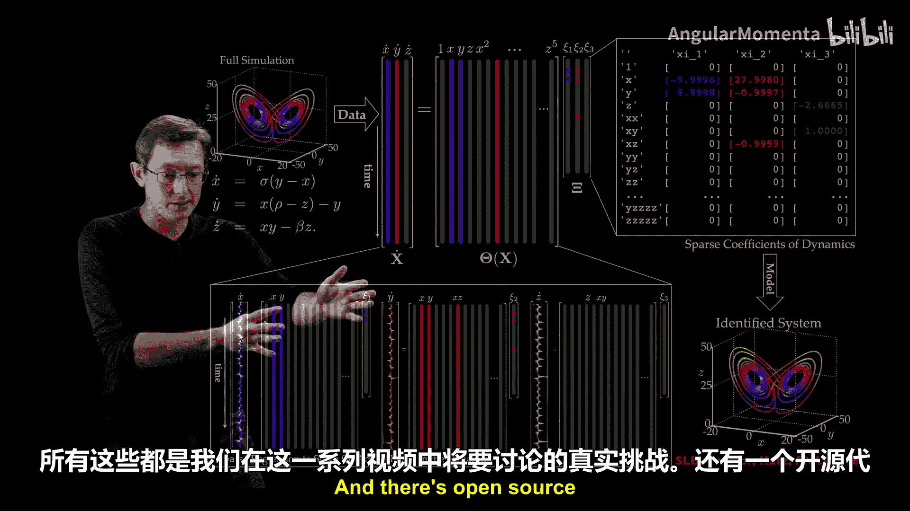

And there's open source code Pi Cindy， you can download this on GitHub。

 read about it on JoAS or on the archive and try this out for yourself。

 we want this to be you know continually getting better because of community involvement。

 so please try this out。

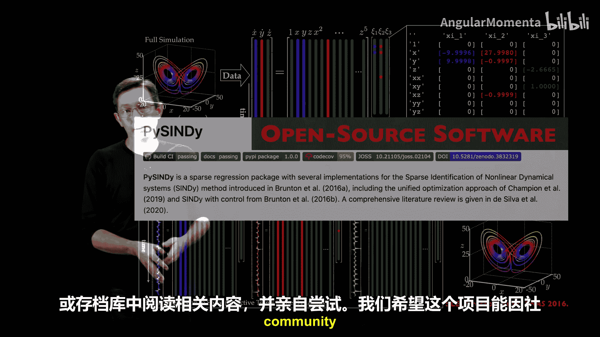

You can also discover partial differential equations so I alluded to that in the intro if I have spatial temporal data。

 for example this fluid flow past a cylinder if I measure the vorticity field omega and the x and y velocity fields U and V in space and time I can build a partial differential equation model for this。

 so just like in Cindi we build a regression problem。

 so this is a generalized linear problem where we try to represent the time derivative of some quantity in this case the time derivative of vorticity as a sparse combination of a library of candidate partial derivatives and nonlinearar products of partial derivatives。

 so I compute all of these gray columns by computing partial derivatives and nonlinearar crossters from this data and I'm trying to find the sparseest combination of these terms that add up to equal the time derivative of mega my vorticity。

😊，And when we do this， when we apply this sparse regression。

 we actually learn purely from data that the na or Stokes equations are the dynamics that are most consistent with the data and as sparse as possible。

😊，So this is fantastic work by Sam Rudy， who is a PhD student working with Nathan Cuz and me。

 and he applied this to a ton of other systems I'll show you in a minute。

What's cool is because when you have this kind of spatial temporal data， there's so much data。

 you can also massively subsample little patches of that data in space and time。

 and even that subsampled problem is still well conditioned enough oftentimes to learn the true dynamics。

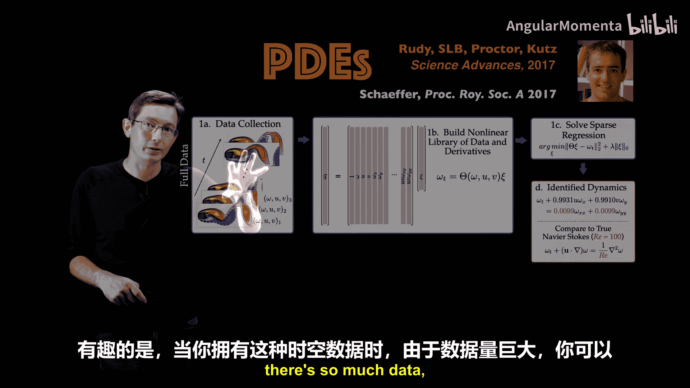

I'll point out that there was a parallel paper by Hayden Schchaefffer who also showed very shortly after the first Cindy paper that you could extend it to partial differential equations。

 so both of these papers kind of extend Cindy to learn PDE systems。And since then。

 there have been tons of cool applications learning new models that have never been written down before for。

Plasma systems and many other systems。

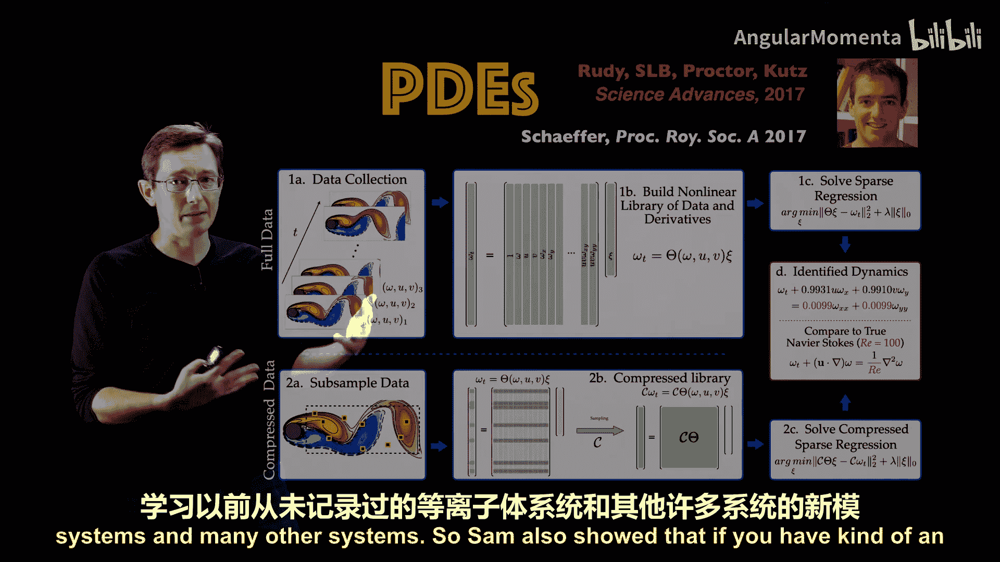

So Sam also showed that if you have kind of an ensemble of random walker data。

 if you have just like a random walk and you look at an ensemble of these kind of these random walk data。

 and you look at the evolving distribution of that random walker。

 you can learn things like the heat equation， which describes kind of this average motion of this diffusion in time of these random walkers。

 which we thought was really cool， so you can apply this either in kind of the deterministic or in the ensemble statistical framework to learn PDEs。

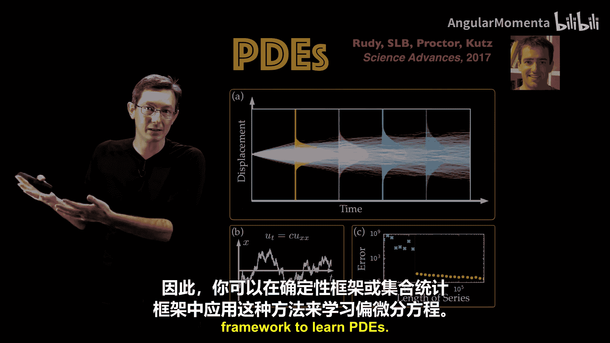

And he applied it in his first paper to many， many partial differential equations， and again。

 in every case where we knew the answer by trying to find the sparseest PDE that described the data。

 we actually learned the correct dynamics you know purely from measurement data。

 so that was kind of neat。Okay， so I'm going to kind of wrap up this video just by pointing out that there are some big challenges and that's going to set up the next few videos in this sequence。

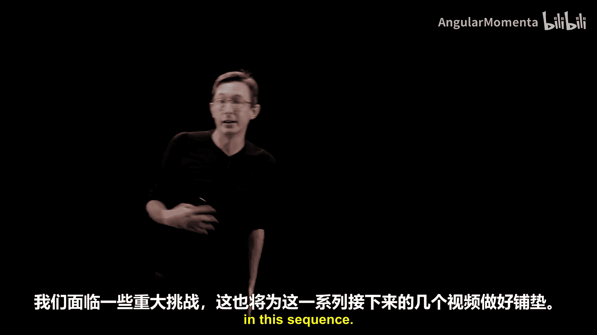

So this is the big picture kind of schematic overview of Cindy and there are a few key steps you need to generate some data from a system。

You build a library of candidate terms that could describe the dynamics of that data。

 and then you apply some sparse optimization to uncover the sparseest combination or the fewest dynamics terms needed to describe that data。

And all of those have some real challenges associated with them。

 So the first challenge is in the coordinates， how did I know that X。

 Y and Z were the right variables to measure， That's not obvious at all。

 If I'm measuring data from the brain， how do I know that what I'm measuring are the right dynamic variables that admit a sparse dynamical system。

 So that's a key first challenge。

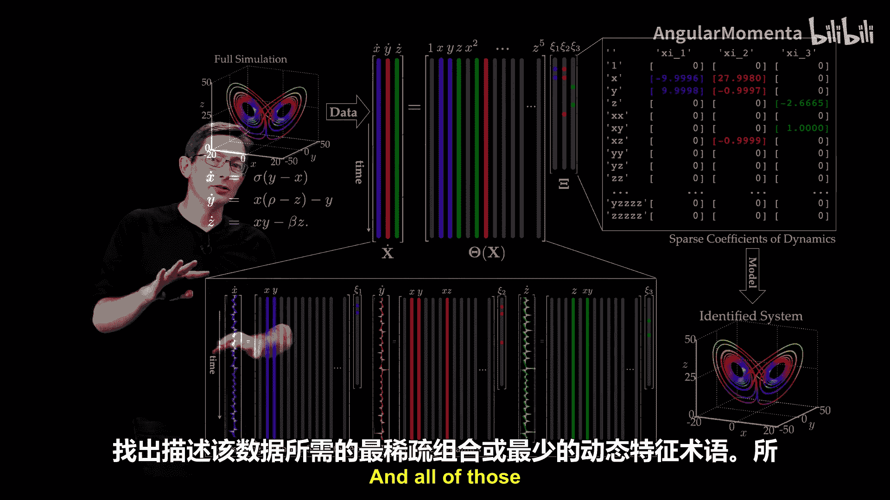

The second challenge is in the library， even if I measure the right variables。

 how do I know that my dynamics are polynomial， how do I know that they're quadratic and cubic and cortic。

 maybe they're signs and cosines， maybe they're beels functions。

 how do I design the library so that I can get a dynamical system that's sparse and accurate？

The third challenge and when we first wrote this paper five years ago。

 we thought that this was kind of the hard challenge。

 it turns out this is maybe the easiest part is the optimization what algorithms do I actually use to get a sparse model once I have the right coordinates。

 once I have a good library， how do I actually find the sparses combination that give me my dynamical system and in this third challenge this is where a lot of the kind of physics informed machine learning comes in if I know partial physics can I enforce that in my optimization can I constrain my optimization to give me sparse solutions that are also physical by construction a lot of interesting questions here as well。

And then there's a zeroth challenge and we don't always talk about this， but this is super。

 super important which is the data itself Cindy relies on having high quality data。

 pretty clean data fairly rapidly sampled in time and enough of it that you can kind of disambiguate different types of dynamical systems and get the right model that describes your system so there's fundamental questions like how much data do I need。

 how fast do I have to sample it what quality， how little noise do I need and we're going to talk about all of that in upcoming videos so if you are interested in learning the real nuts and bolts of how to do Cindy for model discovery in your system of interest I'm going to talk about all of these challenges in the upcoming videos and we're also going to talk about key success stories in fluid dynamics and in other fields so that you can get a feeling of how to do this sparse modeling in your own problem okay。

Stay tuned， we're going to talk about all of this coming up soon， thank you。

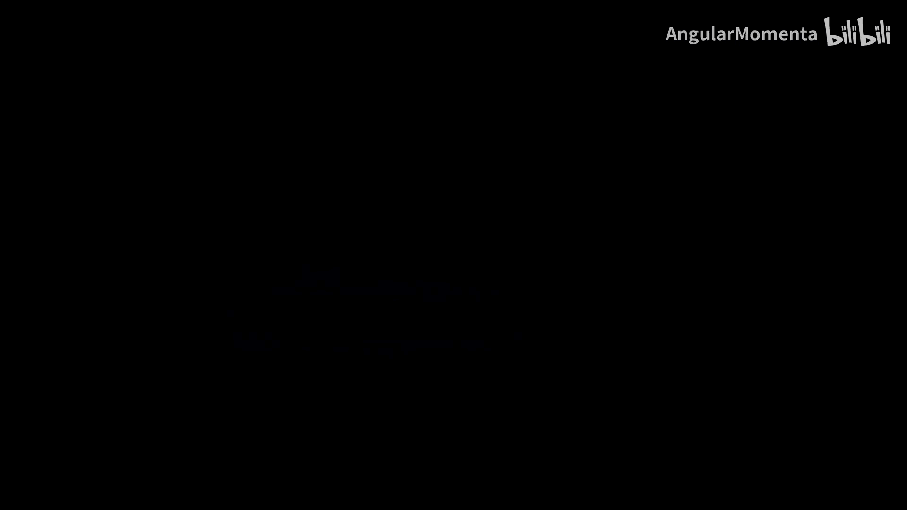