# 【精译】物理信息机器学习-p11-11-稀疏非线性动力学模型与SINDy，第二部分：训练数据与模型消歧--BV1c9uDzQEj8_p11-

🎼，Welcome back。So we've been talking about the sparse identification of nonlinear dynamics or Cindy algorithm。

 which is a machine learning optimization that builds dynamical systems to describe time series data like the Laren system or the fluid flowopasa cylinder。

 for example， it can learn ordinary or partial differential equations that are in some sense。

 as simple as possible needed to describe the observed data。

And in this lecture series we've essentially given the overview of the Cindy algorithm， how it works。

 what are the pieces， and we've outlined the main challenges。

 so today I'm going to zoom in specifically to the challenge of the data。

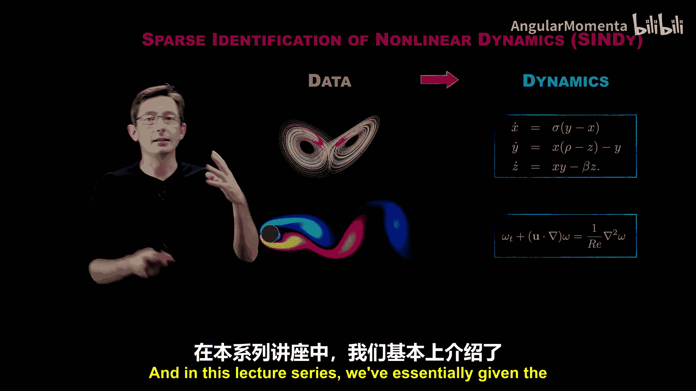

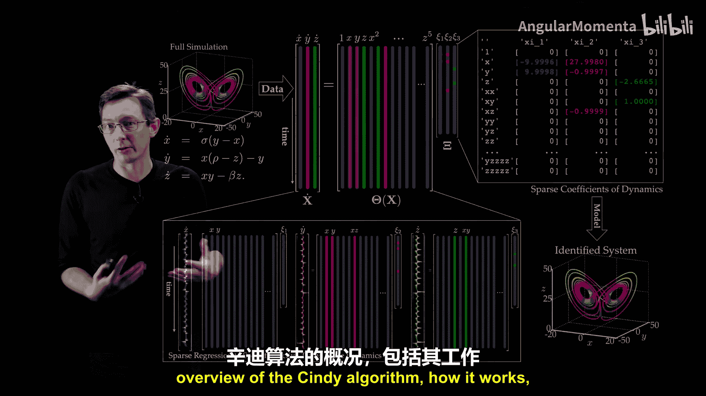

So if we assume that we are measuring the right coordinates and we have a good library where we can represent our dynamic sparsely。

 and we have an optimization algorithm that should select that sparse model。

 we're going to zoom in and talk about what kind of quality and quantity of data we need so that we can get a good CinD model。

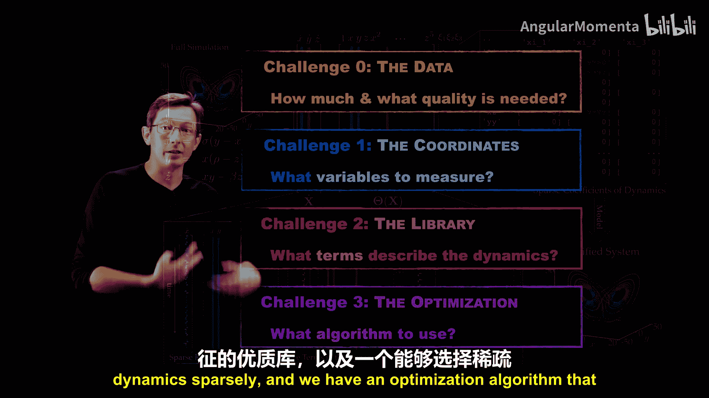

I get emails all the time from people across the world that are using this algorithm for their own scientific discovery and I love hearing all of the cool things that people are using this for that I would have never thought of in the first place and a very。

 very common question is you know okay， I have this kind of data I'm trying to identify this kind of a model。

 it's not working why。And most of the time it boils down to the data。

 so Cindy generally speaking requires relatively clean data sampled relatively quickly and with enough kind of richness of data that you can tell what dynamical system you're working with。

😊，Now there have been pretty important advances that relax some of those restrictions and allow you to apply this to a broader class of data。

 but I want to talk about kind of what are the challenges of data in Cindy。

 so I think this is going to help a lot of people hopefully figure out what kind of data you need and what you can expect out of your model。

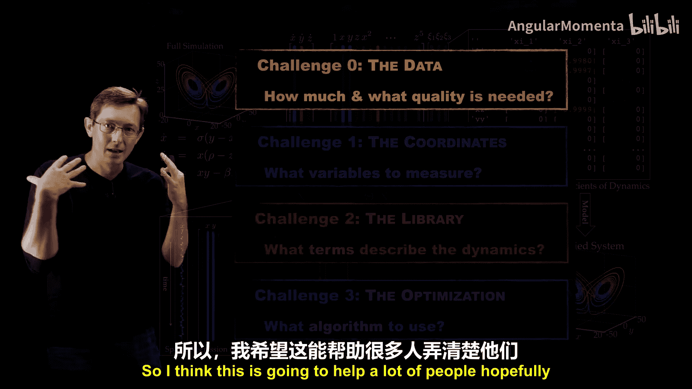

Okay， so recall this is the big architecture where you have data from some dynamical system。

 you believe that there is a sparse dynamical system that probably describes that data in these coordinates。

 so we assume that we have measured the system in some good coordinate system X。

 Y and Z we have a library of candidate terms we think could describe the dynamics。

 and there's some optimization algorithm to select the sparseest combination of that library those library terms that best fit the time derivatives x do y dot and Z dot。

Now this right away should key you in that we're going to be approximating derivatives from data and that's notoriously challenging if you have noisy measurements。

 and so if you have noisy measurements， we're going to have to use some kind of a fancy regularized derivative to get clean estimates of XOt Y dot and Z dot。

Okay， so I'm going to walk through a few key advances people have made with my group and collaborators included to improve or to characterize how this works with different qualities of data。

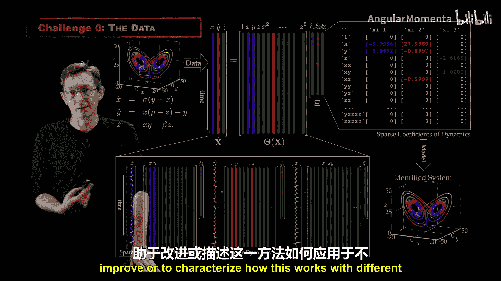

So the first thing I want to show you。 and this is great work by Kathleen Champ who is a PhD student with Nathan Cuson myself。

 is if you have really， really clean data。 and you have fast enough sampling of that data。

 You can identify these nonlinear dynamical systems with very， very short time measurements。 So here。

 Kathleen is looking at four dynamical systems in the Laent system Duffing， vananderpo and Rossler。

 So at least these two are chaotic and these two are kind of deterministic nonlinear oscillators。😊。

And so what Kathleen is looking at here in this plot， we have the sampling rate。

 so how fast you're sampling your system in time， kind of how many deelta Ts are fitting in one period。

 and then how many full periods of oscillation you need to sample before you get the correct behavior。

And what she shows here is that if you sample fast enough at around two to the eight samples per period。

Then you can get away with less than a whole sampling period and still correctly identify these dynamical systems。

Wwhichhich is pretty remarkable this kind of blew Nathanthan and me away when Kathleen showed us this result。

 so for the Lorentz system， even if you've only seen less than a full period of oscillation。

 you haven't even seen the other lobe of the dynamics if your data is clean enough and sampled fast enough you can identify the full Lorentz model just having seen a fraction of one lobe that's pretty remarkable。

So if you have clean data and if your sampling rate is fast enough。

 you can really identify a lot of dynamics from relatively short absolute time series okay so that's what this shows but all bets are off if your sampling rate is low or if you have a lot of noise on these measurements。

 both of those cause a lot of trouble in real worldorld applications of Cindy okay that's where a lot of our kind of real problems come from。

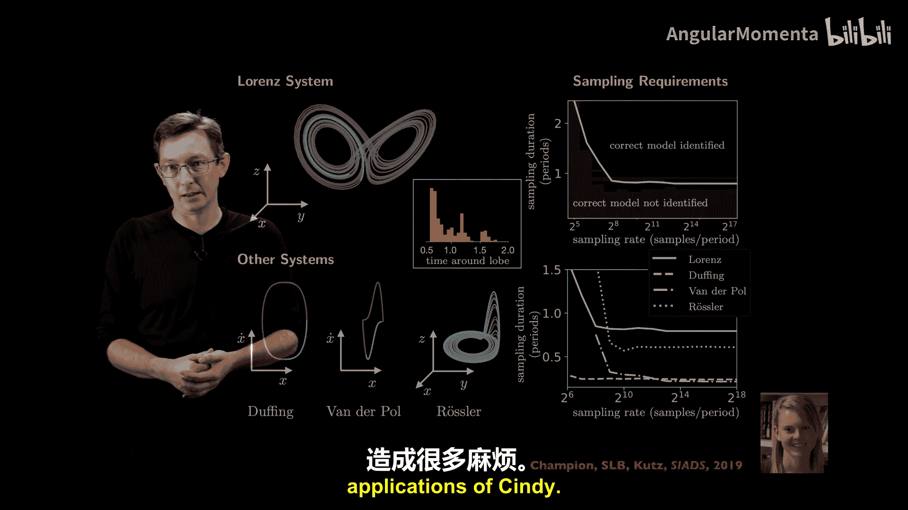

So oftentimes we don't have access to clean measurements of X， Y and z。

 and we definitely are usually not measuring the derivatives x dot y dot and z dot instead what we often have is noisy time series measurements like these kind of noisy X。

 Y and z。And so in the original Cindy paper back in 2016。

 we showed that if you have noisy data like this， you can approximate your derivatives using a total variation regularized derivative based on the total variation optimization from decades earlier。

And even from your noisy time series measurements， you can get relatively decent approximations of your derivatives that when you combine these you get fairly accurate CinD models。

 you identify the right structure and pretty close to accurate parameters for this dynamical system。

So this is pretty promising that even with relatively noisy data。

 if you have enough of it sampled fast enough in time and over a long enough period。

 you can often use some kind of denoising techniques to approximate these derivatives。

Sam Rudy in his PDE find version of Cindy essentially uses polynomial fitting。

 he fits a polynomial through the noisy data and then takes the derivative of that。

 which is also a really nice strategy。So this can work。

 but oftentimes we have more noise than this can handle or less data， and that's a real issue。

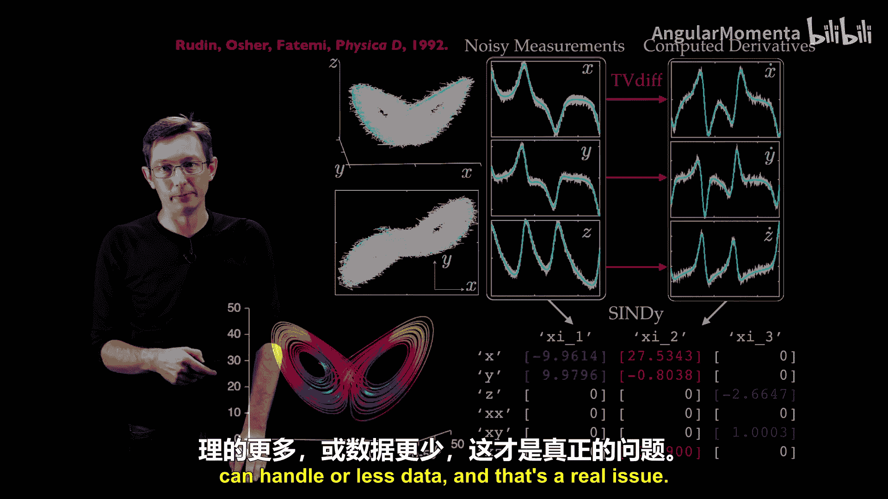

Okay， so。I want to talk about this fantastic paper that I think was one of the major innovations early on in Cindy that kind of opened the door to lots of real world applications like experimental data that are really noisy so this is by Hayden Schchaefffer and Scott McCllough。

 Hayden's had a number of kind of key advances in extending the Cindy algorithm to things like PDEs and to noisy systems。

And the basic idea here is that the way that they handle adding。

Or handling systems with a lot of sensor noise is by essentially using a weak formulation of Cindy or kind of a control volume version of Cindy。

 so I'm going to draw a sketch here， so this is kind of the basic Cindi optimization problem you have you're trying to fit the X dots as a sparse combination of these candidate terms in theta。

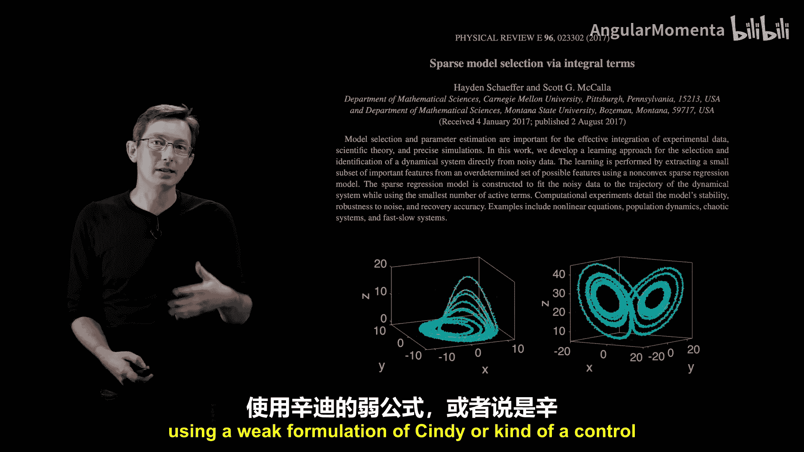

And essentially what this integral terms Cindy does is they basically just integrate up both sides so they create these kind of like a weak formulation of the CIindy problem and if you integrate up both sides you can account for a lot more noise because you're kind of averaging out the noise over many。

 many samples this is really just a very cartoony picture of what they're doing I'll show you a better picture in a minute but this right off the bat has allowed researchers to handle much。

 much larger amounts of noise in their system。

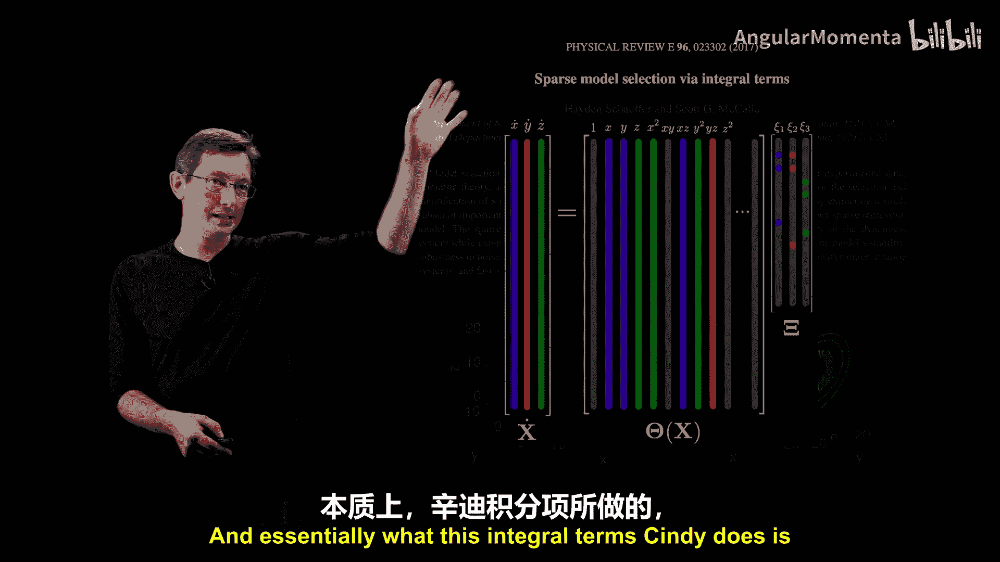

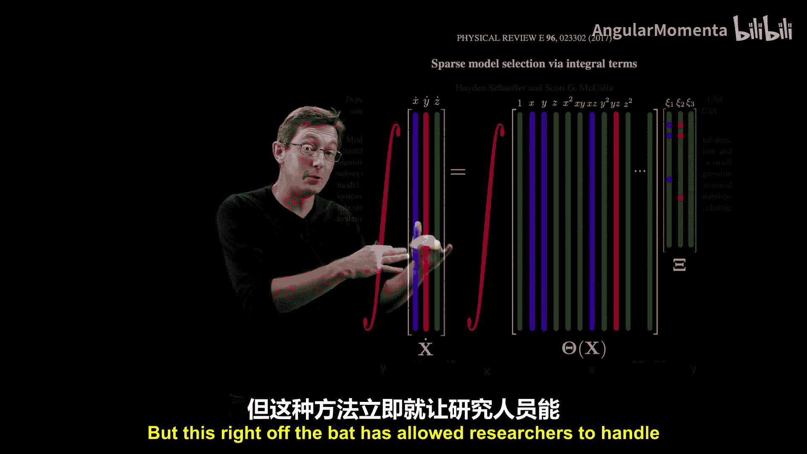

And there have been a lot of papers since then that have applied this to modeling noisy data as partial differential equations to discover new partial differential equations to describe noisy data。

 and so here are five papers that have made a big impact kind of on me reading them。

 and I'm going to show you a few of them。So a lot of this is by Roman Gregorevv's group at Georgia Tech。

And this is kind of the picture I want to show where maybe they have some spatial temporal data。

 either from a simulation or from an experiment of a fluid flow or a plasma or an electroconvective system。

 some kind of rich multiscale physics problem。And essentially what they're going to do is they're going to integrate over a little control volume。

 that noisy data。And then they're going to use that control volume integrated representation for the PDE find。

 and that allows them to handle much， much higher amounts of noise。

 like what you would get in an experiment and still identify accurate PDE models for these dynamics。

In other work by this group， they have shown actually that by kind of tuning the sparsity。

 how many terms you keep versus how many terms you throw away。

You can get a whole family of models from naviier stokes to models that actually have more terms than naviier Stokes and have better accuracy。

 or in this case， if you want to tone back the model accuracy。

 you can go and relax it to something like the Euler which is a little bit more simplified and that's kind of the exact philosophy that we want in this Cindy modeling is that if you apply this to a new system like some plasma system or a fusion system。

 we want to be able to get a hierarchy of models from you know less complex or more complex or in this kind of Goldilocks zone so you want to be able to flexibly choose models that are a little bit simpler and less accurate or a little bit more complicated and more accurate that's important to get this kind of Paredo family of candidate models。

And I think this is a really nice example of that。And then there's this great work by Alvez and Fuusa where they essentially took data from plasma systems。

 this is essentially kinetic models of plasmas， and they derived using this weak formulation of Cindy to discover a partial differential equation。

 they discovered different kind of coar-grained PDE models of this plasma system and they applied it to multiple different types of systems to identify canonical instability dynamics。

 magnetized shock dynamics， I really think this is pretty impressive so five years ago when we came out with the Cindy algorithm。

 we had no idea that you would be able to identify brand new PDEs that hadn't been written down before from noisy kind of experimental or numerical measurements and these innovations in recent years have really opened the door to using these for scientific discovery。

😊。

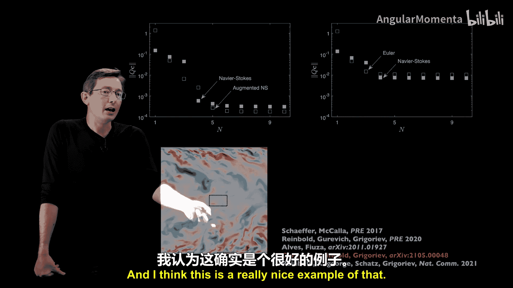

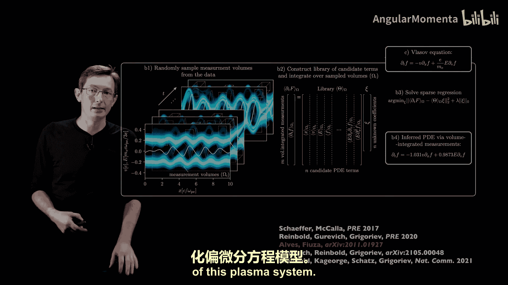

For really complex systems where we don't know the answer。

 so that's super cool and that's a really exciting area of active research in the community。

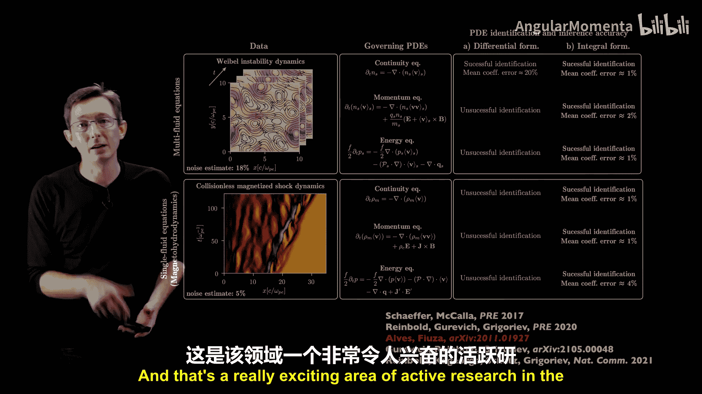

Okay， good。 Yeah。 So a couple other things I want to talk about about the data。 Remember。

 this is the big problem we're trying to solve。 It's essentially a regression problem。 We have。

 you know， some output variables we're trying to fit。

 and we're trying to find some combination of features in theta that describe X dot。

 And we want to have the sparsest column vectors in C。

 Those tell me what terms are active in my dynamics。

 All of the non-zero entries in these C vectors correspond to columns of theta that are needed to describe dynamics in X dot。

😊，And。Every row of this equation is another measurement in time。

 you can take different initial conditions and stack them on top of each other， that's totally fine。

 I can take 20 initial conditions and integrate all of them for a short time and stack those trajectories on top of each other。

 totally fine。嗯。But to get the right sparse coefficients in C。

 this theta matrix has to be well conditioned。 It has to have a good condition number。

 okay and essentially the way that we get well-coned theta matrices is by adding more data that excites more transients in the dynamical system that gives us more examples of data points that could disambiguate which terms are active in the dynamics。

 and I want to give you an example of what I mean by this。

 it's a little bit of an abstract statement what I'm saying I want to make it concrete with an example。

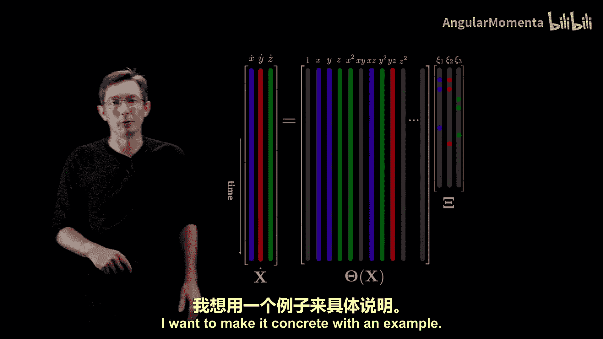

So。How do we disambiguate multiple consistent models。

 Imagine I measure a dynamical system that's on an attractor。 It's just moving around in a circle。

 It's an oscillator。 Something's oscillating back and forth and in the X and Y coordinates。

 my data is just going around in this circle。Well， the simplest sparse model that describes this behavior is a simple linear oscillator x dot equals omega y。

 y dot equals minus omega x， it describes the data perfectly and it's sparse， it only has two terms。

But there are other perfectly valid models that could describe this data， for example。

 I could have this cubic hop normal form， which would also describe limit cycle behavior。

And so the only way that I can tell which of these models is actually valid and true for my data is by collecting more initial conditions that are off of the attractor to see what the behavior is if I collect more initial conditions and they're still going around in perfect circles。

 I know I have a linear oscillator but if I collect more initial conditions and I see them all shrink wrapping onto this blue circle then I know it' something more like this cubic hop normal form and so that's what I mean if I go back to this this picture here。

😊。

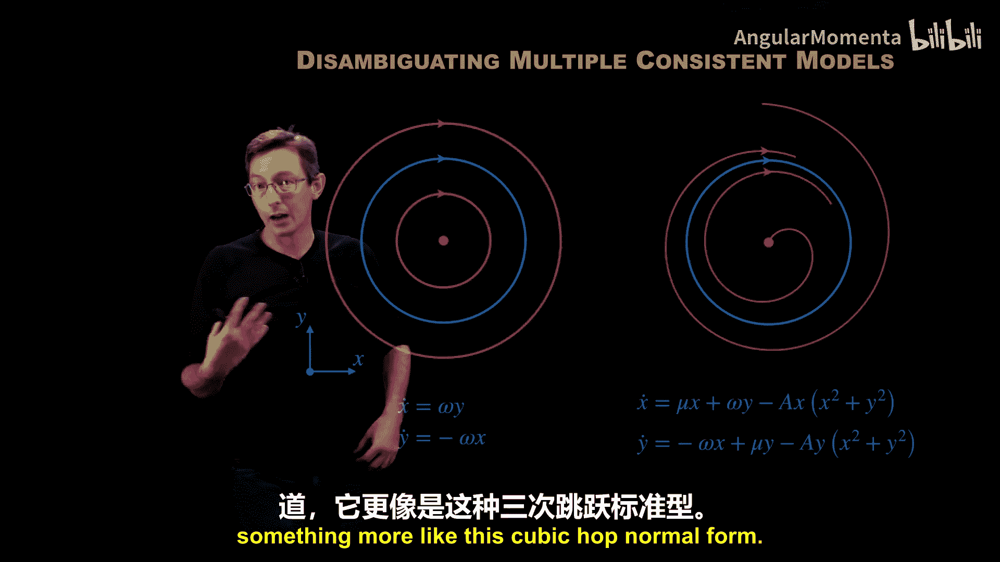

I would have to do those additional experiments and collect those additional trajectories or transients before this theta matrix will have a good enough condition number that I can accurately solve for the true underlying dynamics of my system and in fact。

 on that blue circle my cubic terms and my linear terms are basically completely parallel This has a you terrible condition number and I can't tell those terms apart。

 so you really do need to excite additional transients to get a better condition number。😊。

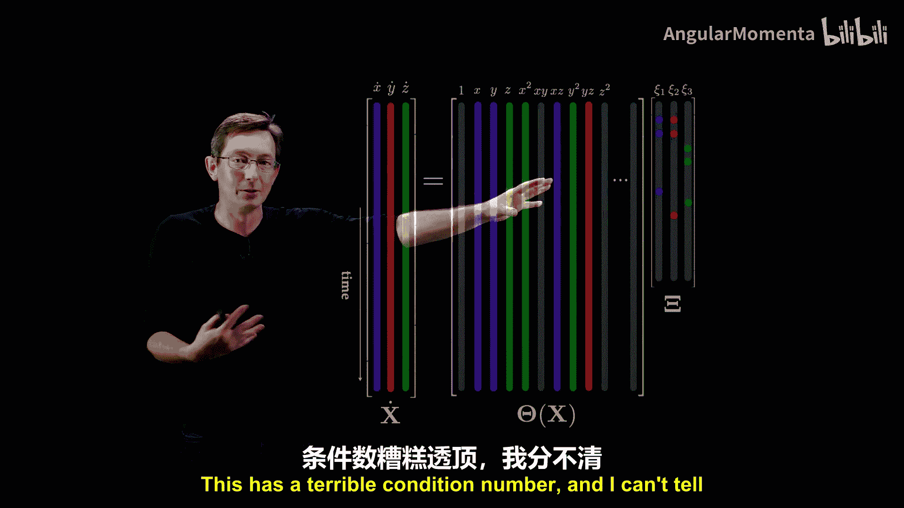

Now we see the exact same thing in our partial differential equation modeling。

 This is from Sam Rudy's paper where if I take something like a traveling wave。

 I just have a single solidlit time that's traveling from left to right there are multiple partial differential equations that can give me traveling wave phenomena。

 I could have this simple onedisal linear wave equation or I could have thisline wave equation with aline velocity and you know cubic derivative here and the only way I could tell the difference is by measuring two waves with different amplitudes and observing that they travel at different speeds again。

 if I have a library with all of these terms in it and I just have one traveling wave with a constant velocity I can't disambiguate whether or not it's a simple traveling wave or a more complex a more complicated PDDE so I need additional data。

 additional initial conditions with different amplitudes。😊。

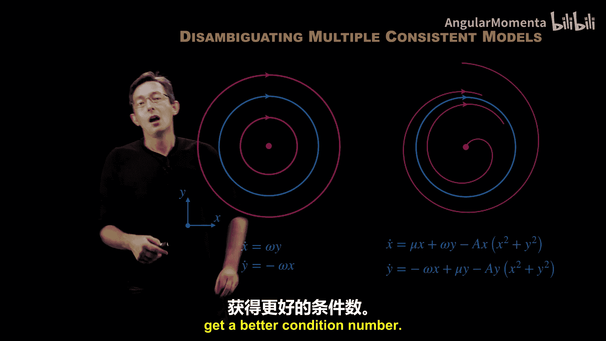

It would excite those different nonlinear terms Okay。

 that is super important oftentimes in experiments， you know。

 we get to design our experiments to excite different regions of parameter space or phase space and that's super critical here when you're developing these CID models。

😊。

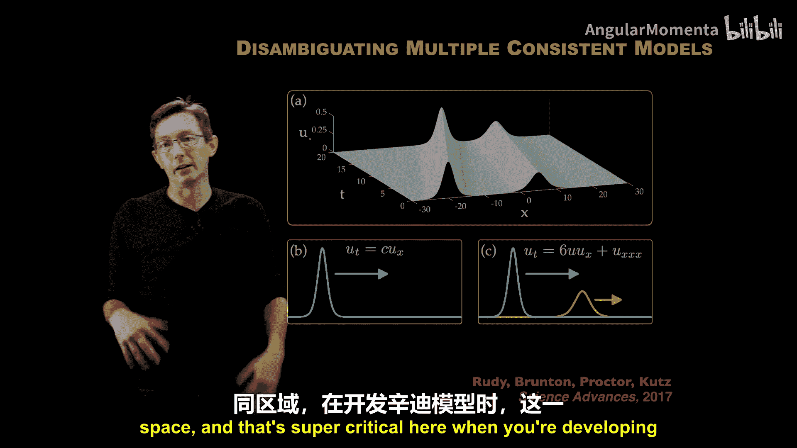

Okay， good。So we're talking specifically today about this first challenge of the data， how much data。

 what quality， what quantity， what sampling rate， I hope you know you have a lot of cool ideas now and some paper trail to go look up you know the exact details of how to do this for your system and in the next lectures we're going to talk about you know what variables to measure。

 how do you know if you're even measuring the right thing in the first place。

 how to build your library to get the dynamics and what optimization algorithms to use okay all of this is coming up soon。

 thank you。

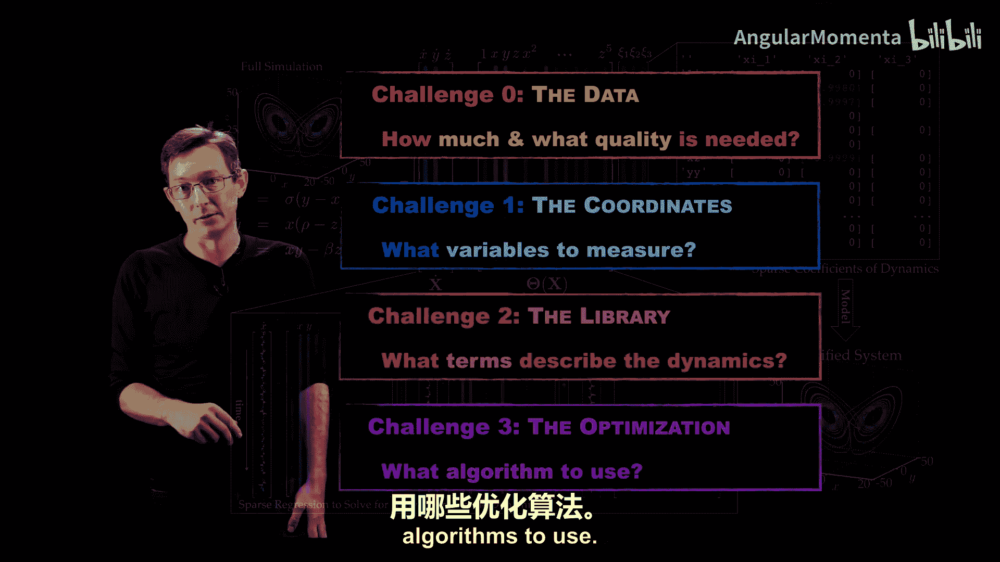

🎼。