# 【精译】物理信息机器学习-p12-12-稀疏非线性动力学模型与SINDy，第三部分：简约模型的有效坐标--BV1c9uDzQEj8_p12-

🎼。Welcome back。Okay， we're talking about the Cindy algorithm。

 which allows us to discover sparse nonlinearar models from time series data。

 and specifically we've gone through kind of the overview of the Cindi algorithm and we've identified four key challenges that I'm talking about in this video series。

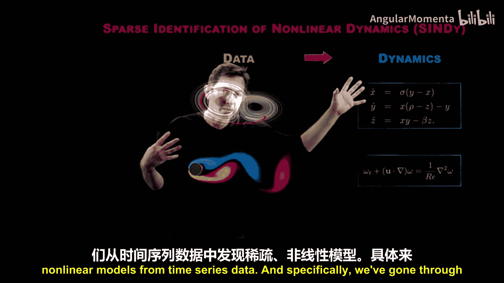

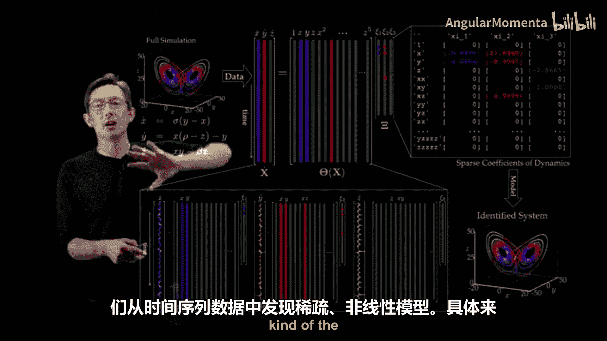

So we've already talked about the challenge of the data， how much data， what quality。

 what quantity and so on， and today we're going to zoom in specifically to this question of the coordinates。

 what variables should we measure in this indi algorithm？

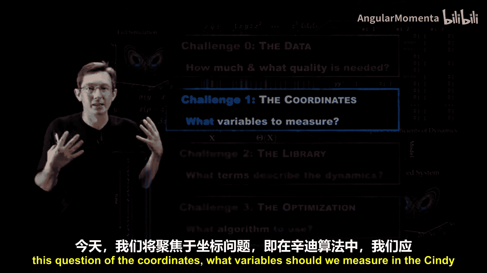

So I want to go back to this picture here because I think this really illustrates the idea。

This is the overview schematic we use to illustrate Cindy for the first time where you assume that you have data from a complex system like the larens model。

 and you measure that data in the variables X， Y， and Z you compute the derivatives。

 you build a library and you find the fewest candidate terms in this library that are needed to describe x dot y dot and Z dot。

 so these are terms in the dynamical system。But there is a huge assumption here that we usually gloss over。

 at least when we wrote the first paper five years ago， we kind of glossed over this big issue of。

How did we know that X， Y， and z were the right variables to measure？

That's a huge amount of upfront knowledge about your system that X。

 Y and z are the right systems to measure for the Laent system。

 What if someone gave me this data and it was rotated a little bit or distorted a little bit in those coordinates。

 I might not get a sparse nonlinear representation。

 I might need a dense representation with a little bit of all of these terms in it okay。And。

So that's a key question is how do we even know what the right variables are to measure in the first place？

Now， in lots of cases as kind of an expert scientist or engineer。

We know something about our system of interest， so I highly recommend using Cindy as a tool for guided model discovery。

 It's not purely automatic。 you don't just turn the crank and get models out you're the expert。

 you know what your data is telling you， you know what kinds of models you think you might want to get out of this system and you might have an idea of what variables you're measuring what the units are if they're physical if you think that there would be relationships So oftentimes you can get a good sense of if you're in the right coordinate system or not kind of as an expert researcher。

But there might be cases where we really don't know， so for example。

 if we're measuring the brain and we want to get a Cdy model for patterns in the brain or we're measuring the spread of a disease on a continent。

 how do we know if we're measuring the right variables。

 how do we know if those are the variables that admit a sparse representation in this model space？

And so that's the kind of question we're going to talk about today， okay？

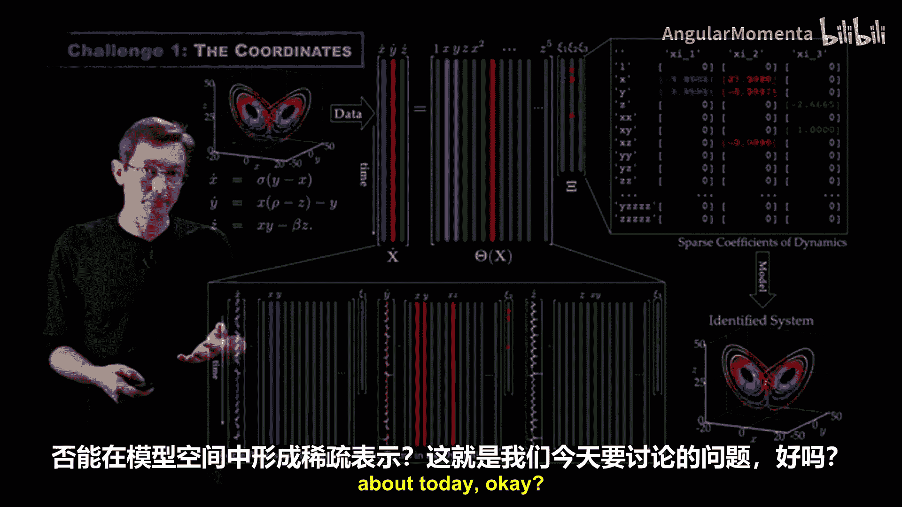

Now， if I have a high dimensional system like a fluid flow。

 I already showed you that you can discover a partial differential equation that describes this。

 the naer Stokes equations。 That's fine。 But what if I want an ordinary differential equation。

 something I can do kind of O D E analysis on， and I'll point out。

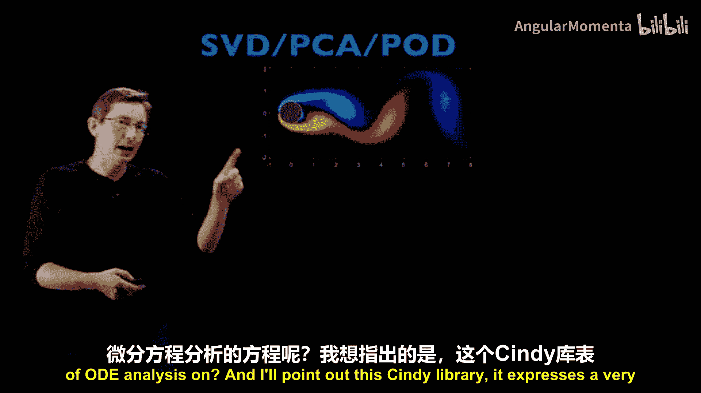

This Cindy library。It expresses a very large space of possible models。 So， for example。

 in this set of polynomials in X， Y， and Z up to fifth order。

 I think that there are 81 terms in this， this library。

 which means there are 81 coefficients in each of the columns of Cai。

And that means that there are many possible model structures that could be encoded。 so for example。

 if I wanted a model that had exactly two terms， two of these column vectors of theta。

 I would have 81 choose two possible models with two terms active if I had three terms in the dynamics I would have 81 choose3 and this gets really big really fast so this encodes a tremendous amount of possible model structures。

If we define sparsity。As models that have 10 or less terms from theta， then there are 81。

 choose 10 plus 81 choose 9 dot dot dot possible models that's more than a quadrillion models。

 and that's part of the power of the Cindi algorithm is that it allows you to very efficiently kind of through sparse optimization find out of that huge space of a quadrillion models the right structure that actually describes your dynamics。

But there's a catch。 So the space of possible models of different structures is huge。

But this library itself actually scales really poorly with the dimension of the state vector X， Y。

 and Z。 So I'll talk about that library scaling issue in the next lecture on the library。

 but it's something I want you to have in the back of your mind now because we can't build a library with 100 variables up to fifth order that would be way too big the library itself would be too big。

😊。

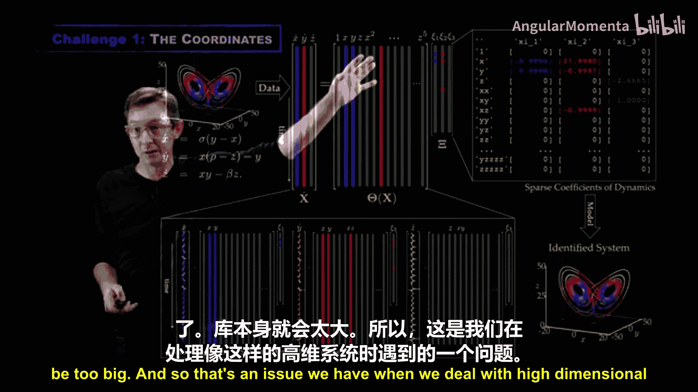

And so that's an issue we have when we deal with highdial systems like this。

 when I simulate this fluid flow on my computer， I simulate this as a discretized system of ordinary differential equations with maybe 10 or 100。

000 degrees of freedom， depending on the discretization。But。

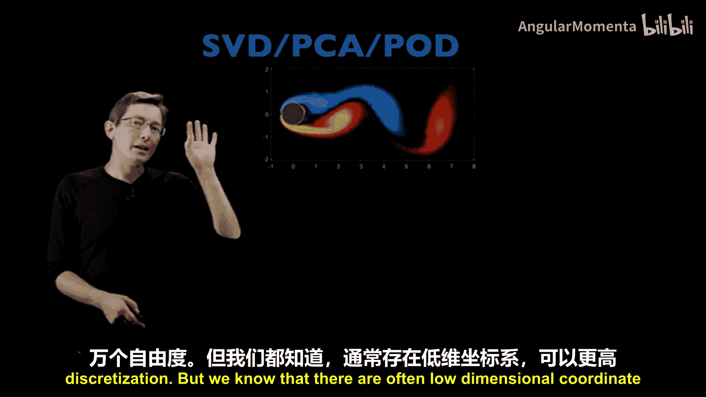

We know that there are often low dimensional coordinate systems where you can describe this data more efficiently。

 so even though this requires 10 or 100，000 degrees of freedom to simulate in my computer。

We know that there are these low dimensional patterns that describe most of the behavior here。

 and if I write the dynamics in this coordinate system in terms of these three modes。

 the amplitudes of those modes admit a very simple differential equation。

And so that's one way to handle getting the right coordinates for Cindy is if I have a spatial temporal system like a fluid flow or a plasma flow or something like that。

I can often take the singular value decomposition， also known as principal components analysis or proper orthogonal decomposition to get a low dimensional basis in which I can represent those dynamics in the amplitudes of these three modes。

 X， Y and Z， those are the amplitudes。 That's generally a very good coordinate system for representing my dynamics。

So if you don't know anything else about the system， but it's high dimensional。

 the first thing you might want to try is taking the SVD。

 the singular value decomposition to get a low dimensional basis where you can build an efficient library and start to identify models。

And when we do that for you the flow past a cylinder， for this example here。

 we can build our model library in those three variables， it's still tractable。

 this library is not too big to work with。

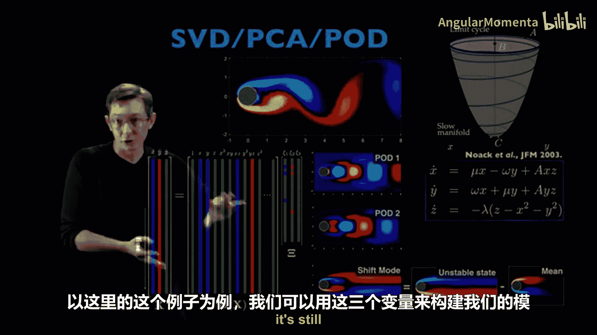

And we can identify a model that has the right structure and the right dynamics in this coordinate system so that's just a general good idea if you have high dimensional spatial temporal data。

 first try taking the SVD， see if that gives you a good coordinate system where you can build models。

And we have a lot of theoretical basis for why we think this might be a good idea in fluid mechanics in plasma physics in lots of spatial。

 temporal systems。Because the singular value decomposition。

Is an orthogonal basis that is kind of optimally tailored to your particular data to represent it as well as possible with as few degrees of freedom as possible。

 that's good for our modeling。And we also know that if I take this expansion。

 this galeran expansion and I plug it into the governing naer Stokes equations。

 when I expand that out， I get a nonlinear ordinary differential equation in terms of the amplitudes of these modes。

 and so it gives us some hope that there is a differential equation that describes this evolution that we can discover using this Cindi algorithm long story short。

 try the SVD。 it really works in a lot of cases， especially fluids， works like a charm。

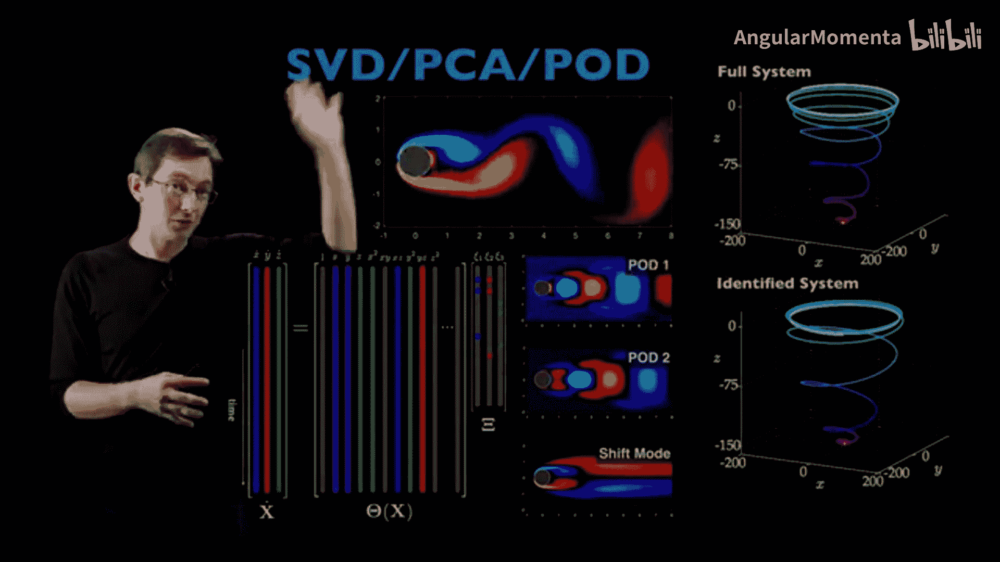

Now。The S VD， the singular value decomposition can be thought of in kind of modern neural network language as a shallow linear autoencoder。

 It essentially can be built as a neural network with a high dimensional input and output and a single low dimensional latent layer given by this Z variable where your network loss function is trying to minimize the error between input and output。

 knowing that your choking down to only a few degrees of freedom and then lifting again。So。Caat。

 you never actually want to compute the SVD this way。

 but you can think of the SVD as a shallow linear auto encoder。

Which means that if your SD coordinates aren't quite cutting it for you。

 if they're not quite good enough for building Cindi models。

 you could generalize this into a deep nonlinear autoencoder。

 So instead of just a single hidden layer， this deep auto encoder has many。

 many later layers for the encoder and many layers for the decor and it also has nonlinear activation functions。

 So what this allows you to do。Is instead of building a orthogonal subspace， a linear subspace。

 the deep auto encoder is designing a nonlinear manifold that's parameterized by Z。

And oftentimes that allows us to massively reduce the number of degrees of freedom required to describe these dynamics。

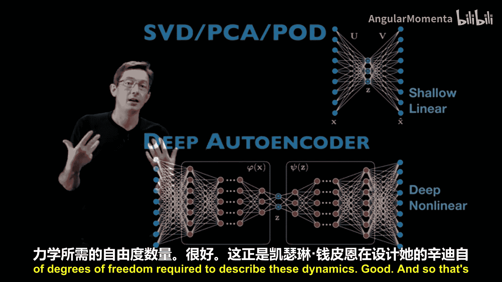

Good。And so that's exactly the strategy that Kathleen Cha took in designing her Cindy auto Encor framework。

So I think this is one of my favorite papers that came out of the lab。

 this is work with Kathleen Champion， who is a PhD student with Nathan Ktzzen me， Bethany Lush。

 who is a postdoc with us， Nathan and myself。And essentially， what Kathleen did here。

Is combine the power of an auto encoder to learn good coordinate systems with a sparse nonlinear model in the latent space Z。

So this is super cool。 Autoenrs learn good coordinate systems are manifold to describe your data。

 and you can add additional constraints in the loss function of this neural network training so that the dynamics on that latent layer are sparse nonlinear models in these kind of CinD framework。

 So essentially there are these additional loss terms that allow us to train this model to find good coordinates and CinD models。

😊，And I'll talk about this again in the next lecture on the library， but I want to allude to it here。

 which is oftentimes polynomials are not the right。Terms to describe your dynamics。

 maybe you have signs and cosines or beels functions or some exotic nonlinearity。Well。

 oftentimes by applying the right coordinate transformation。

 you can transform your system into a coordinate system where polynomials are a better library to model your dynamics。

 this is very closely related to normal form theory from classical dynamical systems which essentially says that through subsequent coordinate transformations you can essentially kill terms and a tailor expansion and get sparse polynomial models for your dynamics so there's a lot of theoretical foundations for why this is a good idea and it's one of my absolute favorite approaches to Cindy when you really have kind of complex data。

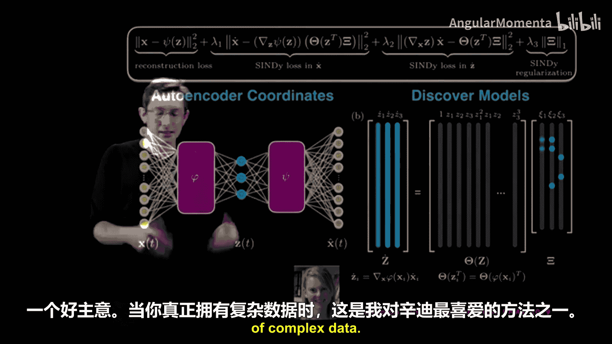

And so in this example， you could take a very complex high dimensional system， so this is， you know。

 I don't know， maybe 100 degrees of freedom in space and time series measurements of this evolving。

And through the auto encodecor， you can learn a coordinate transformation where the dynamics are sparse。

And in this case， I believe that the discovered model was actually a different sparse model。

 but if you rotated this model， you recovered the original laent system。Which is super cool。

 so up here all we had was high dimensional data and underneath it there were some Lorenian dynamics so we could learn the coordinate transformation that gave us a sparse model that was within a rotation of the true Lorenz dynamics。

😊，So I think that's pretty cool， and we'll talk more about this this later。Okay， good。

 a couple other things you can do， so I've been talking now about if you have really high dimensional measurements。

 how do you crunch those down using either linear SVD coordinates or a nonlinear auto encoder。

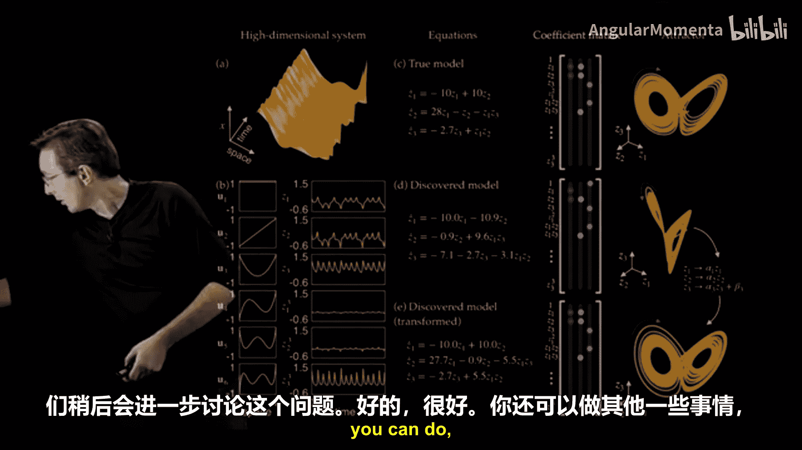

But what if you have too few measurements that's also very often the case。

 maybe I have a complex system and I have one scalar measurement or two scalar measurements。

 you know I have an electrode in the brain， what can I get from that kind of data。

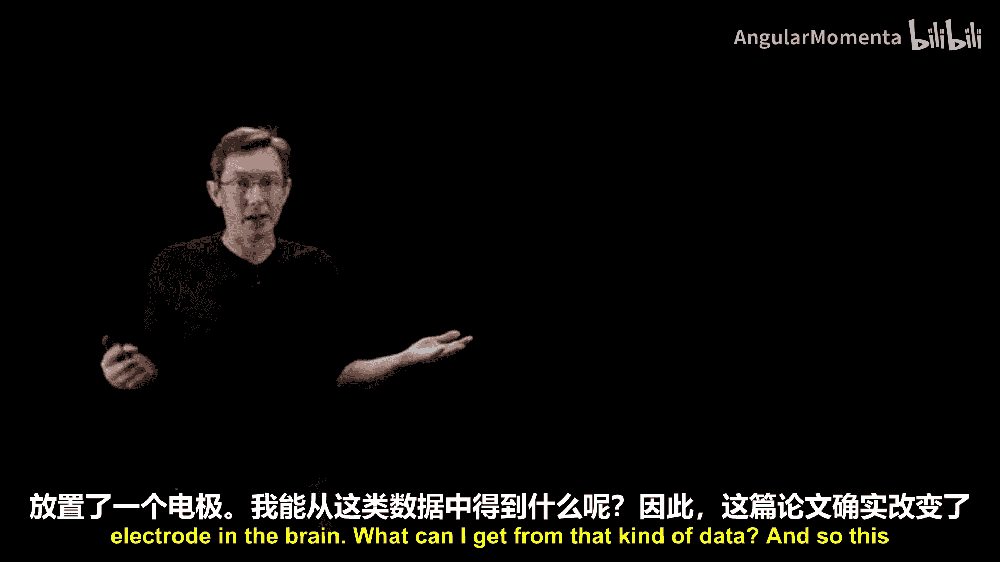

And so this paper really changed the way I think about these sparse models。

 this is work with JC Lazo and Barrett Noak。Where we were modeling fluid flow systems like the flow past this three cylinder configuration。

And we didn't want to assume that we had the full measurements of the entire velocity field everywhere。

 That's a pretty big assumption。 If I'm flying， you know， a Boeing aircraft。

 I don't have the full wake velocity measurements behind my wing。

 I might have a few pressure measurements along the wing。

 or I might be able to measure my lift and drag。And so what JC showed is that if you just had lift and drag measurements on these three cylinders and you had clean enough measurements that you could compute the derivatives。

 you can actually build very accurate CD models in those Ly and drag coordinates。

 those intrinsic coordinates， and this is kind of the lift。

 you know on the three airfoils from the simulations， the direct numerical simulations。

 that's the ground truth， and from our Cindy models in the blue dash line， almost perfect agreement。

So one of the nice things about these CID models is that because it's using regression。

 it can finds sparse models that approximate the dynamics on kind of strange variables you wouldn't think to model on likeLi and drag。

And there's a lot of associated benefits with modeling in these coordinates that I'll talk about in the video on sparse fluid modeling。

Good。

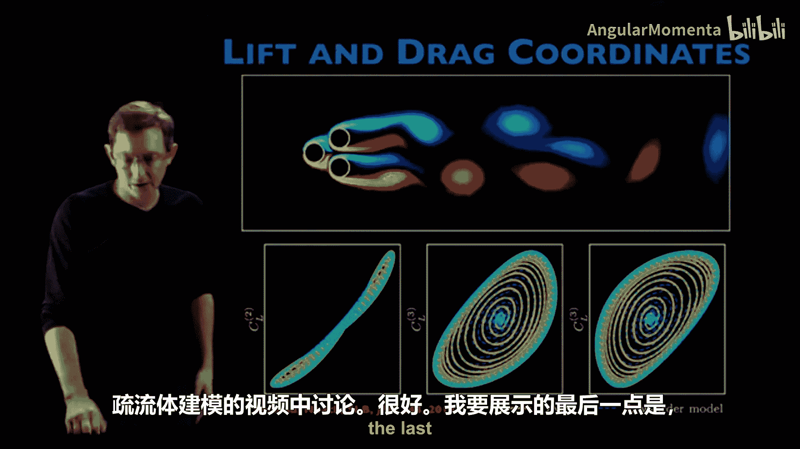

Okay， one of the last things I'll show you here is。If if you have too few measurements， again。

 if there's some variables， you're not measuring some latent states， what do you do with that。

 And this came about because of a reviewer comment in our original Cindy paper five years ago。

 we got some fantastic insightful comments from the referees。 and one of them was this。

 So in our Loent system， we assumed we had access to X， Y and Z and we could compute the derivatives。

😊，But what if we only had access to X， what if there were hidden variables。

 Y and Z just weren't available to us in this measurement， what could we do with Cindy？

And so this actually started an entire new research avenue in our collaborative groups along kind of latent dynamics and time delay coordinates。

 and it's a fascinating story。 there's a lot more to this I'm just giving you the high level sketch。

So were assuming that we're measuring a limited subset of measurements and we don't have access to the full state。

So you know we just have X measurements， what you can do under certain conditions given by the toins delay embedding for nonlinear chaotic systems or by observability for linear dynamical systems。

You can essentially build a matrix of time delayed coordinates of this scalar measurement X。

 so this is a ankle matrix where each column is an augmented vector of your state at either past or future times。

 so exit time1， time2， time 3， dot dot dot to time Q。And you can build this big matrix。

You can compute at singular value decomposition， and you can essentially discover eigen time delay coordinates or these little short time trajectories that allow you to embed this x measurement into a higher dimensional space given by these called these rows of V。

This is a classic delay embedding， this is not something we invented。

 this has been around since the 80s doing this SVD on the Hankel matrix。

But when you then try to apply Cindy to this system here， some very interesting things happen。

So you can essentially try to design a CinD model in these V coordinates and these time delay coordinates。

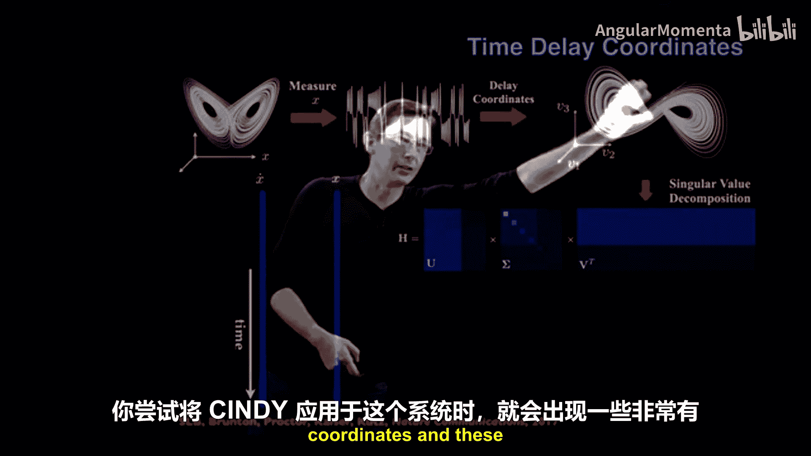

And when we find the sparseest model and we allow ourselves to have nonlinear terms and linear terms。

 we find that the sparse models tend to be linear， honest to goodness。

 linear models with no quadratic terms， no cubic terms， just linear。And this has deep connections。

 it turns out to Coopman operator theory。 we kind of discovered we stumbled on this connection that time delay coordinates essentially provide almost an optimal coordinate systems to getting a Coopman linear system。

 a sparse Coopman linear system， and we've written you know four or five follow on papers。

 exploring the structure of this， why it works， how it works。

 applying it to chaotic systems and deterministic systems and we've learned a lot。

 So I'll put some links to those papers and videos in the description。

And this model allows you to do things like predict even very chaotic dynamics， you know。

 so you can predict when you're about to switch lobes to the other side of the Lorenzo tractor and you can even color code your tractor based on when it's essentially acting like a linear system and when it's about to switch。

 things like that。So we learned about this because we were trying to handle Cindy on systems with latent variables and so it turns out that time delay coordinates plus Cindy gives you a very。

 very accurate coman linear model okay there's like a whole many papers and an hour long video on this。

 so I'm not going to dwell on this for too long just a long way of saying you can handle latent measurements oftentimes by delay embedding。

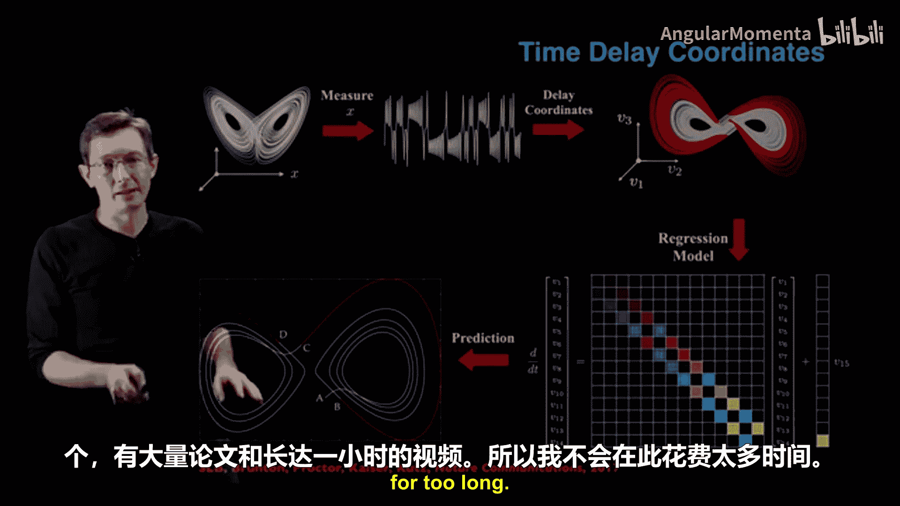

And this is actually something Kathleen Champion explored quite a bit。

 which is for non chaotic systems， you often get a perfectly closed model using those delay embedding with the Cindi regression procedure。

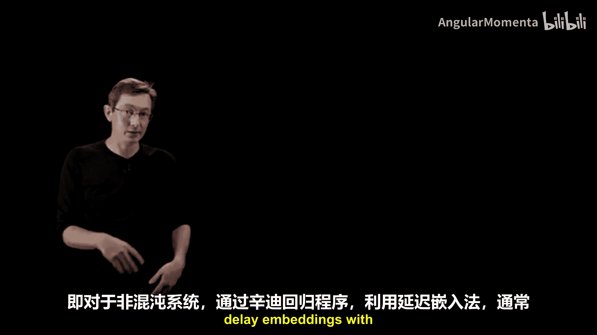

Okay， good。 so we've been talking about this kind of big Cindy overview and specifically these key challenges。

 So now we've covered challenge zero of the data， challenge one of the coordinates and in the next videos we're going to talk about the library so how do you actually build that theta matrix so it's well conditioned so that it describes the dynamics of your system so that it's not too large and what optimization algorithms do we use to actually find those sparse models in the first place Okay all coming up soon Thank you。

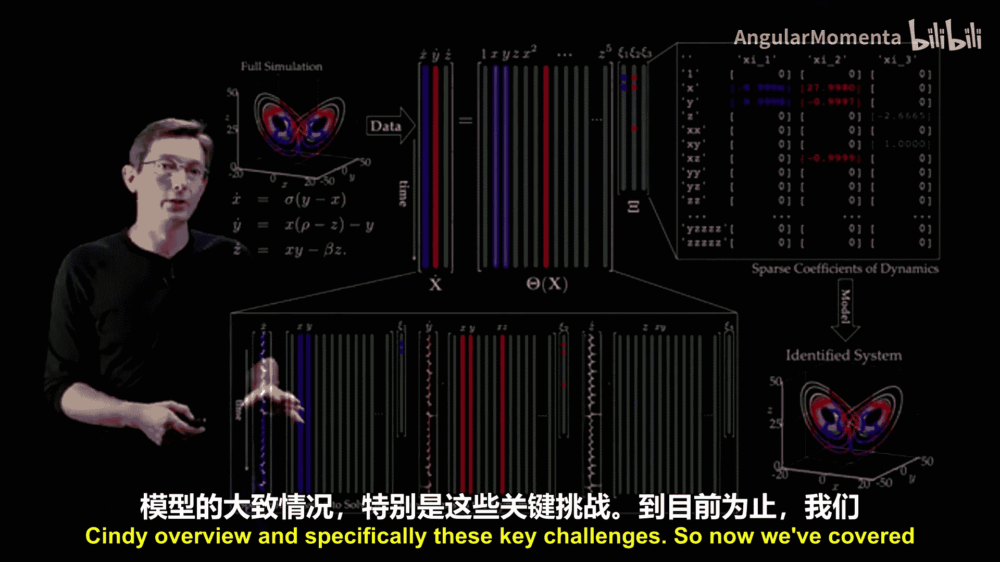

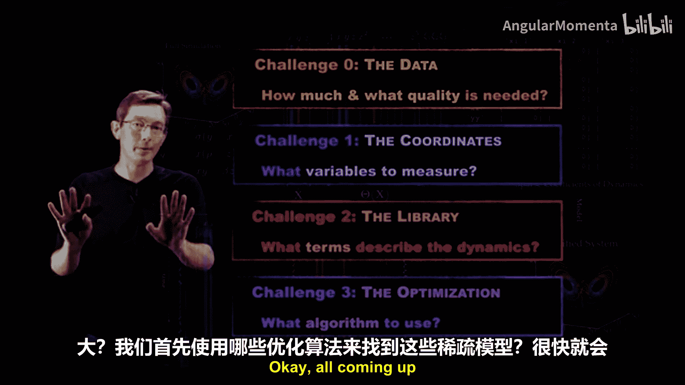