# 【精译】物理信息机器学习-p13-13-稀疏非线性动力学模型与SINDy，第4部分：候选非线性函数库--BV1c9uDzQEj8_p13-

🎼。Welcome back So if you're just now joining us， we're talking about the sparse identification ofline dynamics or Cindy algorithm。

 and this is a part of a multi video series on how to use Cindy for scientific discovery in a number of fields of interest。

So the high level goal of Cindi is to take time series data from some complex system and extract interpretable。

 generalizable dynamical systems models that describe that data and are as simple as possible。

 have as few terms in the dynamics as possible， and this can either be in the form of an ordinary differential equation or a partial differential equation。

And so we've been talking about kind of what are the key challenges of Cindi。

 so you know we've already described the overview of how this goes where you collect measurement data and approximate the time derivatives of that data。

 you build a library of candidate terms that could describe those dynamics。

 things like you know linear terms， quadratic terms， maybe signs and cosines。

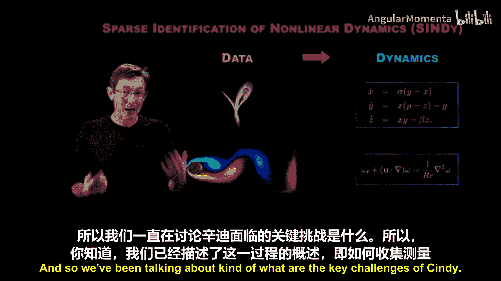

And then you apply sparse regression to try to select the fewest terms in this theta library that are needed to describe x dot。

 and those terms are the sparse entries of the columns of this C matrix。

 so each column of C the first column tells which terms are active in the x dynamics。

 which terms are active in the Y dot dynamics or the second column in the third column describes what terms are active in the z dot dynamics。

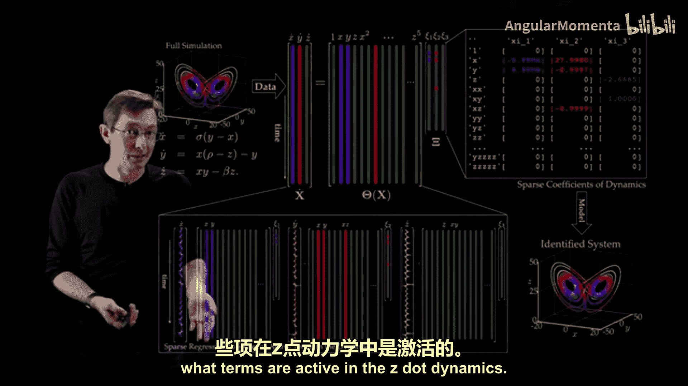

And so we've been going through these kind of canonical challenges because I want to make sure that everyone who watches this is kind of armed with the state of the art for how to build CD models for your problem of interest we've talked about the data。

 what type of data you need， the coordinates， how do you know what variables or good variables to measure and today we're going to zoom into this issue of the library。

 how do you build that theta matrix so that you have a good chance of getting a sparse model that describes your dynamical system。

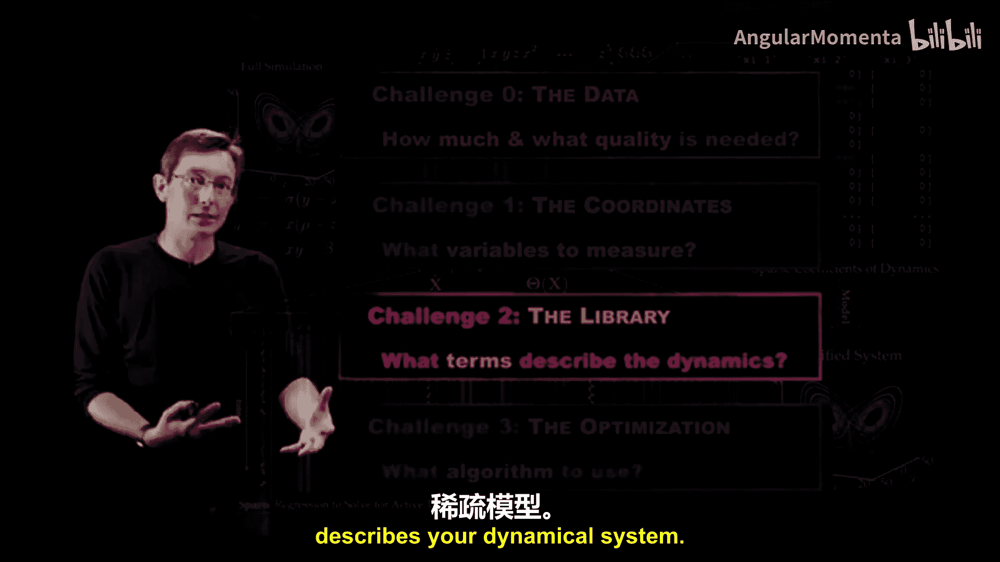

Okay， good， so again in this big picture here we're going to zoom into this theta matrix here。

 how do I build a theta matrix of candidate terms that I have some hope of representing these dynamics sparsely in？

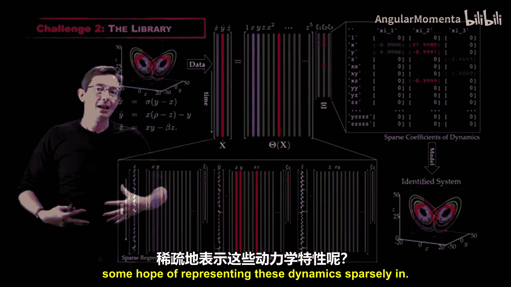

Okay， so at the end of the day， Cindy is a generalized linear regression problem where we're trying to find a sparse combination of columns of theta to describe the time derivative of my measurement data。

And so a lot of effort goes into building this theta matrix。

 and this is where you have a lot of creative freedom to design new theta matrices that have properties that you think your system might exhibit and I'll give you some examples。

😊，I work in fluid mechanics often， and in fluid systems。

 we know that the navier stokes equations are quadratic， they're quadratic。

 they have a quadratic nonlinearity because of the convection term。

And so it's very common for us to get low dimensional models of fluids that are of the form linear plus quadratic。

So when I model fluid systems， I often start by adding linear and quadratic terms to my models。

Sometimes we add higher order terms， cubs， cortex， quinttics。

 and so on and so forth to model kind of low energy。

Fluid phenomena that we have truncated or are not modeling。

 but we want to account for them in the structures that we are modeling。 So long story short。

 polynomials are a good choice of theta for my fluid systems。In general。

 if you start with a new system， here's what I recommend you try first try just linear terms。

 compute a dynamic mode decomposition model， see how accurate it is in reconstructing Xdot。

 see how accurate it is for you forecasting， take that model integrated into the future and see if it's at all reasonable and accurate。

 if it's accurate and it works， good， you get to go home early。

 you have a good model in terms of linear dynamics。If it doesn't give you a good model fit， though。

 if X dot is not well fit or your dynamics do not predict well into the future。

 try adding quadratic terms if the linear plus quadratic terms work good。

 you go home slightly less early。And then if that doesn't work。

 you add cubic terms and so on and so forth， you add complexity until something clicks into place and it works。

 I wouldn't recommend starting with a fifth order polynomial basis because that might be too complicated。

 so I would start small with linear then linear plus quadratic and then add and add and add until until something works。

Now for some systems we know that polynomials are not the right basis to describe the dynamics。

 you might want trigometric functions， signs and co-sines。

 if I'm dealing with pendulo or something that I know lives on a periodic configuration space。

 I know my variables are you two pi periodic， I'm going to put in two pi periodic basis functions。嗯。

😊，Sometimes you might think of beels functions or a functions。

 The sky' is the limit to what you can add to this library。

 but I would caution you to try different isolated libraries first before you combine them。

 because you're always worried about the condition number of this matrix。

 If this matrix becomes illconed， it's very hard to solve for these sparse coefficients accurately。

 especially if you have a little bit of noise in your data。

 So we're always trying to kind of battle not making this library too large or making the columns too kind of linearly dependent。

So like a lot of times， sine of x will look a lot like a linear combination of x and x cubed and x to the fifth。

 So if you have those polynomials and a sign in the same library， this might be ill conditioned。

 something you need to look out for。Good okay so that's just very high level advice now we're going to start looking at some ways that you can extend this library to account for other physical effects。

So for example， oftentimes my dynamical system is not purely a function of the state variable。

 there might be some external forcing， some control variable， some time dependence。

 and you can incorporate all of those into this library by adding columns。

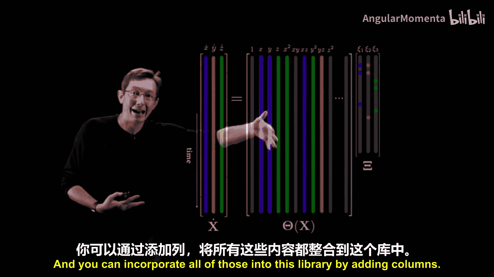

So for example， in Cindy with control， this is a paper by Erica Kaiser and U。

 essentially what you can do is you can augment your right hand side library to not just include functions of the state X。

 but also to include nonlinear functions of the control input U and cross terms。And that can really。

 really be important if you have a control system that you can kick the control and excite transientience and you need to disambiguate between the internal dynamics and the effect actuation and control。

And this is very， very much related to this idea of dynamic mode decomposition with control by Josh Proctor。

So I'll illustrate it on this very simple predator prey system where you have kind of two species。

 a predator species and a prey species。

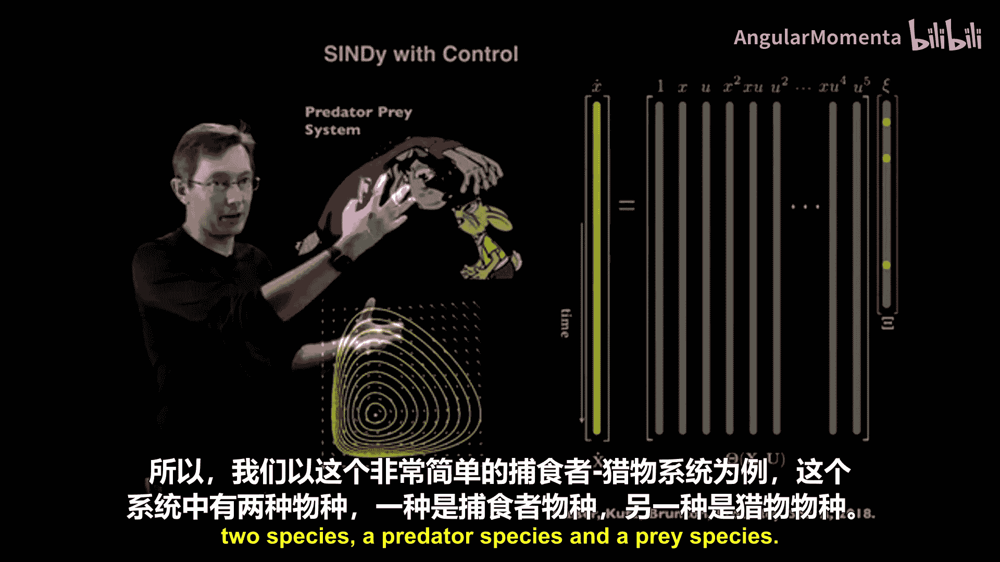

And we're going to assume that there is a natural dynamical system in terms of x1 and x2。

 the predator and the prey that's unforced。But then at some point in time at time 100。

 we're going to come in， essentially we have some control over the system。

 let's say we're trapping hairs right back in the old Appalachian days they would trap hairs for their pelts and that would change the whole dynamical system because humans were controlling or forcing the system。

So let's say that for the first 1 hundred0 years， I had one control strategy。

 I was trapping at a certain rate， and these were the observed dynamics。

 but I knew what that trapping rate was。If I just modeled a system in terms of the predator and the prey without taking into account the fact that I had this control knob I was adjusting。

Then after I changed the control policy in the next1 hundred years。

 my regular Cindy model would be completely wrong， this yellow curve。

But if I added in those columns that took into account what my control。

 my external control was doing， then my blue model almost perfectly matches kind of。

What happens in the future？So this is a way of saying that oftentimes if you're actively controlling a system。

 you have to take that into account in your Cindy library or else you'll get the wrong dynamics。

So my colleague Josh Proctor thinks about this a lot in the context of disease systems。

 you want a model for a disease system， but you can't afford to stop treating people and stop vaccinating and stop deploying bed nets and other intervention strategies and so you have to have a modeling procedure that allows you to simultaneously disambiguate the internal dynamics and the effective control without turning your control off。

 so that's what we're doing here。

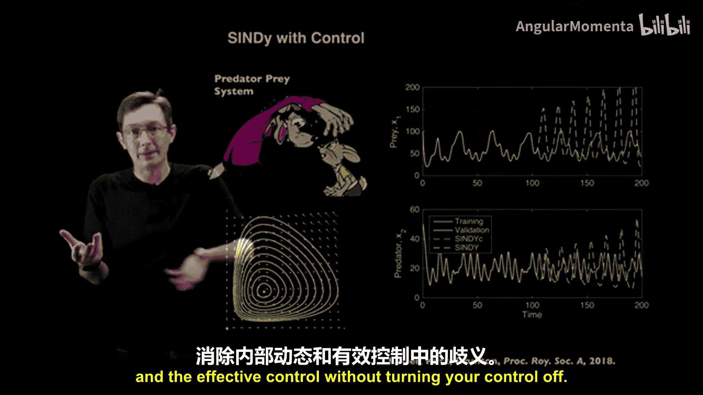

And ERika has extended this to a full modeling framework where you essentially have your unknown dynamics。

 but you can also have controllers entering。You collect data in the same way as before。

 but now we can kind of kick our controller and try different control strategies。

And we can get sparse nonlinear models for the dynamics and the effect of control。 Okay。

 so this is pretty powerful。

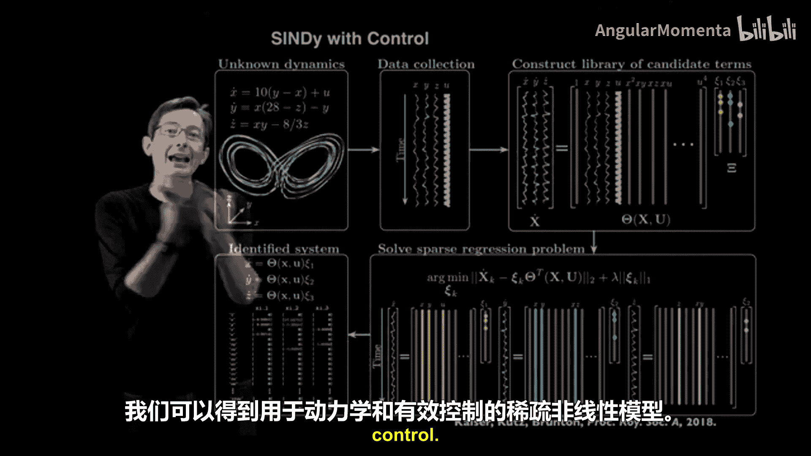

And it allows you to do things like develop model predictive controllers based on those sparse CinD models。

 so you get accurate and efficient nonlinear models that you can then use with things like model based control。

 model predictive control， reinforcement， learning control， and so on。

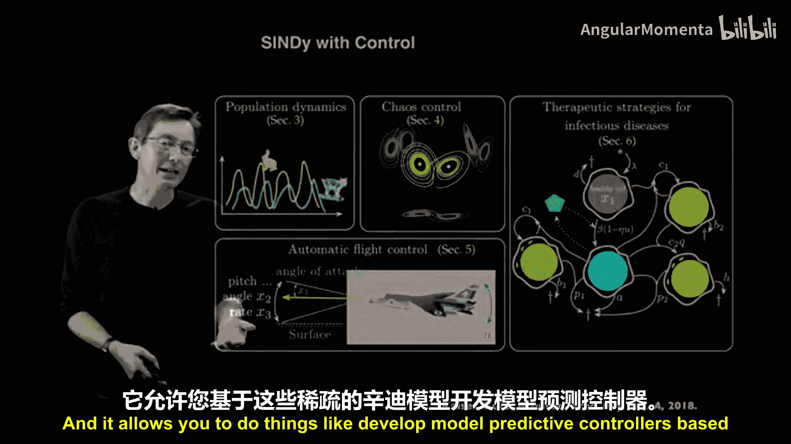

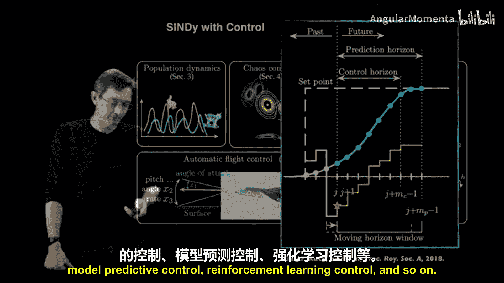

And Erika tried this on a number of systems， chaotic systems like the Lorentz attractor。

 and in comparing with neural networks， for example。

 what she found was that these Cindi models actually have a much better prediction horizon they can predict farther in the future with more noise because they've learned the actual true sparse dynamics of the system。

 they're more generalizable than neural networks are， which is useful for control。

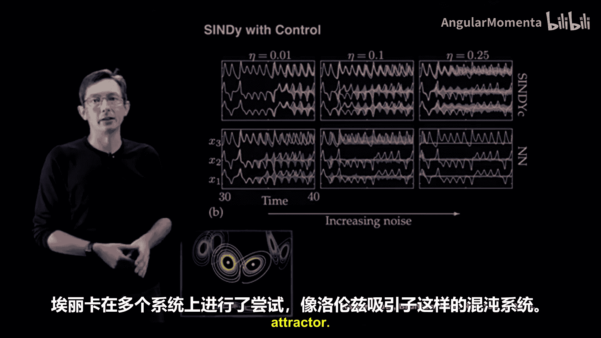

So it's a long way of saying that you can build your Cindy library to have more effects。

 you can add the effective control if you think that there's some time variation。

 you can add time columns and cross terms with time as well。

Let's say are trying to model the climate system and we want to include as a variable the amount of CO2 emissions。

 we might also want to include as a variable you know solar cycles and things like that。

 those would be additional external forcing variables that might affect the state。

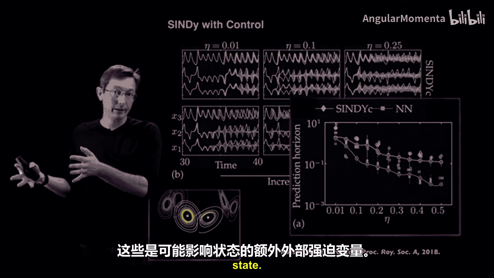

In the original paper， we actually showed that like control variables。

 you can also include parameters， bifurcation parameters or tuning parameters into the model。

So you can model discrete differential equations just as well as continuous with Cindy。

 you just take discrete time data and you model the K plus month time step as a sparse nonlinear model of the K time step。

And in this example， we took the chaotic logistic map with the bifurcation parameter mu。

 and we measured it 10 different values of the mu parameter。

And by including that mu column into the Cindy library。

 so now I can have terms that are not just x and x squared and x cubed。

 but mu and mu x and mu squared x and mu x squared， now we can learn the form of this logistic map。

Even from a few noisy measurements， and then from that learned model。

 we can fill in the bifurcation diagram with no noise at all parameter values because we learned the actual true dynamics。

And this all happens in the library， you have to know kind of based on the data I'm measuring what would I want to put in the library。

 do I have a parametric dependence， how might it enter my system， okay。

 very important questions to ask。

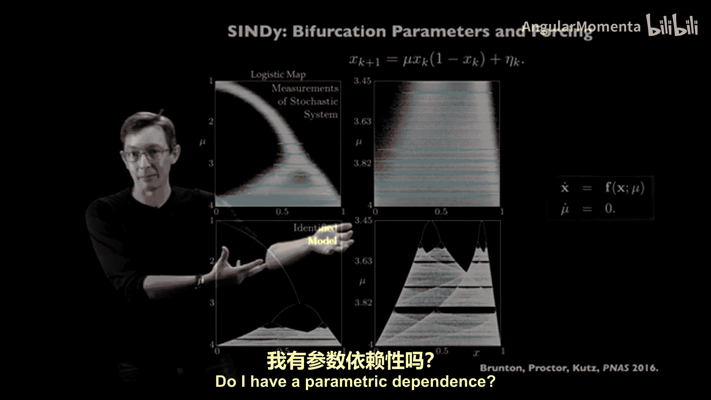

Good， okay。😊，Another big avenue of research in Cindy is trying to extend this framework to handle larger classes of dynamical systems。

So what I showed you before allows you to identify sparse models in a fixed basis like polynomial。

 signss and cosines， vessels functions， but what if you have dynamics like this that are rational functions so you have some polynomial on the top and some polynomial in the denominator and this is worked by Neil Mangan when she was a postdoc with Nathan and Josh。

And essentially， this is a very hard class of systems to model with Cindi because these rational dynamics are not easily expressable as a sparse combination of atoms or basis columns of theta。

So here's kind of a toy system we were thinking about these Michaelus mein dynamics for chemical kinetics in biological systems。

And the idea is that if you have this rational function。

 what we can do is we can multiply both sides by the denominator， we don't know what it is yet。

 but we multiply it by some hypothetical denominator and we get a system like this。

And so now we can take this dynamical system。And write it in the same way as our original Cindy problem。

 we have a library times a sparse vector equals0。And now this library has to be larger。

 it has to include not only terms that describe F， but it also has to have terms that describe F times x dots。

And so essentially what that means。

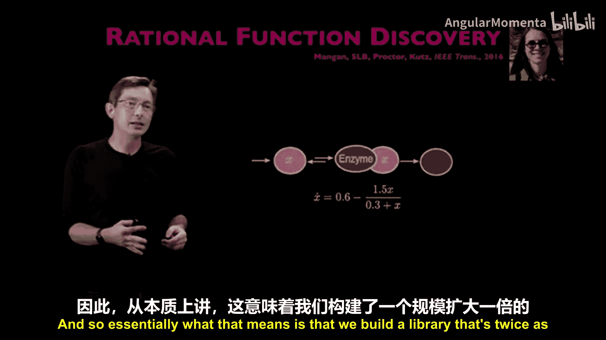

Is that we build a library that's twice as large， it has all of the library that theta would normally have。

 and then that same library times x dot and now we're trying to find the sparsest C vector that multiplies theta to equals0。

Turns out this is a horrendous optimization because the sparsee vector C that equals0 is zero。

 and that's not a very good model， is the zero model。

So what we ended up finding out in the course of this paper is that you don't just want the sparses C。

 you want the sparse to C in the null space of this library theta。

 so this library has a null space you want the sparsee linear combination of that null space that gives you this C vector and it turns out that there actually are optimizations out there within the last 10 years to solve for this。

 it's pretty ill posed because this null space explodes in rank if you add a little noise to your system。

But for noiseless data。We can learn very complicated chemical kinetic models with rational terms using this implicit Cindy approach。

 Okay， very cool idea。 We learned a ton about Cindy and the optimization in writing this paper with Neil。

😊。

And recently， one of Nathan and my PhD students careered in Cayman。

has essentially taken this implicit CinD modeling procedure and made it robust。

 so now you're not finding the sparsees vector in a null space。

 you're essentially using a much more robust algorithm to find these models so if you take that same kind of mious met dynamics here。

And you're going to multiply the denominator over。What Cardi realized is that instead of trying to write the entire implicit equation equals zero。

If you know even a single term that is definitely in your dynamics。

 you can move it over to the right hand side and now you have a regression that's not equal to zero。

 so you don't get into that null space problem。And so essentially what Cardi does is he sweeps through all of the possible terms that could be in the model。

 and he one by one moves them over and tries that model， and if that doesn't work。

 he moves another one over and tries that model and one of them is going to work and give you an accurate model that is also sparse。

So this solves a lot of problems。In the original implicit Cindy， we had a null space problem。

 very ill conditioned。By moving candidate terms over and kind of locking them in the model。

 this becomes as robust as normal Cindy， this has all of the robustness properties of normal Cindy。

 which are pretty good， you can handle moderate amounts of noise with the kind of standard Cindi algorithm。

And by testing all of these terms， you can do this in parallel and you also get some interesting consistency checks along the way so really。

 really cool paper， I highly encourage you to read this Kairin came in has done great work on this robust implicit modeling and has shown that we can model systems that we never dreamed of modeling before like this BZ chemical reaction so this is a four this is a coupled system of four partial differential equations nonline with rational terms this is about as hair as it gets in terms of things we would want to model。

😊。

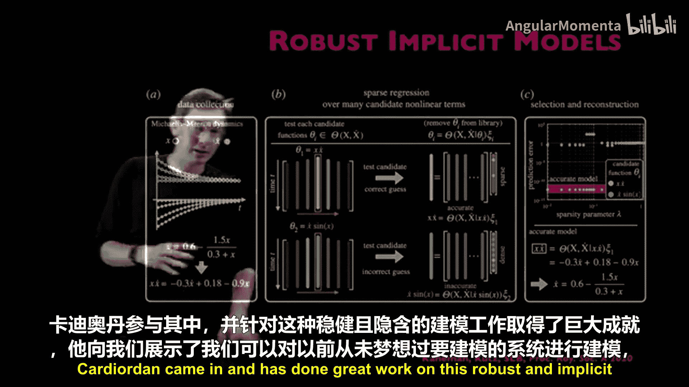

And with our original Cindy framework， we would have no shot of modeling this。

 we would need data that's way too clean， way too much of it。

 handling the rational terms would be a nightmare。But with Cardi's approach。

 essentially of you know picking at random one of these terms and moving it over and then doing the regression。

 he's able to find this very， very rich， rational， coupled partial differential equation。

 So that's super cool。 A lot of applications of this。 and this is hot off the presses。 So you know。

 I'm curious to see what people use this for in the future。😊。

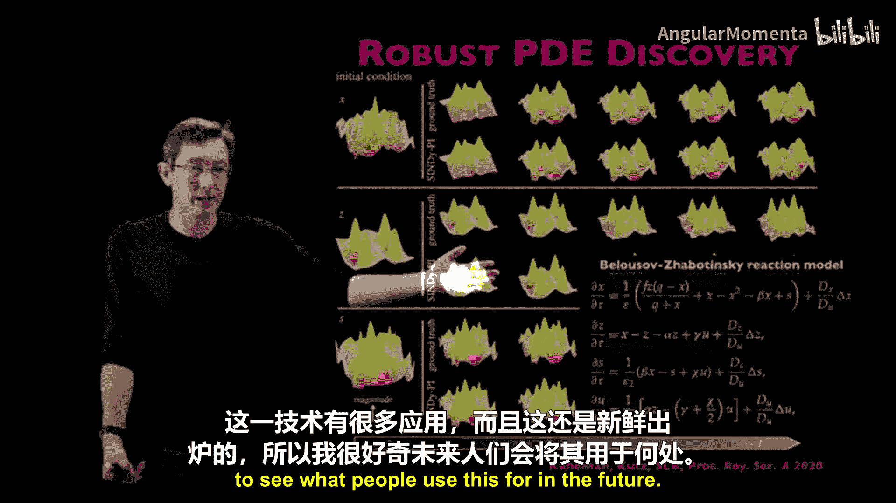

Okay， great。😊。

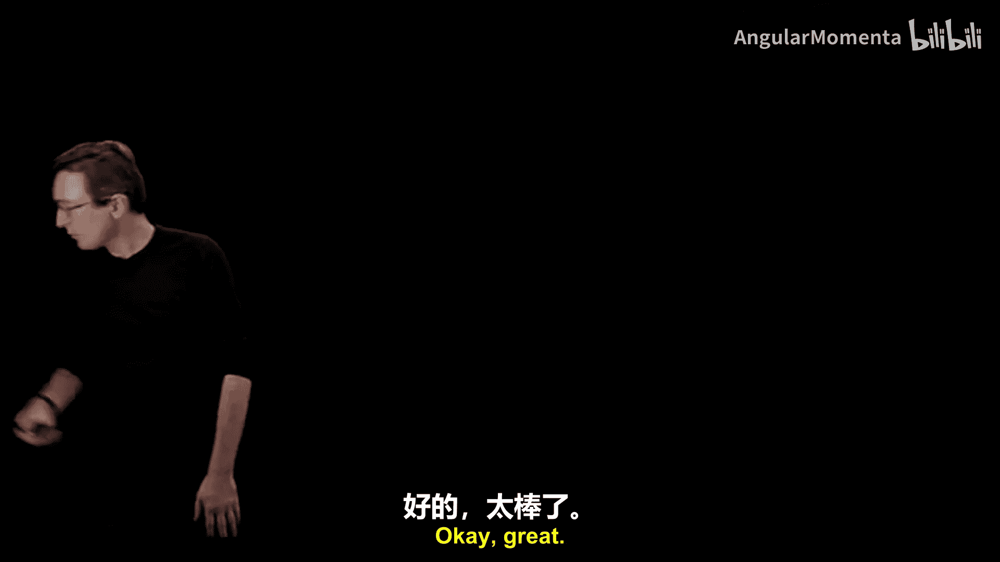

So a few other things I want to talk about in this Cindy library problem that we're talking about is the curse of dimensionality。

So we know that one of the key strengths of Cindy。iss that this library expresses many possible model structures。

 there are many millions of possible models with five or six terms out of this library that could be written down and the sparse optimization procedure with high probability searches through that vast model library to find the sparsee correct model given by the coefficients of cassit。

That's great。But there is also another kind of cursive dimensionality in how many columns this theta matrix will have。

So for three variables and fifth order polynomials， it's not that bad at something like 81 terms。

But if I had 10 variables and 10th order polynomials， this theta library would be gigantic。

 It would have， you know， hundreds of thousands。 I haven't computed。

 but probably millions of columns， and it would be far too ill conditioned to take a pseudo inverse of to do the sparse optimization on It just wouldn't work。

 Okay， And so there's a fundamental curse of dimensionality。 We want to have this library scale。

 Well， we want to basically have as few columns as possible。

 but still have the flexibility of representing a large model space。

 So these are kind of dueling or competing objectives。Good， okay。

 that's one motivation to reduce the size of your state X。 Okay。

 so if you can find some way of getting less degrees of freedom to describe your system。

 you probably would want to do that in this procedure because it's going to make your theta library scale better。

Now I've been saying a lot about the condition number of this theta matrix。

 and technically I don't exactly mean condition number。

There's actually a really interesting paper by Joel Choop in， I think 2009。

 it's one of the greatestest good papers and way in the kind of end of the paper in， I don't know。

 Theorem 9 or 11， somewhere deep down， I'll try to put it in the description。

There is a theorem about when you can expect to get exact recovery of a sparse model in a library using the Lasso regression Now we're not exactly using Lasso。

 but it's close enough for our purposes。And he introduces a kind of more powerful or generalized notion of condition number called the ERRC condition。

And it essentially is a condition number on all sparse subspaces in this matrix。

And it gives you some conditions for when you can expect exact recovery based on kind of a generalized condition number of theta。

Turns out it's a pretty hard thing to compute。 It's kind of an NP hard quantity to compute。

 but it's good as a thought experiment of what we care about in this matrix。

 We if there is a set of columns that is the true model， some sparse set of columns。

If there are other columns in this matrix that are really。

 really parallel or almost linearly dependent on those true model columns。

 this sparse identification is going to be very challenging。

 and so that's a reason to improve the condition number of this the to keep it being as small as possible because the more columns you add the more linearly dependent they are。

 and also to add more rich transient data to sample more initial conditions to improve the chances of these columns being linearly independent。

It's kind of a technical aside but very important， I think about this all the time。

 if you're serious about these models， you're going to have to think about it too。

Your true model structure， the sparse columns you care about。

 can't be nearly linearly dependent on model columns you don't care about。

 or else you're going to get the misidentification。

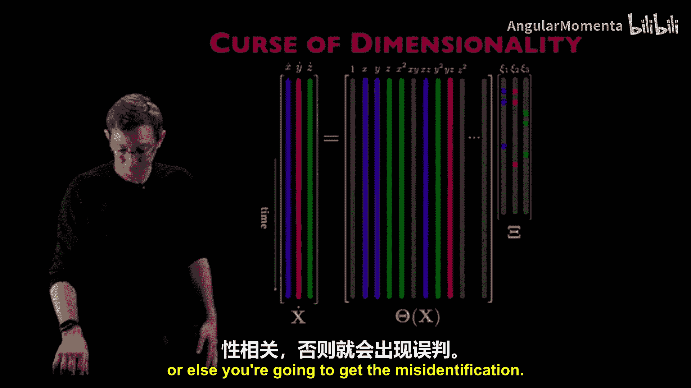

Good cursa dimensionality， so we've already talked about how one way to handle this for high dimensional data is to take the SVD。

 the principal components of that data to try to crunch it down to a smaller feature set that will keep your theta library smaller a deep autoencor network is kind of like that on steroids where you can essentially you take very high dimensional data and find as few variables that you think are dynamic as possible。

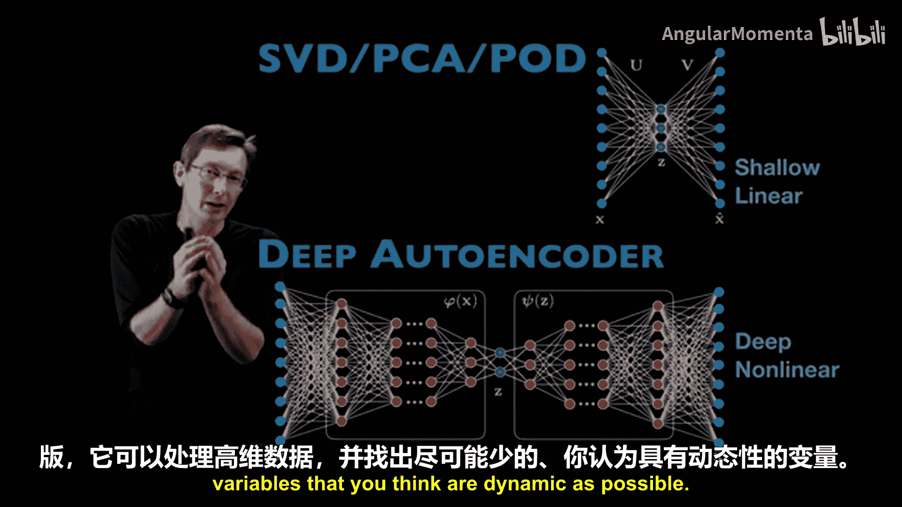

Another approach that I think is really cool is this paper that came out。

 I guess a couple of years ago by our German colleagues。

 where essentially what they do is they generalize the Cindy library approach to now include tenser train formulations for those right- hand side dynamics。

So instead of our generalized linear model， x dot equals theta x times c。

 where theta is just a set of columns， they essentially can kind of compress that into a tensorial representation using these tensor trains and allow for much。

 much larger kind of polynomial representations with still being a very compact model getting away from some of these ill conditioning issues and cursive dimensionality。

I'm not going to go into too many details， there's a lot to unpack here。

 I highly recommend you read this paper， it's fantastic and it solves one of the most important problems of Cindy。

 which is the cursive dimensionality。And they show that with their kind of。Tensertrain basis。

 they identify the correct dynamical system， whereas if you use our simple， generalized linear model。

 sometimes you incorrectly identify only a portion of the dynamics。 so very important paper。

 it kind of addresses that cursive dimensionality。

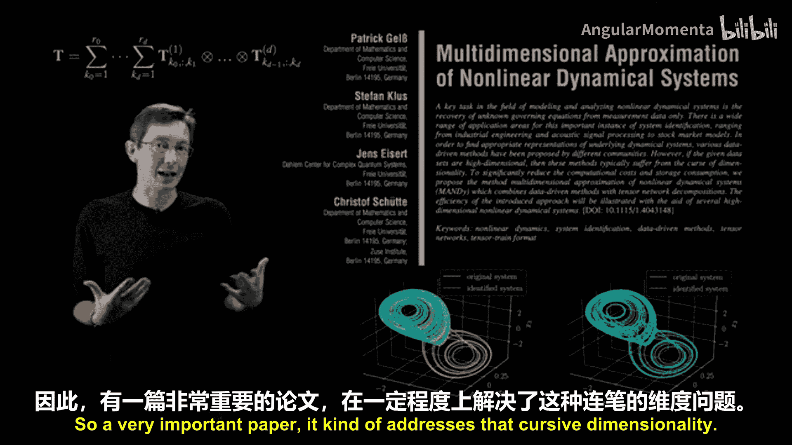

And one of the last things I want to tell you about is another way of kind of。Handling that library。

 there's a couple cool things about the library I want to tell you about。

You can also bake in some prior knowledge of the physics into that data library If I know that I have a symmetric system。

 you can build your library elements to reflect that symmetry。

 whether it's an odd symmetry or you know two pi periodic symmetry or something like that you can sometimes bake that into the library so here I'm going to show you some really cool work by Efei Guan who exploited symmetry in this electroconvection problem。

And I'll talk more about this in the Sprse fluid modeling video。But essentially。

 he takes time series data， reduces the dimensionality using a principal component analysis or this SVD。

And then he's modeling the amplitudes of these modes as they evolve in time。

 so the amplitude of the first mode is A1， the amplitude of the second mode is A2 and so on。

 and these are kind of the time series of those amplitudes evolving in time。

And what we realized when we looked at this data is that it has this incredible symmetry。

 you can already see that if you kind of flip or rotate in certain ways。

 nothing changes about the data。And that symmetry can massively guide how we build our Theta library。

So we can do this kind of constraint， Cindy， I'll tell you about the constraintsstrain Cindy in the next lecture。

To get this sparse model， but we essentially constrain ourselves to have a smaller library。

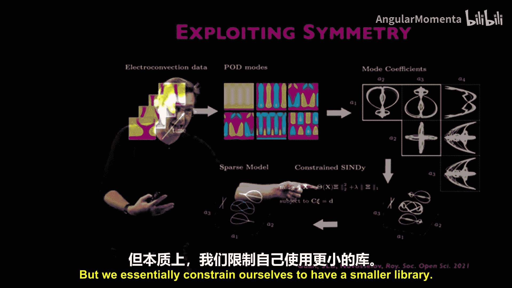

And I'll show you what that looks like here。So by taking the data and identifying that there are some symmetries。

 in this case， we have five key symmetries。You can determine right off the bat that there are many。

 many terms in your theta library that can't possibly exist and exhibit those symmetries。

 so right off the bat， all of these black terms are ones that we've completely crossed out as inadmissible with these observed symmetries。

And so right away， what that does is it reduces our theta library。Pretty dramatically， I mean。

 this is less than half as big as it would have been。

And it allows us to identify better models with less data because there's less variables we're fitting。

 we have a smaller theta matrix with a better condition number。

 and we can identify it with less data because we've enforced the symmetry。Okay。

 so this is just one of the many things you can do in the Theta library。

 that's one of my favorite parts of Cindy is just the flexibility and the freedom of designing the library of candidate terms。

 enforcing symmetries and physics， and really kind of building in your expert intuition for the dynamical systems you're trying to discover。

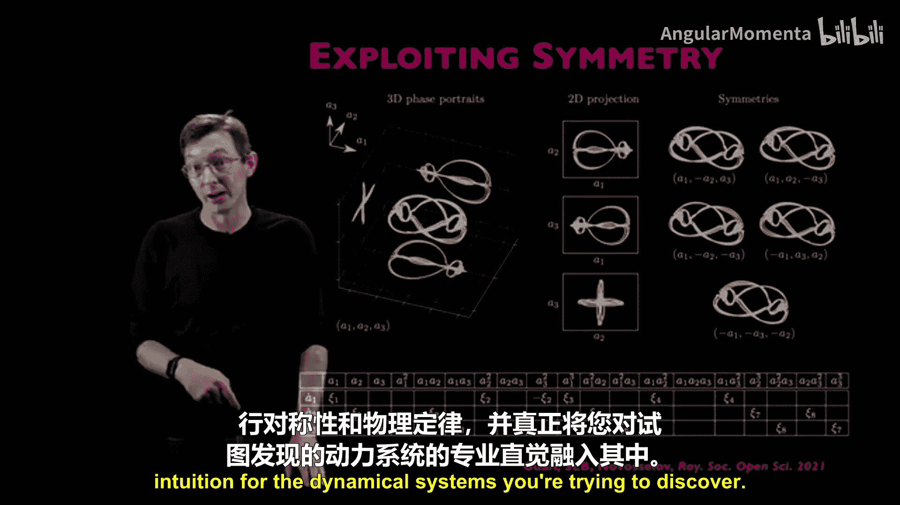

Okay， good so we've been talking about these key challenges。

 we are almost done in the next lecture we're going to talk about the challenge of optimization。

 which is kind of a fun one because there is so much happening in this world of optimization like this is the lifeblood of machine learning well maybe data is the lifeblood This is the engine you know that's kind of making machine learning work is all of these optimization algorithms So that's coming up next All right thank you。

😊。

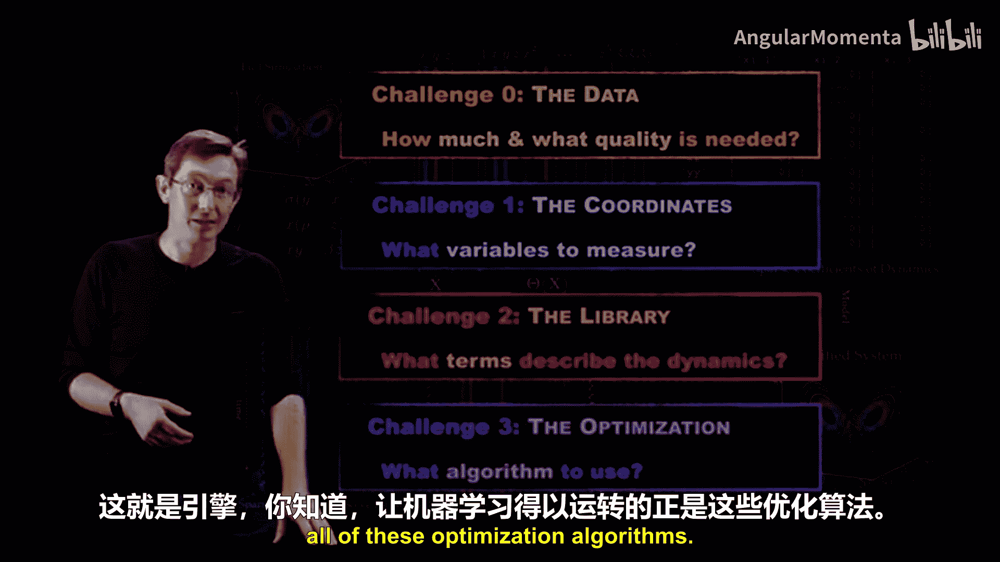