# 【精译】物理信息机器学习-p14-14-稀疏非线性动力学模型与SINDy，第5部分：优化算法--BV1c9uDzQEj8_p14-

🎼。Welcome back。So we're talking about the Cindy algorithm and I've been walking through some of the challenges that we face and how we can overcome these with things we've learned in the last five years since coming out with this algorithm。

The big picture is that Cindy is a machine learning procedure for model discovery that allows you to take time series data and discover interpretable and generalizable dynamical systems models that you can use for things that you want like control and prediction and understanding。

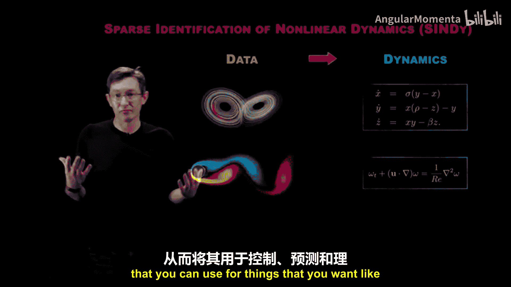

Okay good and we've gone through this big picture overview we've talked about how Cindy works。

 what are the different pieces and specifically we've highlighted these four key challenges and today we're on the last challenge of the actual optimization algorithm how do we get sparse models we've measured the right data in the right coordinate system we have a library where we think the dynamics should be sparsely representable how do we actually solve for a sparse model given all of those ingredients so that's what we're going to talk about today and there's a lot of cool stuff here so I'm excited to tell you about this one。

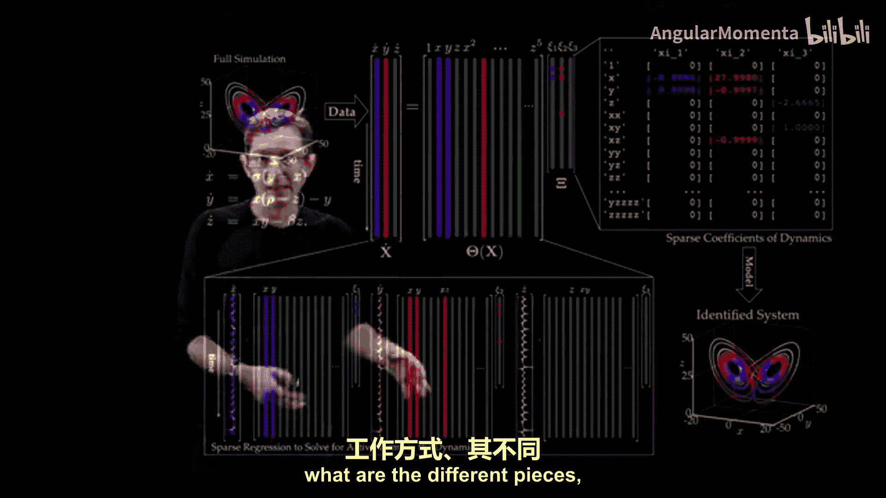

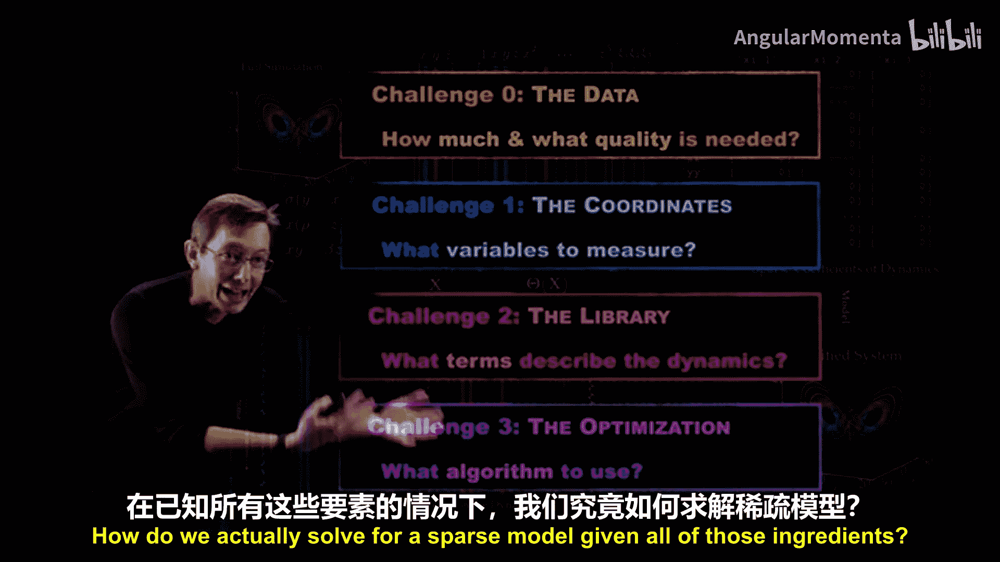

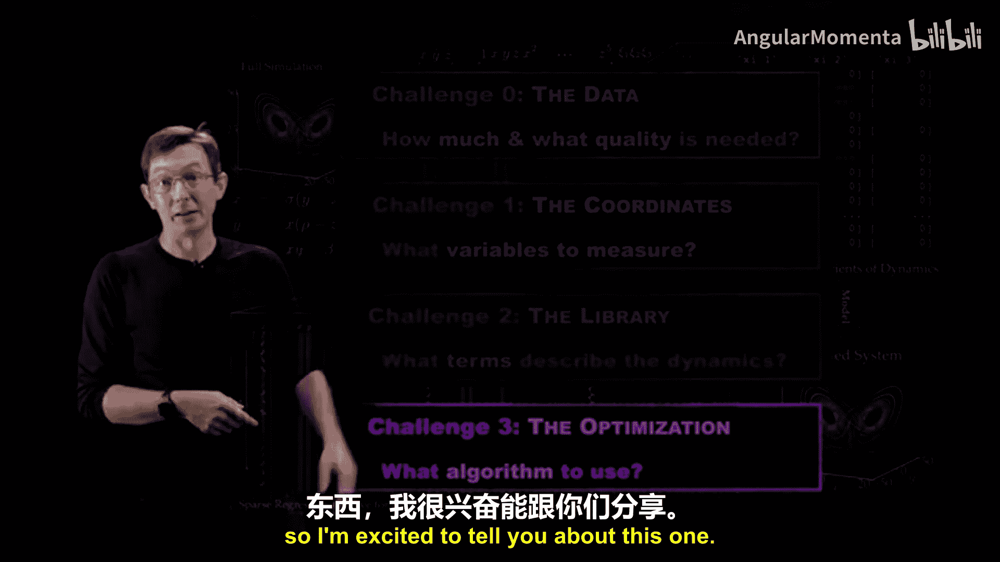

All right， good， so again we're just going to walk through this whole procedure。

 you've already seen this so many times before you have data that you're collecting for your system。

 you are approximating some derivatives X dot， you have a library of candidate terms that could be in this differential equation to describe those X dot variables。

And we're going to use some kind of a sparse regression procedure to find a sparse vector of coefficients in C that highlight or identify what terms are active in the X dot y dot and Z dot dynamics。

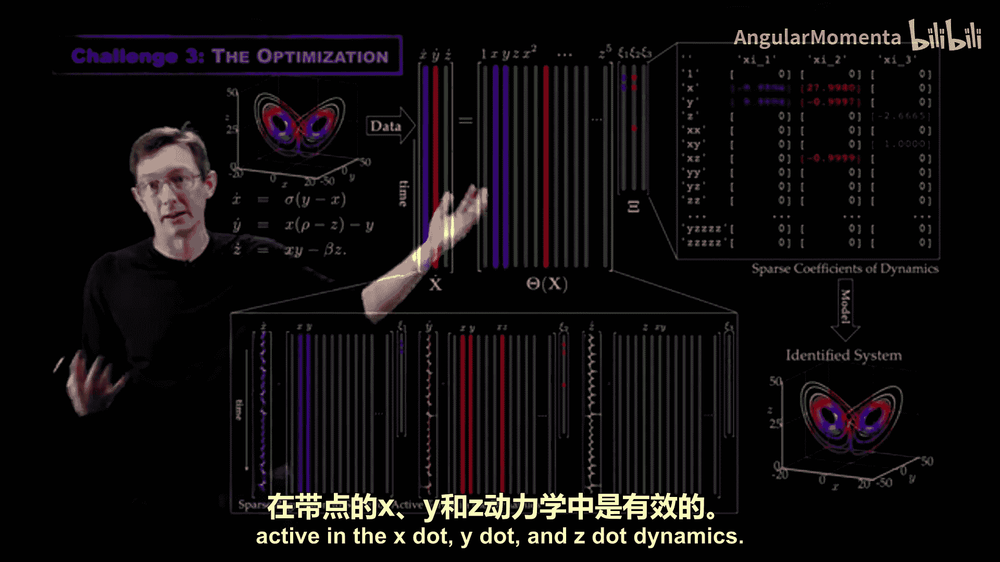

Okay， so today I'm going to talk specifically about all of the optimization algorithms that go into this。

 why it works， how it works， and kind of our philosophy of sparse modeling。

And sometimes I call this parsimonious modeling that essentially just means getting the minimal model that describes the data but no simpler。

 Okay， that's a principle of modeling that's been valid for the last 2000 years and it's still valid today。

 and we're not the only ones that do this。 So Boongar Lipsson and Schmidt and Lipsen have this with their genetic programming approach。

 Miles Cranmer does parsimonious modeling with neural network systems and genetic programming。

 This is our approach to the problem。 And so today I want to walk you through a few important parts of。

This sparse modeling so that we can really understand what's going on under the hood。

So this entire CID procedure is a generalized linear regression， We have data X， Y， Z。

 we compute their derivatives and we build a library of candidate terms。

 and we're trying to solve for some unknown variables C given by these columns we want those to be as sparse as possible and still fit the data if we find a sparse C。

 it tells us what terms are active in that differential equation。

Now the simplest thing you could do is a least squares regression。

 you could just do a pseudo inverse of theta and that will give you a C matrix that has a little bit of all of the terms active。

 that's what least squares does， is it spreads out that error by overfitting really and giving you a little bit of dynamics in all of those terms。

Now that will give you a good model fit for Xdot a lot of the time， maybe better than a sparse model。

 but we believe it's overfitting to the training data。

 in some sense we don't believe that the model the true model should have 81 terms active at once that seems far fetched based on what we know from physics okay。

And so instead， we want a sparsity penalized regression that still does a good fit。

 but has as sparse of a C vector as possible while still getting that good fit。

And there's a lot of algorithms you could use to do this in the original paper。

 we said that this is kind of like the Lasso algorithm。

 the least absolute shrinkage and selection operator from Tip Shirani 1996。

And to some extent I feel like that actually was a little bit of a disservice or an oversimplification。

 we don't actually use the Lasso algorithm to solve the sparse regression problem typically it's not usually the best algorithm to actually use to findrs sparse vectors see。

 it's kind of morally what we're trying to do， but there's other algorithms that tend to work better。

So we actually cooked up our own algorithm called sequential threshold least squares。

 and it's as simple as it sounds。 What you do is you first do a least squares regression and you get a C vector that has a little bit of all of the terms。

But we notice that some of those terms are very small。

 and if you hard threshold those and zero those out。

 you can do another least squares onto the remaining coefficients。

 Now some of those are going to become small， and you can hard threshold those and do a least squares onto the remaining coefficients。

 and some of those become small， and you iteratively apply this procedure of doing a least squares。

 hard threshold， least squares onto the remaining coefficients。

 hard threshold until the model converges and this tends to have way better model convergence than things like the Lassso。

 It's fast。 It's accurate。 and it gives us very good sparse models。😊。

There's a couple of catches here， so that's what we do。

 We do sequential threshold scoress most of the time。But when you're doing this regression procedure。

 we're constantly balancing the model error here with the sparsity of the model measured by how many terms are nonzero。

 we want as many zero terms as possible while still having good model error。

And this balance is controlled by this。My。Clicker died。

This sparsity of the model is controlled by this lambda parameter here and if I have a really big lambda。

 it says I care a lot about sparsity， this is the dominant term， and if I have a really。

 really really small lambda， I say I don't care at all about sparsity。

 I just want a good model fit okay。And so to some extent。That lambda， if I have a very， very。

Small lambda， essentially， Then I'm killing。I'm sorry。 If I have a really big lambmbda。

 Lambda is almost infinite， then one over lambda is small。 And for big lambmbda。

 I don't care at all about the error。 I just want a sparse model。

 And there's no model that's sparser than the model with no terms。 So it gets me very low complexity。

 but very high error。And on the other extreme， if I say lambda equals0。

 I don't care at all about sparsity， I recover my least square solution。

 which has very high complexity but relatively low error。And by modulating this lambda parameter。

 this kind of balanced term here， which we essentially translate into where we threshold our terms。

You hope that you can find a family of models from this underfit to this overfit model。

And hopefully it actually looks more like this with a Paredo optimal kind of elbow here where the really good sparse models are。

And specifically， if you have some training data that you're training this model on。

 least squares is going to look great， but the minute you have some withhold data or some validation data。

 your least squares is probably not going to perform nearly as well on that withhold set because you're overfitting to the training data。

And so it actually， there's this sweet spot here where you actually have less complexity。

 but that's more reflective of the true physics underlying your system。

And that's where you hope that your cross validated Cindy models live is in this kind of elbow here。

So key takeaways， we usually do a sequential threshold lease scores algorithm。

 although there's many that you could choose from。You get to choose the sparsity of your model by adjusting this lambda parameter or your thresholdholding value。

 and you can get models with more complexity or less complexity。

And sometimes when you don't know the physics， when you don't know the answer。

 it's actually good to get a handful of models， two or three or four models on this Pareto curve so you can compare them and see what terms turned on and off as physicists and scientists and engineers。

 we can learn a lot about systems based on that complexity。Good。

And I'll point out that there are lots of approaches for selecting the kind of most parsimonious model。

 we can use model selection from this paper by Neil Mangan。

 or we can use these other optimization techniques。And like I said， there are other perspectives。

 especially these genetic programming perspectives that also use cross validated metrics for parsimony。

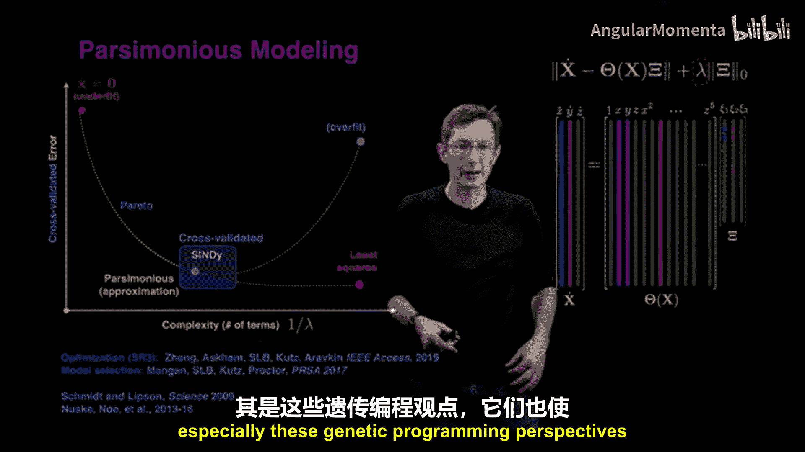

Good， now I mentioned this SR3 optimization algorithm。

So we cooked up that sequential threshold least squared algorithm。Essentially just because it worked。

 we tried a bunch of things and that one worked and it worked really well， and so we ran with it。

Working with some real optimization experts， Pengzang and Sasha Aravkin along with Travis Ashkim。

 we essentially showed that our kind of homebed sequential threshold least square algorithm is actually a formal relaxation of the L0 sparse optimization problem there's many ways of relaxing it Lasso is one relaxation this sequential threshold least squares is another relaxation and it essentially allowed us to formulate a more general sparse optimization algorithm we call SR3 sparse relaxed regularized regression。

 so it's regularized to be sparsee promoting it's relaxed in the sense that we introduce another variable W that kind of takes some of the pressure off of the C vector so C can be a sparse as possible。

And double you can be close to C and give as good of a fit as possible。

 and just that splitting and that relaxing goes a long way to making this actually a much better converging algorithm。

 So we should do a whole lecture on this。 I'm not going to go into too much detail here。

 All of this code is open source and you can read about it in in this paper all of our papers are open access these days you can just download it for free from anywhere but oftentimes we actually use SR3 as kind of our souped up regression algorithm So it's like sequential thresholdly squares。

 but it's also possible to add additional regularizing terms and additional constraints。

 if we have constraints on our coefficients that we know ahead of time。

 we can bake them into this SR3 framework。😊。

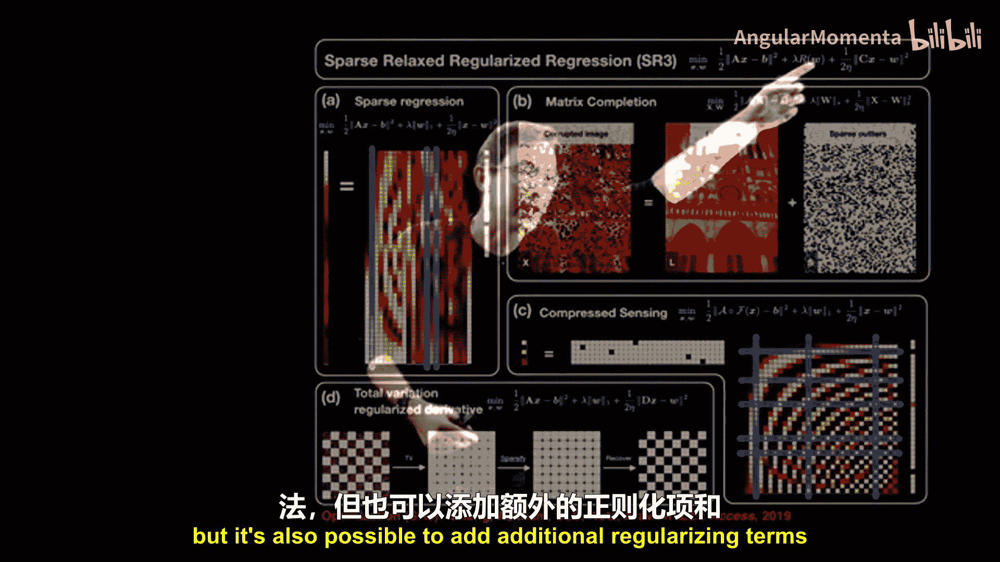

Good， a couple other things you can do， so remember we talked about reduced order modeling of fluid flows and I'm going to have a whole video on sparse fluids modeling。

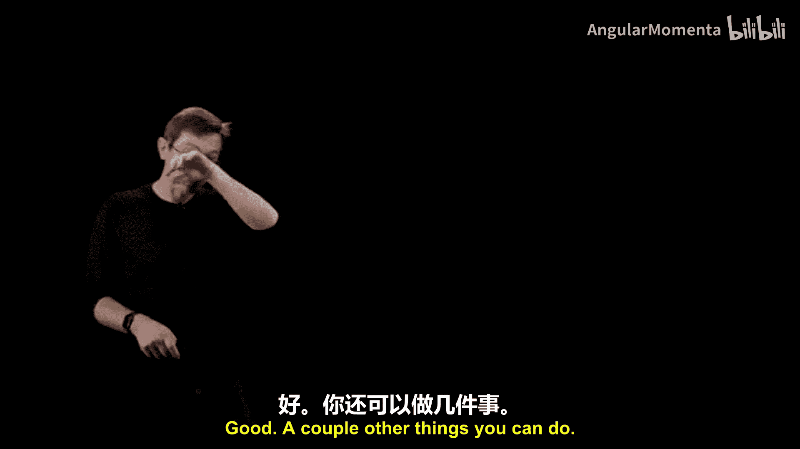

But。In lots of physical cases， there's prior information we have about our system。

 we are not doing a completely unstructured search in this library， for example。

 in fluid flows like this one， incompressible fluid flows， we know that energy is conserved。

And more than that， we actually know how energy is conserved。

 it's conserved by a symmetry in the quadratic nonlinearities。

So this is something that my colleague John Christstav Laazzo pointed out to me very soon after the first Cindy paper came out about five years ago。

 he emailed me and kind of told me about this， you know， rich。

Symmetry in fluid flow equations that we could incorporate into our modeling procedure。And again。

 this comes in as part of the optimization algorithm， so JC has partial knowledge of the system。

 he knows how to make it conserve energy by enforcing a sew symmetry constraint in these quadratic terms。

 basically some of these quadratic terms have to be equal to others。

 some of them have to be equal and opposite and things like that there's some structure。And so。

 essentially。You can perform this minimization trying to find this minimum error。

But you can also have it subject to semi quality constraints on these coefficients C。

 we can say that some of the C's have to equal each other or be equal in opposite or be multiples of each other。

And this is pretty important because。Because our algorithm is based on this sequential thresholded least squares。

 it's basically iteratively leastd squaresing and then thresholdholding。

It's really easy to satisfy these equality constraints at every step of the least squared。

Optimization。That's just the KKT kind of version of least squares that satisfies these equality constraints。

 and so that was a huge innovation that JC introduced into this procedure is that by kind of modifying our optimization。

 we can include equality constraints on these coefficients of and get way better model performance。

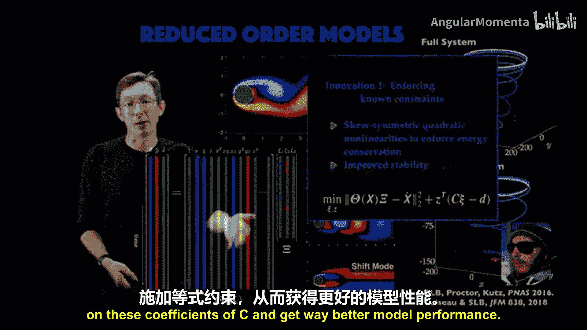

So just to show you what this looks like for energy conserving nonlinearities。

 again in the Navyier Stokes equations， kind of in reduced coordinates。

 we know that this expression has to be true on our model coefficients。

And so you can essentially derive a set of equality conditions that have to be true for these CinD coefficients see。

And specifically， you can derive these very few equality constraints that if you satisfy all of these。

 I guess， eight constraints。Then your system is guaranteed to conserve energy by construction。

 and that's pretty remarkable so we can guarantee energy conservation by enforcing these。

 and specifically we can enforce these through a modified least squares that would then be implemented at every step of our sequential threshold least squares algorithm。

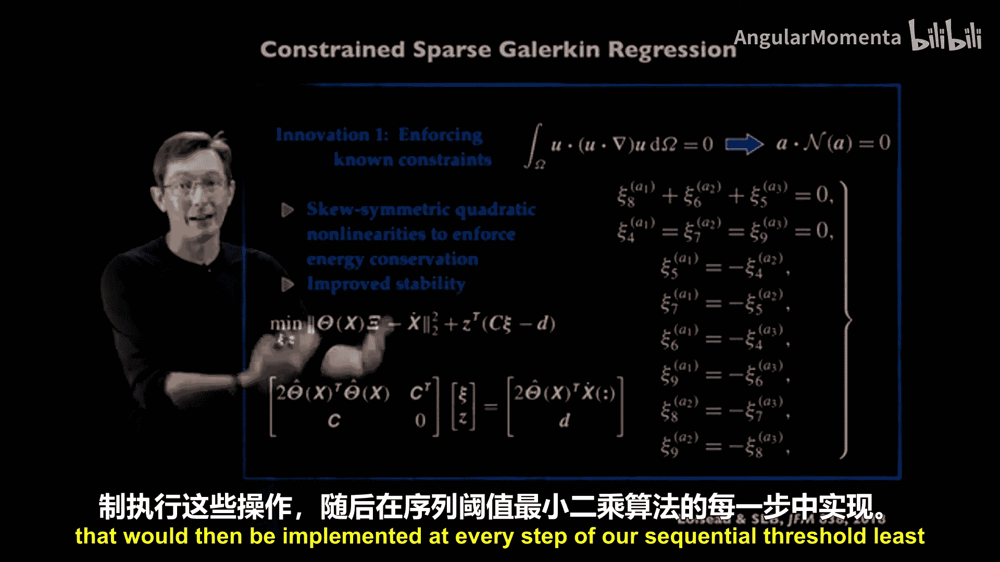

And so when you apply this to fluid flow systems， so here we're looking at the drag coefficient on these two flows。

 and the white curve here is the ground truth from a high fidelity simulation。

The yellow and blue are kind of the previous industry best reduced order models with three and seven modes。

 they're not that great， I mean， they get qualitatively the right behavior， but not quantitatively。

But when you include these kind of constraints and either cubic or constrained Cindy， you get much。

 much better agreement because by construction we're enforcing those dynamics。

So I think this is pretty important and one thing I always like to point out on this is that because these are sparse on nonlinear models。

 there are only a few terms and you can play around with them and write down really。

 really simple interpretable expressions for what these dynamics are doing so this is an equation that JC wrote down for the cylinder flow and to date this is the simplest and the most accurate model that I'm aware of in the literature。

So those are the kinds of things you can do here。And I really don't want to forget something super important along this stability constrained Cindy。

Is some recent work by my PhD student Alan Captain Auglolu。

 who essentially used another version of global Boedness condition that was derived by Schleal andOAAC in a 2015 JFN paper。

Which basically says there are conditions that have to be satisfied for any quadratic model to be globally stable。

And so Alan was able to bake that into this Cindy optimization so that he is able to get linear plus quadratic models that are guaranteed to be stable forever by construction。

 absolutely fascinating stuff， really cool optimization。

 I'll put a link to his video and also to his paper in the description。

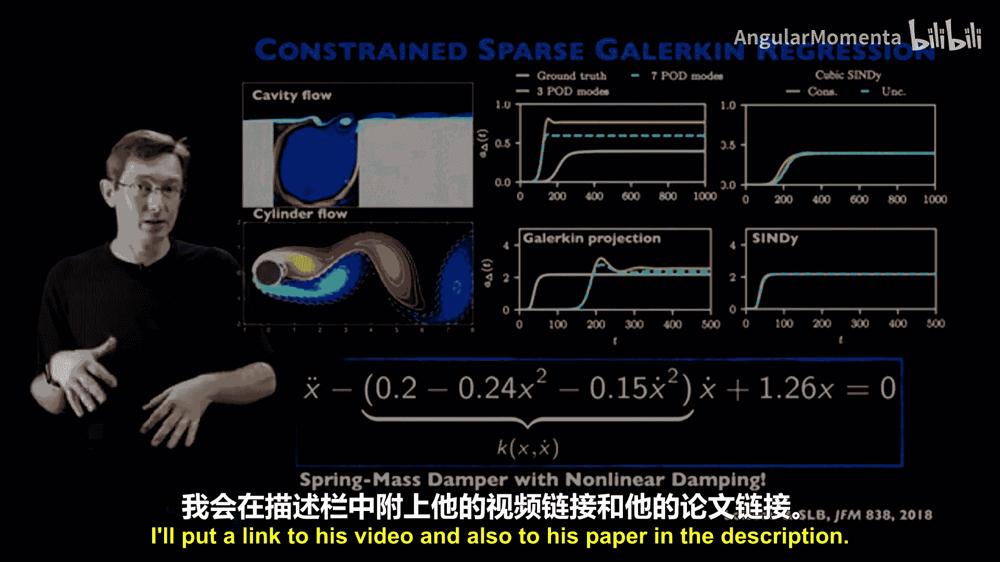

Okay， other things you can do with this optimization。

 there's a really kind of interesting idea here that many dynamical systems will abruptly change in time。

 so maybe I'm flying around in my aircraft and something happens and I just you a piece of my wing breaks off or I you know my rotors get a little gummed up and some parameter of my system changes。

Most of the model might be the same and maybe one parameter or two parameters either change or get added or deleted。

And so we have this version of Cindy， which is essentially for abrupt changes where we can very rapidly learn small changes to the Cindy model faster than it would take to learn a brand new model from scratch again。

 that's part of the optimization procedure to get these really fast recovery models。

 this is the kind of thing you would want to do in real time for control systems。

Okay， good。So we've been talking about the various challenges of Cindy in this lecture this is one of my favorites because these are the optimization algorithms。

 essentially sparse optimization is a commodity algorithm now or set of algorithms there's many。

 many to choose from I only named a few of them I know if you talk to JC Lazo he would have other optimization algorithms that he would recommend for you and there's many more out there for you to choose from but the optimization algorithm allows you to robustly find the model once you have the right coordinates and the right data and the right library and it also allows you to bake in partially known physics and kind of prior knowledge like stability or conservation laws into those models All right。

 thank you。😊。

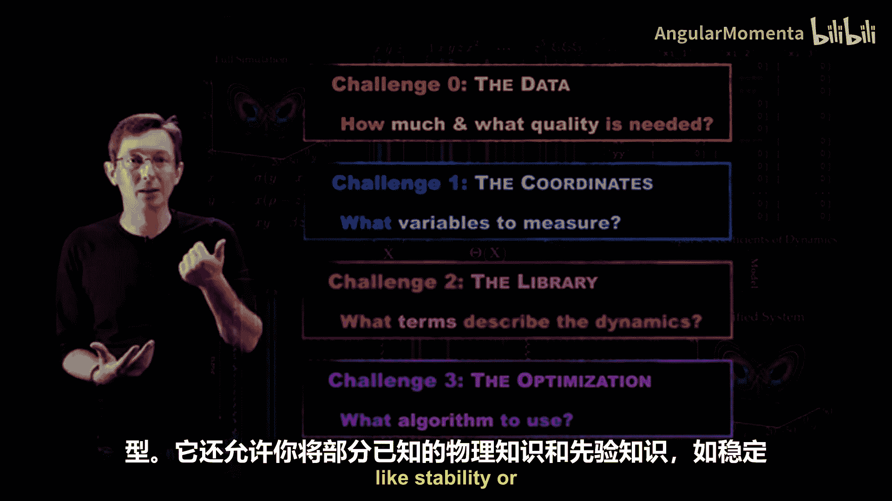

🎼Yeah。