# 【精译】物理信息机器学习-p15-15-基于物理信息机器学习的差异建模--BV1c9uDzQEj8_p15-

🎼。Welcome back。So we're talking a lot about how to model dynamical systems using modern tools in machine learning。

 and so I want to tell you about a really cool kind of perspective on how to model systems with machine learning called discrepancy modeling。

So oftentimes when you know， when we're trying to use some new machine learning technique to show that we can learn dynamical systems。

 you know， learn how a system evolves in time， learn a turbulent fluid system or something like that。

 we do an end to end learning， We act like we don't know anything about our system and we try to learn everything from scratch。

And that's kind of cool to demonstrate capabilities。

 to demonstrate that you can learn these complex systems。

 but instead of trying to discover a model from scratch with no prior knowledge。

 it's much more realistic that you would start with some partial knowledge of the physics。

 maybe you have an idealized model like an Hamiltonian a Lagrangian for you a double pendulum or for an automobile an autonomous vehicle。

 maybe you know something about constraints that have to be satisfied or symmetrymetries as conservation laws for your system。

 and you don't know the exact dynamics， but you have this kind of partial physical knowledge that you are starting with。

And so instead of discovering the model from scratch with machine learning。

I think it's much more reasonable oftentimes to try to learn。

 so you start with this imperfect model and you might want to focus your machine learning efforts in modeling the discrepancy。

 The part of your model that doesn't fit your data that's， I think。

 a more realistic way of how we might approach autonomous systems and robots。

 learning fast and on the fly is starting with an imperfect or idealized model and then focusing the machine learning effort on the discrepancy。

So today I'm going to talk a little bit about how you might do that and also talk about kind of a little bit more almost the philosophy of when you would want to learn end to end。

 when you would want your machine learning models to capture that discrepancy and when you wouldn't and this will have some kind of historical connotations with things like you know the universal law of gravity and things like that。

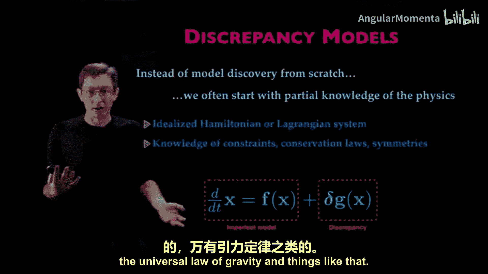

So here's an example I really like by Kair Dan Kayman。

 who is a PhD student working with Nathan Cuzson me。

And this is a double pendulum apparatus in my lab in mechanical engineering at University of Washington。

And you can see so this setup here， what he's trying to do is swing it up and stabilize this inverted double pendulum。

 which is a relatively simple mechanical system， you know， on a piece of paper。

 you can derive the Lagrangian or the Hamiltonian and you can derive the equations of motion from those frameworks。

But it turns out that when you use that idealized Hamiltonian or Lagrangian model for control design。

 there are imperfections in that model that make it very hard to accurately and efficiently swing up and stabilize the system。

So what do those imperfections look like， things like nonlinear bearing chatter in the joints or wind resistance。

 those are things that we typically don't model in our first principles physics。

 or at least it's difficult to do so。But when you include a discrepancy model using kind of machine learning techniques。

 when you model the discrepancy of your idealized model with the experimental data。

 you can start capturing those subtle effects in this discrepancy model。

 and then you can do pretty remarkable control tasks。

 like swing up and stabilize this double pendulum。I just love this video。

 I'm gonna keep showing itcause it's， it's awesome。 He， this is the old rig。 This is the。😊。

The original rig that Ben Strom started building， and now Cardi has a new triple pendulum setup。

 fancy new rig。 It's more expensive than my car， and hopefully I'll show you a video of that sometime soon。

 but it's super cool。Okay， so that's the idea of discrepancy modeling， though。

 you want to augment your idealized model with all of the terms and really subtle physics like wind resistance and bearing chatter that are hard to model from first principles。

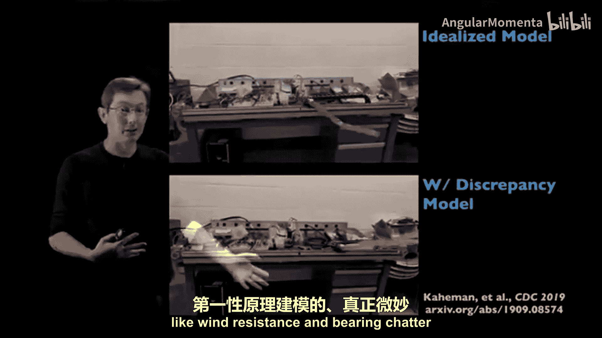

And so we can kind of look at this on two axes going from easy to hard。

 so on the X axis what you have is modeling disturbances and unknown physics。

 so this is where you know your bearing chatter and your wind resistance comes in and it's very difficult to model those with first principles。

 physics， you know pencil and paper， textbook physics。

 it's hard to model bearing chatter and wind resistance for example。

And on the other axis you have how difficult is it to incorporate known physics。 So for example。

 in that double pendulum， I know that there are you know these constraints that my system is constrained to be you know in angular coordinates。

 theta 1 and theta 2， I could write it in X1， x2 or sorry X Xy coordinates and Cartesian coordinates。

But I would need to know that that system enforces some constraints， these bearing constraints。

 and that's actually oftentimes very hard for machine learning to learn。

 It's hard to learn that the Hamiltonian energy is conserved or that my system is constrained to live on a circle or some tourroidal configuration space。

And so I think this is a really interesting kind of set of axes to show why you want these hybrid discrepancy models。

 there's some things that are easy for machine learning to do like they can learn those bearing chatter and wind resistance models just by。

Collecting data， the first principles models can learn that the Hamiltonian energy should be conserved and that the system is constrained to live on a tourus。

And so you want to get the best of both worlds。 You don't want to do everything with first principles or everything with machine learning。

 You want to find some sweet spot in the middle between these where you're getting the best of both worlds。

And hopefully this curve actually is more like a Pareto optimal curve where there's kind of an optimal elbow here where our discrepancy models live。

 we get as much as we can with the first principles and we bake in as much prior knowledge as we can and then everything that our first principles model can't capture like that wind resistance。

 we're going to model that discrepancy with machine learning。

And that machine learning could be anything。 It could be a deep neural network。

 It could be a dynamic mode decomposition model， a sparse identification of nonlinear dynamics。

 a Gaussian process model。 you know， this is not just a deep neural network。

 but it's something that is kind of data intensive or data informed model that that's what I think of as machine machine learning。

 So this is a sweet spot where you get the best of both worlds。

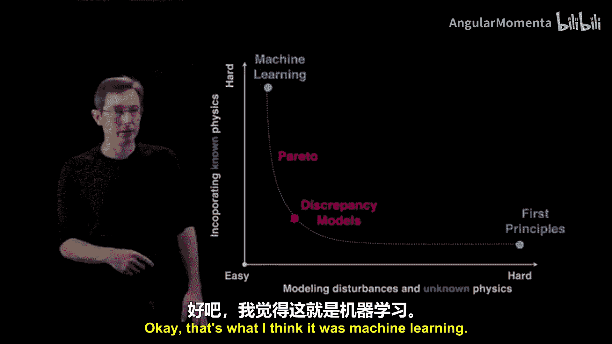

And you can apply this to lots of systems， so I showed you that swing up of the double pendulum。

 this is a robotic arm in our Boeing advancedance research center or barkRC this system。

 you know again， it has as this system ages the way that the joints move and the way that the motors behave changes in time and so these discrepancy models can also be very important when you're building digital twins and you want to incorporate things like aging or you know different environments。

 things like that。

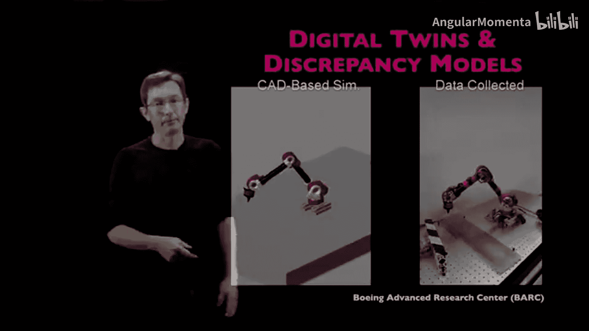

Good， so just to kind of very， very briefly summarize this idea is that you're going to kind of use first principles physics where it's good。

 you know here in our imperfect model to enforce things like constraints and conservation laws and symmetries and we're going to use machine learning for what it's good at。

 which is you know modeling the really hairy， hard to quantify bits from data and you're going to put those together and hopefully get something that's easy to train and satisfies kind of your rudimentary physics。

Okay， now at this point， you know， that's the kind of guts of the idea。

 but I want to pull back and talk a little bit about how this has historically manifest itself and some of the key takeaways and caveats we as engineers can learn about how and when we should apply machine learning to model dynamical systems and what might go wrong。

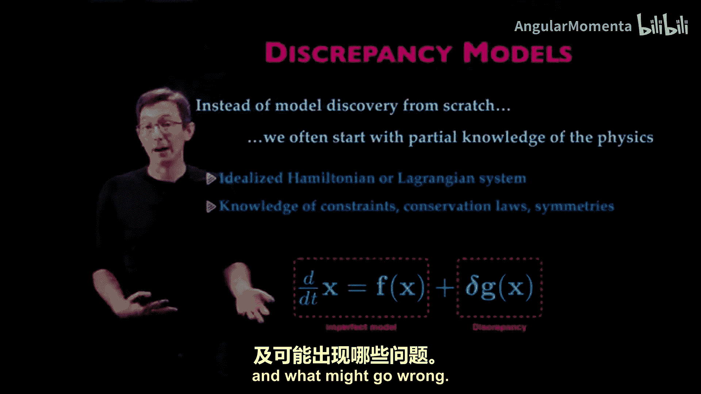

So I show this movie sometimes I really like this visualization by Moin Christen。

Which shows kind of the difference between these two worldviews of the Earth centric solar system and the Sun centric solar system。

And you can see， of course， that。If you put the earth at the center of the solar system。

 which is what people thought for you10 plus years， the dynamics are very， very complicated， okay。

 it's hard to get a simple， idealized model that describes this behavior here and it's much simpler to get a simple model when you have the right coordinate system。

But what I want to point out here is that。You know。

 it took a long time for us to go from the aristotelian model of I'm sorry。

 the Poomac Ptolemi's model of circles on circles in the Earth centric system。

 to Kepler's laws of motion here in the Suncentric system and this Copernican system and what I'll point out is the Ptolemys system。

 which is in the wrong coordinate system， It's the wrong physics。

 It was actually more accurate for a long time than Kepler's model that had the right physics that had the sun at the center of the solar system。

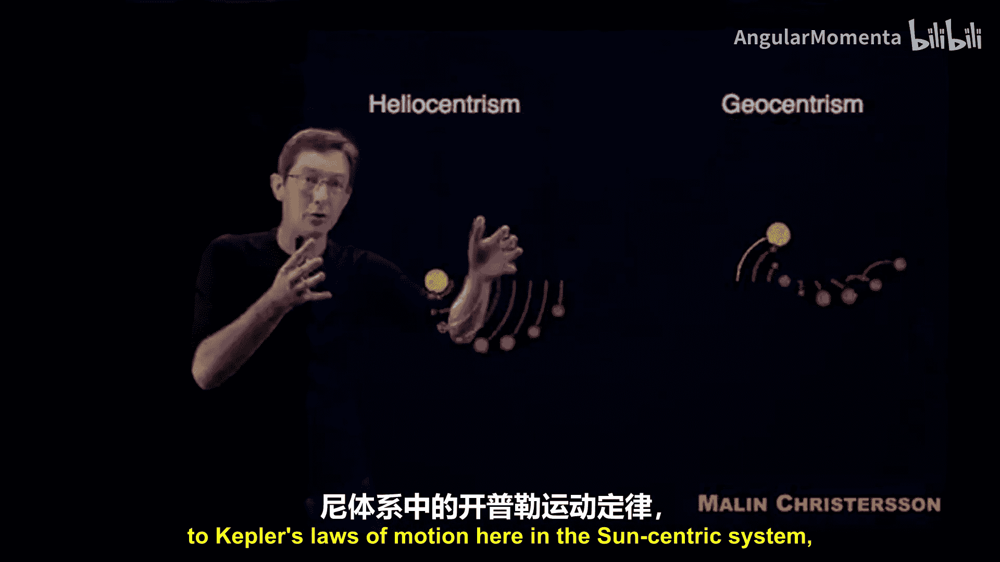

And so to some extent there were these discrepancies， unmeasured variables。

 planets we didn't know about yet， and forces that we couldn't predict that made it so that Kepler's actual correct idealized physics model was not as good of a fit as Ptolem's model。

 and I think that this is a really important point for us as machine learning engineers when we learn dynamical systems。

 it's easy to overfit to the data， thetllomaic model is essentially a Fourier transform of the solar system data and it was extremely accurate。

 more accurate than the right model because there were discrepancies because there were planets that hadn't been measured。

And so you have to think about kind of what core bits you're trying to measure and model。Okay。

 another example I really like to think about is Galileo's ball drop experiment。 So， you know。

 in some sense， Galileo and and this famous ball drop experiment。😊，You know。

 where he dropped two balls of different densities and they fell at the same rate and they hit the ground at the same time。

This is a very well crafted experiment， and I think that there's a lot of kind of historical。

Kind of retellings or small fictions that go on with this story。

 So if you look at Galileo's balld experiment， this is essentially supposed to prove that there is a universal kind of law of gravitation。

 a gravitational constant and that objects fall at the same rate， regardless of their densities。

But we know that that's not entirely true。 All of us， you know。

 if you've dropped a beach ball and a bowling ball。

 they do fall at different rates because there are these additional forces。

 it's not just gravity acting on on those objects， you also have fluid forces， you have drag forces。

 viscous drag forces and you know， turbulent forces on those different objects。 And so， you know。

 for example， if you increase the velocity。

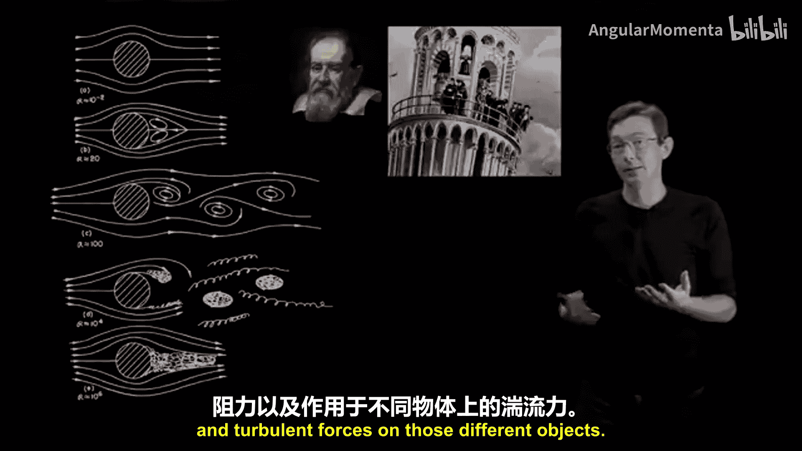

Of a falling object， you go through all of these different drag regimes as the fluid forces change and bifurcate。

 according to very， very complicated physics。And so to some extent， you know。

 Galileo's ball drop experiment trying to say that these balls fall at exactly the same rate because there is one。

 you know， constant acceleration of gravity。 that is neglecting a bunch of discrepancy physics。

 There are discrepancies in those ball drops that is not captured by the model。

 and you have to ignore those。If you want to uncover that kind of constant acceleration of gravity。

And in fact， Galileo did not just discover this by dropping balls off of the leaning tower of Pisa。

 He did very careful experiments。 So sorry， let me take a step back。

If you actually collected data and you were， you not dropping dense balls。

 but you were dropping beach balls and basketballs and wiffle balls and golf balls。

 you would very likely not come up with Galileo's constant acceleration。

 It's much more likely you would come up with Aristotle's model that the rate at which a ball falls or move through the air is somehow proportional to its mass or its density。

 That actually seems very consistent if I throw a baseball。

 it's going to go way farther than if I throw a beach ball because the drag of that beach ball is somehow related to its density。

 And so you know this was the leading model for， again。

 over 1 thousand years because it fit the data better。And so to some extent。

 you have to kind of divorce the discrepancies and the different types of physical forces that are at play in a system if you want to uncover kind of the universal idealized model。

 which is what Galileo did。

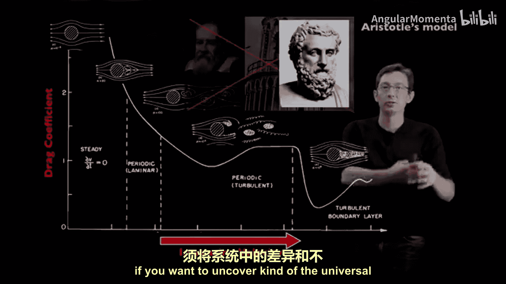

And， you know， in some sense， what Galileo did was not just drop balls off of the leaning tower of Pisa。

 He also did other very careful experiments looking at how penduula oscillated and very controlled still environments and looking at how balls would roll down ramps of different inclines so he could control the kind of drag forces and those discrepancies and control for those additional effects。

 and I think this is an extremely important cautionary tale again for us as machine learning engineers when we have a new system like。

 you know， we're trying to learn how balls move， you know or fall through the air and。

 We want to learn the physics。😊，Chances are much more likely that we're going to learn Aristotle's model。

 which is not kind of the true underlying physics because it is a better fit to the data because of those discrepancy terms because of the complexity of the real world and fluid drag forces。

And so that's a really important philosophical question you have to ask yourself。

Which one do I want to learn， It's， it's a fair question， Do I want to learn， you know。

 that there is a constant acceleration of gravity and all balls should fall at the same rate in a。

 you know， perfect world， or do I want to learn the full， hairy。

 turbulent drag physics and get a more accurate model of how real balls would fall。

 That's a fair question。 And in different circumstances， you would want to learn different models。

 So you have to keep that in mind。😊。

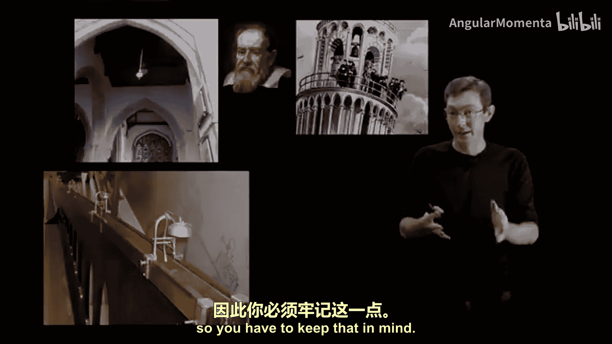

And so there's a set of experiments that were conducted。

 this is work with Brian De Sililva when he was a PhD student with Nathan Cutson myself。

And some of Nathan's collaborators。Essentially did this experiment。

 They took all of these different balls and they dropped them from， I think it was。

 you know the roof of a five storyory parking garage and they watched and tracked their motion as they fell to the ground。

 So you have golf balls， tennis balls， baseballs， wiffle balls， basketballs。

 okay all different densities， all different kind of drag profiles。

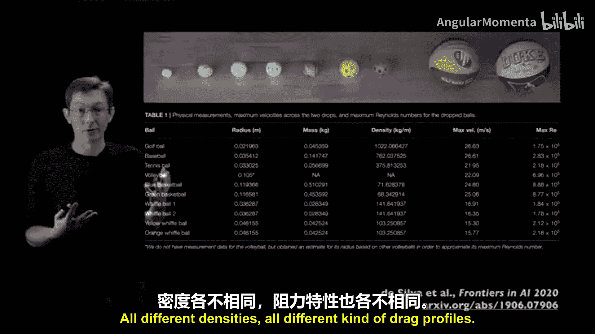

And so if you look at the data， this is kind of you know the height and this is stop strooboscopic measurements as they fell from you know whatever 40 meters down。

 you see that they all fall at different rates， again。

 the actual raw data is more like the aristotelian model that it somehow depends on their density。

And if you plot kind of the height over time， you see that they all take different trajectories and these dash lines are kind of different models of the physics。

 so this is the idealized gravity with no no friction。

 and then the kind of white and yellow dash lines are having some velocity based drag model and again this is just that same data on a log plot。

So you see that the data doesn't actually support just one of these models。

 like it's all over the place。And so you know we can do a number of experiments。

 this was using our sparse identification of nonlinear dynamics algorithm where you put in a candidate set of terms that could describe the acceleration and just with regression you try to see which terms best describe the data。

And for these different balls over multiple drops， you get different terms showing up and disappearing。

 you know you get spurious term， this x should not be there， this v squared shouldn't be there。

 you know， so this is the wrong physics according to Galileo。Now。

 if you add a group sparsity penalty。 So what you say is that the same physics has to be true。

 the same terms have to be there for all of the balls across all the drops。

 if you add group sparsity。You then kind of rule out all of those spurious terms and you learn the actual dynamics that x double dot。

 the acceleration is equal to a constant of magnitude 9。8， right gravity。

And there is a kind of drag or a dissipation term that's proportional to its velocity。

 That's the very， very simple velocity based drag model。And so again。

 great care has to go into how you constrain your machine learning algorithm to learn the correct physics because the actual data you doesn't support that it says that there are density dependent terms。

 there's other physics that's more likely to describe your data。

 if you just look at wiffleball falling。And so I just found this to be extremely kind of。

Enlighting for myself， I know we've talked about this a lot， you know， our group。

 and it really does start to beg the question what kind of model do you want？

Do you want a model that actually captures all of this variation between these different types of balls that does have a density term in there and does capture that。

 you know turbulent drag wake of these balls。 or do you want something more like Galileo's simple。

 idealized physics。 This is kind of related to that problem of discrepancy modeling and how you how you model and how you control your learning process。

 So really important idea you know， when you're modeling systems with machine learning to think about what kind of what kind of model do you want。

 do you want an idealized model that you can analyze and learn from that kind of generalize as well。

 or do you want a model that just with brute force fits your data more accurately。

 Do you want Galileo or do you want Aristotle， All right， Thank you。

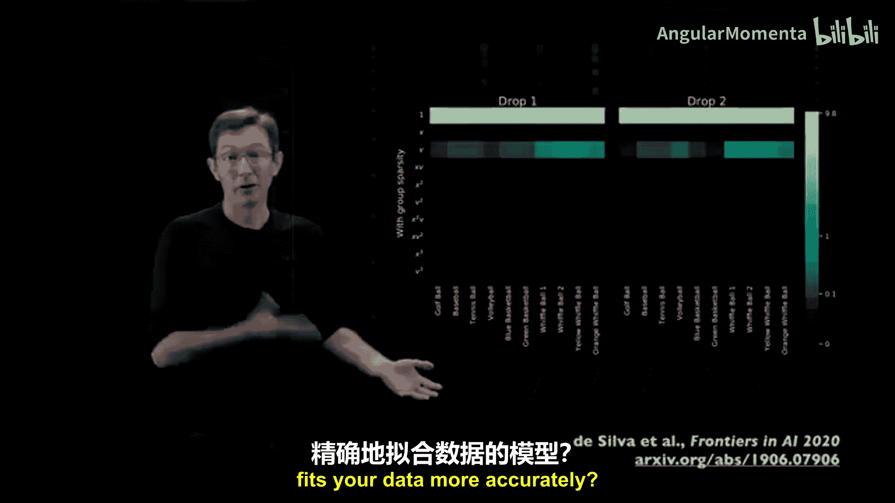