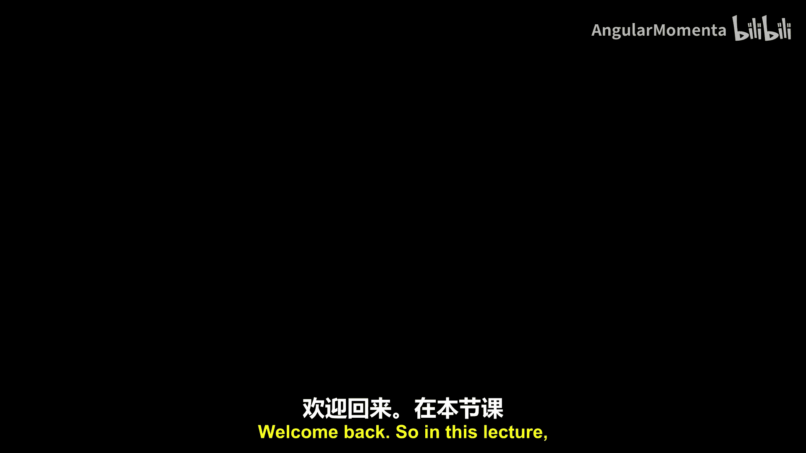
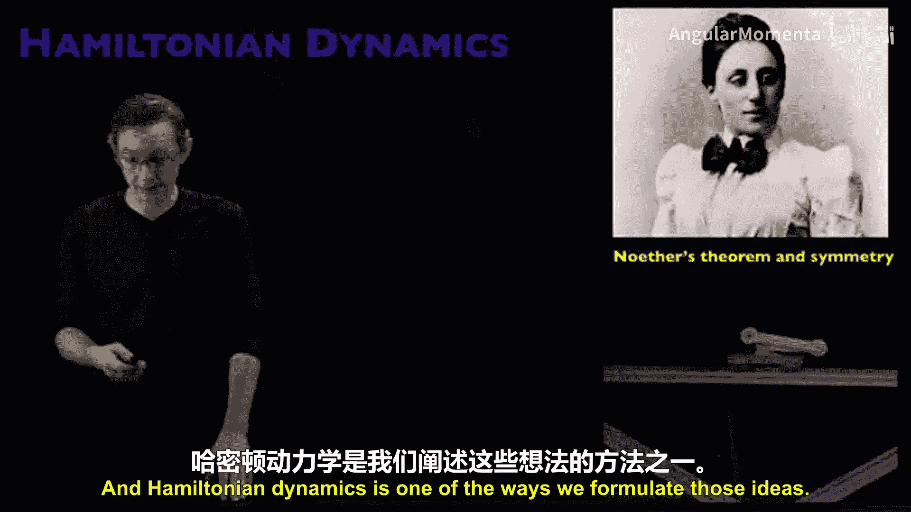
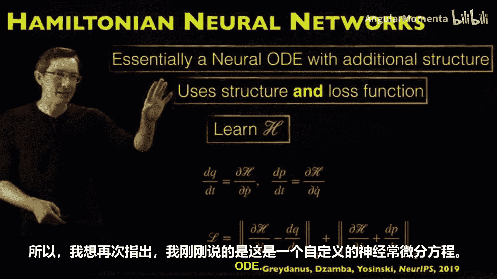
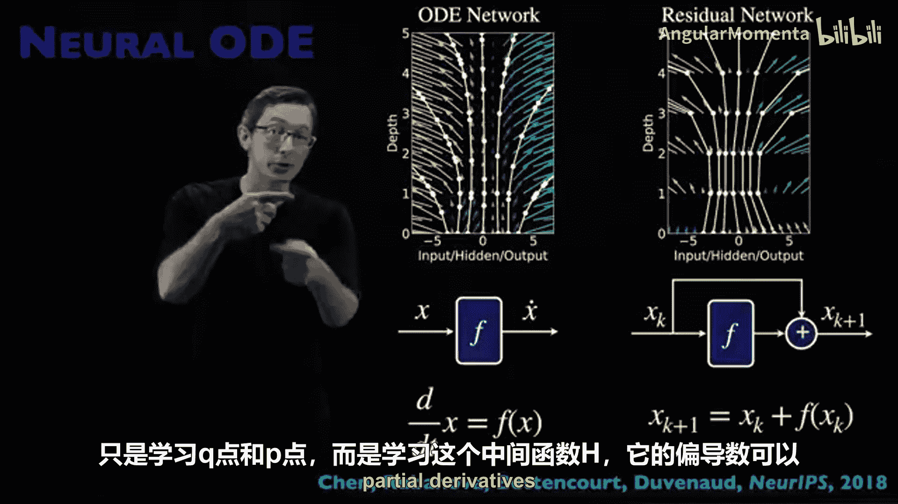

# 【精译】物理信息机器学习-p16-16-哈密尔顿神经网络--BV1c9uDzQEj8_p16-

Welcome back。So in this lecture， we're going to talk about a custom neural network architecture called a Hamiltonian neural network。

That essentially leverages the Hamiltonian structure of many。

 many dynamical systems to do better dynamical systems learning from noisy observational data。

 so you know tons of examples of Hamiltonian dynamics in the real world。

 including mechanical systems like this mass on a spring， the pendulum， the double pendulum。

 lots of fluid flows and systems are Hamiltonian， in fact。

 you know Hamiltonian is often synonymous with kind of an energy conservative mechanical system。

 that's not maybe exactly true， but this paper， this really cool Nips 2019 paper。

 essentially leverages the structure of Hamiltonian dynamics。

 a certain kind of structure and symmetry that we've known for hundreds of years for these Hamiltonian dynamical systems and essentially bakes that in to a particular neural network architecture and loss function。

That allows you to learn better models from less data and noisier data， so I'm going to jump in。

Now before going much farther I just want to point out you Hamiltonian dynamics。

 this is not something that was recent to neural networks or machine learning。

 we have known about Hamiltonian dynamics a really long time。

 you know our revolution in our understanding of mechanical systems and the differential equations that describe them。

 this has been a process going on over hundreds of years from Bnoulli to Newton， Euler Lagrange。

 Hamilton and Hamiltonian dynamics in particular， has been around for at least 100。

 150 years in its kind of current form。And Hamiltonian dynamics describe tons of mechanical systems like this double pendulum apparatus here。

 in fact， fluid flows， if you have an idealized kind of potential flow an incompressible ir rotationtational fluid flow。

 you might remember that there is the potential function and stream function。

 the stream function is in fact a Hamiltonian， that governs those Hamiltonian dynamics。

And Hamiltonian systems， generally speaking， can be thought of as energy conservative or nondisipative systems。

And so that's one of the kind of hallmark features of these Hamiltonian dynamics is that they should be conserving energy and energy conservation is one of many types of invariances and symmetries that are discussed in Emmy Nother's famous Nother's theorem that deeply。

 deeply gets into how symmetries affect the dynamics of a particular system of interest。

 and so this idea of remember， we're trying to bake physics into machine learning and use those ideas together。

Symmetry is one of our most fundamental notions of what is physical， in fact， Einstein， I believe。

 said that nother's theorem was one of the most deep and kind of。

Profound results in the entire history of mathematical physics。

 not just in the last hundred years but ever okay and I tend to agree this is one of my absolute favorite favorite favorite kind of ideas in physics that you know conserve quantities give rise to symmetries and vice vers symmetries give rise to conserved quantities and Hamiltonian dynamics is one of the ways we formulate those ideas this is just a little bit of history and a lot of that is described in this fantastic book Introduction to Mechans and symmetrymme my research advisor when I was an undergrad Jerry Marsden is one of you know the world's leading kind of contributors to this modern perspective on Lagrangian and Hamiltonian dynamics and I highly recommend this book if you want to know more about the math of these kinds of systems where they exist how symmetries work into this whole picture。

ind of Allah Noer's theorem。faascinating deep， deep subject and super important that we start baking these ideas of symmetry and Hamiltonian structure we call it simpleplectic structure into our machine learning algorithms so I think for example。

 you know if I had to guess I would think you know Jerry would probably think that these Hamiltonian neural networks were super cool。

So there are some systems again this is a little bit more in that history lesson。

 there are some systems that are really easy to integrate forward in time。

 so if I have a simple single pendulum， the dynamics are deterministic and they're non chaotic so if I know the initial condition。

 the initial position and velocity， I can simulate that system forward very accurately into the future and my prediction will track the actual true solution for a really long time。

 especially if I get things like the friction or the dissipation right。

 you know then my solution should track this you know very， very accurately almost you know forever。

So these are systems that are easy to integrate， this is a Hamiltonian system。Some systems are very。

 very hard to integrate like this double pendulum， so chaotic Hamiltonian systems are often very hard to integrate numerically。

Like an Rga cutta integration scheme， for example， is going to typically fail on these kinds of systems。

Because those algorithms are not designed to conserve the energy。

 to conserve the conserved quantities of this system。

 so we know that in the frictionless case in the ideal case。

 energy should be conserved for this double pendulum。But if I look at this simulation。

 so this is energy over time where I have a benchmark that's like a ground truth。

 very accurate numerical solution， I have ODE45 which is a fourth order Runga cutta scheme with an adaptive time step and then this kind of variational integrator here in purple。

 I'll tell you about that one in a minute。But the benchmark is on this constant curve here at energy 60 because we know the energy should be constant。

And our naive Runga cutta integrator， if you just let it go。

 it will very quickly start to diverge in its energy， energy is not conserved for this integrator。

 even rather a relatively small time step that's a huge problem for these chaotic systems now you know for the double pendulum maybe it's not that big of a deal but if I want to simulate the objects in the solar system that's also a chaotic system and that's also you know very important for us to know is an asteroid actually going to make a transit near Earth 300 years from now。

 I need accurate integrators that don't blow up the energy。And so。

There is a large class of custom handmade integrators。

that preserve Hamiltonian structure called simpleplectic integrators or that satisfy the structure of the Ouler laggrange equation。

 those are called variational integrators， very closely related。

 you can think of them as kind of close cousins of each other and those simpleplectic and variational integrators do a much。

 much， much better job of conserving the conserved quantities of the system of interest。

So all of this to say。When you deal with a system that has this Hamiltonian structure。

 this simplectic structure， then baking that structure into to your numerical integrator or to your neural network machine learning model could have a huge。

 huge difference。Now just a funny aside， this is actually a figure I made when I think I was a first year grad student at Princeton。

 this was for a course project。You can tell that this is one of the first figures I made because it's all it's not a vectorized graphic there's you know raster issues because I saved it as a JPEG kind of a clunky title so you know come a long way in how I plot things you from when I was a firstyear grad student you know but these have been important for a long time this is what I chose to actually make my first main research project you know in my advanced dynamical systems class all about variational and sctic integrators for this double pendulum so big idea the structure of the Hamiltonian dynamics or the Euler Lagrange dynamics really matter and if you don't respect those if you just naively integrate forward you get bad results but if you bake in the structure you get much better results so that's the idea of this Hamiltonian neural network is that we're going to be trying to bake in this simpleplectic structure into that neural network structure。

Now again I mentioned that this is an old field， even numerically integrating systems using this Hamiltonian structure is decades old。

 so you know this paper I think is from 1988， this ones from 1990 where they introduced these simpleplectic integrators that by construction respect the structure of these Hamiltonian dynamics so that these integrators are much more likely to conserve the energy of the system that's the same kind of idea in this Hamiltonian neural network is that what we could do if we had a system this is up here is the strawman。

 this is the baseline case that doesn't perform well and the bottom row is what the Hamiltonian neural network does。

So if I have a system that is given some， I have some position variables Q and some momentum variables P。

 what I could do is I could build a neural network that predicts the derivatives Q dot and P dot from Q and P。

 that would be like kind of the naive thing to do if I had a system I' just build a big feed forward neural network to predict the time derivatives as a function of。

Q andP。But what the Hamiltonian neural network does instead is instead of learning the dynamics Q&P directly。

 what it does is it learns the Hamiltonian function H， again， using a big neural network of Q&P。

Such that that Hamiltonian， if I take its derivatives and its partial derivatives in the right proportions and the right ways。

 it satisfies Hamilton's equations， it satisfies that splectic structure that we know Hamiltonian systems have to satisfy。

So this is kind of what you would naively do in something like a neural ODE and this is an approach that in principle bakes in that Hamiltonian structure so these models should conserve energy better and you should be able to learn from noisier。

 cruier data and still get very nice clean conservative or Hamiltonian type face portraits so it's a really simple idea but it's also very powerful okay I think it's a great Nips paper。

So we're going to learn this Hamiltonian and remember the Hamilton's equations take this form。

 so the time derivative Q are my position a vector of positions or generalized position coordinates。

 things like the angle of my pendulum。And P are the generalized momentum or the momentum of associated with each of those position variables。

 Q， so if I had you know theta， this would be the moment of inertia times theta dot。

 if I had that mass on a spring， then  Q would be the position of the mass and p would be the mass times that position dot or the time derivative of that position。

And this is the structure that those dynamics have to satisfy to be Hamiltonian dynamics。

 so a Hamiltonian system is going to have this structure to the differential equation that governs Q and P。

 this is called simpleplectic structure， and there is a minus sign missing。

 I believe on this equation here， this has to be plus and this has to be minus that's really important。

And so what a Hamiltontonian neural network does is it learns H。

And then it builds a custom loss function to make sure that this is true that these dynamics are being satisfied and that custom loss function looks like this it basically says。

Q dot had better equal partial H partial P dot， that's this one here。

 Q dot had better equal partial H partial P dot， if so， then this last term is small。

And P dot had better equal minus partial h partial Q dot。

 that means this term had better be equal for this to be small and again there's a typo here。

 huge mistake you need to always be paying attention and catching me if I make a mistake like this。

 there should be a minus sign on this term here， P dot equals minus partial h partial Q dot that antisymmetric structure where this one is positive and this one is negative is a hallmark feature of this Hamiltonian or splctic structure。

But the real point here is that instead of just learning a neural network for Q dot and P dot。

 we're actually learning this intermediate function H， this Hamiltonian。

 which is essentially the total energy of your system or the conserved energy。

And we're adding in as a loss function that the Hamiltonian or sctic structure should be satisfied given that H。

 so it's a really clever way of enforcing this sctic structure and getting these Q dot and P dot dynamics out。

Now， of course， we're going to use kind of auto differentiation。

 autograd that's built into most modern machine learning frameworks so that we can actually compute these things efficiently。

And so in essence， you can think of the Hamiltonian neural network as a custom neural ODE。

 with some additional structure， basically we're learning this H function and we're imposing as a loss function these terms here that promote that the simplectic structure is satisfied。

So a Hamiltonian neural network is a custom neural ODE with additional structure。

And so if we go back to our first lecture on physics and machine learning， this。

Approach here is imposing physics both through an architectural choice by learning H and through a loss function by making your loss function promote this sctic structure here。

So and I want to just point out again， I said that this is a custom neural ODE。

 so just to remind you of what a neural ODE is， a neural ODE is basically a generalization of a residual network like the ResNe but designed to be in continuous time so the ODE network learns the continuous time dynamics X dot equals f of x。

 but again instead of just learning Q dot and P dot。

 we're learning this intermediate function H whose partial derivatives give me Q dot and P dot so it's a custom neural ODE of sorts and it uses the same kind of optimization framework and kind of autograd autoDF ideas as neural ODEs do。

Good， okay， so that's where we are right now。And again， remember。

 like in this whole physics informed machine learning where there's all of these opportunities to bake in physics。

 this Hamiltonian neural network essentially is a choice of an architecture so our feed forward network is learning this Hamiltonian function that's architectural and we use the loss function to make sure that that Hamiltonian we learn gives the simplectic structure that we need for QDt and P dot。

 so it's kind of both stage three and for and I like that generally the more these you can incorporate the better your physics is going to be baked in。

And so this is how it actually performs now these are relatively simple toy problems。

 so I would like to see a more intense comparison on some real you know challenging problems like chaotic systems。

 but we have mass spring here， we have an ideal pendulum and we have a real pendulum。

And what you can see here there's a lot to unpack you should go read the paper but what you see here is like the actual you know total energy and so white is the ground the ground truth baseline blue is kind of the naive or baseline neural network and yellow is the Hamiltonian neural network and so you can see just like in our simpleplectic integrator or our variational integrator the Hamiltonian neural network does a much。

 much much better job in all of these cases of tracking the true conserved energy and the naive baseline neural network in blue does a pretty poor job it deviates very quickly so this is not a surprise we've known this for I don't know 40 years that baking in that Hamiltonian structure is essential if you want your algorithms to conserve the known conserved quantities like total energy this is a nice demonstration that it actually works。

Now homework problem for you， I would love to see this and I'm disappointed a little bit that it's not in this paper it's maybe one of my gripes about the Ns community in general is that they don't really understand what good benchmark problems are in dynamical systems or fluid dynamics or kind of the applied sciences I would like to see this applied to a double pendulum like my example from my first year of grad school I want to see a chaotic system where it's actually really hard to track the total energy and I want to see if these Hamiltonian neural networks do the trick I think that would be a much more challenging case and I'd like you to try to code that up you can download all of this code so it shouldn't be that hard and in fact it's a fairly intuitive setup here based on on torch and you know so you can try this out yourself and I'd like to to see how this works on a double pendulum that would be pretty cool and you know shoot me the results if you get it working and maybe we'll make a video about it。

Okay， so that is Hamiltonian neural networks， I think it's super， super cool。

 it's a really elegant way， very simple way through architecture and loss function of baking in and promoting this Hamiltonian structure that we know is essential for so many mechanical systems for so many systems that we observe in science and nature and it can make a huge difference just baking in that structure and that simplectic structure in the loss function。

😊，So there is a cool extension of this or kind of other version of this called a Lagrangian neural network that I'll tell you about in another video that is really a similar idea。

 but it uses the Euler Lage equations instead of Hamilton's equations which has some key benefits all right。

 thank you。