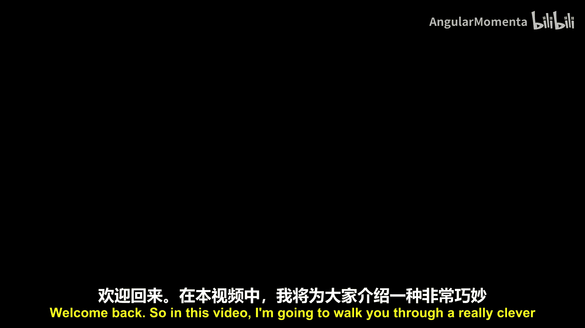
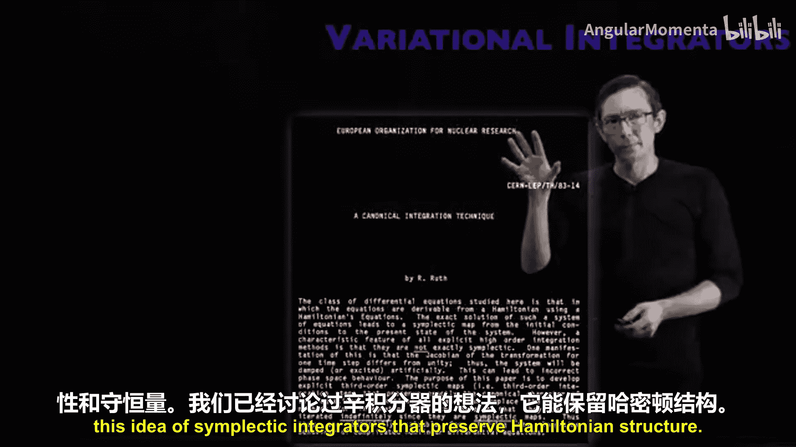
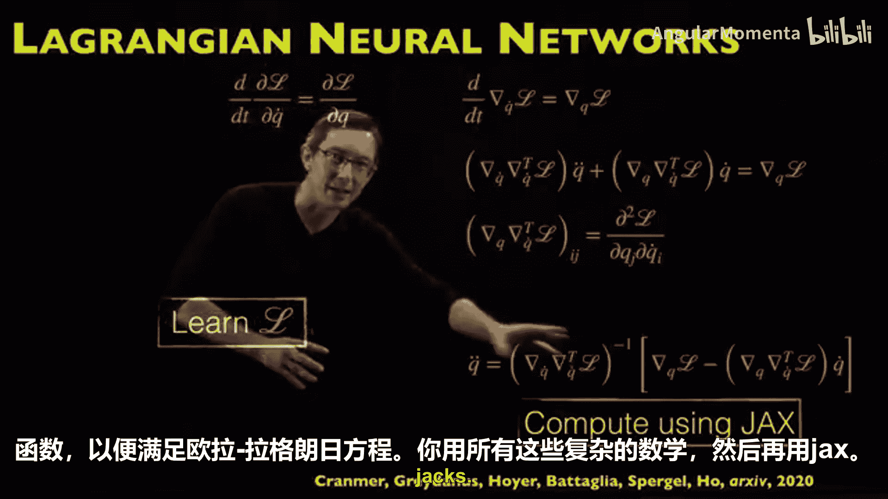
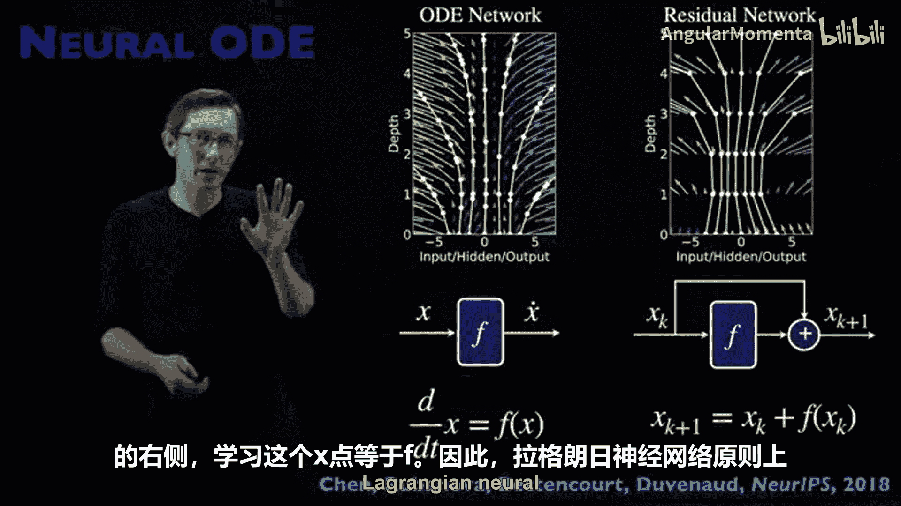
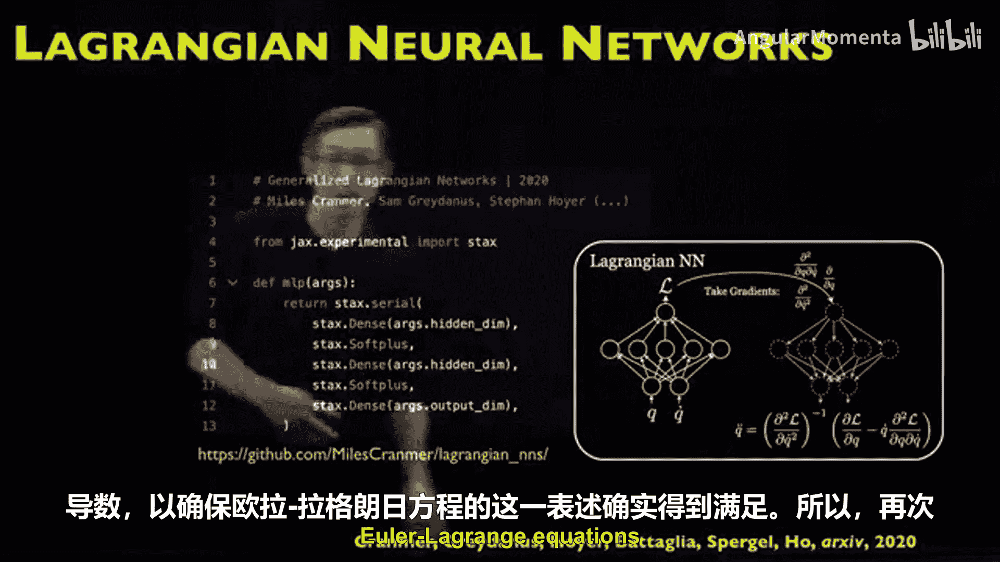

# 【精译】物理信息机器学习-p17-17-拉格朗日神经网络--BV1c9uDzQEj8_p17-

Welcome back so in this video I'm going to walk you through a really clever neural network architecture called a Lagrangian neural network that bakes in kind of the Euler laggrange equation structure into a neural network to dramatically improve its performance when you know estimating and predicting and modeling mechanical systems like a double pendulum so this is one of my favorite kind of custom neural networks because it really does a clever job of baking physics into into the architecture and loss function and it has really。

 really good performance so it's kind of a riff on the Hamiltonian neural networks I talked about this in another video where if you have a system that you know has some Hamiltonian structure like it's got it conserveres energy or something like that。

Then instead of just naively learning the time derivative of your state vector Q and P Q positions and P momenta。

 instead of just building a neural network to learn Q dot and P dot which is kind of the naive thing you could do a Hamiltonian neural network learns the intermediate Hamiltonian function H so that if you take its derivatives。

 it's partial derivatives in the right way you can get Q dot and P dot okay so it's a clever way of making your neural network learn this intermediate Hamiltonian function so that you can enforce this Hamiltonian or simpleplectic structure on the equations of motion so we already talked about that。

And the Lagrangian neural network is kind of an extension or a riff on that Hamiltonian network idea。

 but it has some key advantages that I'm going to talk about and so it's I think the you know greatdonis was from the original paper but Cranmer Hoyer Batalia Sperle and Ho are kind of new authors on this Lagrangian neural network paper and those of you who know me know that I'm a huge fan of Miles Cranmer and Shirley Ho's work。

 so it's kind of no surprise that this is a rockstar paper so the idea here in physics。

 for mechanical systems for kind of classical mechanics。

 you have these two essentially equivalent perspectives that you can take on writing down the equations of motion you can write down a Lagrangian and write down the Euler Lagrange equations。

 which is kind of a variational approach to physics or you can write down the Hamiltonian and Hamilton's。

Equations which in principle these are you know in most situations pretty much equivalent。

 they're kind of dual versions of the same picture there are some subtle differences that I'm not going to get into but you can think of these as being pretty complementaryary so there's the Lagrangian perspective。

 the Hamiltonian perspective， they're pretty closely related and this paper takes the Lagrangian perspective。

So again， instead of just naively learning an equation for Q double dot using some feed forward network as a function of Q and Q dot。

What a Lagrangian neural network does is it learns a neural network model for an intermediate function called the Lagrangian。

So that if you take the partial derivatives of the sgrangian in the right way。

 you recover the Euler laggrange equations and you enforce that that has to be true in your loss function。

 so the Larangian neural network is a really clever way of choosing an architect。

 this is an architectural choice to model the Larangian and a choice of the loss function to make sure that the Euler laggrange equations are satisfied given that Larangian。

And so this is really important for systems that have some kind of。

 you know conservation law or symmetry， generally speaking， if I do this naive thing here。

If I have a system that has energy conservation or some kind of symmetry that I know should be enforced。

 if I do this naive thing， typically that conservation， that conserved quantity is not preserved。

And that symmetry is broken by this naive choice up here， so in the case of this double pendulum。

 you might have energy kind of eventually bleed out or blow up。

 whereas if you enforce this lagrange and this euler laggrange structure。

 you're much more likely to preserve to conserve that energy or to preserve that symmetry that you know about in your system。

 so this is a super， super powerful approach， if you know that your system has some symmetries or some conserved quantities or this kind of lagrangian structure。

 this is a really， really simple and powerful way of baking that into your neural network architecture。

And one of my gripes with the original Hamiltonian neural network paper is you know they looked at really simple toy problems here。

 Cranmer et all are actually looking at a pretty challenging case of this double pendulum。

 this is a chaotic system， it's very hard to integrate using traditional methods。

 so this is a good test case。And again， just kind of a little bit of tiny bit of history lesson here。

 you know， Larange and dynamics is not something new in the machine learning era， you know。

 this has been around for。A couple hundred years right。

 we've been developing Lagrangian dynamics for a long time。

 it kind of is the natural evolution of Newton's picture of dynamical systems for mechanical systems。

It's a very natural way for us to incorporate ideas like invariance and symmetry and conservation laws。

 so know there's theorem and symmetries is one of the。

Most fundamental concepts in all of mathematical physics， not just of the modern era。

 but like ever written down is this idea that symmetries give rise to conserve quantities in Hamiltonian or Laangian systems。

huugely important idea here and the Lagrangian perspective allows us to encapsulate those symmetries to understand those symmetries in a very systematic and methodical way and if you want to learn more about it there's this fantastic book by Marsden and Ratu Intro of Mechans and symmetrymmetry。

Calling it an introduction is， I think a little bit。

Cute because it's actually a pretty advanced book， but it talks all about Larangian dynamics。

 Hamiltonian dynamics， how you handle symmetries， tons of examples of systems。

 it's a really really good book if you want to learn more about the history and implementation of these before the machine learning era。

And again。You knowLo and lots of systems can be written down with Euler lagrrange equations with a Lagrangian or with a Hamiltonian。

 so simple mechanical systems like a pendulum are you know you can write down the Euler lagre equations for those these are easy to integrate using a numerical integrator like a Runga cutta scheme very easy to integrate accurately forward in time。

But other systems like the double pendulum， just adding one more pendulum arm makes this actually very hard to integrate。

 so this is also a lagrangian system or can be represented by the Oer lagre equations。

But this system is very hard to numerically integrate。

 The reason I'm telling you about this is because there's a parallel between how we numerically integrate these systems and how we would model them in the modern era using a neural network so。

If I integrated this system using something simple， like a Runungga cutta fourth order。

 this OD45 scheme， what you'll see， so energy should be conserved in the idealized double pendulum if I don't have friction。

 energy should be conserved， so my yellow benchmark solution here， if I look at the energy。

 it should be a constant value of 60， whatever my initial energy is。

 it should be constant throughout my simulation。But if I use a naive integrator like ODE45。

 this is just a Runga cutta fourth order integrator。

 you see that very quickly my solution starts to diverge and my energy eventually blows up。

 that's really bad news you don't want your you know conserved quantity to not be conserved in your integrator that's a huge problem。

And so there is a large class of numerical integrators called variational integrators。

 and they're designed specifically to respect the Euler laggrange structure。

 the structure of the Euler laggrange equations given a specific lagrangian。

 so I can write down the Laangian for this pendulum。

 and I can come up with a custom variational integrator that is much more likely to preserve energy or that conserve quantity for this system。

That's the pink curve here and it does a much， much much better job of keeping that energy constant so variational integrators are used all across scientific computing if you want to predict the motion of the planets and the asteroids and all of the moons that's a pretty nasty chaotic system that is also you governed by Ouler laggrange equations。

 we might use a variational integrator if we want to know 500 years from now if an asteroid is going to come close to Earth where it really matters that you actually are doing a good job here。

So I'm telling you this because this is directly paralleling what we're doing with the Laange and neural network。

 there's the naive thing to do which is this blue runa cutta curve here and it's not going to do a good job you need to bake in that Euler lagrrange structure into your integrator and then you do a great job it's going to be the same idea in the neural network if we bake in that Euler lagre structure it's going to have a much better chance of preserving our symmetries and our conserved quantities。

And so we already talked about。This idea of。

Syplectic integrators that preserve Hamiltonian structure and so similarly there is this idea of variational integrators that preserve this Euler Lagrron structure so I already talked about this a little bit。

 This is my favorite paper to look into variational integrators。

 This thing is a beast it's like 150 pages long it talks about all of these classic integration schemes and how their special cases of this variational integrator idea really。

 really powerful ideas in here， really comprehensive and this is the topic of Matt West's thesis in 2004。

 so this is really the source for these algorithms。

And that's kind of paralleling what we're doing in this modern machine learning era with this Lagrangian neural network。

 So the idea here is。Instead of just naively learning the differential equation。

 a neural network for the differential equation governing those state variables。

 Q and Q dot that defined my system， that would be like theta and theta dot for this pendulum。

Instead， what we're going to do is we're going to learn an intermediate lagrangian function with our neural network and then we're going to use autoDF to take the necessary differential partial derivatives of that laggrangian and we're going to add in a term in our loss function that the Euler lagre equations are satisfied by that Lagrangian so you're learning a Larangian so that Ouler laggrrange equations are satisfied that's a really clever way of baking in lagrangian dynamics into your neural network。

And they compared this against a number of leading algorithms like a standard naive neural net。

 the neural ODE， a Hamiltonian neural network， and others。

And so there are some key benefits over the Hamiltonian neural network。

 which I think is kind of the closest idea。Which a Hamiltonian neural network。

 this is kind of a subtle point， but it's really important and they make it multiple times。

In a Hamiltonian neural network， you need to know the right choice of variables Q and P if you have a configuration variable。

 a shape variable or kind of a position variable Q。

 you need to know what its associated conjugate momentum variable P is。

Sometimes that's really easy if I have a mass on a spring I know how to compute the momentum variable that goes with the position variable。

 but in some cases in Lagrangian dynamics or in Hamiltonian dynamics。

 it's actually kind of messy to get those variables P those right variables P and that's a limitation of the Hamiltonian neural network is that you need to have the right kind of intrinsic coordinates ahead of time。

 whereas this Lagrangian neural network will work you know for kind of an arbitrary choice of Q and Q dots it's a little bit more flexible and it's more likely to work in nasty cases where it's hard to compute those conjugate momentum。

 so for those of you who you know remember your classic mechanics。

 physics sometimes getting those conjugate momentuma is actually kind of tricky。

And that's I guess what I'm saying here， Hamiltonian neural networks requires what are called these canonical coordinates and Laangian neural networks don't require those canonical coordinates。

 so it's easier to work with just whatever variables you like。Okay。

 so same idea as a Hamiltonian neural network though we're learning this intermediate function L。

 the lagrangian of the system， and then we're going to use kind of you know automatic differentiability to compute the necessary partial derivatives so we learn the Larangian with the neural network we know that the Larangian should satisfy these Euler lagre equations this is actually one of the most fundamental and。

😊，Universly true。Equations in all of physics so this is。

A differential equation that summarizes the principle of least action， the least action principle。

 and the principle of least action is true in quantum mechanics in general relativity。

 special relativity， classical mechanics， optics， electromagnetism。It's basically always true。

And so that's one of the reasons I love Larangian dynamics is because it is a perspective that time and time again。

 it proves itself useful， even when we learn new fundamental forces and new perspectives。

 the principle of least action stays the same。So we know that this is supposed to be true。

For the L that we learn for the Larangian that we're going to model with our neural network。

And so you can essentially， this is just a bunch of math。

 you can pause the video and work out that this is all true， this is also in the original paper。

 you can kind of derive what these partial derivatives with respect to that Lagrangian are and you can derive some properties and you can essentially figure out you know that this Q double dot should equal this expression here in terms of my Lagrangian and Q and Q dot。

And this is something that can be computed using automatic differentiability in a modern machine learning language like jackX or like torch so really。

 really cool idea is that you can compute all of this righthand side relatively easily using jackX and then you can incorporate that these two terms this term on the right and Q double dot had better equal each other in a loss function you can literally say Q double dot minus all of this stuff that you can compute with jackX and put a norm on that and now that's a term in your loss function that says if that loss function term is small。

 then your oiler laggrange equations are being satisfied really clever idea。

 we are choosing an architecture， we're choosing to learn the Larangian and we add a custom loss function so that the O laggrange equations are satisfied and you do it with all of this nasty math and then jackX。

And this is a custom version of a neural ODE， so that's another important point is that the kind of naive benchmark version of this is just a neural ODE a neural ODE is like a continuous time version of a resNe where you're learning the right hand side of a differential equation with your neural network。

 you're learning this X dot equals f of x。So the Lagrangian neural network in principle is a lot like a neural ODE。

 except with this intermediate step that we're learning a Lagrangian first before doing it。

So you can download all of this code here， it's actually really easy to get this working and run it and test it out yourself。

 you can try it for different systems， different oil little lagrangee equations and the code is here so I encourage you to try it out。

嗯。And there's a nice little comment， I think I'll show it in the next slide basically saying you know it's surprisingly easy to implement this in JX。

 so this could be kind of a mess to implement， it's relatively easy in JX and the key thing we're doing here is we're building a you know basically a big feed for neural network to learn the Larangi and in fact this is the code right here it's just you know three dense layers with you know some activation functions。

To learn this Larangian。And then you're going to use JX to compute all of the partial derivatives with respect to Q and Q dot to make sure that this formulation of the O laggrange equations is in fact satisfied。

And so again， it's essentially a neural ODE with some additional structure。

 this additional intermediate step of learning the Lagrangian and a custom loss function to make sure that once you learn that Larangian。

 the Ouler lagrrange equations are actually being satisfied by your data okay and I think where did I see it here？

Yeah， perhaps surprisingly though we can implement this operation in a few lines of Js C appendix we publish our code on GitHub so solving O Lage with Jas。

 this didn't have to be easy， this term here could have been a real mess but it's actually relatively easy with modern machine learning workflows like JaX or torch so this is one of my favorite kind of physics inspired neural network architectures because it takes one of the most fundamental ideas in all of physics again this transcends it's not just true for classical mechanics you know the principle of least action kind of lagrange and dynamics are true much more generally than just classical dynamics this allows us to bake in that lagangeian physics through kind of two stages one through an architectural choice to model the Larange in itself and then through a custom loss function that allows you to enforce。

Promote that the O laggrange equations are being satisfied on your trajectories for the L that you're learning。

Really really cool idea I highly encourage you to you know download this code， try it yourself。

 see if you can break it， see how much noise you can add on the data and still get it to work I think there's a lot of cool things you can do to play around with this you know see if you can extend this to work on。

😊，Non deterministic or non classical mechanical systems。

 see if you can make this work on some exotic physics where we know that O lage is still true。Okay。

 really， really cool paper and a really cool kind of take on the Hamiltonian neural network that has some key benefits。

 okay， thank you。