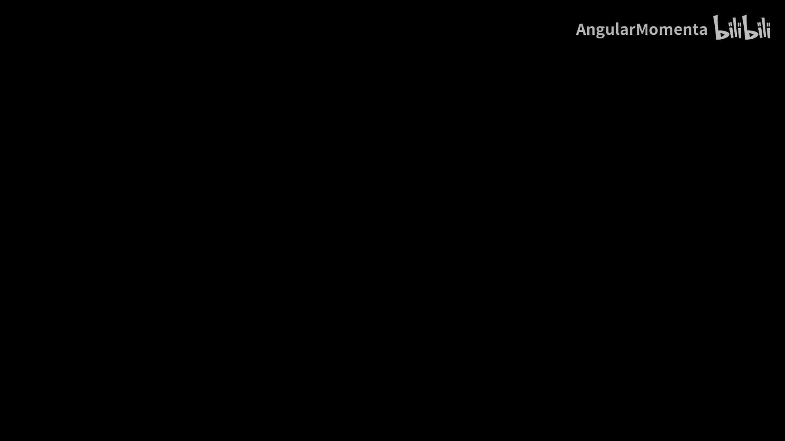
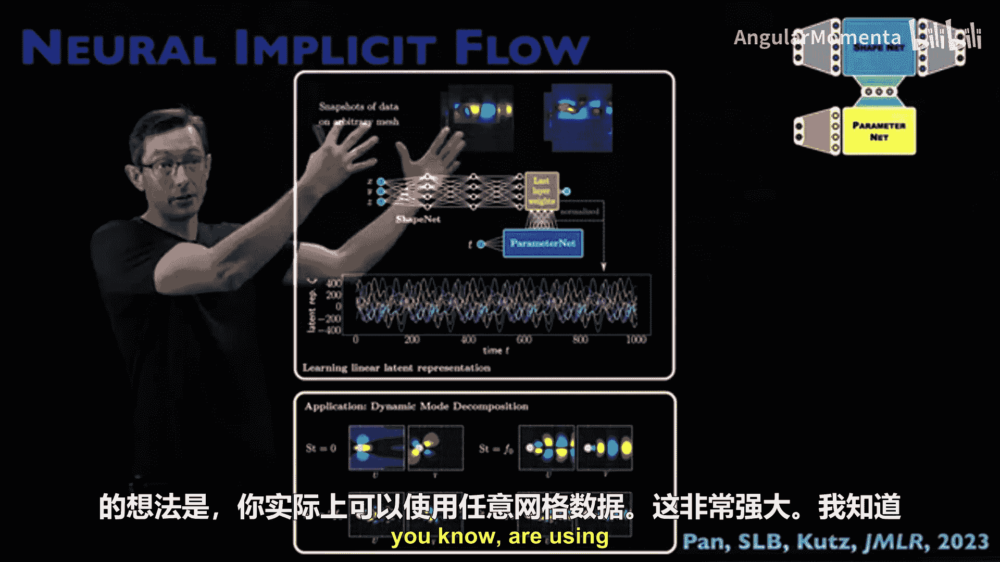
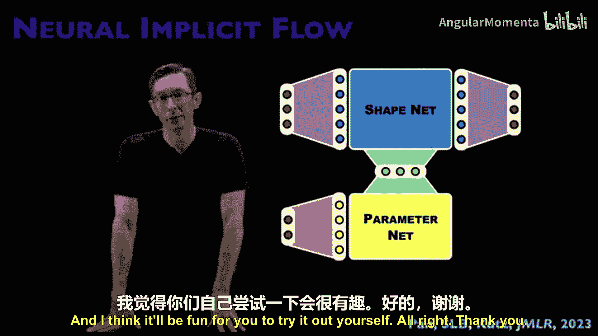

# 【精译】物理信息机器学习-p18-18-神经隐式流--BV1c9uDzQEj8_p18-

Welcome back。So we've been talking about operator learning methods with neural networks and today I'm going to talk through this method called neural implicit flow developed by Shau pan when he was a postdoc working with me and Nathan Cutz so this is a JMLR paper from 2023 and this is a picture of the neural implicit flow architecture。

 so you'll notice it's actually it looks a lot like a deep ONe。

 so it looks a lot like this kind of classic deep operator network from Caridocs at all。

 where you have a trunknet and a branchnet， this kind of split networks that you then recombine later。

Su Pan's neural implicit flow has a similar kind of split between a shape net and a parameter net。

 so I'm going to talk through how this works what you can do with this and it's actually really。

 really cool this is one of my I'm very partial because like we you know developed it when he was at UW with us。

 but I think it's a really really clever way of splitting network to do different tasks with different auxiliary networks and we' I've liked the idea of auxiliary networks parameterizing a network for a while。

 I think it's a clever idea。So the idea of the shapenet is that this is going to actually be a lot like a pins kind of network。

 it's going to model some output field of interest like some velocity field as a function of maybe space。

And then this parameter network is going to parameterize that shapenet with things like you know the mock number and the Reynolds number of the fluid flow or you know parameters that you can change in the system or maybe as time time can enter into this parameter net and as time evolves and my solution changes this parameter net will modulate the shapenet so my solution function U of x changes in time so I think this is kind of a nice way of separating out the things that are largely spatial。

 that's kind of what the shapenet means and things that are largely exogenous like time parameter control inputs down here so a really cool idea and again pretty closely related to both deep operator networks and pins in some pretty interesting ways。

So let's just talk about you know a really really simple example。

 this is kind of what I was talking about your ShaNe is essentially modeling your field of interest like your velocity field as a function of space and your parameter network is capturing the effect of if there's parameters I vary like Reynolds number or mock number。

 something like that or time that all happens in the parameter net and these shape functions can change with time or as I vary that parameter for different mock numbers or Reynolds numbers and so you train with PDE solutions at different parameter values and as they evolve in time。

 you train these networks and then you can predict your PDE solution at different new parameters mu and new times T。

Now I would really， again， I always want you to be thinking critically and you know。

 just because it's our paper doesn't mean you should be not thinking critically。

Is this only going to work for interpolation of muse or might it extrapolate for new muse so if I。

Have sampled these mu values， these parameter values here， here and here。

I'm pretty sure this will interpolate for intermediate muse。

 but can I use it to extrapolate to a new mu that I've never seen before that's usually very。

 very hard so I would be skeptical， I would like you to be skeptical too。

 but that's something you can actually try you can download this code you can try those different experiments and verify for yourself oh。

 this works for interpolation and mu， but it's not going to be amazing for extrapolation and mu except under certain circumstances。

 so that would be interesting to verify yourself。Okay。

 so this is and you'll see that the shape net then starts to look a lot like a you know the neural network that you would use in a pinNs architecture。

 you're just modeling your solution you as a function of space X。

 except now I've moved time down here to this auxiliary parameter network。

 so shape functions up here and all of my other exogenous or external variations down here。😊。

And I actually really like this example， this is used for compressing really really really big turbulent data。

 these are huge isotropic turbulence data sets with resolution 128 cubed so a movie of this thing is actually going to be very。

 very large and with this shapenet with a multiscale shape net now we are representing this is just a rectangle but you know that under the hood there's a lot of stuff happening in this shape net and I'll show you what that looks like later there are kind of resnet versions of shapenet there are multiscale shape net there's a lot you can choose to represent these shape functions here。

But with an appropriate multi scale shape net， you can actually build a very compressed version of this data set and actually this is something that surprised all of us when Shau shared this result with us is。

If you think about this as a compression paradigm， you take this huge data。

 you train the parameters of your shapeNe and your parameter net。

 this is a lot less data to store these networks than these flow fields。

And then this is actually the compression， This is like the MPpeG compressed version of this movie are just the neural network weights here。

 because now I can reconstruct the movie by putting in my spatial grid and my time vector and this network will reproduce this turbulence field here so Shau actually showed that you can get really。

 really strong compression using this neural implicit flow architecture。

 I thought that was really cool so you're learning shape functions that are efficient for capturing this particular flow evolution。

😊，Another example is you can combine this with sparse sensor placement techniques like QDme so we've talked about sparse sensor placement before where you have some high dimensional system。

 it has patterns and so you want to put targeted sensors down to maximally estimate those patterns。

 similarly you can use that idea here in the shape net to essentially use optimal sensor locations to estimate full flow field data you know using these sparse measurements here so if you have sparse measurements。

Of a new flow field， you can use those sparse measurements to infer what all of the other measurements would be at all other points。

 X， Y， and z。So that is a pretty useful idea， your training data would be high resolution images and some select point sensors。

Your point sensors go into your parameter net， your high resolution data would be you the inputs and outputs of this shape net and you'd train that a bunch so that now if you had new sparse sensor locations in this parameter net。

 this combined neural implicit flow architecture would be able to reconstruct the field at any X。

 Y and Z very cool idea and it works really， really well for systems that have strong patterns like this C surface temperature across the surface of the Earth。

Again， I would be asking questions if I were you like， you know。

 I'm pretty sure that this data is relatively low rank。

 I think that the sea surface temperature is not a super complex。High dimensional data set。

 so I would wonder how this would work on a more complicated flow。

And then the other thing that I think is neat about this neural implicit flow is that it inherits ideas from deep operator networks and from kind of neural operators。

 that's why it's called neural implicit flow。😊，The idea being that you can also work with arbitrary mesh and arbitrary resolutions。

 this is really cool because this is because the shape net is kind of like the neural network you would use in a pins where it's just you know the velocity fields that I care about as a function of X。

 Y and Z I can train that network on points that came from a random irregular mesh。

 I can train it from data where each snapshot in time is on a different mesh。

 I can train it for basically I can train this on data from kind of mesh agnostic data and that's a huge。

 huge benefit that's one of the hardest things when we are dealing with actual engineering systems so it's easy to play around with a Fourier neural operator。

you know， for fluid flow in a periodic box with a uniform mesh， that's easy。

 but if I am trying to design a race car or an aircraft wing or a wind turbine blade。

 that geometry over my design cycle is the geometry is changing the mesh is changing and so it's very hard to use。

You know， neural networks when my mesh is actually changing when the representation of how I discretize space changes。

 you know over time or over you know different designs of my geometry and that's one of the things that got us the most excited about this neural implicit flow is that it actually works for data you know on arbitrary meshes you can have nasty meshes。

 the meshes can be changing they can change for different parameters。

 but because this shapenet is just a function the output fields as a function of X Y and T。

 I can put in different X Y and T at those weird irregular mesh locations so really really cool idea here is that you can actually work with arbitrary mesh data that's super powerful and I know colleagues in industry you know are using this because that's one of the features that's hardest is irregular meshes。

And this is just know more benchmark data showing kind of what would happen if you had different MLPs with different activation functions or you know Fourier kind of neural networks or siren layers。

 and the upshot here is that as you go from left to right， the ground truth is on the right。

 the neural implicit flow， this method here is the second to the right。

 and it is most faithfully capturing the true physics of this。

 I believe decaying isotropic turbulence。And it's also really good for， you know， things like， again。

 irregular meshes are sometimes needed for things like growing vortices and things like that。

 and the neural implicit flow NIF does a really， really really good job of capturing the actual high fidelity interface of this growing vortex these are cool pictures I like cool pictures I wanted to share them with you。

It's a beefy paper， you can download this and read it yourself， you can download the code。

 you know it's not a light read， this is not a simple quick read。

 but I would encourage you to check it out and see what you get from it。

And then I mentioned that there are a lot of different ways you can actually build that shapenet。

 so there's a lot of customization， you can use all of your intuition of how you think you can represent those spatial functions。

 U as a function of X so you can use things like this looks a lot like a residual network。

 you can use something kind of akin to a Resnet with siren layers or you can build something that's akin to a U if you wanted to。

 so your shapeNe， there's a lot of flexibility here。

And by offloading the time dependence and the parametric dependence to the parameter net。

 you can have the ShapeNe do what it does best， which is represent these spatial functions using either a ResNe or a unit or。

 something like that。Okay so that is the mile high view of neural implicit flow Shau has a really cool video on this that I'll put in the description。

 check it out， download the code， try it out， try to see where it breaks email us if you break it email us if you fix it or extend it think about how you can add physics in here what if I know about some symmetry my solutions have to have or I know about some symmetry in my parameters or in time how do I bake in that prior knowledge of physics into these kinds of architectures or maybe I can take this latent representation here that allows these two networks to talk to each other maybe I can do diagnostics on that maybe I can apply Cindy and learn ODE models for those time series in that latent space a lot of interesting things we've just scratched the tip of the surface it's a very exciting area to be working in because all of these operator methods are pretty new and there's a lot of you know they don't always。

They break a lot so there's a lot of opportunities to upgrade them， fix them， extend them。

 analyze them more and I think it'll be fun for you to try it out yourself All right thank you。

