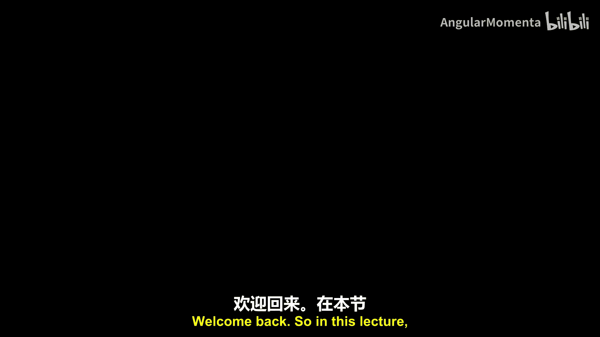
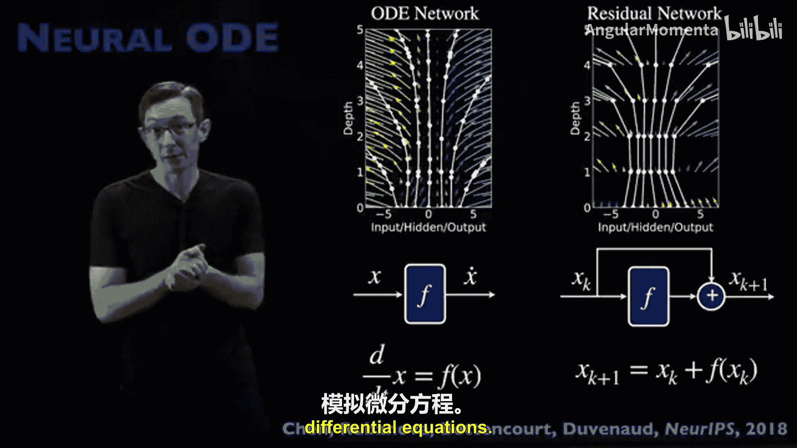

# 【精译】物理信息机器学习-p19-19-神经常微分方程--BV1c9uDzQEj8_p19-

Welcome back。 So in this lecture， I am going to introduce this idea of a neural ODE。

 which is a really powerful modern machine learning architecture for modeling differential equations like ordinary differential equations。

So this is from a famous 2018 Nipps paper already kind of a modern classic in the field of machine learning and also kind of dynamical systems。

 and it's a very natural entry point in this physics informed machine learning topic that we're covering here。

So the idea of a neural ODE is that we are going to model with our neural network F the differential equation describing the state of some system X so we know that lots and lots of systems like a pendulum or a fluid flow or a robot can be modeled with a differential equation。

 x dot equals F of x and we're going to try to model the right hand side of this differential equation with a neural network so pretty normal idea you can do this you know this is also what we try to do with dynamic mode decomposition and Cindy we're modeling the right hand side x dot with some kind of machine learning model here we're going to use a deep neural network now to understand kind of the history of neural ODEs。

 it actually helps to go back to the residual network。

 because this really is a generalization or an improvement of the resnet architecture for modeling differential equation。

So I'll talk about that in just a minute， but again。

 the idea here is that we're going to represent F by a deep neural network。

And we're going to train this network using a modern numerical integration scheme。

 some numerical integration scheme to step this forward。

 and some kind of adjoint sensitivity using the autodiiability of our neural network that we're going to represent F with。

So let's get some context for what we're talking about here by going back to the residual network。

So we know Res， this 2015 paper are you know one of the cornerstone workhorse algorithms in modern neural networks。

 the idea being very simple。That if I want to model the input output relationship between some state X。

 maybe at time step K and at time step K plus1， a very reasonable way to do this is to actually copy the input directly over and only model the difference between the output and the input the so-called residual is what we're modeling with our own neural network F very simple idea but very powerful。

 this allowed us to have much deeper networks that also didn't have the problem of forgetting the input over you know those many。

 many layers， so really important architecture。But if you write this down in kind of math。

 what this ends up saying is that my output， know xk plus1 is equal to my input。

 Xk plus the neural network modeling this residual F， which is a function of the input。

And for any you know for those of you who have any experience with scientific computing。

 you'll recognize that this is pretty much a textbook Euler numerical integrator。

 this is how I would integrate a differential equation X dot equals f of x in kind of the simplest way possible taking the time step of one and integrating it forward like this。

 this is a simple Euler integrator。Now we know that Euler integration。

 especially with large time stepss， is a pretty bad way to integrate a differential equation。

 but again， we're just trying to draw an analogy here and we're going to improve on this analogy with the neural ODE。

 so bear with me for a minute， if the residual network is doing an Euler integration through some vector field F then the thing that our neural network is learning this residual can also be thought of as a vector field。

 some differential equation x dot equals f that we are essentially time steppingping forward with this residual network。

Now again， I'm going to just reiterate this over and over again for those of you that are more in the machine learning community that might not know about numerical integration。

 Ouler integration is usually a bad idea， it's very quick and dirty but it's also highly prone to instability and it has huge errors。

 it's the worst way you could integrate a particle through a vector field。

And so and if you want to know more about this， you know。

 I've got a bunch of lectures on ODE integration so you can kind of figure out how this works and why this is maybe you know there's better alternatives to Euler integration。

 but the idea here is if Res have been so successful based on this simple idea of modeling this residual and doing this essentially Euler integration。

Maybe。I can use better numerical integrators and do something like Resnet but even better okay。

 and that's the idea behind this neural ODE is that instead of modeling you know this discrepancy or this residual F using an Euler integration timescape step。

 maybe I can instead，Instead of modeling this。Large time step forward map from Xk to Xk plus1。

 which is the Euler step， maybe we can model the differential equation itself。

 this x dot equals f of x， the actual vector field， maybe we can model that vector field very。

 very accurately and then use a fancier numerical integration scheme to essentially step that state forward and train this f based on my training data in these white points here。

It's kind of a mouthful， I'm going to say that again。

 bear with me we're going to understand what this difference means and why it works so well in a minute。

 okay？So if I in this neural ODE and modeling the right hand side of a continuous time differential equation。

 this is kind of a discrete time approximation of this continuous time differential equation。

 I can use my neural network to model F directly and if I have this function F。

 we know from classical mathematics， you know Newton， Leebns， Euler Lage。

 like hundreds of years old mathematics， we know how to solve these differential equations and even in the modern computational era we have a lot more experience solving these kinds of differential equations stepping them forward numerically than we have experience with machine learning。

 numerical integration is way older than modern machine learning。

And so if I have this neural ODE representation of my differential equation。

 if I learned this f function with a neural network。

 I can essentially write down exactly what this xk plus1 is in terms of this function F。

 this is not an approximation， this is the exact expression for x at time step K plus1。

 given this differential equation here。Now this is pretty hard to actually compute。

 this is like what a mathematician would write down as the solution but。

There are better numerical integrators to approximate XK plus1 than this kind of crummy forward Euler solution。

 so for example I could use a second order Rga cutta scheme。

 I could use a fourth order runga cutta scheme maybe I could even do something fancy like use a splectic integrator or a variational integrator。

 something that conserves you know energy or some kind of structure of my physics and I'll get to that in a minute that's one of my favorite things about neural ODEs is that you can actually use different integrators and you can get different variants of this algorithm。

Okay， so let's take a big step back。This is inspired by a residual network here。

 but recognizing that Resnets are essentially fitting data。

 data here are these little white points here， it needs your data to be sampled uniformly in time with a fixed time step between the points。

And this is about the worst numerical integrator you could think of to try and model any kind of differential equation。

 so resnets might not be the best way to model a differential equation。Neurural ODE， in contrast。

 models the actual differential equation， the right hand side itself instead of just a one time step update or flow map of that differential equation。

And then once you represent your system this way and you try to train your neural network to represent the continuous right hand side of DDT of x。

Now you can use different numerical integration schemes to train the parameters of F to be consistent with these data points in white。

So let me say this a different way。With neural ODE， with this ODE network。

I actually can have irregularly spaced points in time。

 I dont need to be continuously I don't need them to be evenly spaced like in the residual network because I can essentially。

 I'm using these data points to train the parameters of this neural network F。

And what I'm doing is I tweak F。And I essentially tweak the parameters of F so that when I discretize this numerical integrator and I'm trying to predict these white points。

 they fit as accurately as possible， I'm tweaking my underlying vector field F I'm learning the vector field so that if I numerically integrate along that vector field。

 I get as close to the data， I'm sampling as possible。

 maybe that's the most clear way I've said it yet， I am tweaking the parameters of my neural network to model this underlying vector field。

 all of those arrows in F， I'm tweaking that I'm learning F。

 so that if I integrated these paths through that vector field using a fancy integrator。

 not a crappy integrator， but a good integrator， I want to minimize the loss of my integrated trajectory。

And these white data points of my measured trajectory。 So it's a really， really clever idea。

 and in principle， the difference between a neural ODE and a residual network。

Because we're modeling this continuous time system and using a good integrator， it's kind of like。

If I took my resnet and I had a much smaller deelta T and I had a lot more kind of residual layers。

 so it's the continuous and discrete time analog it's almost like if I have my interest at the bank compounded every year versus compounded continuously this is just a lot better and it's going to give me a lot more accurate models and it's going to allow me the key feature that I can work with unevenly spaced data because I can integrate this over irregular time steps using better integrators really。

 really cool idea okay so let's see how it actually works， this is a figure from the original paper。

 relatively simple differential equation but the top here is just kind of a standard recurrent neural network and this layer here is a neural ODE。

And the dots are the training data， and then you can see kind of the prediction in yellow and the extrapolation in blue。

So the recurrent neural network is really jaggedy and it doesn't do a very good job of the prediction over the training data or of the extrapolation in blue。

 whereas the neural ODE is much more noise robust， it's much more able to have a smooth prediction of the training data and the extrapolation into the future is much。

 much more accurate because we learned this nice， clean。

 more accurate representation of the vector field F using this training data。So really。

 really cool cool idea in principle is that you're learning the vector field F and using machine learning。

 you optimization， essentially by tweaking those parameters of that vector field。

 you're tweaking those parameters specifically so that you're integrated trajectory best matches the observed data points。

 and we're going to use like all the standard tricks of auto differentiation and back propagation to tweak those network parameters for F based on this observational data。

 but under the hood， we are time steppingping our vector field F using a fancy better numerical integrator than something like a Resnet。

Good。And I want to point out。Remember， I said that you can use better integrators so you could use a second order Rgacutta。

 you could use a fourth order rungacutta， but you can also add additional structure into this neural ODE。

 so there are some follow up papers， this Nup's 2019 Hamiltonian neural network。

Is morally in that family of neural ODEs where essentially what they do is they add this additional structure that they're going to learn some Hamiltonian function and they're going to compute the equations of motion Q dot and P dot from that Hamiltonian function you know so that they preserve the total energy of the system so it's essentially a neural ODE where the integrator that I use is forced to have a simpleplectic or energyconserving structure so really。

 really powerful idea you can take your neural ODE and by swapping out your kind of integrator to something like a Hamiltonian splectic integrator。

 you can make your neural ODE conserve energy， very cool idea。

A similar follow up paper by Cranmar et all extends that to a Lagrangian neural network。

So instead of enforcing simpleplectic or Hamiltonian structure in the neural ODE integrator here。

 they're enforcing the Euler laggrange equations are satisfied。

 so this is what you would call a variational integrator and it also has this energy conservation property that is essential in physical applications。

 so this is one of the things I like the most about the kind of neural ODE is that it allows you to bake in additional symmetries and structures and things like that。

To make it more physical， so that's something I really like about neural ODEs。Now。

I don't have time to go into every gory detail about how this algorithm works you know there are nice tutorials online I think the best way to learn about these algorithms is to code it up you know download someone's demo code and then modify yourself or play around with it but you can see that the computational graph is a little complicated it's not trivial and there are kind of forward and backward time pieces of this and so this is something I really want to I do want to get into one technical detail about the neural ODE because it's really important and it ties into the bigger field of optimization and dynamical systems。

 things like reinforcement learning Hamilton Jacobbe Bellman so I think it's important for you to see this piece here and it's kind of technical so if you don't want to get into a bunch of math you can just skip the next five minutes or so。

But again， the neural ODE is trying to model this x dot equals f of x。

 is trying to model a differential equation of vector field f using a neural network。

Mathematically we know how to take this differential equation and step it forward one delta t forward in time。

 so if I have some initial condition at time t not。

 I can step it forward one delta t forward in time using this calculation here。

 this is called a flow map phi that maps my initial condition forward1 delta T in the future。

 this is classic dynamical systems， this is just differential equations。

But what we're doing in a neural ODE is that we're going to represent this function F using a neural network。

 so it's going to have parameters data and we're going to be tweaking those parameters data to try to fit this function F based on observational data okay so that's the idea here。

And so there are a bunch of free parameters， there's the free parameters in theta。

 there's the free parameter of like what initial condition to start at， what deelta t should I use。

 and there's also a hidden state， this is an idea that is in this paper quite a lot is this hidden state X at tau。

My data is sampled at discrete points in time， they don't have to be uniformly sampled in time。

 but they are discreteetly sampled in time typically。And so between any two measurement points。

 there is a whole continuous state x at some continuous variable tau between those two measurement points。

 essentially this flow map integrates me along that hidden state x of tau from time t0 to t0 plus delta t。

And so this hidden state is going to be an important ingredient in the actual optimization algorithm I use to train my neural network to tweak these parameters theta to learn f of theta。

 I'm going to need information about this hidden state that's not in my training data so that's what this math I'm about to tell you is all about is like how do I get this hidden state in a way and get that information into my neural network training optimization。

😊，So you know this is almost exactly what I've written up here except now we're using our neural network F theta as our differential equation。

 and I can similarly flow that forward in time using this flow map。

 but now this flow map is depending on my initial condition， Tn。

 tau and theta all of the parameters in my neural network that defines my dynamics。

 so this is one way of representing this hidden state。

 there is some nasty function phi of all of these free parameters here。And importantly。

 this X of tau is going to be used in my loss function I use to train the neural network。

To fit the data。Specifically， I'm going to need to compute the partial derivative of my loss function with respect to the state of the system Xt at intermediate times between observational data points at times tau so I need to compute this partial L partial Xt。

Now I'm going to skip about five hours of hardcore dynamical systems optimization involving lagrange multipliers and how you actually do this。

 this is a really interesting topic we're going to discuss this in my optimization boot camp that we are developing currently。

But long story short， one of the ways you can deal with this is to introduce this lagGrange multiplier variable。

 A of T， this is kind of a virtual variable I'm going to keep track of when I'm training my neural network。

And it is going to be minus partial L partial x， that's how I'm going to define it。

And it satisfies this differential equation， you can go through some optimization map and you can verify for yourself。

 use the chain rule dot dot dot that this is the differential equation that satisfies this fictitious kind of virtual a variable which is going to be a lagge multiplier and that Lagrange multiplier is essentially going to enforce this constraint when I'm optimizing over my free parameters so。

😊，This is also called an adjoint equation and we've been using adjoint based optimization in control theory in engineering design with differential equations for decades so we know how to do this。

 one of the big advances in this neural ODEs paper is essentially how to do this Lagrange multiplier adjoint calculation without actually having to integrate this by hand。

 without having to do this by hand。So the really key observation here is that if this F function is a neural network。

 I can compute partial F partial x by auto differentiation using kind of the normal tools I would use to back propagate error and train a neural network。

 I can also compute this function here that I need to integrate my adjoint Lagrange multiplier state。

And so what this means is that I I'm still trying to find I'm still trying to do what I always do。

 I'm still trying to learn the parameters theta to parameterize this neural network to approximate my dynamics。

And there is this hidden state X I need to keep track of because it's important for my loss function。

And so to keep track of that， I'm going to introduce this lagge multiplier variable that satisfies these dynamics and I can compute these dynamics and I can integrate and keep track of this a variable using kind of the autodiiability of this neural network F of theta so that's a mouthful this probably is only interesting to like 2% of the people who are actually interested in understanding neural ODEs。

 but it is an important piece， and it ties this to you know pretty important optimization theory with lagge multipliers but critically we're using the autodiiability of our neural network to get the equations for this Laange multiplier we're not doing it from first principles with pencil and paper that would not work that would be a huge pain and so this is kind of how they solved that。

😊，LaGe multiplier adjoint problem using modern AutodF capabilities of this neural network。

So kind of cool， wanted to show you that， again dig into the code if you really want to understand how it goes。

 but this is one of the most important parts of this paper。

 what they call reverse mode differentiation， that basically is just an adjuint method using auto differentiability of their neural network representation of the dynamics。

Good。Okay so that is neural ODE in a nutshell again what we're doing is we are modeling a dynamical system a differential equation using a neural network we're modeling it in continuous time as opposed to what Resnets do is modeling it as a discrete time update this gives us a lot more flexibility in swapping out better integrators you know integrators with structure like simpleplectic energy conserving integrators and it allows us to better fit data that is a regularly spaced by fitting the underlying continuous vector field and using a better integrator to integrate that vector field along these trajectories really powerful idea tons of extensions you should try it out and see how you can get it to work as well one of the things we've used in my group is。

And other people have used this as well。Our methods like dynamic mode decomposition and Cindy don't always work that well if you have irregularly spaced data。

But what you can do is you can take your irregularly spaced data。

 you can train a neural ODE on that irregular spaced data and then you can take regularly spaced data integrated through your neural ODE and use that as the input data for Cindy so neural ODEs are powerful but they're not that interpretable this F is a big neural network so how are you going to say oh that's s of X you can't it's a neural network so what you can do if you have a regularly spaced data is you can train a neural ODE then you can train use that train neural ODE to get regularly spaced data and then pass that through something more interpretable like Cindy or symbolic regression so that's one of the ways we've used this there are extensions for neural PDdeEs again like I mentioned extensions to simpleplectic energy conserving systems very。

 very cool architecture， something I think you should play around with and it generalizes one of the most important kind of cornerstone。

Algorims， resonates to be more suitable for modeling differential equations。 All right， thank you。

