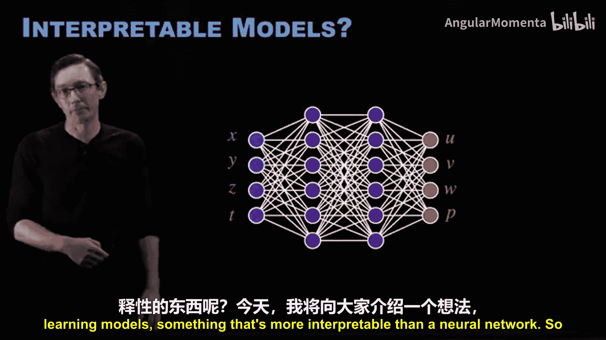
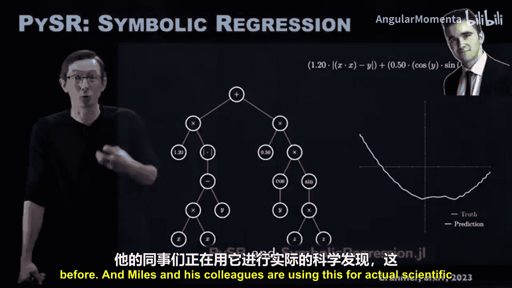
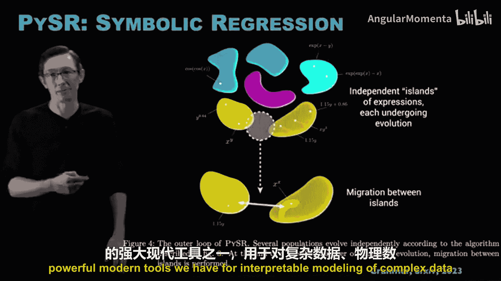
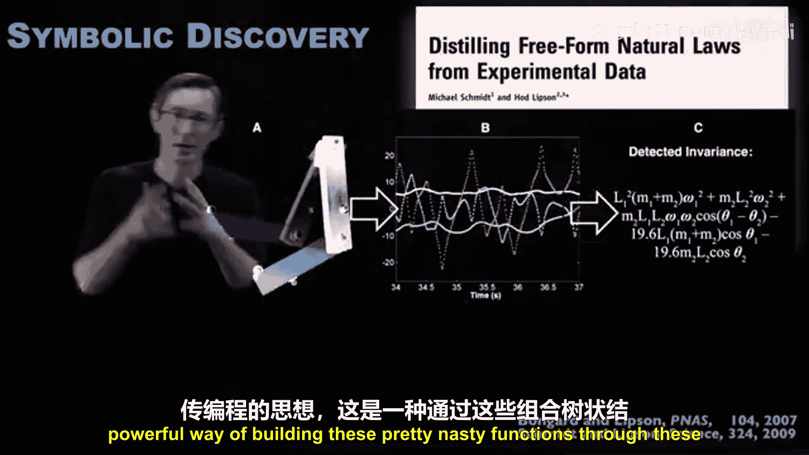
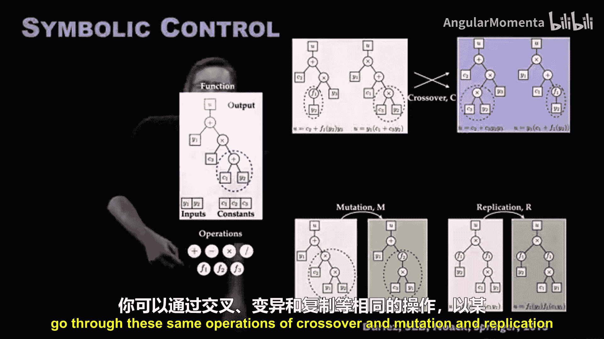
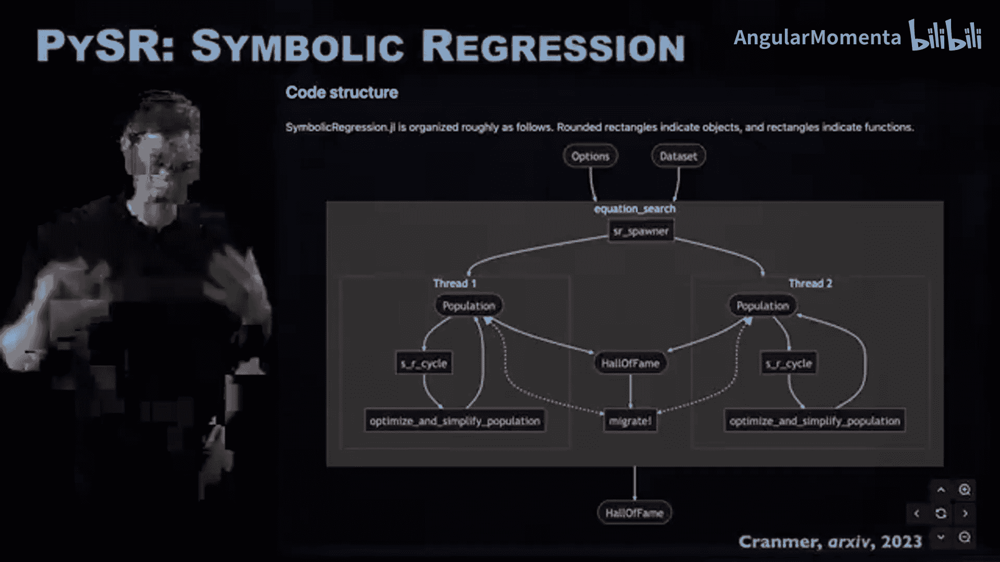
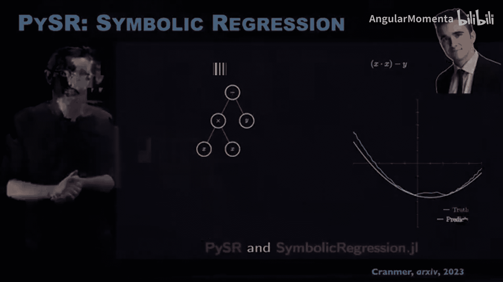

# 【精译】物理信息机器学习-p20-20-Python符号回归--BV1c9uDzQEj8_p20-

Welcome back。So we've been talking a lot about machine learning and physics informed machine learning。

 how you can essentially learn you know physical quantities using things like neural networks。

 but one of the things that we know we want physical models to have is interpretability we want expressions that are simple that you can understand that a human can read and explain things like the Hamiltonian or the Lagrangian or something that's more interpretable than this big opaque neural network。

 these are notoriously hard to understand what's happening under the hood。

 so what if you want interpretable machine learning models。

 something that's more interpretable than a neural network。

So today I'm going to talk to you about this idea， this package called P or Python symbolic regression。

 developed by Miles Cranmer， who is a professor at Cambridge University in the UK that is a really。

 really powerful idea。For building interpretable models of the real world using what's known as symbolic regression。

 okay this is a movie I actually got from the GitHub page for you know this Pser symbolic regressiongression。

jL so you can go to this and download this code yourself and try it out。

Pyer is one of the best maintained software packages out there for discovery for scientific discovery。

 using interpretable machine learning， it is largely the work of Miles Cranmer and you know I think lots of people around the world have helped develop this but really you know I want to give a huge shout out and credit to Mil for making this extremely powerful open source package for science discovery and people across the world are using this to discover you know equations。

 interpretable symbolic equations for things that you know humans have never been able to write down equations for so this is changing the way that we do science in some way and I highly。

 highly encourage you to check this out and figure out how this works。

So symbolic regression is just a way of saying we're going to do some regression。

 some machine learning procedure， but what we want out is a formula that's actually symbolic that's human readable in terms of things like signs and co-sines and exponentiation and things like that。

This movie essentially shows how this， you know this search algorithm is searching over these function trees。

 that's how these functions are being represented in terms of these compositional trees。

 it's searching over these different function trees and you adding a node and optimizing the constants and doing these things to get closer and closer and closer to predicting some you know observed data function here。

 and you want the simplest model if it's the data and no simpler。

 remember that's that principle of parsimony， symbolic regression is a great way of baking in that principle of parsimony to your learning algorithm。

So we're going to talk a little bit about Pser again。

 this is a huge effort by Miles so you really should go check it out， read the paper。

 see what examples people are doing， I'm just going to give you a high level overview of what's happening under the hood here。

And importantly， symbolic regression is not new oftentimes in the field this is called genetic programming genetic programming is kind of an earlier form of symbolic regression using these function trees and it is kind of a descendant of genetic algorithms so these have been around since the 60s。

 the 70s， the 80s， genetic programming in particular you know and it's essentially current form in the 80s but this is a very powerful modern take on that。

 a very， very welldesigned software package so you can actually use it much more flexibly it's much more powerful than before。

 and Miles and his colleagues are using this for actual scientific discovery which is really cool。

So you know， the idea here is that you're trying to learn some input output function that describes your data。

 that's what a machine learning model is， but you want that input output function to be a human readable expression。

 you know， something like this here。And so there are these general kind of genetic operations of mutation where I might just change one term in the equation or crossover。

 maybe I have two equations that both do a pretty good job of predicting my data but not perfect。

 I might swap terms and see if that does a better job， it's kind of like， you know。

This is an analogy for biological reproduction where you take the DNA of two parents and pieces of them get swapped and maybe in your offspring you actually have some stronger characteristics。

 so that's crossover。Sometimes there's a step called simplification where you maybe factor or reduce this thing down。

 get rid of some redundancies， and then optimizing constants。

 so if you have these constants out front， optimizing those can make a huge difference in the symbolic regression procedure。

And then， you know， there's lots of ways of doing this， but often what you would do。

Is you might start with a population of these functions and kind of evolve them forward using these genetic operations。

 and there's lots of ways you can optimize these functions using these operations here。

This is just a pictorial view of what crossover and mutation are。

 so if we have some function we're trying to represent like 1。15 y plus 0。

86 you you know there's a plus operation and it takes a constant here that's the 0。

86 it takes this subbrach here which is 1。85 times y and it adds them together so this is a function tree representation of this expression here。

And if I have two function trees for two different functions。

 maybe each of these you know performed so so in modeling my data。

 what we're going to try to do is we might take a piece。

 a subtree you know some branch on this tree and we might swap them and see if these children perform better now oftentimes you know you get this regression to the mean and the performance doesn't actually improve but occasionally it does。

 and so if you do this enough times some of your offspring might actually perform better and then you allow them to advance to the next generation in this optimization procedure。

Similarly， mutation， maybe this plus sign here should be a minus sign and so we switch it to a minus you kind of randomly pick nodes and swap them out randomly。

 that's again like a genetic analogy， sometimes UV light hits your cell and it changes your DNA a little bit and your offspring has some weird possibly beneficial modification that might help them model that data better。

So again， pictorial， and I pulled these directly for Miles' papers， these are Miles's graphics here。

And this is a figure I really like， it gives this kind of abstract pictorial view of what's happening through this evolutionary symbolic regression process so you evolve these populations and as they you know go through this crossover mutation。

 this kind of evolutionary algorithm， you start finding that there are you know these different islands of classes of functions and sometimes you get migration between these islands。

 sometimes the islands segregate and you get these different classes of behavior but I think this is a really nice kind of pictorial view of that abstract function space we're trying to model with this symbolic regression again。

 great paper you should you know download the paper download the code really try this out yourself。

 this is one of the powerful modern tools we have for interpretable modeling of complex data of physical data。

Now， importantly， symbolic discovery is not new， and I think you Miles definitely doesn't claim that it's new。

 but I think for you， the viewer， I want you to know the history， genetic programming is pretty old。

 that's I think from the you 80s essentially was that idea of building these function trees to approximate input output data。

But there was this really powerful breakthrough first by Boongaren Libson and then by Schmidt and Lipsson。

 where they realized that you could use that genetic programming idea。

 that function tree representation， that evolutionary algorithm。

 not just to learn arbitrary input output data， but to learn differential equations。

 so if you have a physical system， you can use the symbolic regression to discover， for example。

 the differential equation that governs that data， or you could learn a lagrangian you could learn a Hamiltonian in symbolic form using these genetic programming operations of crossover and mutation and replication and things like that。

And so in this paper in particular， they do things like take data from a double pendulum。

 this measurement data here， and they can learn， they can detect these invariances like this Hamiltonian conserved energy here。

 in symbolic form purely from the measurement data。This was a huge advance at the time。

 this was kind of categorically different than anything else that had really been done and it used that idea of genetic programming which is a very powerful way of building these pretty nasty functions through these compositional treelike structures。

 very powerful idea。

And you can see kind of the process here again， I recommend you go download this paper。

 it's a classic now， but you it is built on this idea of genetic programming of these function trees and mutation and crossover and kind of learning differential equations using these input output functions。

 these very， very flexible input output representations。So symbolic model discovery is not new。

This also has been productized into the software package， Eureka。

 that I think Schmidt and Lipsson developed this， but essentially it allows you to upload your dynamical systems data and get these differential equations out。

 which is pretty cool。This was the kind of direct predecessor of our Cindi method。

 our sparse identification of nonlinear dynamics， it's very closely related to that idea of symbolic regression and symbolic model discovery。

So I guess what I'm trying to say is that symbolic model discovery is not new。

 we've been doing this you know， for decades。But the piSer package is an extremely。

 extremely powerful modern way of doing it that allows everybody in the world to have access to these tools and also I'll point out that Barrett Noak and his colleagues applied this to also learn symbolic function representations for control laws so if you have some control law use and actuation signal that you want to learn。

You can go through these same operations of crossover and mutation and replication in some you know proportion。

 some handted custom proportion and you can breed these control lawss to be more and more effective in controlling very complex systems like turbulent fluid flows so this is actually a textbook that the three of us wrote I was a co-author on this where we use the same idea of symbolic regression to breed and evolve really effective controllers for things like fluid dynamics so again just a long way of saying symbolic regression has been around for a long time it's been used for dynamical systems discovery by Bondgar Lipsson and Schchmidt and Lipsson it's been used for control but it's really this kind of piS package is a huge step forward in democratizing this and making it available for everybody in the world so you can try it now。

The features are really really kind of neat， here's actually a lot of the features here of what PISer has versus a lot of the other classic implementation。

 so actually Picindia is in here， Eureka is in here and a lot of others and you can see that you know Piser actually has been very thoughtfully designed by Mil to have the functionality you would need to really apply this to some pretty hard problems。

And him and his colleagues have applied this for lots of neat scientific discovery。

 like relearning the laws of planetary motion from data of the planets and things like that。

 really cool demonstrations that you can use this for actual scientific discovery。

Extensively benchmarked on a lot of systems also so you can actually。

 you know here's a bunch of systems and you can see kind of Pyer's ability to learn the system compared to other leading leading algorithms and I think five out of five here means it did a really good job。

 I'm not 100% sure I'd have to reread the paper to double check that。

Another cool contribution of this paper is this empirical bench。

 so this is actually a benchmark testing setup that has these cases。

 so your symbolic regression algorithm you can actually add a column here testing it against all of these up so that's a really cool contribution too。

And the code structure， I mean， Mil is expert， but he's also a great software engineer。

 and so the software here has been really， really thoughtfully designed。

 use it and actually extend if you have some ideas on your own。

So really， really cool stuff highly but if we zoom out。

 the big win here is that symbolic regression allows you to get more interpretable。

 an actual function， an actual function you can write down。

 and there are simplification algorithms in this code that we do kind of in the olden days in Mathematica we'd call this like the full simpl where it simplifies it down to the simplest version of the expression。

You get that kind of flavor here in Piyser。And remember。

 this idea of you want the simplest model possible to describe the data but no simpler。

 that was that principle of parsimony， that Einstein quote。In PISer you can do that you can plot。

 so you get all of these different functions that could represent your data as this thing evolves and you could plot them in you accuracy versus complexity and you could pick the model that is kind of the most accurate at a given level of complexity at this sweet spot of being as simple as possible to describe the data but no simpler。

That was actually an idea that was used in the original Bondgar Lipsson and Schchmidt and Lipsson papers here that you can plot the Paredo front and pick models based on you know parsimony or simplicity more interpretable and they download the code is a huge service that Miles has done is making this for interpretable general regression okay。

 very cool package try it out yourself all right， thank you。

