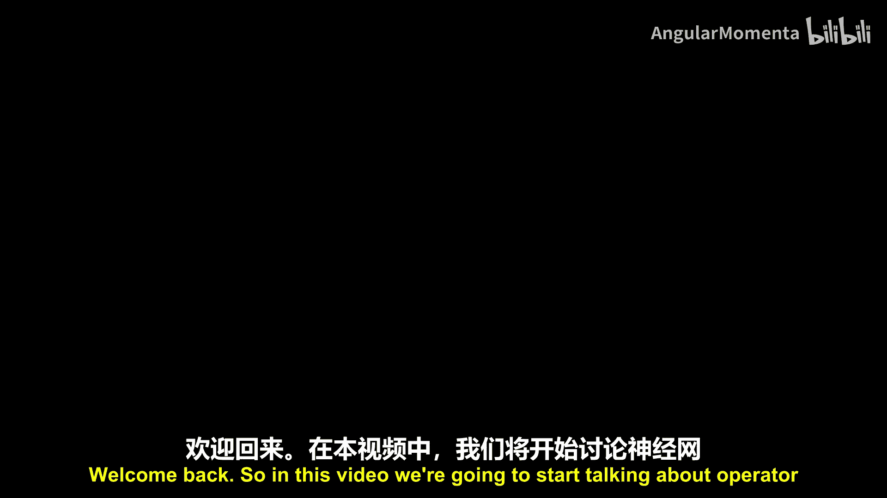
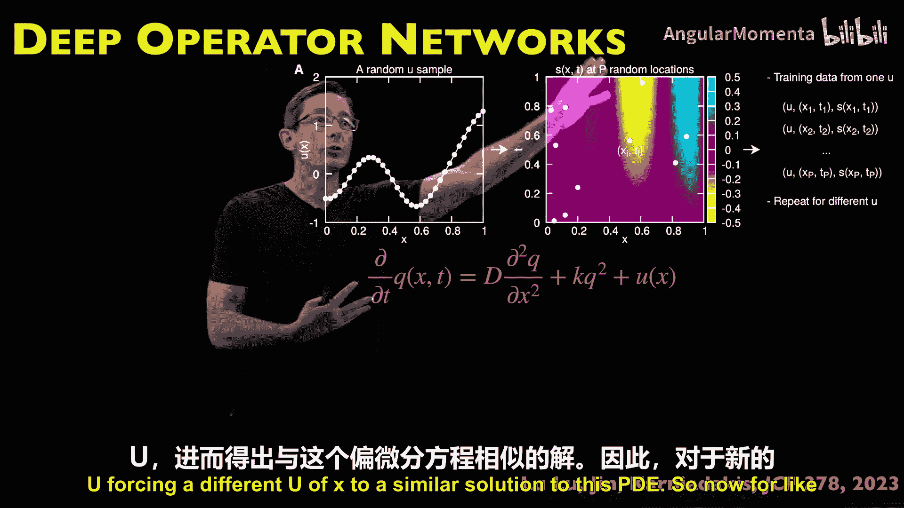
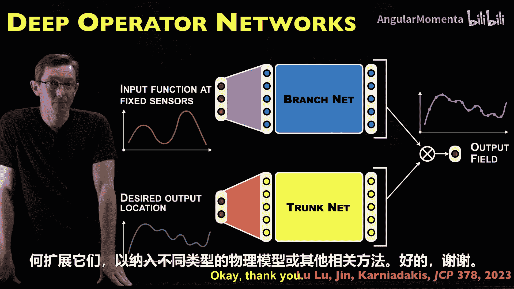

# 【精译】物理信息机器学习-p21-21-残差网络--BV1c9uDzQEj8_p21-

Welcome back so in this video we're going to start talking about operator methods in neural networks。

 which is this really powerful and growing set of methods so deep operator networks or deep O nets were introduced in this paper by Lulu Jin and Carniiaocs。

😊，Where they essentially showed that a few things， actually this paper does a lot。

 and I think it's a pretty interesting read， so I recommend it。

 but essentially what they did is they introduce this idea that if you have an ordinary differential equation or a partial differential equation that is being forced by some kind of external forcing function。

Then there is a map from that external forcing function to the solution function of your ODE or PDE and that mapping between those is an operator。

 so most of neural networks， the universal approximation theorem is really based on approximating input output functions。

 but in this paper they argue that most ordinary and partial differential equations。

We're actually concerned with the solution operator。That maps input functions to output functions。

 So I'm going to say that one more time， this is really， really important。

 a standard kind of deep neural network is a universal function appximator。

 It will approximate some function of a variable X。But in this paper in the deep ONe paper。

 they argue that instead of trying to approximate an arbitrary function on some vector of data。

 what we want to do in ordinary and partial differential equations is estimate the solution operator which maps functions to function。

 so normal neural networks map you know data to data through a function。

 the solution of PDEs and ODEs map functions to functions and those are operators。

 so there's this old kind of similar universal approximation theorem for operators that actually says that a certain class of neural networks can also arbitrarily well appro operators not just functions。

 so this paper is kind of a modern riff on that idea that in ODEs and PDEs we actually want to be approximating the solution operator that take some forcing function and maps it to a solution function of that。

That PDE or ODE that's the big idea and we're going to you know essentially go through how this architecture is designed。

 why does it have a branch net and a trunk net， what are the input functions and the output locations like what does this all mean and we're going to talk about that here？

And this is one of many approaches to modeling solution operators of ODEs and PDEs。

 there are also Fourier neural operators and neural operator methods。

 but this kind of was the first modern paper to do that with deep learning in a careful and concerted way for ODEs and PDE。

 so this is where I'm going to start。Okay， so the idea again is that。

I might have a system of ordinary differential equations that has some input forcing。

 maybe it's forced by some you control or actuation or external disturbance。

 so there's some input function。And the solution， the output function of my ODE。

 is going to depend on this input forcing。And so you know。

 I might measure what is the input function at some fixed locations either in time or space。

 and I might want to predict my output function on a grid。

 a spatial grid or a temporal grid okay and so what the deep O network does is it actually splits。

This network。 So I hope my next slide is the straw man。 Let me just go to。This one here。

 this is kind of the naive way of taking this input function information and this output function locations。

And predicting what the output of your ODE or PDE is given this data would be to just use a big。

 fully connected network。So deep O networks does something a little different。

 it splits and has two different big neural networks one。To encode the input function。

 the features of the forcing function that's forcing your ODE or PDE。

 so there's one network called the branch net that encodes those input features and there is a separate network called a trunk net that is used to encode kind of the solution output functions at these specified output locations。

And so in this paper they carefully and methodically show that splitting this network into these two branch net and trunk nets is better than that large feed forward network。

 and better in the sense that it generalizes better you know it's more accurate， it trains better。

 things like that， okay so they carefully go through and show that this custom architecture splitting the input feature space and the output feature space is a clever idea with representing these solution operators of ODEs and PDs。

So I'm saying this a lot that there's a solution operator。

 I want to go into a little bit more detail of what I mean here。

Let's look at the simpler case of trying to use deep OEs to solve or analyze an ordinary differential equation because ODEs are usually simpler to think about than PDEs。

 so let's say I have some ODE here， maybe this is describing you know some mechanical system that I'm trying to control or some system you know like the suspension of a car or a pendulum。

 something where the state X changes in time， according to some function F that you is kind of the rules of physics for that system。

 it could be you know a statement of F equals MA or something like that。And this system。

 these dynamics are affected by an input function U of T。

 so U of T can be thought of as either some control。

nob I of control over or some input forcing that affects my system over time。

And given a particular input u of T， I would want to know what is my solution， x of T。

 my solution of x of T for future times T。And so in the kind of language of deep O networks。

 there is an operator G that takes this forcing function U and it spits out my output function X of T that I actually want to be solving for So this operator G maps from functions to functions from forcing functions to solution functions X of T and it does it in this case using this flow map computation。

 so this is literally just the way that we write down the solution of an ordinary differential equation is in terms of this flow map integral here。

Importantly。This flow map becomes arbitrarily sensitive and you you get this kind of divergence when the dynamics are chaotic。

 so this is going to be a huge issue for things like operator operator methods。

 deep OEs and Fourier neural operators and things is that it's going to be very challenging to apply these for systems that have chaotic dynamics because you get very sensitive dependence on initial conditions and forcing and these solution operator kind of will cause trajectories to diverge if I perturb this input by a little epsilon my G might diverge for future times so these aren't going to work great for chaotic systems probably you should try it out。

 you should code this up and try this on a deterministic system and a chaotic system but the idea here is we're trying to learn this operator function G using a neural network from functions to functions。

Spttting it into the trunk net and the branch net seems to be an efficient and effective way of doing this and specifically。

What the way you would actually train this， let me go to the next slide where you actually have this。

 the way you would actually train this is that you would have maybe your。you know。

 high fidelity simulations， you'd actually be running a bunch of simulations for different input functions and different output functions and or maybe you'd collect measurements from an experiment and what you would do is you would characterize this input function。

 this forcing function at a few fixed。😊，Sensor locations， so for the case of temporal forcing。

 you would characterize this input function at a few points in time。

 those would be the inputs here is your forcing function at some specified points in time。

And then there would be some output locations where you want to predict what is my solution at these points in time in the future。

 so that would be your desired locations for your output here。

And your branch net and trunknet are going to learn latent features that encode。

Input features that matter for that ODE， output features that are likely to be generated by that ODE。

 and they will be recombined in this kind of output field， which is the actual solution。

 it's your operator G applied to this input function。

And it gives you your solution of that ODE at all of those locations and time that you specified down here。

So it's a really like simple idea， it's a simple idea that you know once I've trained this now I can give it a new input function。

 I can look at what would happen if I gave it a different forcing function that I've never trained on。

 will this predict the solution of my ODE given that new input function。

 that's what we mean by generalization。😊，And this deep O paper kind of carefully shows that at least for relatively simple。

Physics， simple ODs and PDEs， this architecture generalizes better and trains better。

 It has better convergence and better error and better generalization than if I had just done the same thing with a large fully connected network because again。

 you could just have one big network that takes in the exact same data and it's some big fully connected network that then tries to predict this output field at those desired locations。

 This is going to be more prone to overfitting harder to train less generalizable。

Then splitting it into the branch net and the trunk net。

So I think this is kind of a cool idea and this doesn't just have to be for ODEs I gave you an example where the input function was forcing in time for an ordinary differential equation。

 but this also works for partial differential equations this might be an input function over all of the points in space I might be forcing my PDE in space and I still want to learn this operator that goes from that forcing function to the solution of my PDE in space and time now this original deep operator network paper。

😊，And。Was tested on some relatively simple ODEs and PDEs so as far as I remember nothing chaotic。

 the ODEs and PDEs are you know either linear or weakly nonlinear so the ODE I think there is like a pendulum example。

The PDE is a reaction diffusion example where again it's relatively benign and you don't get this kind of chaotic mixing。

 we know that the solution operator for chaotic systems is going to be irrepresentibly complex。

 this is actually proven by point array 100 years ago that the solution operators for chaotic systems are irrepresentable and you know even universal function approximation runs up against those irreability limits okay。

So this works really well for systems that are not chaotic。

And there's some cool examples in this paper again。

 like I'm not trying to criticize you always start with simple examples when we develop algorithms。

 we also start with simple examples and they're really carefully demonstrating these ideas of generalization using this branch net and trunk net on these simple examples。

 so this one is kind of cool this is you know a partial differential equation with some forcing in space u of x。

 so it's just a 1D partial differential equation that varies in space and time and it's being forced in space according to this forcing function。

😊，And so this is kind of the random forcing function。

 and this is how we're specifying those input locations。And then you sample a ground truth solution。

 some solution cube at these points here in white， so that's the training data for a particular forcing function U。

 you can train that deep O network， the trunk net and the branchnet using this kind of data。

 and then you can predict what would be the solution operator that would take me from a different。

U forcing a different U of x to a similar solution to this PDE so now for like a new forcing function U I can get the solution of my PDE without actually running that big simulation。

 so that's a really cool idea here。

And what you see is that you actually get this really nice kind of exponential convergence of the testing error。

 which is what we call strong convergence and that's a pretty powerful a nice property of an algorithm when it actually。

 you know in this kind of log log plot of error versus training。

 you know you actually are kind of log kind of linear in this log log plot。

 that's strong or exponential scaling， and it's one of the really powerful features of this deep O network explored in this paper。

They also looked at things like how much data you need to train this thing and they did some pretty careful analyses comparing it to that fully connected network and looking at a number of ODEs and PDEs。

Again， I'll point out this was really only done for relatively simple ODEs and PDEs。

 so I would definitely encourage you to try this out to download the code， run it on those cases。

 reproduce those results and then start adding some you know more challenging characteristics and seeing where it breaks you know I would try this ODE version。

on something like the Loent system where I think it's going to have a much much harder time actually getting that solution operator because I know that that solution operator is like irrepresentibly complex so it's good to always be thinking know this is a very powerful idea learning operators from functions to functions is much more intuitive when we're thinking about ODEs and PDEs and for me that's one of the main contributions of this paper is thinking about that kind of philosophical change from trying to think of our neural network as just a function approximator to thinking of it as an operator approxiator that takes input functions and gives output functions that's hugely valuable that's a perspective that we're still learning from and developing on in the community today but again and it works really well for simple PDEs and ODEs but I do want you to always be thinking okay is this going to work for my ODEs is this going to work for my PDE so definitely worth playing around with and trying out and you know。

Compare it to the fully connected， try different ways of representing your data。

 and maybe you can come up with a variant that also works really well。

So things I would be thinking about also are。How do I incorporate physics into this so do how do I incorporate things like energy conservation or mass conservation if I know something about my operator。

 if I know it has a symmetry， how would I add those in to this framework would I do it with a loss function Would I add some additional architecture here Those are all really really important questions and I want you to be thinking about can I combine a deep operator network with a pin。

 that's a really interesting question to again， I want you to just be thinking about how these work。

 what kinds of problems they will work for， what kinds they won't work for and how you would extend them you know to incorporate different types of physics or other related methods Okay thank you。

