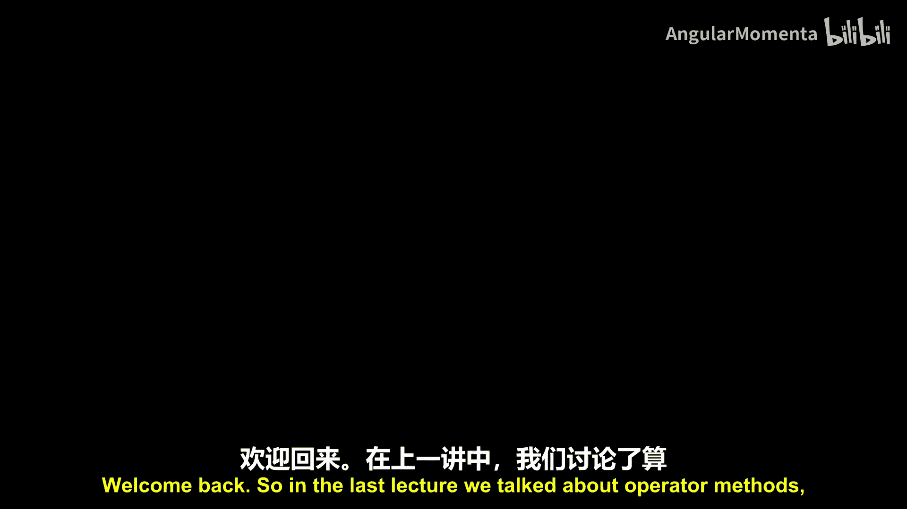
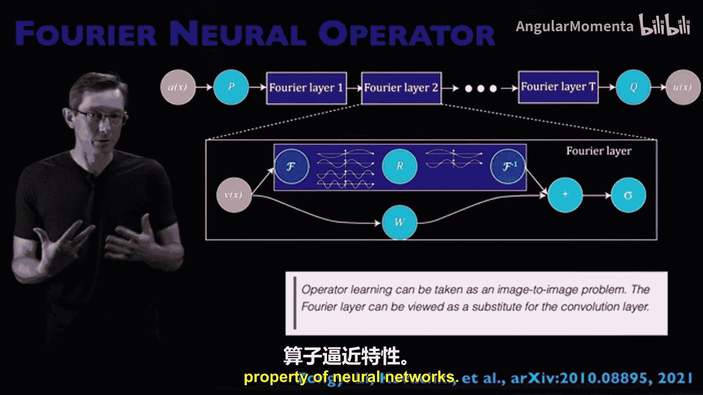
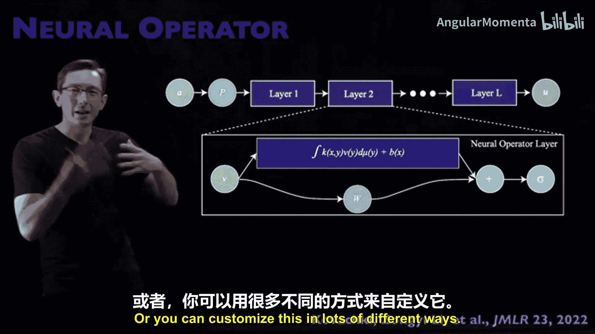
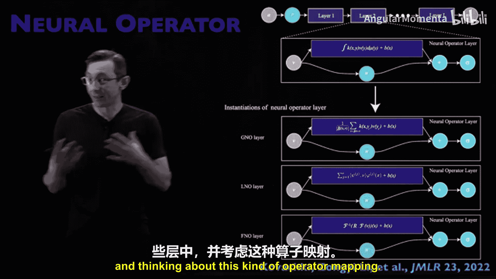
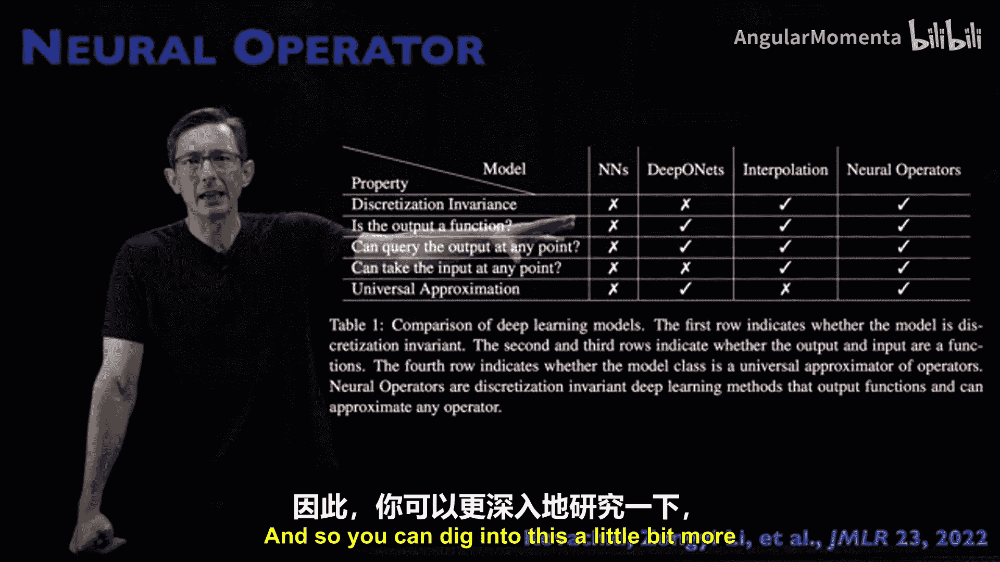
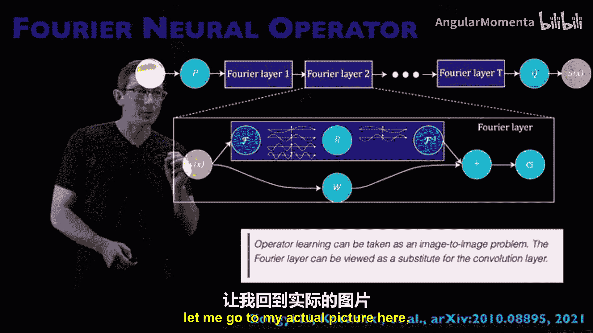
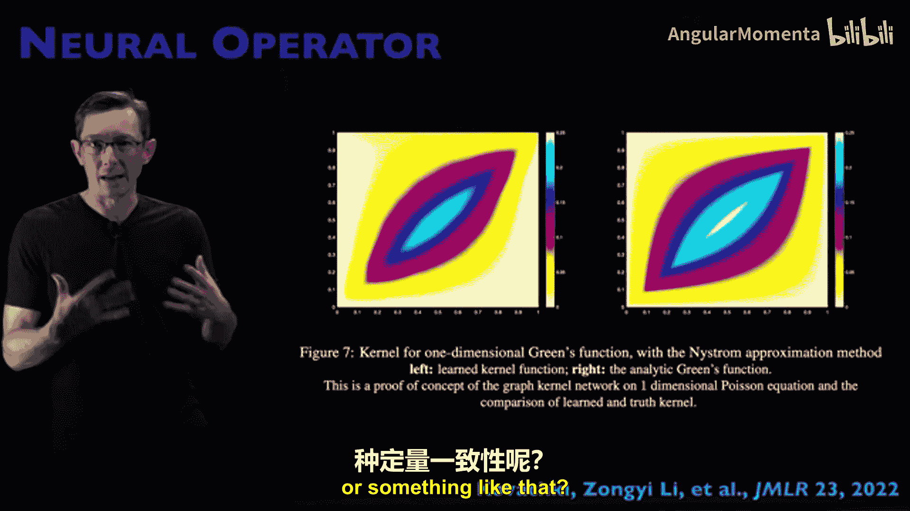
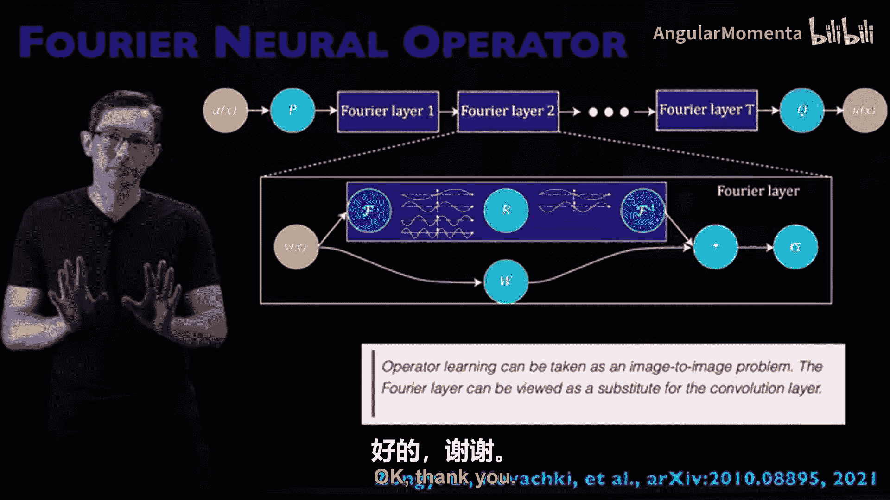

# 【精译】物理信息机器学习-p22-22-傅里叶神经算子--BV1c9uDzQEj8_p22-

Welcome back。So in the last lecture we talked about operator methods。

 this deep O network that kind of generalizes the idea of a neural network as a universal function approximator into this idea that you can also use neural networks to approximate operators from functions to functions。

 so a function might operate from a vector to a vector。A function might go from a vector to a vector。

 but an operator like the solution of an ordinary differential equation or a partial differential equation would map from a function to a function like an initial condition function to a solution function or a forcing function to a solution function and so you might want if you're interested in physics like I am if you're interested in solving ODEs and PDEs。

 you might want to think of your neural network as an operator approximator。

 not just a function approximator and so that's been a really powerful idea that's been brewing in the community and this4ier neural operator。

 which is a general case of just a neural operator is one of the leading approaches to think about operator learning in the community so it's a paper with a lot of great authors Zangy Lee。

 Kavachki， others， anEma and and Kumar and Andrew Stewart among others。And so。

There's a lot of variations of neural operators and so I'm not going to go into tons of detail because there's a lot of ways of like formulating this and slicing this。

 I want to give you the high level of what these neural operators are trying to achieve and kind of roughly what's under the hood okay so I'll put in more resources in the video description to you know open source codes and tutorials and things like that because I think to really understand this。

 you're going to need to actually code this up yourself。

But you know I like this quote this is from Zang Yili's website operator learning can be taken as an image to image problem。

 the Fourier layer can be viewed as a substitute for the convolutional layer。

 so this is a really important idea okay if we think about the solution of our ODE or our PDE。

You know those sometimes look like images if I have a two-disional fluid flow。

 maybe I'll take an initial condition and I'll map that to a final condition。

 that's an operator acting on this input function， but it looks a lot like mapping an image to an image so that's I think an important perspective here。

 and just like if I was taking an image I might take some convolutional layers to pull out features。

 we know that for physics， the way we've been solving computational physics problems for the last half a century is with largely Fourierbased spectral methods。

 we Fourier transform our system in you space we solve our PDE in that Fourier transform domain which tends to be a good representation and then we inverse Fourier transform back to get our our final solution back to our spatial coordinates。

And so I think again， reading between the lines， that's what they're trying to say here is essentially we know that Fourier transform is a good coordinate system for physics。

 so why don't we work in this kind of instead of a convolutional layer that would be helpful for image to image mapping。

 we're going to work in a Fourier embedding space because we know that's good for representing our PDEs or partial differential equations and actually I think it's kind of interesting。

 we always talk about the universal function approximation property of neural networks。

 so the universal operator operator approximation property of neural networks。😊。

And my friend Nathan Cotz pointed out to me， a couple of months ago。

 I saw him at a workshop and he just mentioned this casually， but it stuck with me。You know。

 we also know other universal function approximation techniques like the  Fourier transform is the OG universal function approximator okay。

 so like I've been adding a line in my papers for the last years about how you know。

 justifying neural network approaches because they're universal function approximators，I don't know。

 is that a little facetious because we know you know tons of other universal function approximators it might not be that special so anyway that's just been kind of。

In the back of my mind， I hadn't thought of it， but you know Nathan's 100% right。

 the Fourier transform is also a universal function approximator， so it makes you think anyway。😊。

One of the major kind of demonstrations that got people really excited this session got a lot of press when it came out this original paper was because of the claim that you could do zero shot super resolution。

 you could essentially train on something like a naer Stokes solver at Low resolution。

And you could then increase the mesh because this thing's learning kind of an operator from functions to functions。

 I can change the resolution of the specification of that function and get this kind of super resolution of my solution operator。

😊，Now that's a really interesting idea and they demonstrated this by upscaling from 64 by 64 to 256 by 256。

 and they also upscaled in time from 20 snapshots to 80 snapshots。

And I think it is a really interesting idea。You always have to be asking yourself， you know。

 is this too good to be true we know there's no free lunch there's you know that's like one of my favorite theorems then no free lunch theorem so you've got to be thinking under what circumstances will this super resolution upscaling work or not work？

Now I would argue that probably the 64 by 64 by 20 training data set was somehow had enough resolution to capture the key essential features of the physics that could then be upscale to this higher more useful resolution I think if you went down far enough so that you were really botching the essential physics this probably wouldn't work now again I would like to try this coded up and actually see what are the limits of down sampling in space and in time where you can actually get the super resolution and I encourage you to do that too I always want you to be asking yourself。

You know， I mean， this is a really cool result。 It's a powerful method。 I want you to be thinking。

 how could I break this method When is this method not going to work on my dataset sets， how。

 what are the limits， how far can I push this and make it work。

 Are there things I can add to this to make it work even farther and make even better super resolution leaps。

 Those are always the kinds of questions I want you to be thinking about and importantly。

 where do I download the code， How do I get started on this， You know。

 I can give you all of the lectures in the world about。😊，Theory and math and pictures。

 and you can read what people claim their method does。

 you need to download this and try it yourself and see how it works and see if it works on your problem。

But this is one of the major claims of FNOs is that they're essentially mesh free representations of the physics and so you can do super cool things like super resolution now again。

 limits absolutely， but in the demonstrations in the paper it looks pretty interesting。

So the neural operator in general， Fourier neural operators are just a special case of a neural operator introduced in this kind of more general paper here。

 this GMMLR paper。Where essentially you had this kind of deep architecture。

 this might look kind of like a resonnet or something where you got a bunch of layers stacked like this。

And you have maybe some jump layers bypassing the Fourier layer。

And essentially you'll notice these blue boxes， this is where all of the interesting kind of user specified knowledge and maybe physics kind of comes in here is in the choice of this layer。

And if you look at this function here， what this is is this is convolution with a kernel K and some weighting function。

 some weighting function mu。And so you can specify lots of different kernels K to customize this neural operator to be。

 you know， not just a Fourier neural operator， if I have Steve's kernel。

 I can make Steve's neural operator or you know you can customize this in lots of different ways。

So we have variations， they have introduced variations like graph neural operators where this is a graph kernel average happening here or the Fourier neural operator where literally this kernel function are just signs and cosines。

 you're doing a Fourier transform in this layer， you know， and then LNOs and you know other NOs。

 I forget what L stands for， maybe it's linear， maybe it's I don't know graphph neural operator。

 Fourier neural operator。E narrow operator。 And you can come up with your own using this kind of template。

 So I like this idea that they have an abstracted。The neural operator into this form where if you have a custom kernel K for your particular physics。

 you can design your own custom neural operator layers， but again we know that Fourier has really。

 really nice properties for lots of partial differential equations。

 so this is a very reasonable one for things like navy or Stokes where I'm already probably going to be solving it with something like a spectral method。

Now does make you think if I solve Navy or Stokes， I'm going to back up a slide。

If I solve naier stokes with a spectral method， what am I assuming？Periodic boundary conditions。

 so it's no surprise that the example in this demonstration here is a relatively simple fluid flow you know on a periodic box periodic boundary conditions。

 so it totally makes sense that Fourier spectral methods。

 that's how I would solve this in Python or in MATLb is by Fourier transforming。

Is this going to work when I have a complex geometry like flow over a wind turbine or over a compressor blade or over a。

 you know？747 wing or tail section that's a lot less obvious questions we should be asking ourselves you know。

 is for you the right approximation for my flow or for my physics Okay， definitely for that it is。

But I like that this is a very mathematical method approach to adding different kernel functions into these layers and thinking about this kind of operator mapping。

And again， actually， this is an example with you looking at exactly the kind of geometry I was talking about a。

you know a blade or a wing in a certain with a flow going over it。

 it looks like there's some kind of shockwa forming， I don't have a legend on this figure。

 but that looks like a shockwa to me。And so。There must be some version of this neural operator。

 I'm guessing this is not a Fourier neural operator because it doesn't look like it has periodic boundary conditions but some version of a neural operator with some kernel is appropriate for this kind of physics and mesh discretization but one of the really。

 really important claims this is throughout the entire paper you from the first page throughout is this strong statement that neural operators and Fourier neural operators are mesh independent。

 their discretization， they have discritization and variance。

 they don't care what mesh your training data is on because they really are learning function to function they're learning the coefficients of how those Fourier transforms coefficients map to each other and so in principle once you learn that operator you should be able to swap out a different mesh a higher resolution mesh and refine the picture and again。

Here it actually looks really cool， you can take this relatively jagged low res mesh and you can refine in a way that you actually start to capture that shock in a reasonable way。

So pretty interesting idea of mesh invariance and discretization and variance。

And they actually go on to compare kind of their approach you neural operators to what they considered as the three closest moral kind of neighbors。

 which are vanilla neural networks， deep operator networks。

 and kind of classical function approximation with interpolation。

 like what we would do in applied math 30 years ago is just know sp fitting and things like that。

And so you know。You can dig into this a little bit more and see if this makes sense or if you agree with these claims。

 but the discretization invari is one of the things that they're hanging the importance of this method on and again that comes back because let me go to my actual picture here because you're actually you know getting this kind of continuous Fourier transform representation you can approximate these Fourier coefficients with discretized data with a coursear mesh。

 but you're learning something that is an actual continuous function。

 those kernels are continuous functions and so if you learn the parameters of those kernels you can then resample at an arbitrary mesh it's a pretty cool idea again you should code it up see if it actually works on your problem but I like the idea。

And this is another， you know， just kind of example from this neural operator paper where they're showing that you can use this for approximating。

Things like Greens functions and PDEs， and I think you have left the learned kernel function and right the analytic greens function。

Qulitatively， very， very good， you know， they have the same shape。

 they have the same trends quantitatively， you know I'm not sure I'm going to use this to design you know。

 a system。嗯。If these have quantitative differences。

 that's what I'm trying to say these are quantitatively quite differently。

 they're qualitatively very similar， they're quantitatively not that similar and so if I use this greens function。

 I might get I might get solutions that are not as accurate as if I use this kind of classic analytical approximation but it's important。

 you know this paper is only a couple of years old。

 there are almost certainly things we can add to neural operators to make them more physical to make them more accurate and again I always want you to be thinking about that this is you know we're talking about physics and form machine learning。

 how would I bake physics into this process， how would I improve this quantitative agreement if I knew something about the physics if I knew something about as symmetry or what governing PDE I was thinking about or something like that so those are always things I want you to be thinking about。

Okay， so Fourier neural operator is a special case of a neural operator where you use a Fourier transform kernel signss and cosines as the kernel function in your neural operator。

 and these are good for physics with periodic boundary conditions like maybe your stokes flows on a periodic box。

 pretty cool idea， okay。And there is an extension that I think is also really nice by C and Gusswami and Cariaocus。

And that year is not the year 200 2013， it's there's a typo， it's 2023 where again。

 if our kernel here in a Fourier neural operator are signs and co-sines。

 these kind of pure tone signss and cosines， just like we have the Fourier transform it generalizes to a laplace transform。

 so instead of just oscillations you can have kind of exponentially growing oscillations or exponentially decaying oscillations you can generalize a Fourier neural operator to a laplace neural operator where now you take you know poles in the complex plane kind of these eigenvalues that correspond to again growing and decaying signss and cosines and you can use those as the kernels for your neural operator。

So you know if I want to think about it if I have an eigenvalue in the complex plane that's on the imaginary axis those correspond to signs and cosines and if I give those a real part if it's a negative real part。

 now my signs in cosines are exponentially decaying if I give it a positive real part now those signs and cosines are exponentially growing and so this is a really clever and simple generalization of a Fourier neural operator to a laplace neural operator just like the Fourier transform can be generalized to a laplace transform so this will be more useful for a broader class。

Of solution operators of PDEs that might have kind of exponential growth or decay as well。Okay。

 so that's just the mile high view of forier neural operators and neural operators in general very likely that we'll have more lectures going into you know what are these kernel functions。

 why do we have so many layers， what are these jump connections you know maybe actually coding this up on some examples。

 but I wanted to give you the very high level picture of how these work and where they fit in and again the mesh invaris is one of the Hallmark features of these these neural operators okay thank you。

😊。

