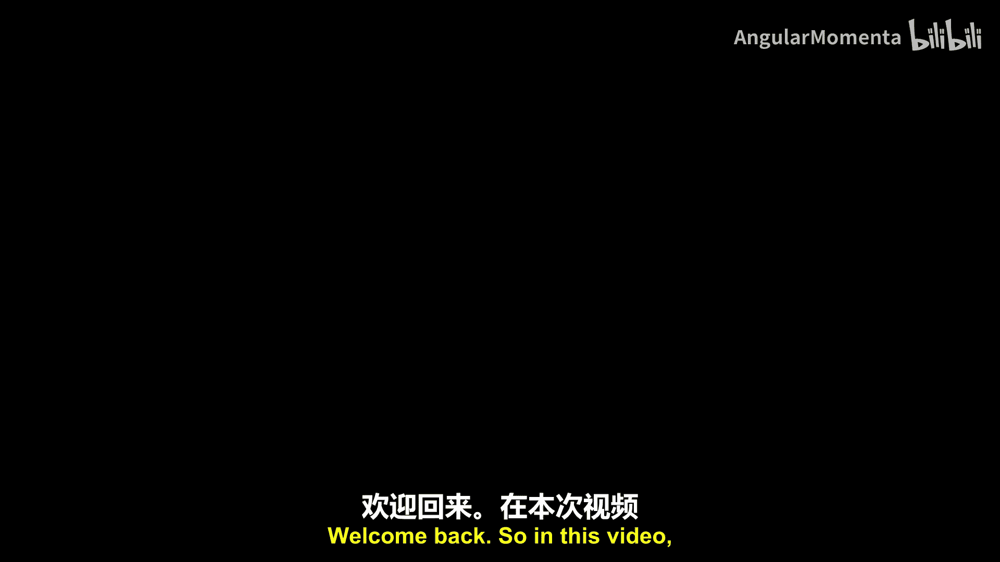
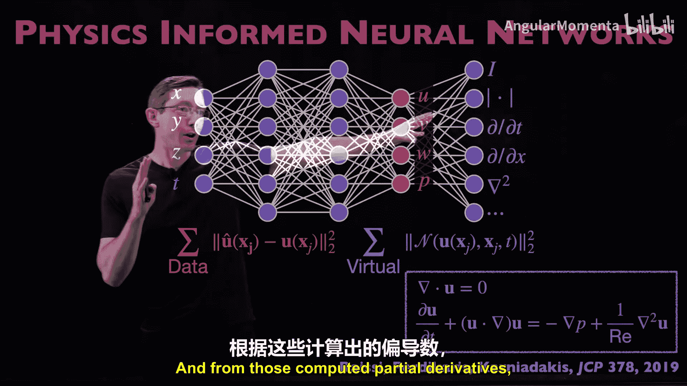
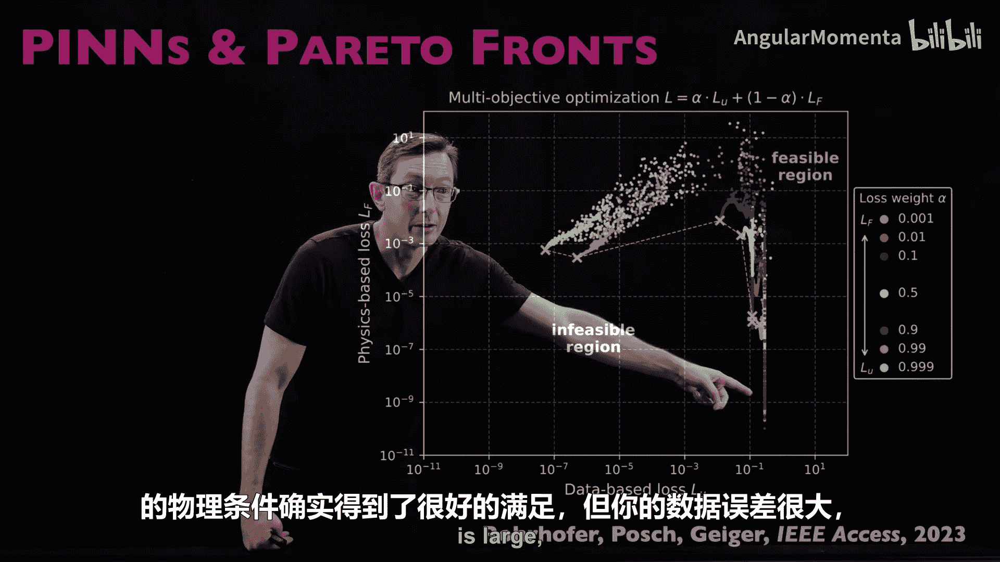

# 【精译】物理信息机器学习-p24-24-物理信息神经网络--BV1c9uDzQEj8_p24-

Welcome back。So in this video， I'm going to introduce this idea of a physics informed neural network or a PN。

 which was first presented in this paper by Masir Ri， Paris Perdiaris and George Carneiaocs。

And since its introduction， it's become one of the workhorse algorithms and kind of ideas in physics and machine learning。

So it's based on a kind of neural network idea that also incorporates known physics in the form of a partial differential equation in the loss function。

 so I'm going to walk you through this， some examples of how it's been extended。

 some kind of caveats and cautionary tales and some big success stories as well of what it can do。So。

Kind of a traditional approach to using a neural network to predict something like a fluid flow field。

 you might build a neural network some kind of you know deep feed forward network that predicts the field variables of interest。

 maybe UVVW and P these would be the x the Y and the z velocity field components and P might be the pressure of a fluid and those are functions of the spatial coordinates X Yz and time T This picture is just a two- dimensional fluid but you can imagine if I wanted to model a three dimensional fluid with three velocity components and a pressure in terms of three spatial coordinates and time I might be able to do that by building a big feed forward neural network and training it on a bunch of examples of flow data I might be able to learn that mapping from space and time to some coordinates UVVW and P okay。

This is kind of the naive approach to using a neural network to predict some physics。

And what these authors did in this kind of classic now pins paper is they extended。

This this naive neural network picture where you have just a simple loss function of your kind of predicted fields from your true measured fields。

 they extend this by computing things like partial derivatives of these output variables in terms of the input spatial and temporal variables and this is a really simple but very powerful idea that you can compute these terms essentially using the same kind of auto differentiation。

 automatic differentiation and back propagation that you would normally use to train a neural network。

 you can use that same idea in a modern language like pi To or jackX to compute these partial derivatives of the outputs with respect to the inputs。

 and if you have those partial derivatives computed you can add in this additional loss function that your partial differential equation should be satisfied。

So if you know， for example， that this velocity field should be divergence free。

 you can add a term in purple here that is literally the divergence of your velocity field and if it's nonzero。

 it means that that physics is being violated。So I have an example here of the Navier Stokes equations。

 which is one of the most popular examples used with pins。And again。

 just to reiterate what this big picture does is it takes a standard kind of neural network representation of the field variables you want to predict or estimate things like velocity fields and pressure fields as a function of space and time。

 it takes that standard kind of generic neural network model。

And it computes the partial derivatives that are relevant for the physics in this problem， again。

 using automatic differentiation and back propagation， things like that。

And from those computed partial derivatives， you can create this additional loss term that tells you kind of if this known physics is being violated or not。

 basically you if there are things that should be zero like the divergence。

 or you could take the right hand side of this equation and move it over to the left hand。

 so all of that adds up to zero， those would be terms in this purple virtual loss function。

And what that does is it adds this penalty when your neural network is violating known physics。

 so this works really well for systems where we know something about the physics。

 we know we're dealing with a fluid flow or a quantum system or an electromagnetic system。

And we're still trying to predict kind of our field variables as a function of space and time。

So it's a really， really cool idea and you'll notice that I have these sums labeled this is a sum over actual data。

 so that's training data， that's actual velocity fields that you have either measured or computed。

And then this purple sum is summed over virtual points。

 so this is one of the cool things about this network。Is if you know the physics。

 if you know that you're looking at a navier stoke's fluid flow。

Then even if I only have pretty limited data here， I can still test if my network is physical。

 meaning does it satisfy you know these equations is this loss function small。

 I can evaluate that on test points that are not actually in my training data so that's a huge and powerful idea also is that oftentimes I've seen these pins trained on very small amounts of actual measurement data and you offload a lot of the training to these kind of virtual points where you can evaluate is this network physical on those virtual points because even on a virtual point where I don't have real measurement data I can still evaluate if my network is you know conserving mass and momentum okay pretty cool idea here。

And if we kind of go back to this big picture of physics informed machine learning。

 it's pretty clear that pins or this physics informed neural network sits here in this kind of stage four of crafting a loss function that promotes what we know about the physics Now of course there's some architecture。

 you know we're computing those partial derivatives and we're modeling field variables as a function of space and time。

 but I think the real kind of special aspect of pins is here in this stage four crafting a loss function。

Okay， so back to this picture here now a couple of things I want to point out。

 there are reasons I like this architecture a lot and there's things that I think you should be aware are maybe a little bit of like a cautionary tale about using an architecture like this。

In general， I think this is a really clever idea because it takes something that is very simple and powerful idea in machine learning。

 this kind of big feed forward neural network， of big MLP。

And it adds a really simple way of incorporating physics into that problem so this loss function here and the fact that we're using kind of automatic differentiation to compute these quantities of interest that go into this virtual PDE loss function。

 it's a very， very clever and also a very simple way of adding in known physics to this neural network process。

 so I like that and I think that's probably one of the reasons that this has been so widely adopted you know cited thousands and thousands of times and used by tons of researchers across the world is because it's a really simple and intuitive way of adding physics into you know the standard way you would build a neural network to model physics。

Another thing I really like and I mentioned this before is that this really allows you to work with relatively small data sets。

 you don't need necessarily that much data here for the actual database loss function。

 you can use virtual points to evaluate if your network is physical or not and so I've seen lots of these networks trained with tons of virtual particles and not that much data and so I think that's a really really powerful part of this as well。

😊，Now the things that this isn't exactly a negative。

 it's just a feature of the way that this is developed is that because the physics is added as a loss function。

 that's a strength because it's very intuitive and easy。

 but it also only suggests that your physics is being satisfied。

 these two terms are always going to be fighting with each other。

 you're always going to be having this pull between your possibly noisy data measurements and this kind of virtual term here that says that your PDE should be satisfied。

 your physics should be satisfied。And so when you train this thing。

 it might be pretty stiff and difficult optimization and you're almost never going to actually have this purple term here be exactly zero so your physics is not being exactly satisfied by this pin mass is not exactly being conserved momentum is not exactly being conserved and you know that may or may not become important in different applications in tons of applications it is perfectly fine to have a small but non-zero physics loss and it still is an improvement over not adding that loss at all。

But in some applications， you might want to。Have a more exact enforcing of that physics maybe through an architectural choice or through an actual constrained optimization and that's something we've talked about a little bit before and we'll talk about again。

 but I just want to point that out here very simple and intuitive it allows you to work with relatively small data sets and those are both you know。

Huge positives。 but the fact that this is a loss function means you're only suggesting that the physics is informed。

 you're not enforcing that the physics is informed and so you should or sorry enforced and so you should just be aware of that。

 I think that's that's super important。And I want us to be thinking about what this kind of architecture is going to be good for okay so it's really。

 really good for estimating things like whole flow fields with fairly sparse sensor measurements it's a really good way of doing that and it improves on some of the past methods that we used to do before pins existed and i'll talk a little bit about that so data assimilation and kind of flow estimates from limited or sparse measurements that's a pretty cool application of this so you can picture maybe you have like a。

😊，you know， a fusion reactor， some kind of spphermac fusion reactor。

 and you can't put sensors everywhere inside of that reactor because they'll melt。

 so you maybe only have a few you know probes on the surface。

 this could be a pretty cool architecture to take that limited data on the surface and add in the physics loss because we know that the physics is you know magnetto hydroddynamics or some kind of plasma physics。

And estimate the internal flow that's most consistent with those measurements and with the fact that we know our physics is governed by this PE。

 So that's just one example。Good， it might not be the most useful thing in the world for speeding up your high fidelity simulations。

 though you know， that's something I think you should really be thinking about how can I use this architecture and what are ways that I maybe don't want to use this architecture。

Good， and so actually one of the best and kind of most interesting papers that was published you know around the same time as the original pin's paper is this paper kind of I think it's called something about hidden physics by many of the same authors in science。

 so very high profile paper where they essentially show that if you have relatively limited data from a fluid flow。

 I think this is you know some kind of a fluid flow in an artery or like a blood flow。

 I don't know if this is called like a thrombosis， but it looks like there's some recirculation of blood flow here。

You can take very limited information and sometimes information that is not even like a velocity field like a smoke visualization or some kind of like a movie。

 and you can infer what the actual velocity field， the quantitative velocity field that is kind of closest to satisfying the naer Stokes equations and satisfying the measurement data that you have。

 and you can see that you actually get relatively good reconstruction of the kind of pins reconstruction and the ground truth reference velocity field and you can kind of see quantitatively here。

 you should download this paper and actually read it。

 it's very interesting paper and it tells you how to take other types of measurements and infer these velocity fields。

😊，But again， I think that's one of the things that pinNs are really。

 really good for is taking limited sensor data and inferring between the lines。

 kind of reading between the lines of what the velocity field should look like to be consistent with your measurement data and to be consistent with your governing equations。

And it's funny that's actually pretty close to what a common filter does if you think about it。

 it kind of optimally balances this idea between you want to agree with your data。

 but you also want to agree with your model and depending on how much you trust your model or your data。

 you might change this kind of hyperparameter that balances those too So there's also a hyperparameter in pins that balances how much you trust your data versus how much you kind of want to be enforcing your governing partial differential equation。

Now I'll point out because we're computing those derivatives。

 those partial derivatives that go into the kind of physics informed loss function here。

 this is going to have a harder time on systems that are discontinuous with things like shock waves or you know chaotic conveing flows or this neural network function of time might be really diverging and really chaotic it's not going to probably be amazing at those kinds of flows so again in the back of your mind you have to be thinking this is not magic this is a neural network with a custom loss function and so you need to know when it is and is not going to work but it you does really really cool things in certain circumstances for things like flow reconstruction from limited measurements and in the past we used to use a method called。

4D var， it was like kind of a variational method in space and time so that's where the 4D comes from and it was this horrific physics based constrained optimization。

 it was an optimization constrained by the physics to again find a flow field that was consistent with your measurements and with the physics。

And all of that now in pins is kind of abstracted from the human， it uses modern machine learning。

 architectures and optimizations， and it typically does you know as well in a lot of cases。

 so for some of you who remember 4D Var， you'll see the parallel pretty quickly for those of you who don't maybe just do a quick Google on 4D Var and you'll see kind of morally how these are related and different。

Okay now I'll put some links in the video description there's some great resources out there that I'm going to link to so a few really good really good videos here this is one by Juan Tuscano and I believe this is Benjamin Mosley on on this YouTube channel these are both really good kind of tutorial videos you know this one Juan actually works this a training how to train a physics In neural network out in code so I would highly recommend this one and there's some great tutorials online also for how to code this up in torch okay so I'll put links to these in in the video description but really it's super important for you to try this yourself I think that's one of the main points here is。

If you want to know what this is good for and what this is not good for。

 youve got to actually try it on a couple of examples and see， oh did it take forever to train。

 was it fast to train， what did it take forever to execute， was it fast to execute。

 did it generalize， did I need a bunch of data or a little data。

 those are all the things you would play around with。And roughly speaking。

 you know these methods again， they're good for filling in lots of missing data or kind of inferring if you have very sparse measurement data。

 they're good for speeding up the inference step so training might be expensive compared to something like。

You know， CFD or fluid flow simulations。 and you， in fact。

 need the training data from those high fidelity sources。 But the inference step。

 once you have a train model can be very， very fast。 And so that's another， you know， good。

Use of these methods。And among these resources， again。

 this video was by Benjamin Moseley and they have a really。

 really nice kind of blog you should check out all about scientific machine learning and they have a really cool blog posts specifically about pins with code on how to actually you know train these and test these yourself so I think this is one of my favorite to follow along and they contrast pins with the kind of classic naive neural network approach where you don't add that physics informed loss and so I believe the example that they train on here is。

A really simple one dimensional physics where you basically take a mass on a spring and you let that spring go or sorry。

 you let the mass go and you have this kind of，Decaying oscillation of your spring masss dampper system。

And there is some pretty sparse training data， these blue points here。

And essentially these are movies， so go to the website and actually you know check out the movies。

 but essentially this shows the training of a naive neural network over training step。

 and it basically never trains it goes into this kind of suboptimal kind of crummy solution because it can't generalize past the blue data that it was trained on because it doesn't know anything about the physics。

And in contrast， if you have this kind of physics informed loss function where you actually say， hey。

 I know that this is a you F equals M spring system。

 now from those blue training points you can train up physics informed neural network that is much。

 much better at generalizing into the future because it got the physics right because that was in the loss function。

 okay。So really simple example but it's one you can code up yourself。

 you can follow it all makes intuitive sense and it's a little easier than the PDE version now I will point out I noticed here that this is trained to 620 steps and this is trained to 12。

000 steps so again that should be making you wonder hey how much training do I really have to do to get this pin to converge but again maybe the training is an offline computation maybe you're willing to spend a lot of resources to train this thing as long as it learns the physics and executes quickly in the future and again this generalizes way better because it incorporates the physics that's kind of the upshot here。

Good。And there's a lot of cool extensions to pins that's one of the things I like。

 you know my lab and my collaborators， we develop a lot of methods。

 you know similar kind of machine learning and physics informed machine learning methods and when I think of my favorite methods。

 things like DMD and Cindy and you know pins and things like that， they tend to be highly extensible。

 they're such a simple idea that you can often add a lot of kind of add ons。

To make them more performant for different kinds of scenarios and so this is just a very you know select few examples out in the literature。

 there are dozens of custom types of pins for different types of physics。

 for different types of data， different types of scenarios。

 one of the ones I think is really cool or fractional pins for partial differential equations that have things like fractional derivatives。

 what if I have the one half。Power diffusion term or some you know hyper diffusion term or I have an integral differential partial differential equation this happens all the time like not everything is as simple as na or stokes just simple mass and momentum conservation with you know easy integer power differential operators oftentimes you have these nasty integral differential equations with fractional derivatives in your physics。

诶。And so there's this really cool kind of split architecture here where your traditional pins terms here can be handled using auto differentiation using kind of the automatic differentiation of the you pitorrch or jack's environment。

 and then the other terms here， your fractional derivatives， your integral terms， things like that。

 those can be handled using your traditional numerical discretization schemes。

 things like finite difference， finite element， spectral methods。

 and you can kind of combine those in this fractional pin architecture。

 so pretty cool idea and actually that broadens it out to a massive massive class of PDs。

Another one I really， really like is this idea of deelta pins。And。

This is an idea that's been kind of floating around， you know a lot。

 I know some of my postdocs and collaborators talk about similar ideas where if you have a geometry。

 like if I know that my physics is evolving on a sphere or on this spiral or on like let's say I look at the cochlea of an ear。

 I know that that's kind of this spiral shape。So if I know the geometry kind of that determine the boundary conditions and where my PDE is living。

You can actually， you have a lot of prior information you can bake into the pins or other machine learning algorithms。

 and so specifically if you look at the Laplace Beltromi operator on that geometry。

 its eigenfunctions give you a very good natural coordinate system in which to represent solution functions of that PDE。

So kind of the simplest example that we've all seen before is that if I look at something like the heat equation on a rectangular geometry。

The eigenfunctions of the Laplace operator on that geometry are signs and cosines。

 and that we know that the Fourier transform， those signs and cosines are a good coordinate system that linearize or simplify that heat equation。

 so it's very similar idea but for more complex geometries that eigenfunctions of the Laplace Beltroomy operator on an interesting geometry will be a very good coordinate system in which to represent your solutions of your PDE。

This can be useful in things like cardiac flows if I take a weird irregular geometry like my heart with all the veins and arteries。

Again， I can look at the eigenfunctions of the Laplace Beltromi operator and that gives me a good basis in which to represent and sum to approximate my PDE solution。

 and so you know there's a lot going on under the hood here I'm not going to get into。

 but this delta pins kind of uses that idea to incorporate some idea of the geometry into the representation of the PDE and you get these improved representations。

So you know some kind of cool examples here， this is a heat transfer problem where you have some heat convection and some geometry with specified boundary conditions。

 and you can see that you the regular pin doesn't agree with ground truth as well as this delta pin。

 so having kind of some knowledge of the geometry and of the PDE physics lets you do better than just having one or the other。

This is kind of a cool example where they use this method to compute geodess on kind of this geometry of a bunny geodesics is just a fancy word for the shortest distance path on a manifold。

 so you know if I look at the shortest distance path from my location to you know Switzerland。

 it's the great circle that connects those two points on our sphere of Earth。

 you if you believe that the earth is in fact a sphere。嗯。

And so these geodesics are actually the solution of a certain partial differential equation I'm not going to get into that。

 but so you know there is some PDE that governs geodesics that you can add as a loss function and this just shows that when you use this kind of geometry。

 these laplace Beltromi eigenfunctions for this geometry you can very accurately get those solutions for this geodesic problem it's a really cool example I think and it's kind of a clever example to benchmark their problem on。

and I don't really know exactly what this example is。

 but I think it's super cool that there is a dragon in their paper， which I like。Okay good。

 so those are just two of many， many， many examples of you know powerful extensions to this idea of pins again because it's such a simple idea you're just adding a loss function that is literally the PDE。

 how much it's being satisfied or not there's a lot of ways of extending this to other kind of more complicated systems。

But there are some caveats， these don't always train that well， sometimes they're stiff。

 sometimes they overfit， there's issues anybody who has worked a lot with pins knows you know there's ways of massaging them to work and sometimes it doesn't work and that's like every method no method is a silver bullet that just doesn't exist but it's good to understand what are the limitations and actually study them in a very methodical and process- driven way and so that's one of the things I really。

 really like about this paper out of Michael Mahoney's kind of group and collaboration on characterizing the actual failure modes in pins and I'm not going to expect you to read all of this you should download the paper and check it out because they have open source code and you can play with it yourself but know some of the main upshots here is that the main contributions as stated in this paper is that they try to train pins on relatively simple but relevant problems things like convection。

ReAction， reaction diffusion， simple PDEs。And they basically found that a standard pin。

Often doesn't train and gives very large error except for you know really。

 really simple parameter regimes of these PDEs okay， so they basically set up a problem。

 a set of physics PDE problems where they can show under certain parameter regimes the method fails to train。

And then essentially they looked at， you know， adding how what if you balance that that PDE loss term so you can crank that PDE loss term up or down。

 that's a hyperparameter of how important the physics is or is not。

And they found that the loss function by increasing or decreasing that PDE based soft constraint actually makes it more complex to optimize and harder to find a good solution in some cases。

And I think this is a really careful paper， I really like the work by Michael Mahoney and his colleagues。

Because they are very， very careful in setting up this problem。

 I don't think they're just criticizing pins， they're actually trying to systematically understand when they don't work and fix the problem。

And so they look at you know the actual neural network itself without the physics informed loss and they do in fact find that it does have the capacity to represent the solutions。

 so it's not a capacity issue， it's not the neural network's fault。

 there's something about having this kind of dueling data and physics loss that makes it stiff or difficult or prone to overfitting in some cases。

 not all cases， but some cases。And again， it's easy to show when something doesn't work。

 but one of the cool things about this paper is that they actually propose two concrete suggested paths to improve the pinNs training process。

 one of them is through curriculum regularization where they basically slowly increase that physics loss from zero to you know some larger value。

 that's a very clever and kind of straightforward idea。

And then their second idea is posing the learning problem as a sequence to sequence learning task。

 so two concrete ideas for how to actually fix these failure modes and all of their code is available in Pytorrch。

So you know， a lot of work has gone into analyzing and understanding how to train these networks when they will and will not train。

 when they will generalize， and how to make them more robust。

 so I think that's also really important to know is that if you just know design a vanilla pin。

 it might work， but you might run into some issues that you know other researchers have spent a lot of time and effort trying to diagnose。

There's another cool paper I like that essentially looks at the Pareto front。

 they actually did a bunch of hyperparameter kind of characterization where they have。

 this looks to me like a heat equation， you know so this is some true velocity field。

 there is a predicted velocity field with a pin， and there's some amount of error。

 this is just generic。What they did was they looked at。If I change the hyperparameter。

 the balance in my loss function between the data loss and the physics informed loss so you can sweep through that hyperparameter and make one bigger or smaller。

 you can essentially get different error acuracies of your reconstructed fields。

 and so they did an extensive test where on a relatively simple heat equation example。

 but they did an extensive test where they looked at the different physics loss and database loss for different example scenarios and initial conditions and data where they change。

 they swept through the loss weight where you know if it's a small loss weight。

It's I forget if you as physics or an F is data or vice versa。

 but one of these regimes makes it so only your data matters and the other regime makes it so that only your physics loss matters and you can see this kind of really interesting landscape of different kind of you know different amounts of loss here so you know in some cases maybe your physics is actually being really well satisfied but you know data error is large or maybe your physics is actually not being satisfied very well but your data loss is small and there's you know this clear balance between those two loss functions again。

 you're never going to get a perfect loss where your physics is exactly satisfied and your data is exactly you know fit if there's any error on your data。

Good。And again， you know， just a pretty extensive view of what happens to this relative error for different values of you know those hyperparameters。

 and they give a lot of suggestions on how to choose and tune those hyperparameters so it's kind of also a practical guide you might want to read this before you train your pin。

Okay， that was a mile high overview of this very important and very widely used physics informed neural network。

 very often called pins， that's the acronym。And again， just to recap。

 it is a really simple and intuitive way of taking just a standard vanilla neural network to predict some physical fields as a function of space and time。

By using the automatic differentiability of these modern machine learning frameworks。

 Pytorch and jacks and so on to compute partial derivatives and add a custom loss function that is quantifying if the physics is or is not being satisfied。

 so for example if I know divergence should be zero from my velocity field。

 I can literally add a loss term that is the norm of the divergence of these predicted velocity fields。

 and I can compute those on arbitrary points， so I don't need to have this physics informed loss trained on data。

 I can train it on virtual points。So that means I can use these pins to estimate flow fields and velocity fields。

Even if I have relatively sparse training data so it's a really cool idea it's very widely used。

 it's highly extended， there's lots of extensions to it。

 but again really important for you to remember because it is a loss function you're adding physics into the loss function you're adding the suggestion that your solution is physical you're not enforcing that your solution conserves mass or momentum or energy。

 you're just promoting that physicality through this loss term and again sometimes it's pretty stiff sometimes it doesn't generalize sometimes it doesn't work for chaotic systems like no method is perfect but it is a really simple and intuitive way of adding physics into your problem and I think that's probably one of the reasons it's been so widely adopted in the community and it's still you know especially at this sweet spot machine learning people love it because it's easy for them physics people love it because it's easy you know to add neural networks into their you know physics。

Kind of workflows and so it's really at that sweet spot where it's kind of easy and pretty powerful Okay more on this definitely check out the resources in the description。

 try to code it up yourself， try to see where it does and doesn't work and we'll look at other methods soon all right thank you。

😊。