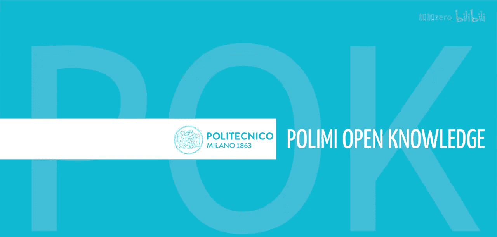
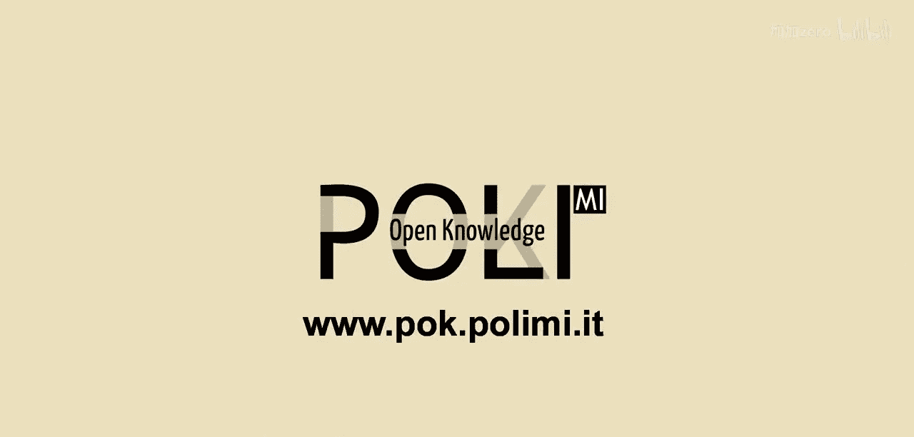

**人工智能：概述 专项课程：P04：人工智能的诞生 🧠**

在本节课中，我们将回顾人工智能作为一个正式学科的诞生时刻，了解其起源的关键事件与早期成就。

---

1956年，在美国新罕布什尔州的达特茅斯学院，马文·明斯基、约翰·麦卡锡以及其他两位资深科学家克劳德·香农和内森·罗切斯特，共同组织了“达特茅斯夏季人工智能研究项目”。

该项目持续了大约六到八周，本质上是一场扩展的头脑风暴会议。约有十位数学家与科学家参加。与会者包括雷·所罗门诺夫、奥利弗·塞尔弗里奇、特伦查德·摩尔、阿瑟·塞缪尔、艾伦·纽厄尔和赫伯特·西蒙。

这次研讨会被广泛认为是人工智能作为一个领域的奠基事件。

---

上一节我们介绍了达特茅斯会议的背景，本节中我们来看看会议提案中的核心主张与人工智能的命名。

会议的提案中包含这样一项断言：“学习的每个方面或智能的任何其他特征，原则上都可以被精确地描述，从而可以用机器来模拟它。” 术语“人工智能”由约翰·麦卡锡选定，旨在避免与控制论产生关联，后者是由诺伯特·维纳开创的一个颇具影响力的领域。

---

了解了人工智能的正式命名后，接下来我们看看该领域诞生初期的两项重要成就。

以下是人工智能早期的两项里程碑式成就：

*   **逻辑理论家**：第一项重大成就可能来自艾伦·纽厄尔和赫伯特·西蒙在1956年的工作。他们创建了一个名为“逻辑理论家”的程序。该程序证明了罗素和怀特海《数学原理》前52条定理中的38条，并且为其中一些定理找到了更新、更优雅的证明。
*   **跳棋程序**：第二项重大成就来自阿瑟·塞缪尔在1959年的工作。他开发了一个跳棋程序，其棋艺水平可与一个不错的业余棋手相媲美。

沿着这些研究方向，在随后的几年里涌现了大量人工智能的硬件和软件成果。

---

本节课中，我们一起学习了人工智能领域的诞生标志——达特茅斯会议，了解了其核心主张与命名由来，并回顾了早期“逻辑理论家”与跳棋程序等开创性成就，这些为后续人工智能的快速发展奠定了基础。