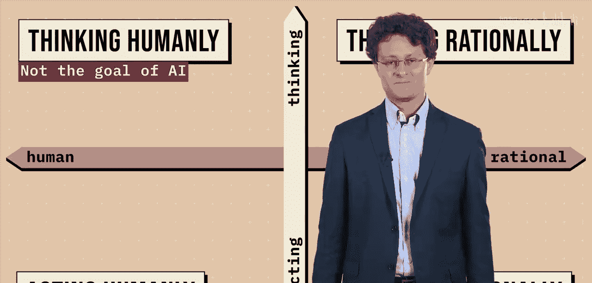

人工智能概述专项课程：P08：人工智能的定义与目标

在本节课中，我们将深入探讨近年来人工智能的定义。许多不同的视角被提出，而斯图尔特·罗素和彼得·诺维格提供的分类法可以帮助我们总结其中的核心思想。

具体来说，他们识别了两个维度：第一个是“思考”与“行动”，第二个是“人类”与“理性”。这样我们就得到了四种情况：像人一样思考、理性地思考、像人一样行动以及理性地行动。

上一节我们介绍了定义人工智能的不同维度，本节中我们来看看具体的四种分类。

以下是这四种分类的详细说明：

*   **像人一样思考**：这一观点在贝尔曼1978年的定义中得到了很好的阐述。人工智能旨在自动化与人类思维相关的活动，例如决策、问题解决和学习。这个概念目前与**认知科学和神经科学**领域相关。然而，**复制人类大脑的生理过程并非人工智能的目标**。
*   **理性地思考**：正如查尼亚克和麦克德莫特在1985年提出的，这指的是通过使用计算模型来研究心智能力。这与**计算逻辑**领域密切相关，其目标是提供驱动推理的严格规则。然而，并非所有智能行为都通过逻辑思考来调节，因此理性思考无法完全涵盖整个领域。
*   **像人一样行动**：正如里奇和奈特在1991年提出的，这与研究如何让计算机做目前人类做得更好的事情有关。请注意，像人一样行动与**图灵测试**紧密相连，因此其目标是表现出尽可能接近人类的行为。同时请注意，“行动”在某种意义上包含了与“思考”不同的活动，我们关注的是观察行为本身，而无需理解这种行为是如何被选择的。然而，**复制人类行为并不一定是人工智能的目标**。
*   **理性地行动**：正如卢格尔和斯塔布菲尔德在1993年提出的，人工智能是计算机科学的一个分支，关注智能行为的自动化，其中智能通过某些**形式化指标**来衡量。

理性地行动与像人一样行动有所不同。例如，人类可能会犯错，而计算机程序在某些情况下（如井字棋、跳棋或魔方求解程序）可以做到不犯错。

目前最常见的人工智能定义基于**理性智能体**的概念，这源自“理性地行动”这一维度。

一个理性智能体是一个函数，它将感知映射到行动，以最大化给定的**目标函数**。理性智能体适用于特定的、狭窄的问题，如下棋、图像识别等。

通常，当一个实体总是采取最佳行动时，我们称之为**完美理性**。然而，理性地行动并不意味着智能体总是执行最佳行动，由于计算资源的限制，也可能无法做到。

因此，理性地行动与**在可用资源下可实现的最佳行为**相关联。人工智能的目标就是设计这样的理性智能体。

本节课中我们一起学习了人工智能定义的四种分类：像人一样思考、理性地思考、像人一样行动和理性地行动，并了解了当前最主流的定义是基于理性智能体的“理性地行动”这一维度。