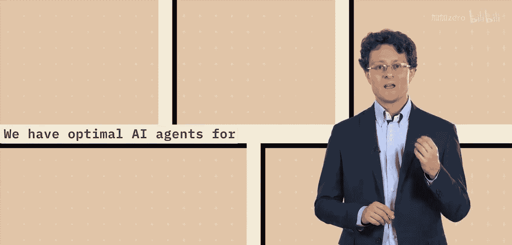
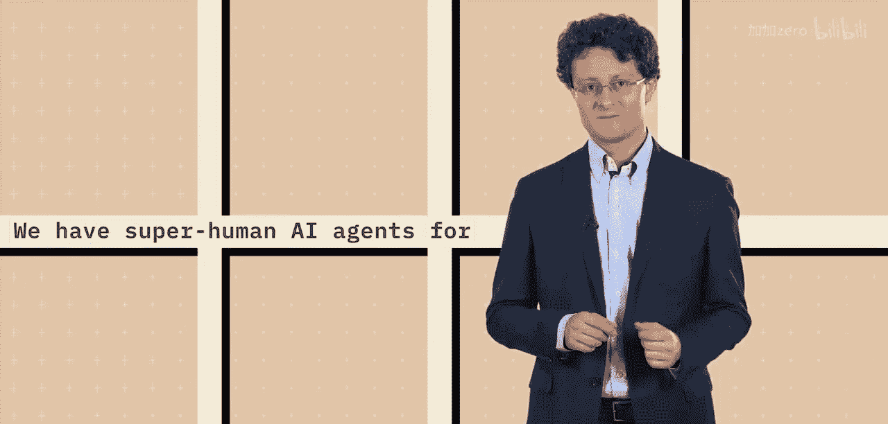
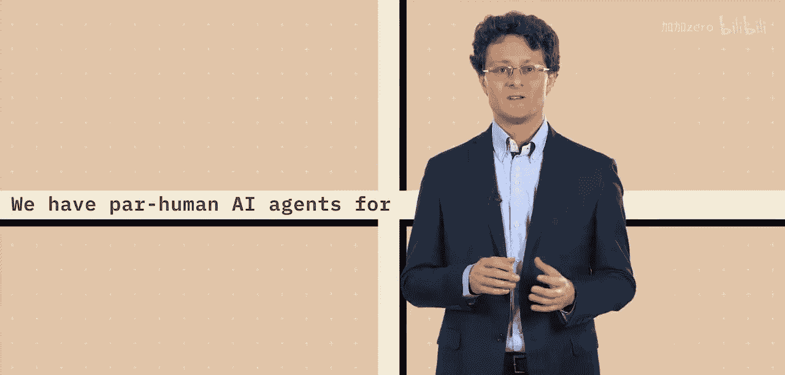

# 009：问题与进展

在本节课中，我们将要学习如何根据智能体相对于人类的表现来评估其能力，并了解不同领域人工智能技术的发展现状与进展。

## 智能体性能的分类

上一节我们介绍了理性智能体的概念，其目标是最大化或最小化某个度量。当我们比较智能体与人类时，可以根据智能体相对于人类的表现，区分出以下五种情况。

以下是五种性能分类的定义：

*   **最优**：智能体的表现不可能更优。
*   **超人类**：智能体的表现优于所有人类。
*   **高人类**：智能体的表现优于大多数人类。
*   **类人类**：智能体的表现与大多数人类相似。
*   **次人类**：智能体的表现比大多数人类差。

## 问题与性能的对应关系

根据狭义人工智能的方法，智能体是为解决特定问题而开发的。我们可以做的是，针对每个特定问题，描绘出最佳人工智能技术的能力图景，并追踪这些技术随时间的进展。

现在，我们提供一些具体例子。几乎所有我们能以**最优**、**超人类**和**高人类**智能体解决的问题，都是结构良好且易于用数学工具描述的。

## 结构化问题中的高性能智能体

基于上述原因，我们拥有以下问题的**最优**人工智能智能体：井字棋（注意这个游戏人类也能达到最优）、Connect4、跳棋、魔方、限注德州扑克（注意扑克是一种结果取决于玩家所抽牌的随机性游戏）。

在这些游戏中，**最优**表现意味着如果游戏重复非常多次，没有方法能获得更高的价值。当表现虽非最优，但优于大多数人类时，我们则拥有**超人类**智能体。

例如以下案例：双陆棋、拼字游戏、雷神之锤、危险边缘、围棋、无限注德州扑克（六人局）、国际象棋（注意在1996年，最早的人工智能成就之一就是具有次人类能力的国际象棋程序）。在这些案例中，我们可以想象未来会出现比现有更强大的智能体，但人类在未来击败这些智能体的可能性很小。

然后，有些问题最好的AI智能体只能达到**高人类**水平，例如填字游戏、Dota 2、桥牌、汽车驾驶、《星际争霸》。

## 涉及感知与物理交互的问题

当转向**类人类**或**次人类**表现时，我们观察到这些问题通常与感知或物理交互有某种形式的联系。

基于此，达到**类人类**水平的问题有：光学字符识别、图像分类、手写识别。

而处于**次人类**水平的问题包括：印刷文本的光学字符识别、面部识别、稳定的双足行走、语音识别。

## 技术演进与未来展望

技术的演进和机器计算能力的提升，使得人工智能的性能不断提高。然而，这并不能保证一个今天我们用**次人类**性能处理的问题，明天就能以**类人类**或**高人类**性能解决。也就是说，我们可以想象，对于某些问题，即使在将来我们也可能无法设计出优于人类的智能体。

本节课中我们一起学习了如何根据与人类的对比来分类智能体的性能，并回顾了人工智能在不同类型问题（从高度结构化的游戏到复杂的感知任务）上的当前能力水平。我们了解到，虽然技术进步推动了AI性能的提升，但在某些涉及复杂感知和物理交互的领域，要达到或超越人类水平仍然面临挑战。