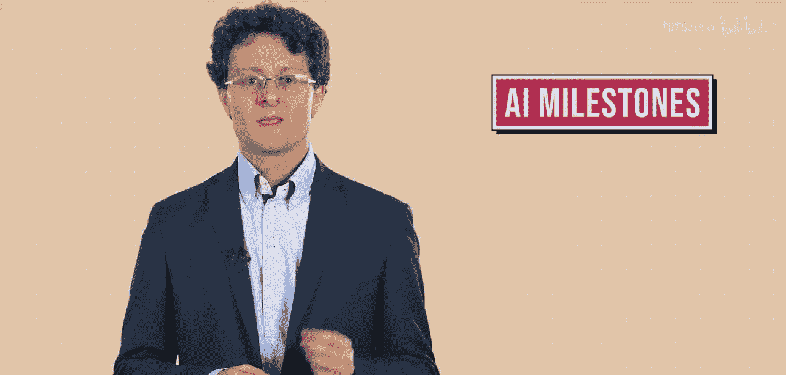
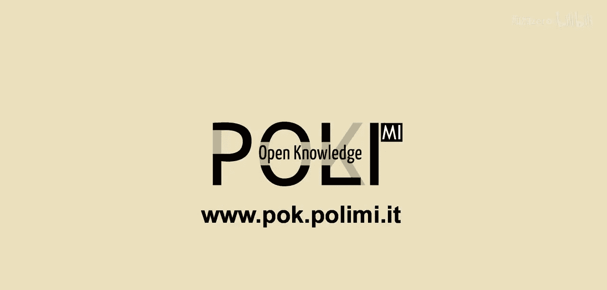

# 010：人工智能发展里程碑 🚀

在本节课中，我们将回顾人工智能发展历程中的关键里程碑。这些具体的、具有挑战性的AI系统的部署，是吸引公众关注和推动研究资金投入的关键。我们通常将那些产生最大影响的AI系统称为里程碑。

## 早期里程碑：公众认知的开启

上一节我们提到了AI发展的宏观背景，本节中我们来看看那些标志性的早期系统。以下是两个具有开创性意义的早期AI系统：

*   **Eliza (1966年)**：这是一个聊天机器人。它是首个向公众展示人工智能潜力的系统，引发了所有媒体的关注，并将人工智能置于科学研究议程的中心。
*   **XCON (1980年)**：这是一个专家系统。它能够根据客户需求，提供如何配置计算机系统的建议。采用XCON的公司估计每年节省了约2500万美元。XCON是推动AI第二次发展浪潮的关键。

## 算力与技术的突破：从游戏到现实

然而，我们必须等到90年代末才迎来第一次重大突破。从2000年开始，一系列里程碑的出现得益于现代计算机计算能力的提升以及新的、更强大的技术的发展。

以下是几个关键突破：

*   **深蓝 (1997年)**：由IBM开发的深蓝在国际象棋比赛中击败了最好的人类棋手。深蓝主要基于**暴力计算（brute force）**，与今天采用的技术相比，其智能程度并不高。
*   **DARPA大挑战赛 (2005年)**：研究界在自动驾驶领域首次获得成功。
*   **沃森 (2011年)**：IBM的沃森计算机在智力问答节目《危险边缘》中战胜人类。这个程序能够理解自然语言提问，是首个在游戏表示上不依赖于逻辑或代数等数学工具，而是结合了自然语言处理的经典技术与新颖统计方法的高水平人机对战程序。
*   **Waymo (2018年)**：谷歌在凤凰城推出了Waymo自动驾驶出租车服务，表明自动驾驶汽车已成为一项成熟技术。

## 深度学习时代：超越完美信息

从2012年起，深度学习时代来临。ImageNet竞赛中图像识别程序的性能急剧提升。2016年，应用于围棋游戏的深度学习程序**AlphaGo**战胜了顶尖人类棋手。

此后，AI开始攻克更复杂的“不完美信息”游戏。以下是相关进展：

*   **Libratus (2017年)**：在德州扑克中击败了世界排名前四的选手，赢取了超过180万美元。
*   **AlphaStar (2019年)**：在《星际争霸II》中击败了99%的人类玩家。
*   **GPT-3 (2020年)**：深度学习使得设计GPT-3成为可能。这是一个语言生成模型，首次能够生成可与人类创作相媲美的故事和诗歌等文本。

---

本节课中我们一起学习了人工智能发展史上的重要里程碑，从早期的Eliza聊天机器人、XCON专家系统，到深蓝、沃森在游戏和问答中的突破，再到深度学习驱动的AlphaGo、AlphaStar以及在自然语言生成上取得惊人成就的GPT-3。这些里程碑清晰地展示了AI技术从概念演示到解决复杂现实问题的演进路径。