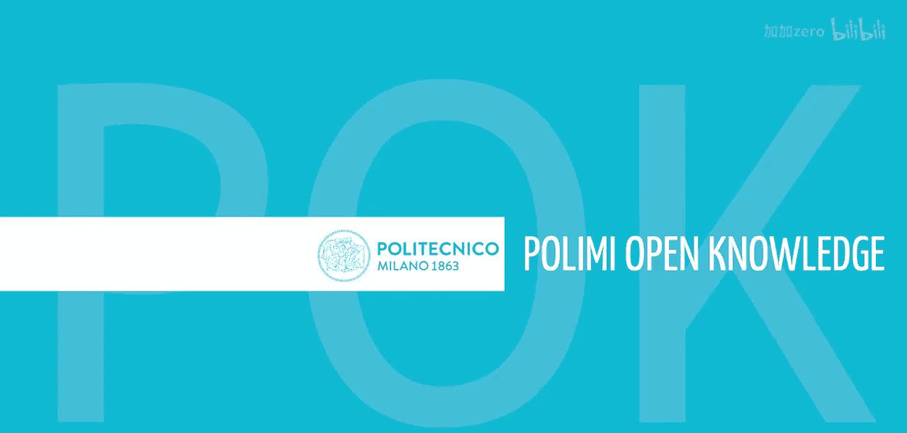

人工智能概述专项课程：P12：工业界的人工智能研究

在本节课中，我们将要学习人工智能在工业界的研究现状，了解企业与学术界的合作如何推动人工智能技术的发展。

自2010年以来，许多公司建立了人工智能和机器学习实验室。这些实验室招募了来自学术界的科研人员，并与公司内部的工程师进行协作。

这些研究人员参加学术会议，发表科学论文，展示他们的工作成果。同时，他们利用研究成果来革新公司的产品与服务。因此，人工智能研究在许多公司的技术发展中处于核心地位。与此同时，工业界在科学研究中也扮演着重要角色。

例如，许多人工智能领域的里程碑式成果都是由私营企业的实验室部署实现的。

因此，促进科学界与企业之间的协同合作，对每个国家而言都至关重要。

以下是主要的私营人工智能实验室：
*   **Google**
*   **Microsoft**
*   **Amazon**
*   **Apple**
*   **IBM**
*   **Facebook**

平均而言，这些实验室各自拥有超过1000名研究人员。它们通过奖项和资助来支持学术研究人员。

这些公司在人工智能研究领域的影响力非常巨大，以至于它们共同成立了“人工智能合作伙伴关系”。这是一个专注于人工智能与社会接口的联盟。

具体来说，该联盟的目标是负责任地使用人工智能。2018年10月，百度成为第一家加入该联盟的中国公司。到2019年，已有来自学术界、民间社会、工业界和非营利组织的100多个合作伙伴成为其成员。

除了大型科技公司，许多其他公司也开设了支持人工智能研究的实验室。

以下是部分公司的例子：
*   **Adobe**
*   **NVIDIA**
*   **Uber**
*   **Intel**
*   **McKinsey**
*   **Sony**
*   **Samsung**
*   **BBC**
*   **Accenture**

如今，数据驱动的方法与人工智能工具被普遍认为是开发创新产品与服务的关键。正如各大公司所展示的，如果没有工业界与学术研究的深度融合，就无法实现这样的创新。

本节课中，我们一起学习了工业界人工智能研究的概况。我们了解到，自2010年起，企业通过建立实验室与学术界紧密合作，共同推动技术进步。大型科技公司不仅自身投入巨大，还通过联盟促进人工智能的负责任发展。数据驱动与人工智能的结合已成为创新的核心动力，而这离不开产业与研究的深度融合。