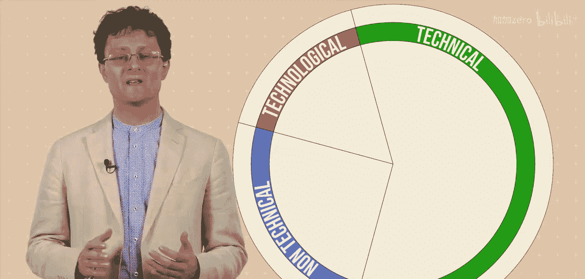

人工智能：概述 专项课程：第13讲：人工智能领域概览

在本节课中，我们将对人工智能相关的子领域进行概览。我们将探讨这些子领域是什么、它们各自的特点以及它们之间是如何相互关联的。后续课程的目标是详细讨论每一个子领域。

首先，主要的区分在于**技术**、**技术实现**以及**监管与组织问题**。

技术层面包括理论、模型和算法。值得注意的是，这些技术可能极其多样化，因此进行进一步的区分实际上是有益的。

具体来说，我们可以根据它们所模仿的人类能力，将其划分为三个主要子类：**感知**、**行动**和**认知**。

---

### 感知类技术

第一子类包含用于**感知任务**的技术。这类技术旨在模仿人类的感知能力。

以下是其主要领域：

*   **计算机视觉**：旨在模仿人类视觉所涉及的所有活动。
*   **自然语言处理**：旨在模仿语言所涉及的所有活动。

---

### 认知类技术

上一节我们介绍了模仿人类感知的技术，本节中我们来看看模仿人类**认知**的技术。这类技术处理信息处理、学习和决策。

以下是其主要领域：

*   **机器学习**：核心目标是从数据和感知中学习。其核心思想可以概括为：`模型 = 学习算法(训练数据)`。
*   **知识表示与推理**：旨在对知识进行建模，并以逻辑化的方式基于这些知识进行推理。
*   **规划与调度**：旨在规划活动并在时间上对它们进行安排。
*   **多智能体系统**：包含处理多个智能实体进行社交互动（合作性或策略性）情境的技术。

---

### 行动类技术

接下来，我们从信息处理转向物理世界的交互。第三子类包含用于在物理世界中处理**行动**的技术。

其主要领域是：

*   **机器人学**：专注于设计、建造和编程能够在现实世界中执行任务的机器人。

---

### 从技术到技术实现

现在，让我们从抽象的理论转向具体的应用工具。技术实现可以是软件或硬件，旨在支持人工智能产品的开发。

我们区分支持人工智能产品设计的方法与提供现成开发资源的人工智能平台：

*   **设计方法**：指支持人工智能产品设计的流程与框架。
*   **人工智能平台**：提供可用于开发人工智能产品的软件库。其背后的核心理念是，大型科技公司开发出库，中小型公司无需重大投资即可使用。这通常被称为**人工智能的民主化**。

---

### 监管与组织问题

最后，我们必须考虑技术之外更广泛的背景。这包括伦理、法律问题以及对劳动力市场的影响。此外，还包括公共或私人组织如何最佳地构建其管理流程以开展人工智能项目。

---

### 总结

本节课中，我们一起学习了人工智能领域的整体框架。我们首先区分了技术、技术实现以及监管组织三大层面。在技术层面，我们根据模仿的人类能力，将其细分为感知（如计算机视觉、自然语言处理）、认知（如机器学习、知识推理）和行动（如机器人学）三类。接着，我们了解了支持这些技术落地的工具与平台。最后，我们认识到人工智能的发展必须考虑伦理、法律和社会组织等关键问题。在接下来的课程中，我们将对它们进行简要介绍。