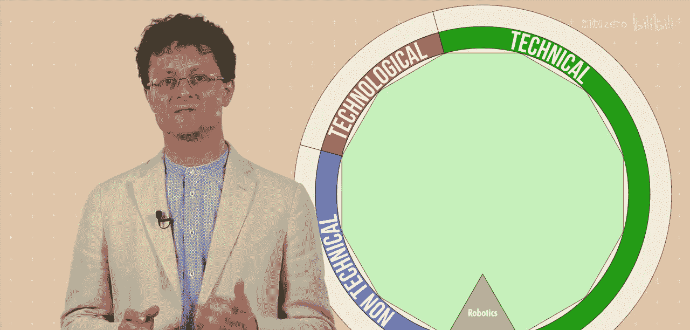

# 014：感知与行动技术 🧠

在本节课中，我们将学习人工智能如何通过“感知”与“行动”两大核心能力与世界互动。感知使计算机能够获取并理解信息，而行动则使其能够执行物理任务。我们将分别探讨计算机视觉、自然语言处理和机器人技术这三个关键领域。

## 计算机视觉 👁️

上一节我们介绍了感知与行动的基本概念，本节中我们来看看计算机视觉。计算机视觉（CV）是一个跨学科的AI子领域，研究机器如何从数字图像或视频中获得高层次的理解。

其核心任务包括获取、处理、分析和理解数字图像的方法，以及从现实世界提取高维数据以产生数值或符号信息。换句话说，计算机将图像转换为算法可以使用的描述。

这种图像理解可以看作是利用几何学、物理学、统计学和学习理论构建的模型，从图像数据中解析出符号信息。

以下是计算机视觉的一些主要应用领域：
*   **生物识别**：如人脸、手势和姿态识别。
*   **图像与视频处理**：包括视频合成、检索、理解及活动分析。
*   **运动与追踪**。
*   **机器人学与自动驾驶**中的视觉应用。
*   **对抗攻击与鲁棒性**。

一些非常常见的应用实例包括：
*   从核磁共振图像中自动检测癌症。
*   使用生成对抗网络进行图像转换。
*   自动检测社交距离。

## 自然语言处理 🗣️

了解了计算机如何处理视觉信息后，我们转向另一种至关重要的感知任务——与语言相关的人工智能。自然语言处理（NLP）是语言学、计算机科学和人工智能的一个子领域，专注于计算机与人类语言之间的交互。

具体而言，其目标是编写程序让计算机处理和分析大量的自然语言数据。这样，计算机就能理解文档的内容，准确提取其中包含的信息和见解，并对文档本身进行分类和组织。

以下是自然语言处理的一些子领域：
*   传统AI与对话系统。
*   文本生成。
*   信息提取。
*   机器翻译。
*   问答系统。
*   语音处理与合成。
*   文本分类与情感分析。

一些非常常见的应用包括：
*   智能虚拟助手。
*   语言翻译。
*   从文档中检索信息。
*   电子邮件过滤器。

## 机器人技术 🤖

在探讨了感知技术之后，我们现在转向实现“行动”的主要领域——机器人技术。机器人技术是一个融合了计算机科学与工程的跨学科领域。

它涉及机器人的设计、构造、操作和使用。机器人技术的目标是设计能够帮助和增强人类能力的机器。它整合了机械工程、电气工程、信息工程、机电一体化、电子学、生物工程、计算机工程、控制与软件工程等多个领域。

机器人技术开发的机器可以替代人类并复制人类的动作。如今，机器人可以在许多情境和目的下使用。许多机器人被用于危险环境，包括放射性材料检查、炸弹处理与引爆、制造过程。它们也被用于人类无法生存的环境，例如太空、水下和高温环境，以及用于清理和隔离危险材料与辐射。

机器人可以呈现任何形态，但有些被设计成类似人类的外观。这有助于机器人在执行某些通常由人完成的重复性行为时被接受。这类机器人试图复制行走、举重、说话、认知以及任何其他人类活动。当今许多机器人受到自然的启发，这促进了仿生机器人学领域的发展。

以下是机器人技术的一些子领域：
*   人机交互。
*   定位、建图与导航。
*   操控。
*   运动与路径规划。

一些非常常见的应用包括：
*   制造业。
*   机器人手术。
*   清洁机器人。

---

本节课中，我们一起学习了人工智能实现感知与行动的三大关键技术。**计算机视觉**让机器能“看懂”图像和视频；**自然语言处理**让机器能“听懂”并处理人类语言；而**机器人技术**则综合多种工程学科，让机器能在物理世界中“行动”并完成任务。这三者共同构成了智能体与物理世界交互的基础。