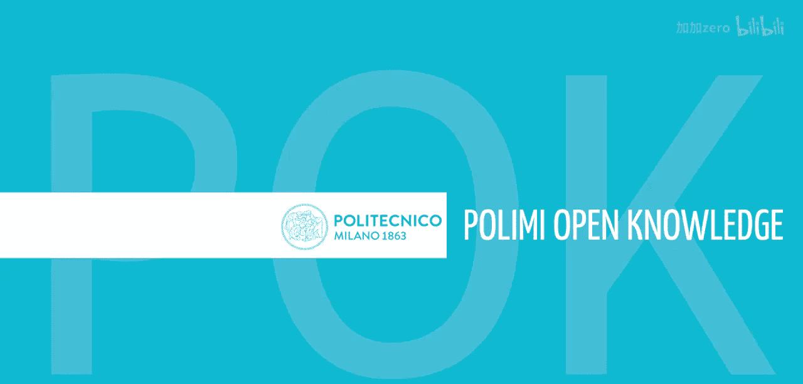
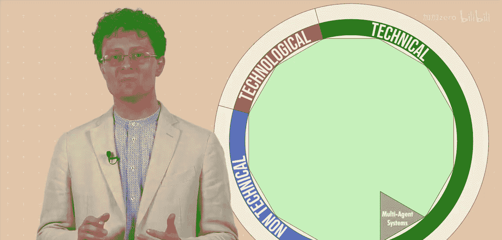

人工智能：概述 专项课程：1.2：认知相关技术

在本节课中，我们将要学习与认知任务相关的四个主要人工智能子领域。认知涵盖了知识形成、记忆、判断、推理、问题解决和决策制定等诸多智力功能和过程。理解这些技术是构建智能系统的基础。

## 机器学习

上一节我们介绍了认知的广泛定义，本节中我们首先来看看**机器学习**。机器学习是研究能够通过经验和数据自动改进的计算机算法的学科。

机器学习算法基于样本数据（称为**训练数据**）构建模型，从而无需明确编程即可进行预测或决策。这些数据通常由计算机视觉或自然语言处理等AI感知系统生成。此外，机器学习的一个子集与计算统计学密切相关，后者为其提供了主要的理论基础。但并非所有机器学习都属于统计学习。数据挖掘是一个相关的研究领域，侧重于通过无监督学习进行探索性数据分析。

需要指出的是，当应用于商业问题时，机器学习也被称为预测分析或高级分析。

以下是机器学习的一些主要子领域：
*   无监督学习
*   监督学习
*   强化学习
*   分类与回归
*   聚类
*   深度神经网络
*   进化学习
*   在线学习与赌博机问题
*   量子机器学习

其非常常见的应用包括市场销售与需求预测等预测与预报、推荐系统、预测性维护以及异常检测系统。

## 知识表示与推理

从学习知识出发，我们接下来进入对知识的运用，即**知识表示与推理**。这个AI领域致力于以计算机系统可用于解决复杂任务的形式来表示关于世界的信息。

知识表示与推理借鉴了心理学关于人类如何解决问题和表示知识的发现，以设计出使复杂系统更易于设计和构建的形式化方法。同时，它也融合了逻辑学的成果，以自动化各种推理，例如应用规则或处理集合与子集的关系。

以下是知识表示与推理的一些子领域：
*   描述逻辑
*   知识工程
*   逻辑编程
*   本体论
*   自动推理
*   定理证明

其非常常见的应用包括语义网和专家系统。

## 规划与调度

一旦知识被处理并进行了某种形式的推理，我们就可以转向**规划**。具体来说，自动规划与调度是AI的一个分支，致力于为实现智能体、自主机器人和无人载具执行的策略或行动序列。

规划也与决策理论相关。规划需要组织一系列任务以实现给定目标。在已知环境且拥有可用模型的情况下，规划可以离线进行，解决方案可以在执行前被找到和评估。在动态未知环境中，策略通常需要在线修订，解决方案通常依赖于人工智能中常见的迭代试错过程，甚至利用学习工具。

以下是规划与调度的一些子领域：
*   确定性规划
*   优化
*   时空系统
*   计划执行与监控
*   规划、调度与学习
*   调度
*   时序规划

## 多智能体系统

最后，我们来看多个AI实体交互的场景，此时每个AI实体都需要明确考虑其他AI实体的存在，即**多智能体系统**。多智能体系统是由多个相互作用的智能体组成的计算机化自组织系统。

多智能体系统可以解决单个智能体或单体系统难以或无法解决的问题。其智能可能包括方法性、功能性、程序性方法，算法搜索或强化学习。

以下是多智能体系统的一些子领域：
*   对抗性智能体
*   协议、辩论与协商
*   协调与协作
*   分布式问题求解
*   机制设计

其非常常见的应用包括基于微观经济模型的自动经济交易、物理安全监控以及去中心化控制。

🎼

本节课中我们一起学习了与认知功能相关的四个核心人工智能子领域：**机器学习**负责从数据中学习模式；**知识表示与推理**负责以可计算的形式存储和运用知识；**规划与调度**负责制定行动序列以实现目标；**多智能体系统**负责处理多个智能实体之间的交互与协作。理解这些领域是掌握人工智能如何模拟和实现人类认知过程的关键。