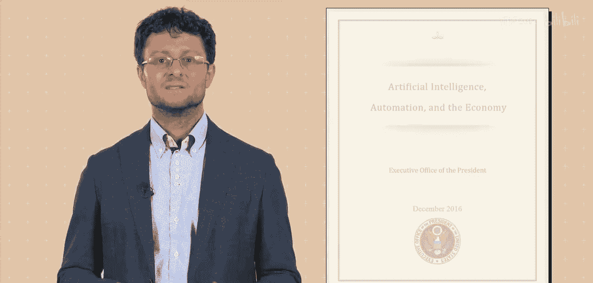

# 019：美国的人工智能战略 🇺🇸

在本节课中，我们将学习美国在人工智能领域的发展战略。我们将回顾从奥巴马政府到特朗普政府时期，美国在AI政策、法规和投资重点上的演变。

---

## 概述

美国的人工智能战略始于奥巴马总统任期。其核心目标是理解AI的潜在影响与风险，并制定战略以引导未来的AI发展。为此，美国发布了三份关键报告。

## 奥巴马政府时期的AI战略

上一节我们提到了美国AI战略的启动背景，本节中我们来看看奥巴马政府时期发布的三份核心报告及其建议。

### 第一份报告：《为人工智能的未来做准备》

这份报告重点关注伦理问题与法规。以下是其提出的三项最关键的建议：

1.  **关注数据**：数据被几乎所有国家战略视为AI技术的主要驱动力。报告规定，联邦机构应优先考虑AI中的开放数据培训和开放数据标准。这是因为数据被认为是人工智能最重要的“燃料”。因此，开放数据并定义数据标准对于促进AI部署至关重要。
2.  **建立监督委员会**：报告建议成立特别委员会来监控AI的发展，并定期向政府报告。
3.  **优先基础研究**：报告建议联邦政府应优先考虑基础性和长期的人工智能研究。

### 第二份报告：《国家人工智能研发战略计划》

这份报告为公共资金投入科学研究提出了优先事项。以下是其核心建议：

1.  **进行长期投资**：建议对AI研究进行长期投资。
2.  **发展人机协作方法**：开发有效的人机协作方法。
3.  **确保系统安全**：确保AI系统的安全与保障。

该文件于2019年更新，并规定了美国当前的国家战略。

### 第三份报告：《人工智能、自动化与经济》

这份报告评估了自动化对各行各业（如工业、行政、商业、教育等）的影响，并旨在优化收益与成本之间的权衡。报告特别关注AI将如何影响市场层面，以及应如何重组市场以促进AI技术的发展。

这些报告将AI发展置于政府议程的中心，并推动了相关法规的制定。

## 特朗普政府时期的战略转变

上一节我们了解了奥巴马政府以报告和规划为核心的AI战略，本节中我们来看看特朗普政府时期战略的显著变化。

2017年，特朗普总统放宽了对AI发展的监管，让大型科技公司主导AI技术的开发。2018年，在一次与大型科技公司的峰会上，白宫定义了四大目标：

1.  **保持美国在AI领域的全球领导地位**。
2.  **支持劳动力**。
3.  **通过公共资金促进研发**。
4.  **消除创新障碍**。

为实现这些目标，白宫采取了一系列措施：

*   成立了人工智能优先事项咨询委员会。
*   创建了产业界与学术界之间的联邦合作伙伴关系。
*   取消了部分法规。

2021年，白宫计划在AI相关研发项目上投资超过80亿美元，相比2020年增长约50%。然而，政府的优先事项是国防与安全，将其他更广泛领域的AI应用开发直接交由公司驱动。

---

## 总结

本节课中，我们一起学习了美国人工智能战略的演变。我们从奥巴马政府时期以三份核心报告（关注伦理、研发战略、经济影响）为基础的规划性战略开始，看到了其对数据、基础研究和监管的重视。随后，我们探讨了特朗普政府时期的战略转变，其特点是放松监管、鼓励私营企业主导，并将投资重点转向国防与安全领域。这一演变反映了美国在不同时期对AI技术发展路径和风险权衡的不同考量。