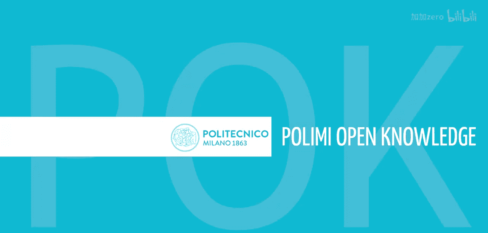
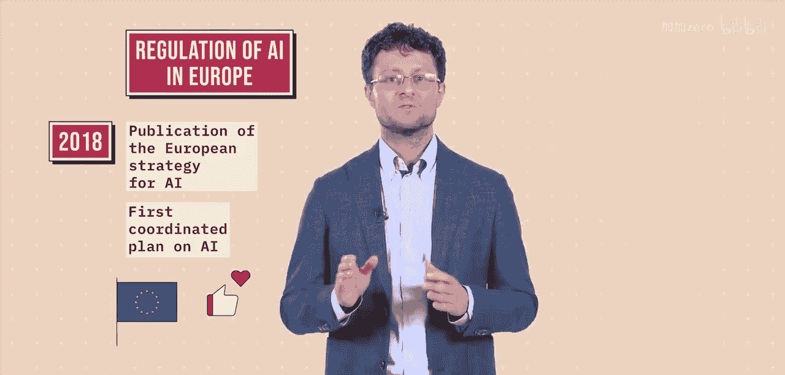
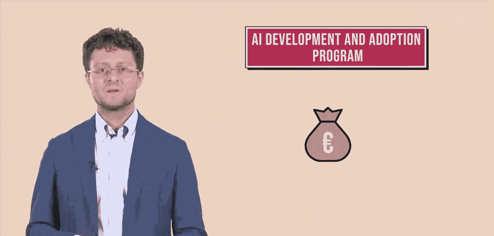
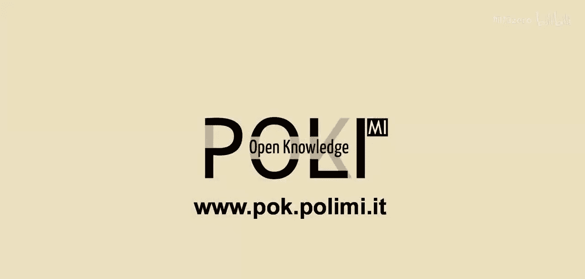

# 021：欧盟的人工智能战略

## 概述
在本节课中，我们将学习欧盟在人工智能领域所采取的战略方针。这一战略的核心是“以人为本”和“可信赖的人工智能”，并建立了一套基于风险评估的严格监管框架，旨在促进人工智能技术的安全、负责任发展与应用。

---

## 欧盟的人工智能方针
欧盟对人工智能采取的是以人为本的方针。这意味着，只有当人工智能对人类有益时，才应被开发。

显然，在授权每一类特定的人工智能应用之前，都需要仔细分析其益处与风险。

因此，这一方针在很大程度上依赖于中央机构制定的法规。

具体而言，最能体现欧洲战略的关键词是“可信赖的人工智能”。

---

## 监管历程
欧盟针对人工智能的监管活动始于2015年。

具体而言，在2015年，我们看到了《欧洲人工智能战略》的发布。

随后，所有成员国签署了第一份关于人工智能的协调计划。

2015年之后，欧盟委员会采取了一系列步骤。

在2019年，发布了《可信赖人工智能指南》。

在2020年，发布了名为《人工智能白皮书》的文件，其中阐述了欧盟对人工智能的愿景，即追求卓越与可信赖。这份文件为2021年发布的法规铺平了道路。

同样在2020年，还发布了关于人工智能、物联网和机器人技术安全与责任影响的报告。欧盟委员会在其中指出了一系列需要解决的开放性问题，以确保多种产品（特别是机器）的安全性。

在2021年，发布了《关于制定人工智能统一规则条例的提案》，即《人工智能法案》。该法案提供了严格的监管规定。

---

## 核心理念
欧盟委员会两位成员在2021年发表的声明很好地总结了欧盟的方针。

根据欧盟委员会执行副主席玛格丽特·韦斯塔格的看法，可信赖不是一种选择，而是一项严格要求。

同时，欧盟内部市场专员蒂埃里·布雷顿将人工智能视为一种工具，因此只有当它有益于人类时才应被使用。

欧洲战略背后的核心理念是，监管框架可以促进人工智能的普及。

首先，它将增加用户的信任，从而增加企业和公共机构对人工智能的需求。

它还将增加法律确定性，并通过统一规则，让人工智能提供商能够进入更大的市场，提供用户和客户欣赏并购买的产品。

换言之，欧盟委员会认为，如果不规避风险、保证可信赖性并解决法律问题，就不可能实现人工智能技术的有效发展。

---

## 风险分级管理
欧盟委员会确定了几个风险等级。第一个是可接受风险。

欧盟将禁止少数特别有害、违背欧洲价值观（因为它们侵犯基本权利）的人工智能应用。

以下是一些例子：
*   政府实施的社会信用评分。
*   利用儿童弱点。
*   使用潜意识技术。
*   除少数例外情况外，在公共场所用于执法目的实时远程生物识别系统。

接下来是高风险。这一级别对应的是数量有限、会对人身安全或其基本权利（受《欧盟基本权利宪章》保护）产生不利影响的人工智能系统。

欧盟委员会制定了一份高风险人工智能系统清单，该清单可根据人工智能用例的发展进行审查。

为了确保信任、高水平的安全和基本权利，提案为所有高风险人工智能系统提出了强制性要求。

这些要求涵盖：
*   所用数据集的质量。
*   技术文档和记录保存。
*   透明度及向用户提供信息。
*   人工监督。
*   稳健性、准确性和网络安全。

然后是有限风险。对于某些存在特定操纵风险（例如通过使用聊天机器人）的人工智能系统，需要施加特定的透明度要求。

例如，用户应意识到他们正在与机器互动。

最后是最小风险。所有其他人工智能系统可以根据现有立法进行开发和使用，无需承担额外的法律义务。

目前欧盟使用的大多数人工智能系统都属于此类。这些系统的提供商可以自愿选择应用可信赖人工智能的要求，并遵守自愿行为准则。

---

## 执行与资助
成员国在法规的应用和执行中扮演着关键角色。在这方面，每个成员国应指定一个或多个国家主管当局，负责监督法规的应用和实施，并进行市场监督活动。

为了提高效率并建立与公众及其他对应机构的官方联系点，每个成员国应指定一个国家监督机构，该机构也代表该国参与欧洲人工智能委员会。

除了对人工智能进行严格而精确的监管外，欧盟还制定了明确的人工智能发展与采用计划。

资金将通过“数字欧洲”和“地平线欧洲”等欧洲计划进行分配。

用于数字化转型的资金比例将约为20%。

此外，欧盟鼓励战略信息交流、数据和计算基础设施共享。它还通过创建公私实体间的数字创新伙伴关系，促进人工智能卓越发展以及人才从实验室向市场的流动。

---

## 总结
本节课中，我们一起学习了欧盟的人工智能战略。我们了解到，该战略以“以人为本”和“可信赖”为核心，通过建立基于风险分级的严格监管框架来管理人工智能应用。同时，欧盟也通过资金支持和鼓励合作，旨在安全、负责任地推动人工智能技术的发展与普及。