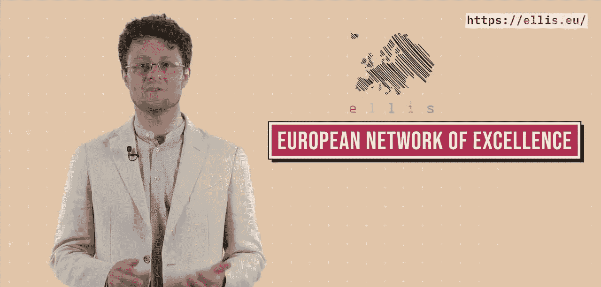
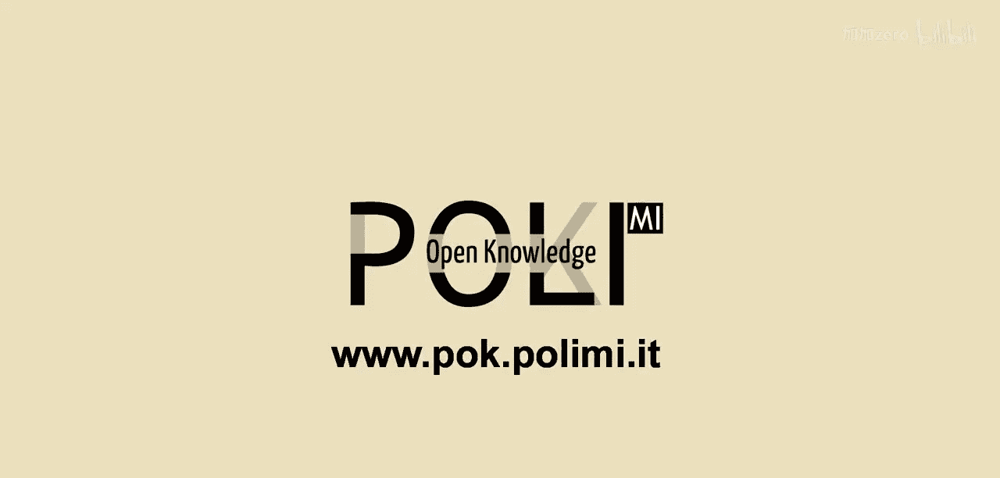

**人工智能概述专项课程：第22讲：意大利人工智能领域的主要参与者概述**

在本节课中，我们将梳理意大利人工智能领域的主要机构参与者。这些机构虽然关系密切，但在不同层面扮演着不同角色。我们的目标是简要介绍这些参与者，在后续课程中，我们将通过访谈更详细地了解它们的使命与活动。

---

在意大利，有多个人工智能领域的机构参与者。即使这些参与者关系密切，它们也在不同层面扮演着不同角色。

以下是意大利国内的主要参与者：

*   **意大利人工智能协会**：按时间顺序，最早的参与者是意大利人工智能协会。其缩写为**AI\*IA**，代表“人工智能促进人类”。它成立于1988年，汇集了意大利大多数人工智能科学家。
*   **其他学术协会**：然而，AI\*IA并非意大利唯一的人工智能学术协会。其他意大利人工智能协会或国际协会的意大利分会包括：逻辑编程小组、医疗人工智能协会、自然语言处理协会、认知科学协会、计算机视觉与模式识别协会，以及国际神经网络学会意大利分会。
*   **数字意大利机构任务组**：2017年，数字意大利机构启动了一个任务组，研究人工智能解决方案和技术的传播如何影响公共服务的演变，以改善公共管理与公民之间的关系。该任务组由30名专家组成，并发布了一份名为《为公民服务的人工智能》的白皮书。
*   **CINI人工智能实验室**：2018年7月，CINI人工智能与智能系统国家实验室成立。它基本上是一个由所有从事人工智能领域的意大利大学和研究中心组成的网络。
*   **经济发展部专家组**：2018年10月，意大利经济发展部启动了一个由30名人工智能专家组成的团队，称为“人工智能高级别专家组”。成员来自学术界、工业界和民间社会。2020年，该小组发布了一份报告，为意大利人工智能战略提出了若干建议。
*   **大学与研究部项目**：与经济发展部的活动并行，2019年，意大利大学与研究部组建了一个学者小组，以验证国家人工智能研究计划，该计划于2021年发布。此外，2021年，意大利大学与研究部启动了国家人工智能博士项目。

---

上一节我们介绍了意大利国内的主要机构。本节中，我们来看看这些意大利机构与欧洲网络的紧密联系。

意大利的学术协会和CINI实验室与欧洲协会和学术网络紧密相连，以促进合作、共享计算基础设施并共同规划下一步研究。特别值得提及的有以下三个欧洲组织：

*   **EurAI**：这是欧洲人工智能协会，前身为ECCAI。它成立于1982年7月，是欧洲人工智能界的代表机构。其宗旨是促进欧洲人工智能的研究、开发与应用。
*   **ELLIS**：这是一个欧洲卓越网络，汇集了许多欧洲人工智能与机器学习实验室。它成立于2018年，其使命通过两种方式使欧洲受益：第一，加强欧洲最好的基础研究，使欧洲能够塑造机器学习和现代人工智能如何改变世界；第二，凭借卓越且独立于工业界影响的免费基础研究，对欧洲经济产生影响并创造就业机会。
*   **CLAIRE**：这是一个欧洲卓越网络，成立于2018年。它是人工智能实验室联合会。CLAIRE旨在加强欧洲在人工智能研究与创新方面的卓越性。该网络建立在欧洲人工智能研究实验室联合会的基础上，其成员团体和组织致力于共同努力实现CLAIRE的愿景：**以人为中心，为整个欧洲实现卓越的人工智能**。

---

本节课中，我们一起学习了意大利人工智能生态系统的主要参与者。我们首先介绍了国内的关键机构，包括学术协会、政府任务组、国家实验室以及各部委推动的战略计划。接着，我们探讨了这些意大利实体如何与EurAI、ELLIS和CLAIRE等重要的欧洲研究与协作网络紧密连接，共同推动欧洲在人工智能领域的发展与竞争力。