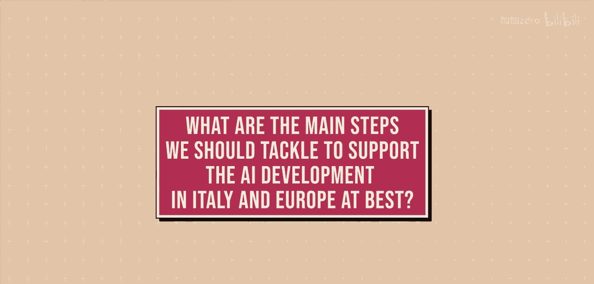

# 023：意大利人工智能协会访谈

## 概述
在本节课程中，我们将通过意大利人工智能协会主席Pierro Popochanantti的访谈，了解该协会的使命、活动以及其对意大利及欧洲人工智能发展的看法。我们将学习到协会如何促进研究、教学，并探讨在欧洲独特的经济背景下发展人工智能所需的关键步骤。

---

## 协会简介与使命 🏛️

Pierro Popochanantti自1974年起便在计算机科学领域工作。他曾为Monte de Paquena机构执行人工智能领域的项目，涉及文档与培训的知识呈现系统、手语翻译应用、公司法规的查询应答以及基因与本体论。自2000年起，他成为意大利人工智能协会的董事会成员，并于2017年12月出任协会主席。

意大利人工智能协会是一个于1988年成立的科学协会，旨在促进人工智能相关技术的研究与传播。该协会是欧洲人工智能协会在意大利的成员，也是意大利最重要的人工智能协会，拥有超过1000名会员，包括学术界和工业界人士。协会支持欧洲层面的Clive和Alice倡议。

---

## 协会的主要活动 📚

上一节我们介绍了协会的基本情况，本节中我们来看看协会具体开展哪些活动。协会致力于增进对人工智能的了解，促进其教学，并推动该领域的理论与应用研究。

以下是协会开展的主要活动形式：
*   通过研讨会、针对性活动和赞助来组织活动。
*   在协会内部，设有多个专注于特定研究主题的工作组。目前有8个工作组，分别关注智能体与多智能体系统、人工智能与法律、人工智能教育、人工智能与机器人、机器学习与数据、知识表示与自动推理、自然语言处理以及论证。
*   协会每年组织一次全国性的科学活动，以及其他面向学术界和工业界的倡议。
*   协会颁发奖项和奖学金，以鼓励学生和年轻研究人员参与其举办的活动。

自2014年起，协会通过举办会议和辩论来分析人工智能的经济与社会影响，并邀请高中生和本科生参与。对于学生，协会还推广采用同伴教学方法的培训活动，让学生们互相教学。自2019年起，协会每年举办一次专门面向企业的论坛，旨在将研究界和工业界的社群聚集在一起。协会坚信，若没有这两个社群之间的紧密交流与融合，就无法实现有效的人工智能发展与采用。

---

## 支持意欧AI发展的关键步骤 🚀

了解了协会的活动后，我们接下来探讨在意大利和欧洲最佳地支持人工智能发展需要解决哪些主要问题。意大利和欧洲的社会经济情景与中国和美国截然不同。

具体而言，意大利和欧洲拥有丰富的中小型企业，而大型公司采用的业务和发展模式并不适用于中小型企业。这催生了对新模式的需求。

以下是实现目标需要应对的几个关键步骤：
*   利用基础研究来克服驱动大型企业云业务的一些问题。
*   启用可互操作的云基础设施、雾计算和边缘计算，以便为微型、小型和中型企业提供解决方案。
*   为了实现这一目标，还需要整合符号与亚符号模型，并赋予机器抽象技能，以优化其行为、适应环境并解释其行动和建议。当可用数据量不足以采用深度学习方法时，这一点尤为重要。

**核心公式/概念**：`AI发展 = 基础研究 + 可互操作的基础设施 + (符号AI + 亚符号AI)`

但首先，协会正在推动跨学科和多学科的贡献，推动人工智能及整个经济模式朝着人类与地球的可持续性方向发展。仅有规则是不够的，我们需要一场深刻的社会文化变革。协会确信，人工智能可以成为一个有价值的工具，来改变前进的方向。

---

## 总结
本节课中，我们一起学习了意大利人工智能协会的背景、目标及其开展的各种活动，从学术研讨到产业论坛。更重要的是，我们探讨了在欧洲以中小企业为主的经济生态中，发展人工智能需要关注基础研究、基础设施互操作性、技术融合以及推动社会文化向可持续方向转变等关键步骤。这为我们理解人工智能在不同地域背景下的发展策略提供了重要视角。