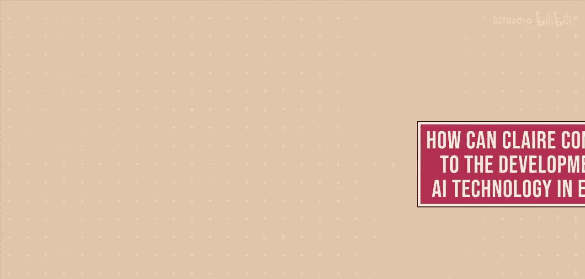
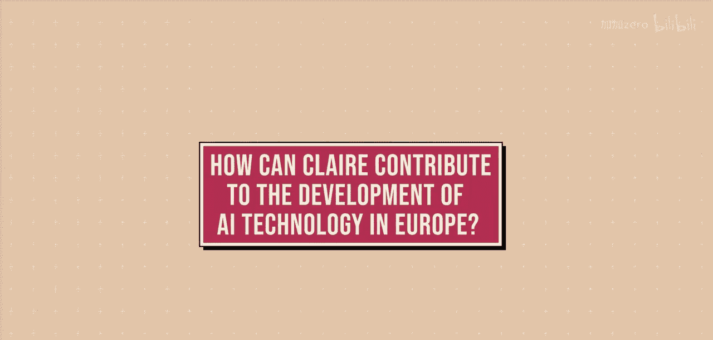
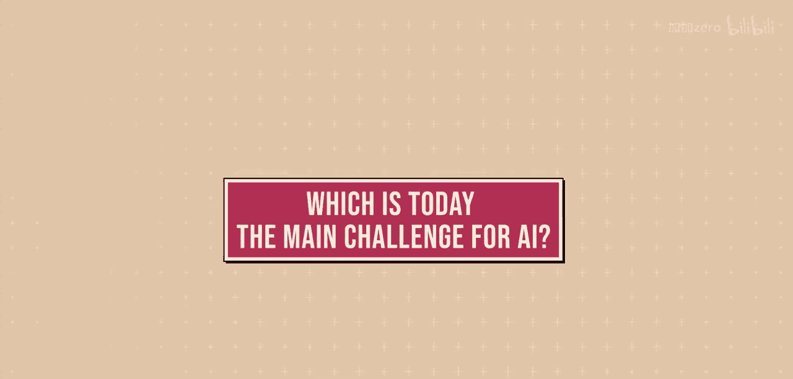
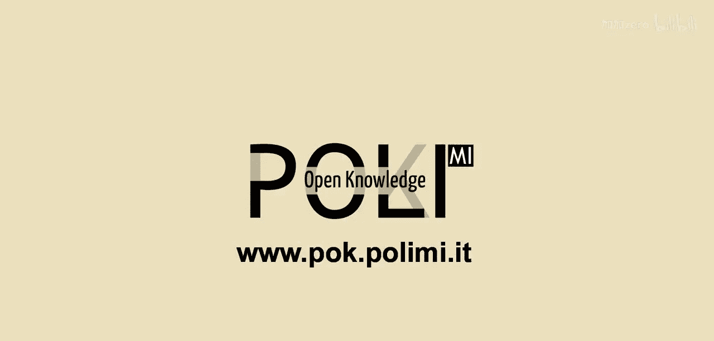

**人工智能概述专项课程：P27：访谈 - Claire 介绍**

在本节课中，我们将了解欧洲人工智能研究实验室联合会（Claire）的概况、目标、活动及其对欧洲人工智能发展的贡献。

---

**Claire 简介**

Jacomo 教授是圣扎大学计算机控制与管理工程系的计算机工程与科学全职教授。他的研究主题是知识表示与自动推理。他是 WA 会士、Hishan 会士和 AI 会士。

欢迎 Jacomo 教授。感谢您参与访谈。首先，什么是 Claire？

非常感谢。Claire 代表 **欧洲人工智能研究实验室联合会**。它是一个广泛的泛欧洲人工智能实验室网络，旨在加强欧洲在人工智能研究与创新方面的卓越性。

Claire 的建立部分受到了 CEN 极其成功模式的启发。在该模式下，研究活动依赖于欧洲众多实验室的分布式协作努力。它们共同定义研究问题，讨论解决方法，然后协作开展实验并发布成果。

Claire 倡议最显著的特点之一是，绝大多数 AI 会士，包括我本人在内，都支持这一倡议。AI 会士是由欧洲人工智能协会认可的杰出科学家。

---

**Claire 的主要活动与原则**

Claire 开展了众多活动，在此我将重点阐述其核心理念。

Claire 相信，人工智能将从根本上改变我们的生活和工作方式，并将在应对社会重大挑战（如气候、能源、交通、食品、自然资源、健康以及包容与安全的社会）方面变得至关重要。

Claire 认为人工智能是全球游戏规则的改变者，已成为创新、未来增长和竞争力的主要驱动力。Claire 的愿景是，欧洲凭借其在人工智能所有领域的现有优势、强大的大学、研究机构和公司，处于推进人工智能发展的绝佳位置。欧洲可以确保许多更先进的技术、产品、系统和服务反映欧洲的需求和民主价值观。

Claire 专注于发展 **可信任的人工智能**，这种人工智能与人类智能兼容并增强之，而非取代。

Claire 致力于大幅增加对现有人工智能科学优势及其他研究机会的资金支持。
Claire 与关键利益相关者合作，寻找公民参与、产业界与公共部门协作的机制。
Claire 定义并应对跨广泛应用领域的价值导向挑战，包括健康、制造、交通、科学研究、可持续农业、金融服务、公共管理和娱乐。

---

**Claire 对欧洲人工智能技术发展的贡献**

Claire 通过多种方式为欧洲人工智能技术的发展做出贡献。

以下是其主要贡献领域：

*   **支持广泛的应用研究**：Claire 支持有望在广泛应用领域产生重大短期、中期和长期影响的研究，包括高效安全的交通、先进医疗、智能工业、高效可持续农业、加速科学研究、下一代学习与教育等。
*   **关注社会影响**：Claire 开展的人工智能研究旨在解决有关人工智能社会影响的一些开放性问题，例如公平性、透明度、可解释性和价值对齐。其明确重点是构建对人类有益的、可信任的人工智能。
*   **吸引与培养人才**：Claire 支持为硕士生、博士生和博士后研究员提供有吸引力的奖学金，并通过高效、轻量但坚实的科学评审，支持杰出的初级、中级和高级研究员。目标是吸引全球最优秀的人才来到欧洲。
*   **促进合作与交流**：Claire 旨在阻止当前的人才流失趋势，并吸引最优秀的人才。它为所有资历层次、所有人工智能领域的研究人员提供大量支持，以促进交流与互动。
*   **支持高质量教育项目**：Claire 支持开发和运行专注于人工智能的高质量学习项目。
*   **保障学术自由**：Claire 认为研究人员需要享有充分的学术自由，研究他们感兴趣的任何课题。正如过去经常发生的那样，最重要的成果往往来自那些被认为边缘化、没有期望产出成果的领域，但它们最终改变了世界。
*   **促进科学讨论与政策制定**：Claire 促进科学讨论，为聚焦和协调欧洲人工智能研究提供独特的机会和力量，同时为制定产业、国家政策和公众指南提供坚实平台。

---

**当前人工智能面临的主要挑战**

人工智能面临诸多挑战，但我希望聚焦于一个：**构建能够在现实世界（可能是在受控环境如智能工厂中）行动的系统**。

这些系统能够做出明智决策，理解其交互的后果，并据此行动。换句话说，系统能够以可控且可理解的方式自行编程。

然而，这涉及人工智能的多个子学科，包括：
*   **知识表示**
*   **规划**
*   **自主智能体**
*   **逻辑推理**
*   **概率推理**
*   **机器学习**

这也与一个称为 **形式化方法** 的计算机科学领域相关，该领域研究自动验证程序的技术。这些技术确实可用于分析程序，也可用于自动合成程序。自动程序合成与这种自我编程密切相关。

此外，我们必须考虑到，这些系统本质上是超级高效的优化器。这种超级优化可能成为问题，尤其是在系统优化的目标未被完全理解的情况下（大多数人类事务即是如此）。结果是，这个超级优化器可能变成一种狂热者，为了达成我们设定的目标而做出超出我们预期的事情。我们人类从历史中知道，狂热者从未带来过好处。

关于这个问题有很多可以讨论，Stuart Russell 所著的《**Human Compatible**》一书就完全专注于探讨此议题，这是一本非常值得推荐的读物。

---

**总结**

本节课中，我们一起学习了欧洲人工智能研究实验室联合会（Claire）的基本情况。我们了解到 Claire 是一个旨在加强欧洲 AI 研究实力的协作网络，其核心原则是发展以人为本、可信任的人工智能。Claire 通过支持广泛的应用研究、关注社会影响、吸引培养人才、促进合作交流以及保障学术自由等方式，推动欧洲人工智能的发展。最后，我们探讨了当前 AI 面临的一个关键挑战：构建能在现实世界中安全、可靠地自主行动与决策的系统，这需要多学科协同并警惕超级优化可能带来的风险。