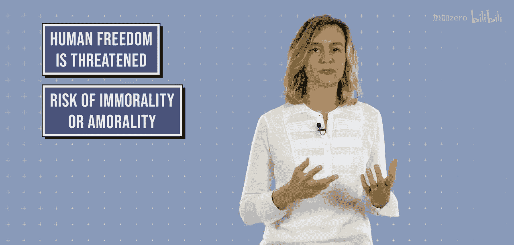
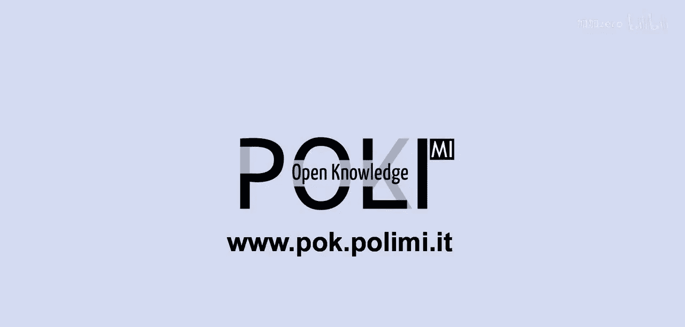

# 039：道德化技术

## 概述
在本节课中，我们将要学习“道德化技术”这一核心概念。我们将探讨技术制品如何承载道德与政治意涵，它们如何作为中介影响人类的行为与决策，以及这对人工智能的设计与责任意味着什么。

---

## 技术制品承载道德与政治意涵
技术制品并非价值中立的工具，它们天然地带有道德与政治色彩。许多学者已经证实了这一点。

以下是两个关键例证：
*   **种族主义天桥**：技术哲学家兰登·温纳曾讨论过城市规划师罗伯特·摩西在20世纪上半叶设计的“种族主义天桥”。摩西故意将长岛公园大道上的数座天桥设计得过低，以致公交车无法通过，只有小汽车可以通行。这增加了前往琼斯海滩公园的难度，使得只有能负担得起汽车的人（在摩西的时代，通常不是非裔美国人）才能轻松抵达海滩。
*   **减速带**：科学社会学家布鲁诺·拉图尔认为，技术制品是道德的承载者。它们持续不断地为人们做出各种道德决策。例如，关于驾驶速度的道德决策常常被委托给减速带，它直接告诉司机：“在到达我之前减速。”

---

## 技术中介：技术如何塑造行为与感知
上一节我们看到了技术如何体现价值观，本节中我们来看看技术如何作为中介直接影响我们。技术中介是指技术在履行其功能时，帮助塑造用户的行为和感知的现象。

换句话说，技术并非简单地连接用户与环境的中立媒介，而是具有影响力的中介，帮助塑造人们使用技术的方式以及他们体验世界的方式。

**技术中介**的概念可以通过产科超声检查来具体说明：
*   超声检查不仅是让子宫内胎儿可见的功能性手段，它还中介了胎儿与父母之间的关系。
*   例如，超声将胎儿图像从女性身体中分离出来，为胎儿创造了一个作为独立生命体的新形象。
*   此外，超声将胎儿置于医疗规范的语境中，它将怀孕转化为一个医疗过程，将胎儿转化为潜在的患者，将先天缺陷转化为可预防的痛苦。

---

## 道德化技术：将道德嵌入物质环境
上述证据表明，我们不应仅将道德视为人类的事务，也应将其视为“物”的事务。与其去“道德化”他人，人类也应该（或可以）去“道德化”他们的物质环境。

如果我们希望人们乘坐地铁时买票，我们不仅可以教育他们在进站前购票，还可以设计地铁闸机来帮助（或要求）人们在进入地铁前完成购票。

因此，**道德化技术**是指为了塑造道德行为和道德决策而有意开发技术。在某种意义上，道德决策是人与技术制品共同努力的结果。

---

## 与人工智能设计的关联：主动责任、不确定性与不可见性
道德化技术与我们之前学过的“主动责任”概念紧密相关。主动责任意味着采取行动预防技术的负面影响，同时实现其积极后果。

那么，主动责任方法、技术道德化与人工智能之间有何联系？简单的答案是，主动责任在像人工智能这样对人类和社会有重大影响的技术设计中起着关键作用。

然而，还有另外两个重要因素值得引入：
1.  **不确定性**：这不仅与人工智能技术本身有关，也与其被引入使用环境以及与人类互动的方式有关。这就是为什么人工智能技术可以被标记为**实验性技术**。如果对某项技术的操作经验有限，无法基于经验直接评估其社会效益和风险，那么它就是实验性的。
2.  **不可见性因素**：计算机伦理学家吉姆·摩尔在一篇著名论文中提出了这个概念，他认为在大多数时间和条件下，计算机的操作是不可见的。他区分了三种类型的不可见性：
    *   **滥用的不可见性**：故意利用计算机的不可见操作进行不道德行为。
    *   **编程价值的不可见性**：那些有意或无意被植入程序中的价值观。
    *   **复杂计算的不可见性**：计算机超越人类理解能力的巨大计算能力。

在考虑采用主动方法来设计人工智能技术、以塑造其促进积极影响时，必须同时考虑不确定性和不可见性因素。

---

## 道德化技术的挑战与风险
让我们考虑一种具体应用了人工智能技术、旨在促进积极效果的道德化技术：汽车酒精锁。这个工具可以在你体内酒精浓度高于法定标准时，阻止你驾驶。

假设这个设备工作无误，且在隐私方面没有问题。然而，许多人仍然不会购买装有这种锁的汽车，即使其价格与普通汽车相同。

人们对这类行为引导技术的负面反应很常见，原因如下：
*   **对自由与尊严的威胁**：人们担心人类自由受到威胁，民主被技术专家统治所取代。自主性的减少被视为对尊严的威胁，因为控制权不在人，而在技术。
*   **道德能力退化的风险**：如果我们将道德决策委托给技术，我们可能会丧失进行道德决策的能力。
*   **缺乏民主合法性**：技术在限制人类自由方面与法律不同，其中所实现的价值和选择并非民主进程的结果。

---

## 设计民主化的道德化技术
一个关键问题是找到一种民主的方式来设计道德化技术。这意味着，例如，植入这些价值观的过程必须是透明的，并经过公开讨论。

技术设计者不能简单地将一种期望的道德形式刻入制品中。这一点非常重要，以避免意外和不受欢迎的中介形式。一个著名的例子是节能灯泡的发明，本意是减少能源消耗，结果却因为灯泡被添加到以前未照明的地方而增加了总能耗。

因此，技术设计似乎不仅仅是发明功能性产品。技术中介的视角揭示，设计应被视为一种**物质化道德**的形式。工程设计伦理应该更严肃地对待技术产品的道德负载，并相应地重新思考设计者的道德责任。

---

## 总结
本节课中，我们一起学习了：
1.  技术制品承载着道德与政治意涵，并能作为中介塑造人类行为与感知。
2.  “道德化技术”是指有意设计技术来引导道德决策。
3.  在人工智能等技术的设计中，必须结合“主动责任”原则，并充分考虑其“不确定性”和“不可见性”带来的挑战。
4.  道德化技术面临风险，如威胁自由、削弱道德能力及缺乏民主合法性。
5.  最终，设计者不能单方面将道德嵌入技术，而需预见技术未来的中介角色；用户和公民应知晓谁决定了嵌入技术的价值观；政策制定者不仅应在事后监管现有技术，更应从最初就共同塑造它们。