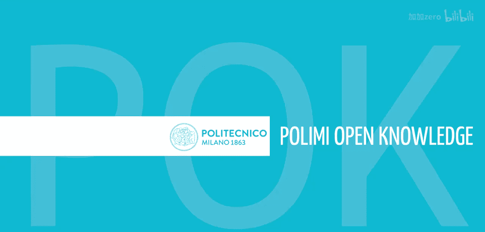

# 043：人工智能的民事责任与损害赔偿

在本节课中，我们将要学习人工智能应用中的一个核心法律议题：当人工智能系统造成损害时，谁应承担民事责任并进行赔偿。我们将探讨民事责任的基本概念、人工智能带来的特殊挑战，以及当前法律框架下的思考方向。

## 民事责任的基本概念

上一节我们提出了人工智能造成损害的问题，本节中我们来看看民事责任的具体含义。

我们所说的民事责任，指的是因违反私法义务（即涉及私人公民之间关系的义务）而产生的损害赔偿责任。一个极端的例子可以表述为：**任何对他人造成损害的人，都有义务进行赔偿**。

通常情况下，将民事责任（以及相应的赔偿义务）归咎于一个人，需要存在主观过错要素，即：
*   **故意**：明知并有意造成损害。
*   **过失**：疏忽、鲁莽或缺乏经验，即非有意造成损害。

然而，立法也规定了一些**严格责任**的例外情况。严格责任仅要求有害事件与致害方行为之间存在因果关系，而不考虑是否存在恶意或过失的心理要素。

## 人工智能造成损害的现实风险

随着技术的进步和普及，与人类一样，智能系统无疑也会犯错、做出错误决策并造成损害。这个问题远非无关紧要。

最经典的例子是自动驾驶汽车。事实上，该领域已经发生了可归因于自主系统行为的伤亡事件。

第一起由自动驾驶汽车导致的致命事故发生在2016年5月7日。当时，特斯拉Model S的车主约书亚·布朗在佛罗里达州的高速公路上行驶时，决定依靠汽车的自动驾驶功能。在他观看电影时，汽车撞上了一辆正在左转的、对向车道的卡车。汽车制造商解释事故原因是卡车的颜色欺骗了系统——与车身垂直的白色侧面在当时特别明亮的天空背景下无法被区分开来。

这虽然是一个罕见案例，但从法律角度看，它引发了诸多思考。

为了理解该议题的相关性，我们可以再举一个几乎涵盖人工智能技术所有应用领域的例子：
*   **在医疗外科领域**，人工智能越来越多地用于诊断目的。
*   **在护理领域**，人工智能也被假设用于紧急情况。
*   **在银行业**，用于管理客户信贷风险的预测系统日益普及。
*   **在人力资源领域**，支持研究和人员选拔的智能系统正在普及。
*   **在保险业**，基于神经网络的图像识别系统开始被大规模用于加速并可靠地评估理赔。

考虑到这些例子，我们意识到智能系统出错的可能性是一个真实的风险。也就是说，当被问及特定问题时，系统可能基于不正确、不完整或片面的参数给出客观上错误的答案。同样，由人工智能选择或决策可能造成的损害是具体且有效的。确定对此类损害负有赔偿责任的当事方，并非仅是法学家讨论的话题或注定只在法庭上辩论。相反，立法者未来关于人工智能生产和使用相关的民事责任所做的选择，潜在地能够构成对发展和创新的阻碍或激励。它们能够引导公司做出“制造或购买”的决策，并最终决定谁应承担技术进步的代价。

## 人工智能带来的特殊挑战

实际上，损害责任的分配是任何技术都会面临的问题。但在人工智能的情况下，这个问题因智能系统通常基于**自学习算法**而进一步复杂化。系统根据自身经验及与外部环境的互动进行学习和自我决策。

这意味着，设计程序或构建系统的人可能无法预测或预先知道系统对周围环境的反应。因此，问题随之产生：谁应该为一种可能无法预测或不可避免的行为负责，从而必须赔偿损害后果？

正如我们将在后续课程中更详细地看到的，基于现行法规，这个问题的答案并非总是简单明了。正因如此，欧洲机构（特别是欧洲议会）近年来一直在研究这个问题。欧洲议会在2020年10月20日发布的决议中（我们将在后续课程中详细研究），提议引入与人工智能相关的特定责任制度。

换句话说，欧洲议会希望看到一部新的、因此对所有成员国通用的欧洲立法，为人工智能造成的损害制定统一的赔偿规则。

## 总结

本节课中，我们一起学习了人工智能民事责任的核心议题。我们明确了民事责任通常需要主观过错，但也存在严格责任的例外。通过自动驾驶汽车等实例，我们认识到人工智能造成损害是一个现实且广泛存在的风险。由于人工智能，特别是基于自学习算法的系统，其行为可能无法被设计者完全预测，这给传统的责任认定框架带来了特殊挑战。目前，立法机构（如欧洲议会）正在积极探索和制定专门针对人工智能的赔偿责任规则，以应对技术发展带来的新问题。