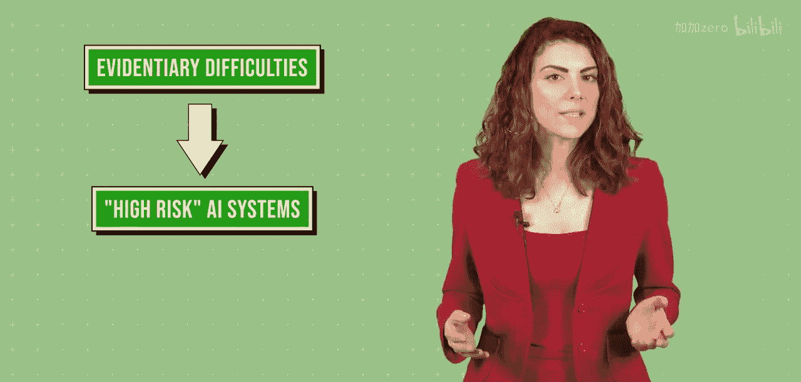
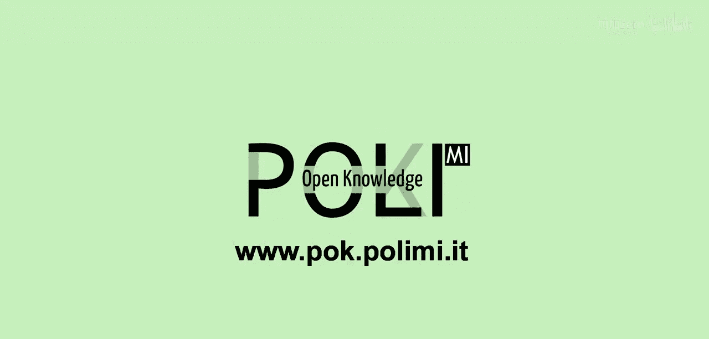

# 045：智能系统生产与使用的责任

在本节课中，我们将学习欧盟议会关于人工智能系统造成损害的责任制度提案。我们将探讨当前法律框架的不足，以及提案中确立责任主体、责任方式及保护措施的核心原则。

## 立法背景与目标

在前面的课程中我们看到，当前关于人工智能系统造成损害的立法责任仍不完善，并不总能充分解决相关问题。

因此，欧盟议会在2020年10月20日的决议中，要求欧盟委员会制定并提交立法程序，起草一部为人工智能建立特定责任制度的法律。

我们将尝试找出这项决议的主要要点。

决议从一个假设出发，即此领域的法律框架必须有两个目的：第一，确保潜在损害受害者的有效和公平保护；第二，确保公司在开发新技术方面有足够的行动自由。

实现这些目标，实际上将有助于一方面增加用户的信心，另一方面为投资提供稳定性。这也能更好地促进主要关注这些技术的初创企业和中小型公司的成长。

## 立法原则与挑战

然而，根据欧盟议会的意见，追求统一立法的目标不能废除现行法规。特别是，产品责任法规不应被删除，而应针对新技术进行更新，并辅以关于人工智能系统的新规定。

此外，欧盟议会认识到，尽管为每个相关领域制定部门法规更可取，但无论如何，为人工智能系统涉及的所有部门提供统一的外国法规并制定共同原则是合适的。

为人工智能系统造成的损害制定责任法规要解决的主要问题是，确定谁应对人工智能系统执行的活动负责。这是一个涉及多个层面的问题，因为从技术设计阶段到后续的执行、控制和维护阶段，可能涉及多个操作者。在自动决策过程中，情况变得更加复杂，例如用户最初部分或全部将决策委托给使用软件或服务的实体，或者人工智能系统的活动与其他系统（无论是否为AI）紧密相连并依赖于它们的情况。只需想想，例如一辆自动驾驶汽车因导航软件建议了错误操作而驶离道路所造成的损害。

此外，决议明确澄清，人工智能系统不能被视作具有法律人格的实体。换句话说，应排除仅由人工智能系统本身对损害负责的可能性。

## 责任主体的界定

欧盟议会认为，最合适的解决方案是让所有共同和分别承担责任的音频操作者负责，这些操作者制造或维持了风险状况，并且本应最小化风险但未能做到，因此必须对暴露的风险进行赔偿。

这些主体是控制人工智能系统并参与其价值链或创建过程的主体。因此，他们将必须根据各自对人工智能系统的控制程度按比例承担责任。

在这一点上，决议本身将人工智能系统的操作者比作汽车所有者。因此，他将根据其对系统的控制程度承担责任。

## 责任方式的划分

然而，确定了责任主体后，必须理解他们以何种方式承担责任，特别是考虑到人工智能系统可能部署在许多领域，准确评估责任需要考虑该领域的特定风险。例如，显然在医学中使用人工智能系统可能比在纯粹的经济关系中涉及更大的风险和相应的责任。

此外，必须考虑到，人工智能系统造成的损害的受害者通常甚至可能没有意识到这些损害。设想一个在公共空间（例如广场）运行的人工智能系统。损害的受害者可能与人工智能系统的操作者没有任何关系，甚至没有合同关系，因此将被迫证明他们因与其未建立任何关系的各方的疏忽而遭受了损害。

再次考虑由人工智能系统驾驶的汽车案例。被这辆车撞到的行人与车主、制造商、维护者等没有任何关系，然而他遭受了伤害。他将如何证明这些任何一方的疏忽？

为了克服人工智能系统造成损害的受害者在举证方面的困难，决议引入了**高风险人工智能系统**的概念。特别是，当人工智能系统的操作具有意外地、超出合理预期地对一人或多人造成损害的潜在可能时，即被视为高风险。

因此，为此目的，欧盟议会建议在清单中具体说明什么是高风险系统，根据情况区分需要证明什么来确定操作者的责任。

对于高风险人工智能系统，责任将是**严格责任**，无需证明操作者有任何疏忽行为。操作者将因其与人工智能系统相关的风险控制方面的关联而承担责任。

对于非高风险的人工智能系统，责任的评估将基于操作者在控制风险本身方面是否存在疏忽，而这种疏忽在任何情况下都被**推定存在**，因此需要由操作者来推翻这一推定，并证明其始终是尽职的。

## 法律保护措施

那么，在确定了谁以及以何种方式对所受损害负责之后，决议提供了哪些法律措施来保护用户和操作者双方呢？

为了界定对受害者的保护，同时又不让人工智能系统的操作者无限期地承担责任，欧盟议会特别指出了两项措施。

以下是两项核心保护措施：

1.  **规定经济赔偿上限**：确定赔偿金额，在最严重的情况下可能高达200万欧元。
2.  **规定保险覆盖**：要求所有操作者，至少在高风险系统的情况下，购买足以覆盖最严重损害且符合法定上限的保险。

然而，为了应对巨额赔偿，决议不排除在每个成员国设立基金以弥补超出既定上限的损害的可能性。

此外，决议提议为行使索赔权设定时限，在最严重的情况下可延长至30年。

最后，为了促进总部设在欧盟以外的生产商与操作者之间的联系，每个人工智能系统的生产商可以指定一名欧洲代表，负责人工智能相关事务的责任。

## 总结与展望

正如所见，该决议旨在为人工智能造成的损害提供一个参考性的规范。

这是一个目前尚不存在的规范，但如果被采纳，将必须与为每个风险领域设计的特定规定相结合。

本节课中，我们一起学习了欧盟议会关于人工智能责任框架的提案。我们了解了其立法目标、责任主体（控制AI系统的操作者）、责任划分方式（基于风险等级，区分严格责任与过错推定责任），以及旨在平衡受害者保护与产业发展的重要法律措施，如赔偿上限和强制保险。这个框架旨在填补当前法律空白，为人工智能的负责任发展提供指引。