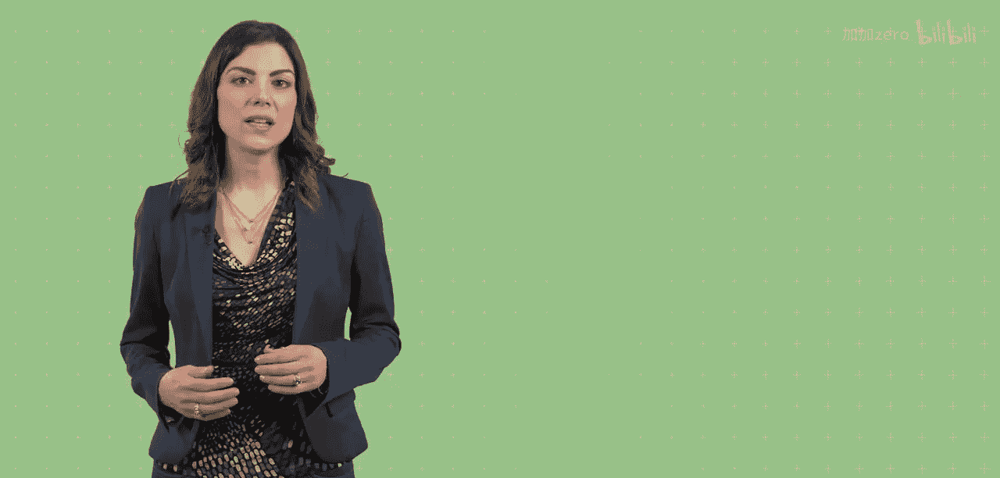
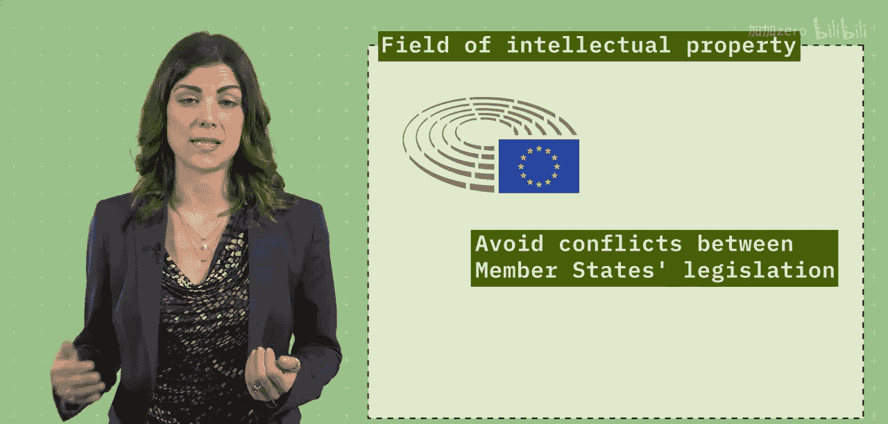
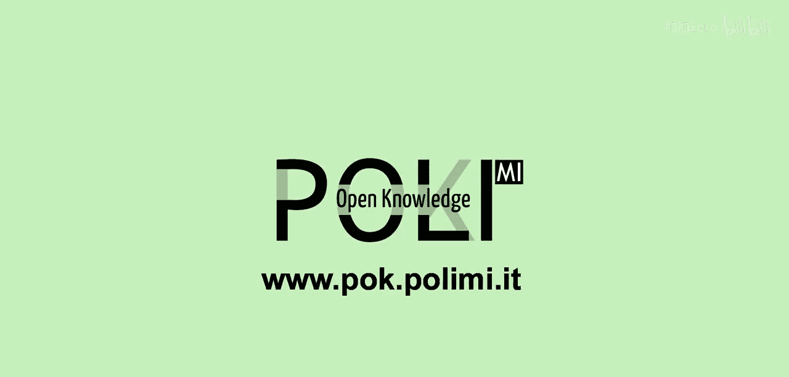

# 049：AI创作作品的保护

## 概述

在本节课中，我们将探讨由人工智能系统创作的作品，其知识产权归属问题。我们将分析现有法律框架下的挑战，并介绍几种可能的解决方案。

---

上一节课我们探讨了人工智能系统本身如何受版权法保护。本节中，我们将尝试理解，由人工智能创作的知识作品，其知识产权归属于谁。

这个问题不涉及人类作者借助或简单或复杂的软件创作作品的情况，因为在此类情况下，创造性的投入始终可归因于人类个体。本问题关注的是那些具备机器学习类型AI组件、能够自主生成可能独立于程序员输入内容的程序。

实际上，我们讨论的是已经发生的事情。目前已经存在能够独立创作音乐、艺术作品或文学作品的人工智能系统，它们通过学习处理成千上万首音乐、艺术品或诗歌来生成作品。

令人印象深刻的是，AI创作的作品与人类智能创作的作品极为相似，并无太大差异。

然而，在此背景下，与我们之前讨论的AI行为所致损害的赔偿责任领域类似，现有立法并不完善。因此，基于现有法律框架解决此问题并不容易。

意大利的立法（与大多数外国现行法律相似）似乎预设只有自然人才能成为作者，从而成为知识作品的道德权利和经济权利的原始所有者。因此，毫无疑问，人工智能作为一个客体而非人类主体，即使它是作品的作者，也不能成为经济权利的受益者，更不用说道德权利了。

在外国的法律体系中，唯一明确考虑到智力作品可能是计算机创造性活动结果的是英国立法。事实上，1988年的《版权、设计和专利法案》规定，由机器创作的作品，其经济成分的知识产权归属于为使机器能够生成该作品而进行必要配置的人。该法案明确规定，对于计算机生成的文学、戏剧、音乐或艺术作品，作者应被视为为作品的创作进行必要安排的人。

当然，英国立法所概述的方向，可能是我们国家立法和欧洲立法可以遵循的备选方案之一，但它并非唯一选择。存在一些学说理论，可归纳为三种主要取向。

以下是三种主要的理论取向：

1.  **否认保护**：第一种可能的方法是，否认对人工智能创作的作品提供任何形式的知识产权保护。在缺乏具体立法措施的今天，如果我们想坚持对法律条款的字面解释，这是最可接受的理论。然而，这可能会阻碍对智能系统实施和使用的投资。
2.  **授予AI法律人格**：第二种可能的方法，由那些希望授予AI法律人格的人支持，意味着承认人工智能本身拥有权利。如果说第一种理论从经济角度看吸引力不大，那么这第二种理论目前看来过于未来主义，且从法律角度难以充分证明其合理性。
3.  **折中方案**：第三种可能的方法介于前两者之间，在我们看来，无疑比其他方案更可取。它寻求应用版权法（即使需要修订和更新），适用于所有智能系统活动的结果在某种程度上依赖于人类的选择和输入的情况。也就是说，这些结果终究是由个人或群体所期望的。

但遵循这种方法，谁将有资格享有版权法规定的权利，特别是AI创造性活动所产生的知识作品的经济利用权呢？

可以考虑以下三种可能性：

*   权利所有者可能是发明、创造和生产该机器的人。
*   权利所有者可能是以某种方式设置机器功能、使其能够创作该作品的人。
*   权利所有者可能是机器的所有者（无论是通过向生产商或经销商购买获得），并且不论是谁设置了机器，只要是他开始了作品本身的经济利用。

根据现行法律，并不存在一个正确的解决方案。因此，知识产权领域是欧洲议会呼吁欧盟委员会提交立法提案以调整现有法律、适应AI技术发展的领域之一。

其目的当然是避免成员国立法之间的冲突，并鼓励对这些技术的投资。

---

## 总结

本节课中，我们一起学习了由人工智能创作作品的知识产权归属难题。我们了解到，现有法律通常预设人类作者身份，导致AI作品的保护存在空白。我们探讨了英国立法的特殊规定，并分析了三种主要的理论取向：完全否认保护、授予AI法律人格以及寻求将权利归属于相关人类参与者（如开发者、配置者或所有者）的折中方案。目前尚无定论，但欧盟层面正在推动立法以适应技术发展，旨在统一规则并鼓励创新投资。