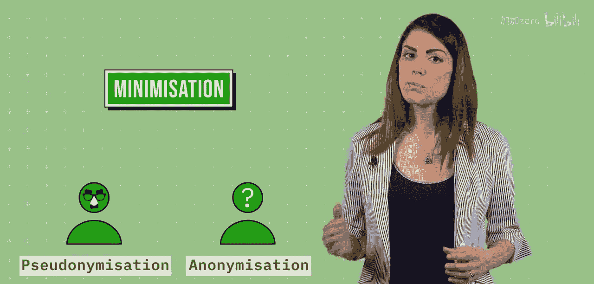

# 050：AI系统中的数据处理与GDPR合规

在本节课中，我们将要学习人工智能（AI）系统如何处理数据，以及如何确保这种处理符合欧盟《通用数据保护条例》（GDPR）的规定。我们将探讨AI与大数据、物联网（IoT）的关系，并重点解析GDPR中的关键原则，如“设计保护隐私”和“默认保护隐私”，以及数据最小化、目的限制等核心要求。

## AI、大数据与物联网的关联

如今，人工智能的应用使得数据的收集和处理达到了前所未有的规模。

人工智能与大数据、物联网之间存在着双向联系。一方面，由互联设备和系统产生的海量数据，需要使用能够从中提取价值的算法。另一方面，正是这种数据的极大丰富，使得算法变得越来越可靠和智能。

然而，这种关系也带来了一些特定的风险。特别是，当这些数据根据法律被认定为个人数据时，存在被非法或随意滥用的风险。因此，有必要应用相关法律来规范通过此类系统进行的数据处理。

## GDPR：技术中立原则

在这一领域的参考法规是GDPR（欧盟第2016-679号条例）。根据所谓的“技术中立原则”，其规定必须适用，无论个人数据处理所采用的手段和方法如何。因此，它也适用于通过AI系统进行的处理。

## 设计保护隐私与默认保护隐私

GDPR第25条确立了“设计保护隐私”和“默认保护隐私”的原则。该条规定，数据控制者（即AI的开发者与运营者）必须通过设计和默认设置，确保其系统在处理个人数据时遵守相关规定。

这具体指的是什么呢？以下是几个最重要的方面：

*   **目的限制与存储期限**：GDPR第5条明确规定，个人数据的收集必须有具体、明确和合法的目的，并且不得以与这些目的不相容的方式进行进一步处理。此外，数据的保存时间不得超过实现处理目的所必需的时间。
*   **数据最小化原则**：该原则要求，只应处理与收集目的相关的必要数据。因此，AI系统随意收集和处理数据是不合法的。

然而，当前对物联网的广泛访问及其收集处理海量数据的强大能力，可能会危及对这些原则的遵守。

## 实现合规的关键措施

从数据最小化的角度来看，主要问题在于AI系统能否对收集的数据进行筛选，只保留提供所请求服务所必需的部分。

一种降低处理侵入性的有效解决方案是数据的**假名化**和**匿名化**。通过这种方式，不仅AI系统收集的数据应仅限于该处理类型所必需的数据，而且在可能的情况下，应以无法识别数据主体的方式进行收集。

关于目的和存储期限，不仅需要用户真正了解其数据是用于使用系统的特定目的，还需要物联网系统能够仅为实现这些目的而处理所收集的数据。

## 人类干预权：禁止完全自动化决策

我们必须强调最后一个非常重要的方面。GDPR基于一种非机器中心主义的视角来看待人与机器的关系，以避免机器凌驾于人类之上，并确保最终决定权始终属于人类。

因此，GDPR第22条禁止所谓的“完全自动化决策过程”。它规定，数据主体有权不接受仅基于自动化处理（包括用户画像）所作出的、对其产生法律效力或类似重大影响的决定。

换句话说，任何人工智能技术，如果无法保证数据主体获得人工干预、表达意见和质疑自动化决定的权利，都不能被视为符合GDPR。

## 总结与展望

由此可见，对于AI系统的数据处理，我们并非没有法规保护。我们可以认为，GDPR可能是一个非常合适的工具，用以规范AI系统数据处理中的不确定性。

然而，由于可能涉及的生活领域和物联网工具相当复杂，正确应用这些原则必然需要根据具体情况进行个案分析，考虑每个使用人工智能技术的产品的独特性。

在本节课中，我们一起学习了GDPR如何为AI时代的数据处理提供法律框架。我们理解了数据最小化、目的限制等核心原则，以及确保人类在自动化决策中拥有最终决定权的重要性。合规的关键在于将隐私保护理念融入AI系统的设计与默认设置中。