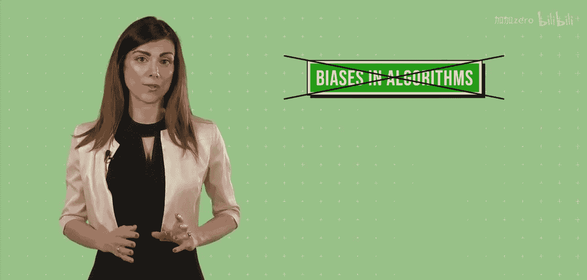

**人工智能：概述 专项课程：P9：算法统治对基本自由的风险——从剑桥分析公司案例谈起**

在本节课中，我们将探讨人工智能系统在决策过程中可能带来的偏见与歧视风险，以及这些风险如何威胁到个人的基本自由与权利。

上一节我们讨论了人工智能技术对保密性和隐私带来的风险。本节中，我们来看看机器使用并不必然保证公正性这一事实。实际上，我们常常认为这些系统相对于我们委托其作出的决策是完全中立的。一台机器在作出决策时，在我们看来似乎完全没有偏见。

但事实果真如此吗？实际上，人工智能系统总是基于人类设计的算法而开发。这些算法也让机器能够基于从人类接收的信息，发展自我学习机制。简而言之，无论是在创建还是使用人工智能系统的过程中，人类的贡献都至关重要。

正是在这种背景下，可能发生所谓的**算法偏见**。如果缺乏适当监控，它们甚至可能导致社会歧视。算法偏见以及人类认知偏见（即判断的偏差模式）的影响，是使用智能系统的一些弱点。

例如，在面部识别技术领域，一些研究发现，对于浅肤色男性的识别准确率约为99%，而对于深肤色女性的识别准确率仅为35%。这是因为在全球范围内，支撑识别系统的人工智能算法主要是基于白人或亚洲男性的数据开发的。

在这方面，基于**隐私设计**的方法变得至关重要，我们将在下一课中详细讨论。在开发智能技术时采用这种方法，可以最大限度地降低系统在回答特定问题时使用潜在歧视性参数的风险，例如性别、种族、宗教、政治或工会党派归属、国家财富等。

但是，算法不仅会受到人类的影响，它也可以反过来影响接触它的个体的观点，从而对用户造成认知偏见。从这个意义上说，可以回想一下曾引起广泛关注的剑桥分析公司案例。这家政治咨询公司利用其掌握的个人数据，来影响相关数据主体的选举选择。

公民往往无法立即意识到这些情况。试想一下所谓的“假新闻”领域。如果说人工智能可以是防止其传播的有效工具，那么同样真实的是，相反，人工智能系统也可能成为其载体。实际上，人工智能系统的设计旨在分析用户画像，选择要向他们推送的信息，并可能影响他们的选择（包括政治选择）。这种选择可能与新闻的真实性无关，而仅仅旨在将后者与用户的偏好关联起来。

这就是所谓的**过滤气泡**：用户只接收到一个受限的新闻和信息圈，即那些最接近他们偏好的内容。在这方面，有人提出了“算法统治”一词，用以指代一种基于算法及其决策主导的社会形式，强调了内容与信息过度个性化所带来的风险。这种个性化可能达到限制我们对自身生活、数据使用以及最终选择的完全自决的程度，同时也带来了经济权力集中在那些能够实施和控制最先进算法者手中的反竞争风险。

算法统治最明显的危险之一就是所谓的**大规模监控**。这不仅体现在对人员流动的监控上，也体现在对人们行为的监控上。一个标志性的案例是中国，其建立了旨在通过计算机制奖励最“有德行”公民的社会信用体系，例如，因为他们从未有过法律问题、没有债务等。

在这些情况下，尽管一个系统可能在一方面看似适合鼓励公民的德行行为，但在另一方面，它也可能变成一个能够在公民之间制造不公平待遇差异的系统。此外，在这种背景下，隐私方面的“交换条件”对公民而言将更为严重，因为国家有可能从保护公民免受其数据处理相关滥用的实体，转变为控制这些数据并基于此制定自身政策的实体。

从以上所述可以清楚地看到，算法固有的偏见可能导致错误甚至歧视性自动化决策的风险。为了避免这种后果，解决偏见的方法或许就在于其根源本身：永远不要放弃人类的介入。

然而，这种介入必须在至少两个层面进行：
*   **在立法层面**：制定能够真正保护个人并为其基本权利和自由提供保障的规则。法律必须在人机关系中确立一种**以人为本的愿景**，即技术服务于个人，而非相反。
*   **在操作层面**：强制要求人类对人工智能系统的决策进行持续监督，以验证其是否符合公认的道德和法律原则。

在这方面，下一课我们将讨论如何设计和开发符合《通用数据保护条例》的智能系统的措施。

本节课中，我们一起学习了算法偏见如何产生、其表现形式（如面部识别中的准确率差异、过滤气泡），以及它如何通过影响个人决策（如剑桥分析公司案例）和助长大规模监控（如社会信用体系）来威胁基本自由。我们认识到，解决这些风险的关键在于确保人类在立法和操作层面的有效介入与监督。