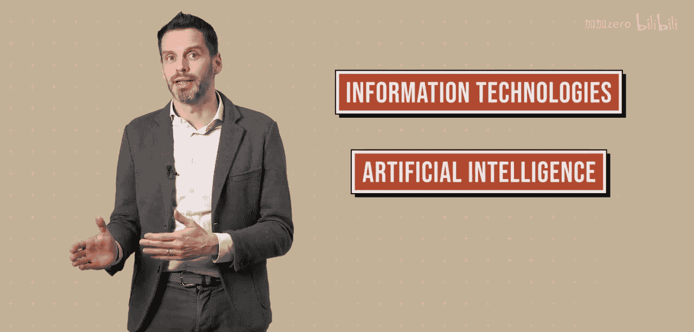
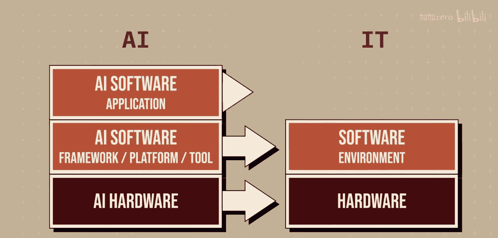
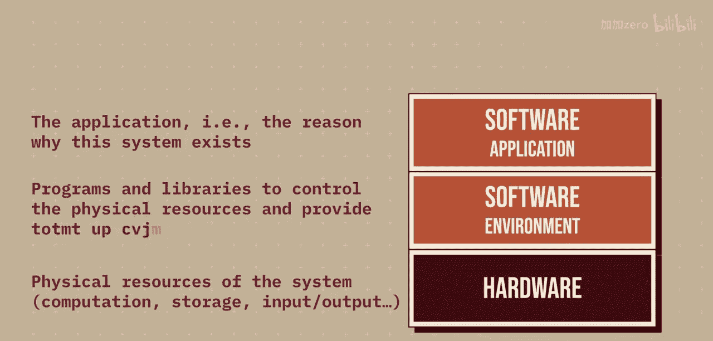
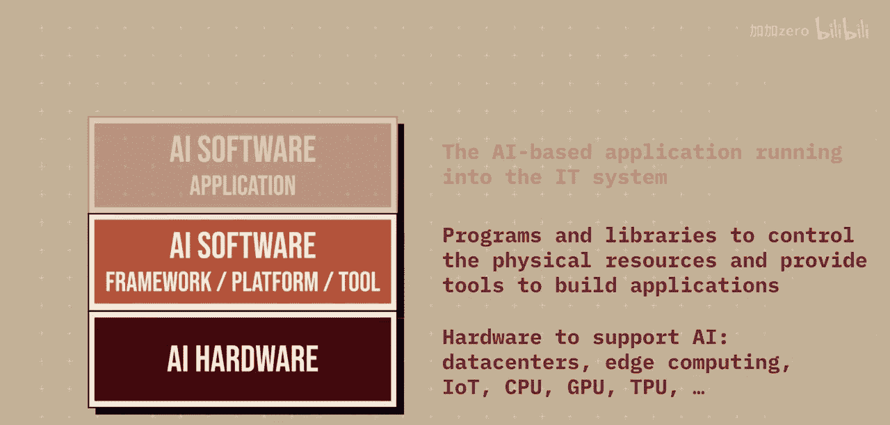
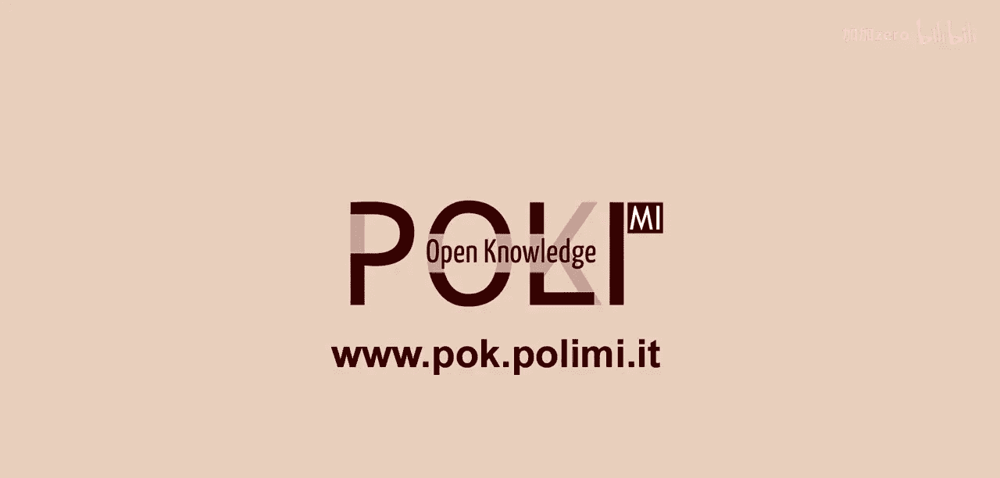

# 053：从IT视角看人工智能 🧠

欢迎来到《人工智能技术与平台》课程。

信息技术与人工智能之间存在着怎样的关系？我们如何利用IT视角来描述和刻画基于人工智能的系统？在本节课中，我们将通过探讨信息技术与人工智能之间紧密而富有成效的关系来解答这些问题。

为了达成这个目标，我们需要先退一步，理解什么是人工智能。

## 什么是人工智能？

2018年，米兰理工大学人工智能观察站将人工智能定义为**计算机科学的一个领域，致力于研究开发具有人类典型能力的硬件和软件系统**。

> 此类系统能够通过自主决策来追求特定目标，而这些决策在此之前通常由人类做出。

**具有人类典型能力的硬件和软件系统**。因此，一个基于AI的系统同时包含硬件和软件两个层面。更精确地说，我们可以进一步将软件区分为**软件应用**和**软件框架、平台与工具**。

从这个视角出发，我们可以说一个基于AI的系统包含：
*   **硬件**：即所有可用的物理资源。
*   **AI应用**：即系统存在的目的。
*   **中间层**：包含位于硬件和应用之间的框架、平台和工具。

## IT架构的启示

那么，这三个层面让我们联想到了什么？它们让我们联想到典型的计算系统IT架构，该架构同样包含**硬件**和**软件环境**的两个层面（即**操作系统**和**应用程序**）。

具体来说，借助这个IT视角，我们可以定义：
*   **硬件**：系统中所有可用的物理资源。例如，用于计算、存储数据和应用程序以及网络连接的资源。
*   **软件应用**：在系统中运行的应用程序。
*   **软件环境**：提供所有用于控制物理资源的程序和库，以及构建应用程序的工具。

## AI系统的技术架构

现在，牢记这个视角，我们可以回到AI，并从技术角度理解基于AI的系统是如何组织的。

### 底层：AI硬件 🖥️

在底层，我们有**AI硬件**，它包含所有旨在支持AI算法学习和推理的硬件资源。

我们将看到，硬件资源范围广泛，从大规模数据中心到微小的物联网设备，在计算能力、可用内存和功耗方面有时存在数量级的差异。

我们将看到，这些在计算、内存和能耗方面具有截然不同技术限制的设备家族，将需要特定的AI技术。

在这一层，我们还能找到**AI硬件加速器**，例如GPU、TPU和FPGA，它们是AI世界的一场革命性突破。我们将了解硬件加速器的重要性及其工作原理。

### 上层：AI应用 📱

在上层，我们有**AI应用**。这是系统存在的原因。例如，我们可以有一个在智能音箱中运行的、用于识别用户语音命令的AI应用；或者一个在智能汽车中运行的、用于检测行人存在的AI应用。

在这里，AI应用的可能性仅受AI开发者想象力的限制。

### 中间层：AI框架、平台与工具 🛠️

在中间，我们可以找到**AI框架、平台和工具**。这一层包含所有技术解决方案，例如，旨在支持AI应用在AI硬件上有效且高效运行的软件库和工具。

这一层的目标是双重的：
*   一方面，它通过提供硬件资源的抽象来屏蔽底层硬件的复杂性。
*   另一方面，它提供所有工具，帮助AI工程师和开发者轻松设计和开发AI解决方案。

我们将看到，在这一层中可以找到不同范围的技术和解决方案。例如，这里可以找到所有著名的机器学习和深度学习框架，如 **Scikit-learn**、**TensorFlow**、**PyTorch** 和 **MXNet**。

此外，在这一层中还能找到所有支持AI应用有效且高效开发和运行的软件基础设施，例如**云计算系统**以及像 **Spark** 和 **Hadoop** 这样的计算框架。

## AI与云的关系 ☁️

机器学习解决方案在云中带来的革命性方法，被证明是**普及AI**、使其可供广大研究人员和开发者使用的关键因素。

这是一个特别有趣的点，本课程将通过探索云中支持机器学习和深度学习的三个计算层级来深入探讨：**基础设施即服务（IaaS）**、**平台即服务（PaaS）** 和 **解决方案即服务（SaaS）**。

## 课程目标总结

总而言之，在本课程中，我们将探索：
*   支持机器学习和深度学习进行学习与推理的硬件。
*   用于有效且高效设计和部署AI应用的AI框架、平台与工具。

## 课程范围说明

同样重要的是，需要明确本课程**不追求**的目标。我们的目标**不是**对框架、平台和工具进行排名。

之所以排名不在本课程范围内，是因为日新月异，每天都有新的解决方案和新技术出现，每一种都有其自身的特点、优点和缺点。此外，特定解决方案的优缺点严格取决于算法以及应用程序预期运行的软件环境（例如，是计划在云端、智能手机上还是在微型物联网设备上运行的AI应用）。

明确了以上内容，我非常高兴欢迎大家学习这门关于人工智能技术与平台的课程。

让我们开始吧！🚀