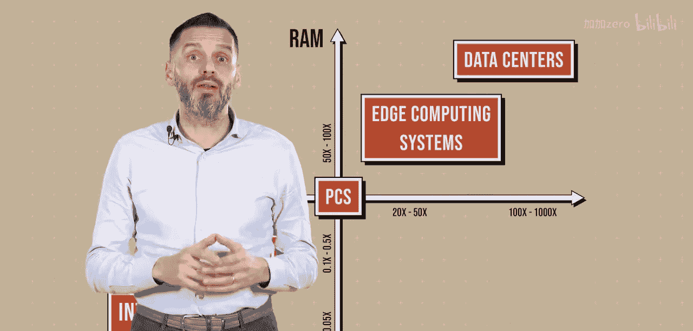

# 054：概述

在本节课中，我们将概述用于人工智能的硬件技术，以及它们如何影响AI应用。

我们之前了解到，AI系统包含AI硬件层、中间AI软件层（包括AI框架、平台和工具）以及运行AI应用的顶层。本节中，我们将详细阐述适用于AI的不同硬件解决方案家族，并看到这些家族涵盖了从受限于计算能力、内存和功耗的微型物联网设备，到包含多个高性能服务器用于计算、存储和联网的大型数据中心。

## 硬件技术解决方案示例

以下是我们可以找到AI应用的一些技术解决方案示例。

*   在我们的家中，如今有智能传感器能够测量物理量和环境量，以控制旨在提升人们舒适度的家庭自动化系统。
*   我们越来越多地通过虚拟助手与在线系统互动，这些助手能够识别人们的指令并代表他们执行操作。
*   智能汽车正从实验室走向我们的道路。这类新一代汽车包含多个直接在车上并行运行的AI算法，例如用于检测行人或识别路标。
*   股票市场预测或个性化营销建议是需要大量计算和内存的AI应用，因此它们的执行通常被转移到云端或大型数据中心。

这些只是广泛的AI硬件技术中的几个例子。但它们揭示了AI可以在任何地方执行的事实。因此，我们周围的所有技术解决方案都可能成为AI可行的技术资产。但在这样做时，我们必须考虑每个特定技术解决方案的性能和技术限制。微型设备将能够支持执行简单的AI算法，而更强大的技术解决方案将能够支持更复杂、更有效的AI算法。

我们将展示，最有前景的观点不是将这些单元视为独立设备，而是技术正朝着一个由多个单元组成的生态系统发展，每个单元都参与AI计算。

## 硬件技术家族分类

现在，让我们进一步尝试对可用的AI硬件技术进行形式化分类。

我们可以将可用的AI硬件技术总结为五个主要家族：数据中心、边缘计算系统、个人计算机、嵌入式个人计算机、物联网设备。

让我们从第一个家族——数据中心——开始分析。它们代表了最强大、性能最高的技术解决方案，因为它们包含用于计算、存储和联网的大规模高性能服务器。从这个角度看，数据中心是云计算范式的参考技术解决方案。这是一个关键点，因为数据中心与云计算之间的相互作用在所谓的“AI即服务”方法中扮演着关键角色，通过提供机器学习解决方案即服务、机器学习平台即服务和机器学习基础设施即服务来实现。我们将在后续课程中详细探讨这些方法。

第二个家族是边缘计算系统。它们是该领域的新参与者。边缘计算旨在通过提供计算和存储能力，在数据产生的地方附近处理数据，从而将云“移到地面”。例如，智能汽车或工业4.0中的智能制造就是这样的技术场景，其中数据以高频率采集，并且这些数据必须在本地快速处理，以提供有效且高效的反应，例如让汽车减速或解决技术生产问题。

接下来，我们找到第三个家族：个人计算机。这是与我们最接近、最熟悉的技术解决方案。在我们的个人计算机中，有用于检测垃圾邮件的智能算法，以及更多旨在支持用户和业务的算法。

最近的发展显示了第四类AI技术的重要性：嵌入式个人计算机。这些设备能够有目的地在其环境中运行，例如移动设备、智能音箱。这类技术解决方案正变得越来越重要，因为它们通常提供了用户与基于云的计算系统之间的交互接口。因此，AI可以直接在设备上运行，或者设备专门用于通过麦克风、摄像头或加速度计等采集数据，而AI处理则在云端进行。

最后，物联网设备是硬件技术的最后一个家族，代表了在环境中普遍运行的微型、无处不在的设备。通常，这些设备由电池供电，计算通过微控制器进行。此外，可用内存和闪存的严重限制显著影响了运行的AI应用。尽管存在这些限制，物联网仍是一个非常具有前景的技术解决方案，用于分布式智能和支持所谓的“智能无处不在计算”。

在接下来的课程中，我们将通过描述每个家族的特性、参考应用、优点和缺点来详细分析这些技术家族。

此外，我们还将看到，技术演进不仅包括这些技术家族，还包括旨在加速AI算法执行的特定硬件设备。

## 总结

本节课中，我们一起学习了人工智能硬件技术的概述。我们了解了AI可以在从微型物联网设备到大型数据中心的广泛硬件平台上运行，并正式介绍了五个主要的硬件技术家族：数据中心、边缘计算系统、个人计算机、嵌入式个人计算机和物联网设备。每个家族都有其独特的性能特点和应用场景，共同构成了一个支持“智能无处不在”的生态系统。在后续课程中，我们将深入探讨每个家族的具体细节以及用于AI加速的专用硬件。