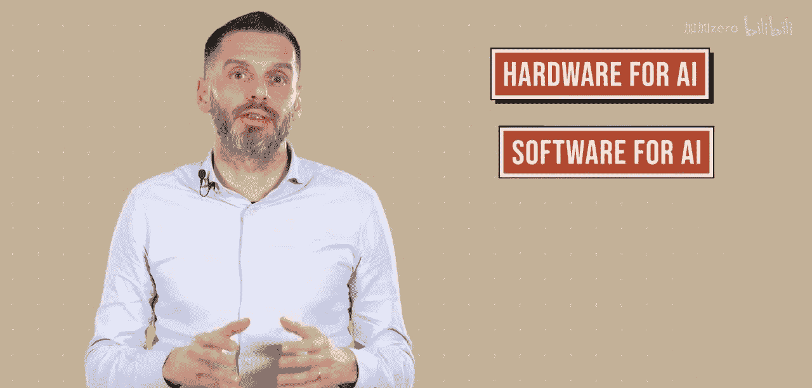
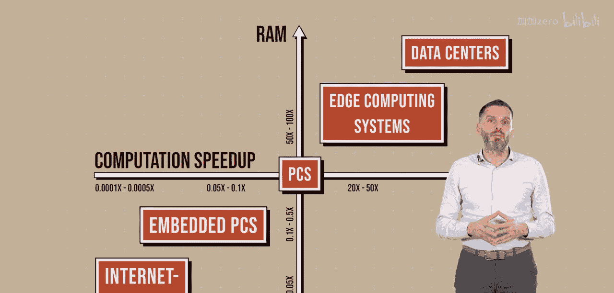
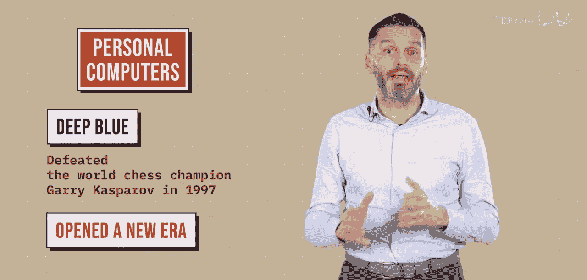
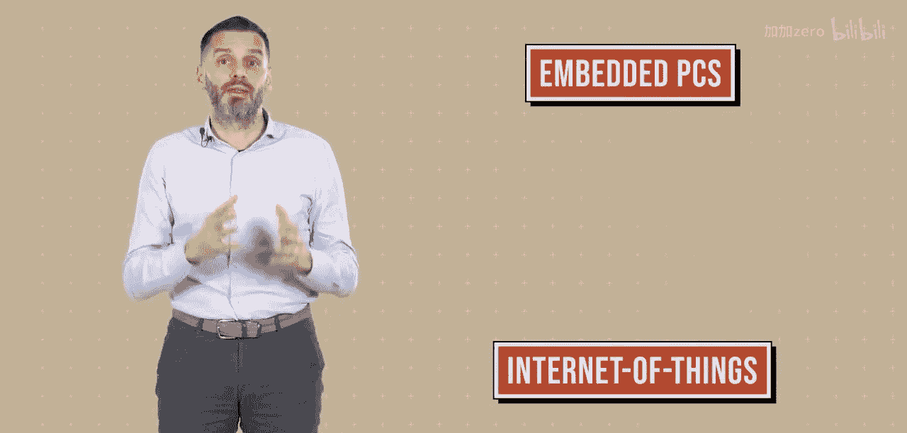
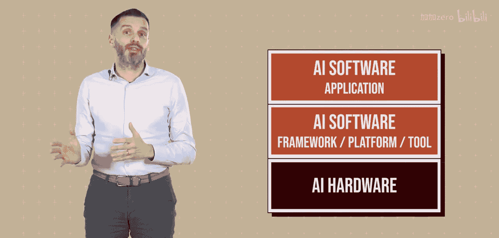
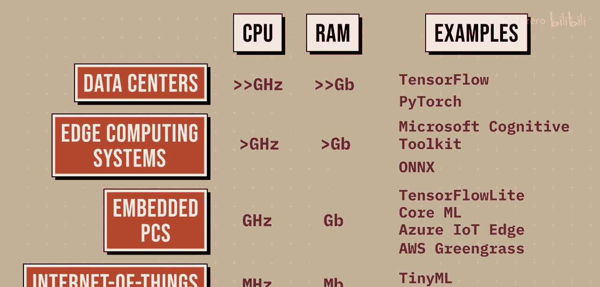
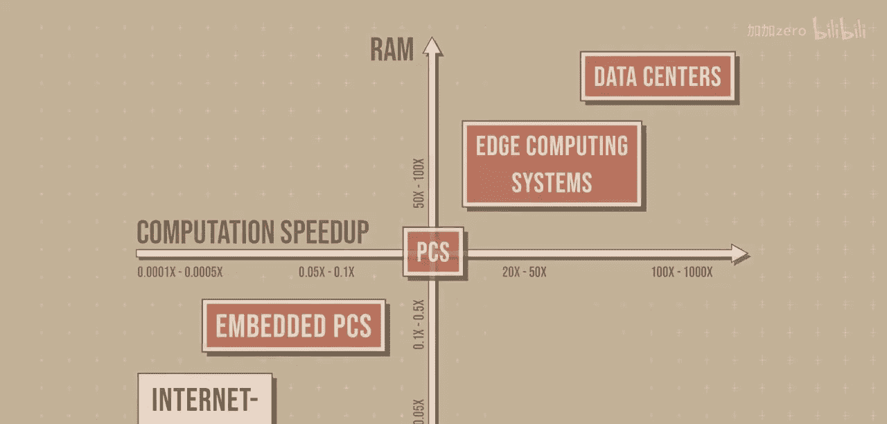

# 055：技术演进与人工智能革命 🚀

在本节课中，我们将探讨硬件与软件之间的协同作用对于实现高效人工智能应用的重要性。

## 硬件与软件：一体两面 🤝

从人工智能的视角来看，硬件和软件是同一枚硬币的两面。我们首先通过审视一系列不同的技术解决方案来分析这种协同关系。

以下是构成我们当前计算生态系统的技术解决方案，它们或显性或隐性地始终参与其中：
*   **物联网设备**
*   **嵌入式个人电脑**
*   **个人电脑**
*   **边缘计算系统**
*   **数据中心**

## 技术在AI革命中的关键作用 💡

那么，这些技术对于人工智能革命究竟有多关键？让我们看一些例子。

数据中心凭借其强大的计算和存储能力，一直在人工智能领域，尤其是在训练和推断大型神经网络方面，扮演着至关重要的角色。例如：
*   数据中心训练了**IBM Watson**，该系统在2011年赢得了电视智力竞赛节目《危险边缘》。
*   数据中心训练了**AlphaGo**，该软件在2016年击败了世界排名第一的围棋选手。
*   数据中心训练了**Libratus**，该人工智能在2017年击败了世界顶级的德州扑克玩家。

让我们将目光转向2020年，史上设计规模最大、最复杂的神经网络被提出。这个名为**GPT-3**的神经网络用于自然语言处理，包含了**1750亿个参数**。数据中心在GPT-3的训练中起到了关键作用，因为若在普通计算机上训练，将需要数百年时间。

边缘计算系统是自动驾驶汽车和自主机器人等领域的技术解决方案。关于个人电脑，有一个有趣的轶事。我们都知道**深蓝**，这台计算机在1997年击败了国际象棋世界冠军加里·卡斯帕罗夫。这则惊人的消息开启了人工智能与人类关系的新纪元。有趣的是，深蓝的计算和存储能力与我们今天的个人电脑相当。

最后但同样重要的是，嵌入式个人电脑和物联网系统能够在环境中自主运行，为智能家居与建筑、智慧城市等提供了技术基础设施。智能对象和智能音箱是该领域的相关例子。

## 应对硬件多样性挑战 🧩

我们提到了硬件与软件的相互作用。但是，我们如何应对可用硬件解决方案如此巨大的技术异构性？我们正从微小的电池供电设备转向大规模数据中心。

那么，包含框架、平台和工具的中间人工智能软件层，如何能在如此广泛的硬件技术范围内运行？答案既简单又复杂。

简单的答案是，我们根据目标参考硬件的不同，拥有不同的解决方案。复杂的答案是，软件的选择严格依赖于硬件，因此需要对人工智能系统进行**硬件-软件协同设计**。让我们看一些例子。

在数据中心和边缘计算系统中，我们拥有足够的计算和存储能力，可以考虑所有最强大的现成人工智能框架、平台和工具。以下是这些AI软件解决方案的例子：
*   **TensorFlow**
*   **PyTorch**
*   **Microsoft Cognitive Toolkit**
*   **ONNX**

通常，这些解决方案为机器学习和深度学习解决方案提供推断和训练功能。

嵌入式个人电脑的性能低于数据中心和边缘计算系统，它们依赖于简化版的人工智能软件解决方案。以下是适用于嵌入式个人电脑的框架、平台和工具示例：
*   **TensorFlow Lite**
*   **Core ML**
*   **Azure IoT Edge**
*   **AWS Greengrass**

与数据中心和边缘计算可用的方案不同，用于嵌入式个人电脑的人工智能解决方案通常仅提供机器学习模型的推断能力，而这些模型的训练通常在更强大的计算单元上进行。

最后，物联网设备需要专门设计的人工智能解决方案，因为其在计算、内存和功耗方面受到严格限制。为此，必须考虑人工智能框架、平台和工具的近似或量化版本，例如**TinyML**和**STM32Cube.AI**。

## 算法与硬件的演进差距 ⚡️

正如我们所探讨的，人工智能硬件的技术演进已迈出巨大步伐，以支持越来越复杂的神经网络和模型。然而，算法的演进速度更快。

例如，我们之前提到的GPT-3是迄今为止开发并训练的最大网络，拥有超过1750亿个参数。如图所示，这种增长趋势是稳定的，此类神经网络的复杂度每三个半月翻一番。而硬件技术演进的唯一参考是**摩尔定律**，它估计硬件性能每18个月翻一番。算法演进与技术演进之间的差距是巨大的。

我们如何应对这个问题？答案在于考虑专门为人工智能设计的额外硬件。借助这些专用硬件，我们能够并行化代码并依赖硬件加速操作，从而通过减少推断和训练时间来提升机器学习和深度学习解决方案的性能。

以下是这些AI硬件加速器的例子：
*   **图形处理单元**
*   **张量处理单元**
*   **现场可编程门阵列**

值得注意的是，由于其复杂性和功耗，这些硬件加速器通常出现在数据中心和边缘计算系统中。我们很少在嵌入式个人电脑中找到它们，而物联网设备通常不被视为硬件加速器的可行技术解决方案。

## 总结 📚

本节课中，我们一起学习了硬件与软件协同对于人工智能应用的基础性作用。我们回顾了从物联网设备到数据中心的不同技术层级，并通过实例看到了硬件能力如何支撑从深蓝到GPT-3等里程碑式AI系统的发展。同时，我们也认识到，面对算法的飞速演进，专门化的硬件加速器（如GPU、TPU、FPGA）对于弥合性能差距至关重要。理解不同硬件平台对应的软件生态（如TensorFlow、TinyML）以及进行硬件-软件协同设计，是构建高效AI系统的关键。