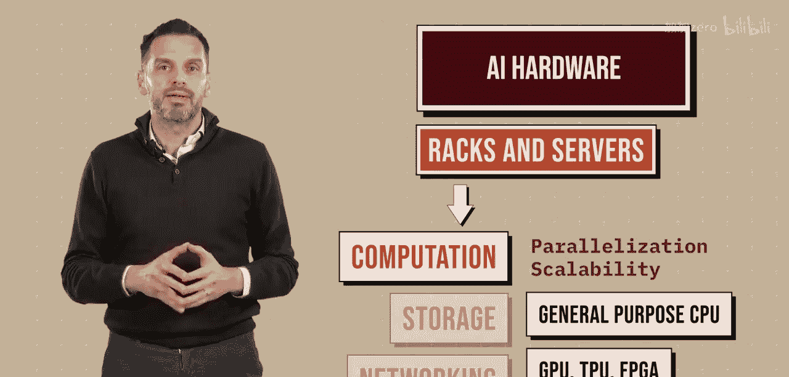
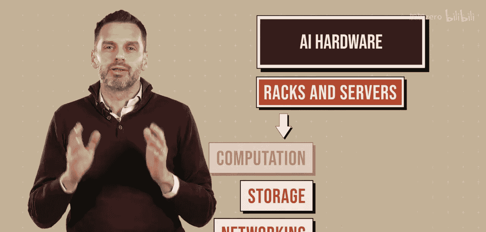
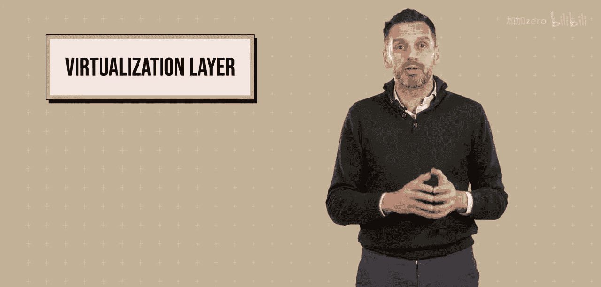
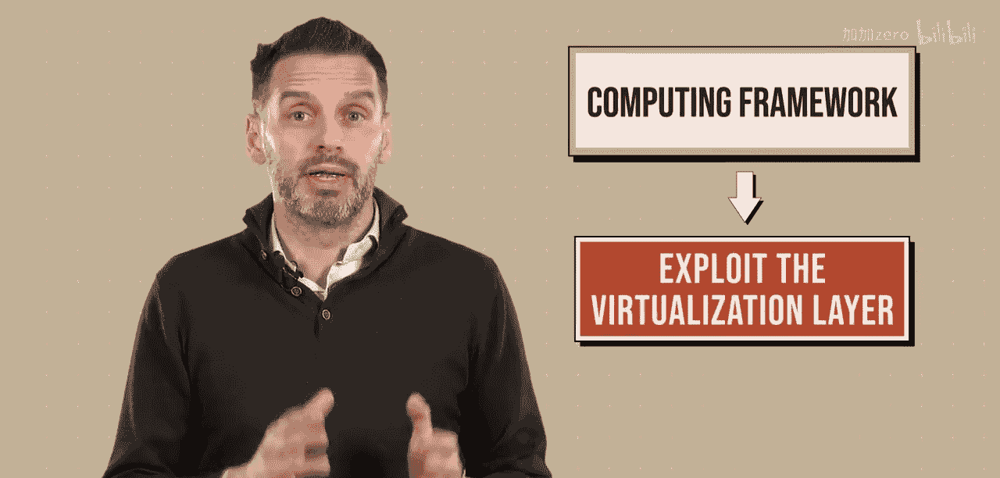
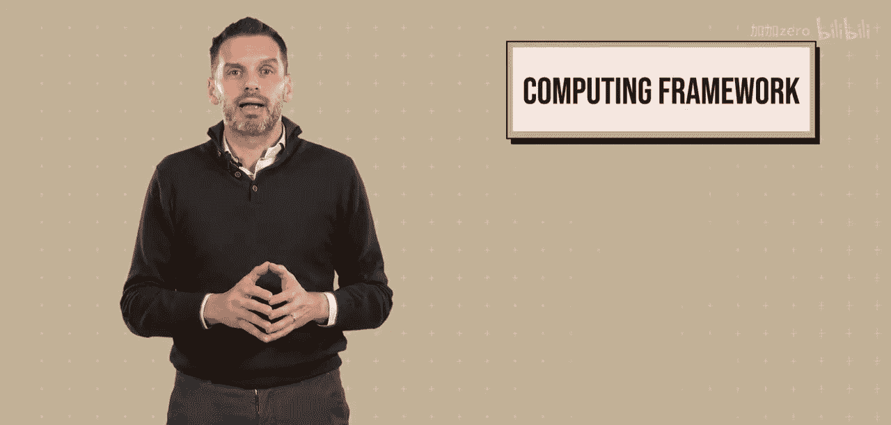
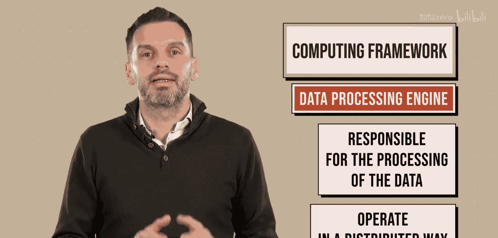
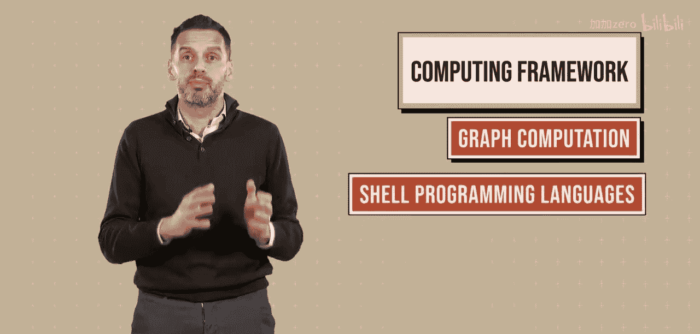
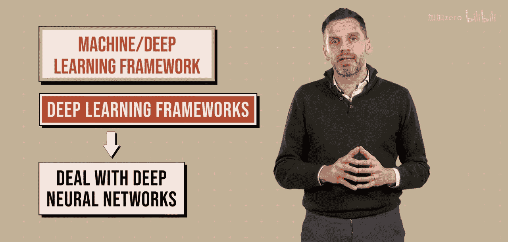
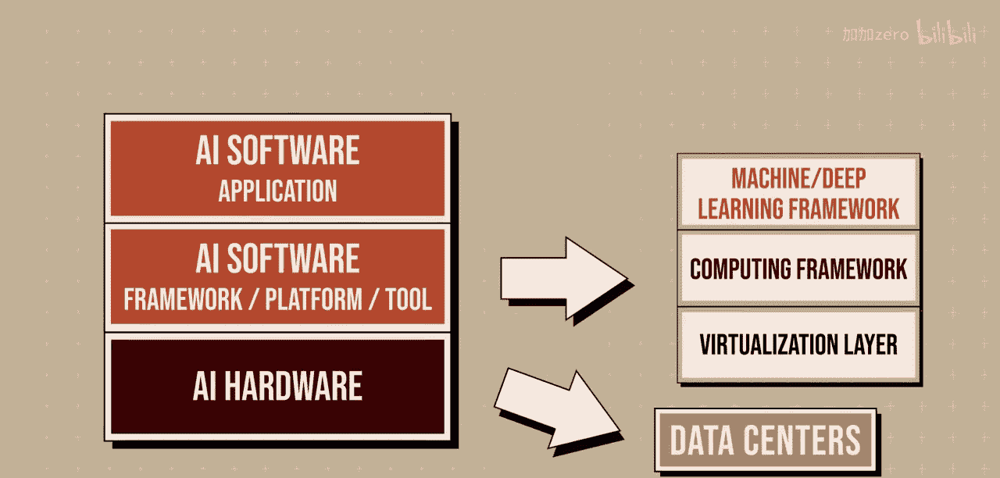

# 056：云端人工智能的IT架构 🏗️

在本视频中，我们将探讨以下问题：当硬件层是数据中心时，我们如何设计智能系统？换言之，如此大规模、高性能计算基础设施的存在和可用性，将如何影响软件层和AI应用的设计与开发？

从硬件角度看，数据中心包含用于计算、存储和网络的资源与服务器。并行化和可扩展性是支持机器学习和深度学习解决方案在此进行学习与推理的关键能力。高性能CPU以及硬件加速器（例如GPU、TPU和FPGA）是相关的技术资产。

除了计算，高性能存储和网络解决方案（如网络附加存储或存储区域网络）对于克服大型神经网络训练中的主要瓶颈之一至关重要，即需要移动大量训练数据。

在数据中心中，中间的软件层包含三个不同的模块：虚拟化层、计算框架以及机器学习和深度学习框架。

让我们从分析第一个模块——虚拟化层开始。其目标是虚拟化数据中心中存在的计算、存储和网络资源。这种虚拟化能力对于支持云计算模式至关重要，在这种模式下，硬件资源以在线和按需的方式提供给用户。这种能力对于支持机器学习和深度学习中的“即服务”方法也至关重要，即按需激活虚拟计算单元来处理用户提出的机器学习和深度学习请求。

虚拟化通过虚拟机或容器来实现。可扩展性通过按需添加计算、存储和网络虚拟资源，并在不再需要时移除它们来保证。此外，借助这些虚拟化机制，AI开发者可以设计配备AI工具箱、框架以及AI应用的特定软件环境。此虚拟化层的工具示例包括VMware、Xen、KVM、LXC和Kubernetes。

接下来我们看第二个模块：计算框架。计算框架是一个软件层，能够利用虚拟化层来支持大规模数据中心中有效且高效的计算。计算框架的示例包括Hadoop、Spark和Flink。

有趣的是，现成的计算框架在采用的技术和提供的功能上有所不同，但我们可以将其数据架构归纳为五个主要模块：集群管理器、数据处理引擎、数据存储、图计算以及编程语言外壳。

集群管理器是最底层，直接与虚拟化层交互，以管理分布在不同计算单元（无论是虚拟化还是物理的）上的处理任务的分配与协调。集群管理器通常依赖于一个调度器，这是一种软件管理模块，类似于我们操作系统中用于协调个人计算机上运行的处理的调度器。此类调度器的示例包括YARN和Hadoop YARN。

数据处理引擎是负责数据处理的软件模块。该引擎设计为以分布式方式运行，例如，通过将计算分配到集群管理器提供的一组计算资源上，并在需要时集成结果。

例如，当我们需要计算大规模数据集的平均值时，我们可以通过将计算分配到不同的工作节点上来并行化处理，每个节点处理数据集的一个子集，然后数据处理引擎最终聚合计算出的平均值，以提供整个大规模数据集的总体平均值。数据处理引擎的示例包括Spark和MapReduce。

有效且高效的数据存储对于加速机器学习（尤其是深度学习）解决方案的训练和推理至关重要。计算框架的数据存储解决方案示例包括HDFS、HBase、Amazon S3、Cassandra、MongoDB和Spark SQL。这些解决方案通常与集群管理器和数据处理引擎紧密集成。

此外，计算框架为处理特定数据结构（如图）提供了专用工具，并为高级编程语言（如Python、Java、Scala或R）提供了支持外壳。

在分析了虚拟化层和计算框架之后，我们最后来看看机器学习和深度学习框架。它们旨在为AI应用提供机器学习和深度学习解决方案及算法。

具体来说，机器学习框架提供用于分类、回归、聚类、异常检测的AI方法，以及数据整理和数据准备的解决方案。这些框架可能包含也可能不包含神经网络算法。不同的是，深度学习框架专门设计用于处理深度神经网络，这是一种具有大量隐藏层的特定类型的神经网络。

机器学习和深度学习框架可以在计算框架之上运行，也可以作为独立解决方案运行。在计算框架之上运行的机器学习框架示例包括Spark MLlib、BigDL和Mahout，而TensorFlow on Spark、Deeplearning4j和BigDL则是在计算框架之上运行的深度学习框架示例。

不同的是，独立的机器学习和数据处理框架示例包括Scikit-learn、Torch、pandas、NumPy、Matplotlib，而旨在以独立方式运行的深度学习框架包括TensorFlow、Caffe、MXNet、Keras、Theano、Microsoft CNTK和PyTorch。有趣的是，深度学习框架通常能够利用GPU、TPU和FPGA等硬件加速器，而独立解决方案通常组织成库和包。

总结一下，当AI硬件层指向数据中心时，中间的AI软件层包含虚拟化层、计算框架以及机器学习和深度学习框架。最后，上层的AI应用层指向机器学习和深度学习即服务。

这种新的技术范式将在下一个视频中探讨，敬请关注。

---

**本节课总结**

在本节课中，我们一起学习了当人工智能系统构建在数据中心硬件之上时，其IT架构的设计。我们了解到，这种架构由三个核心软件层构成：

1.  **虚拟化层**：负责将物理资源（计算、存储、网络）抽象为可按需分配和扩展的虚拟资源，是云计算和AI即服务的基础。
2.  **计算框架**：构建在虚拟化层之上，提供大规模分布式数据处理能力，其核心模块包括集群管理器、数据处理引擎、数据存储等。
3.  **机器学习与深度学习框架**：提供具体的AI算法和模型，可以直接在计算框架上运行，也可以作为独立解决方案运行，并能够利用硬件加速器提升性能。

这种分层架构确保了AI系统能够充分利用数据中心强大的计算、存储和网络资源，实现高效、可扩展的训练与推理。