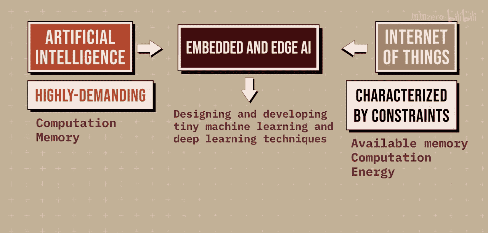
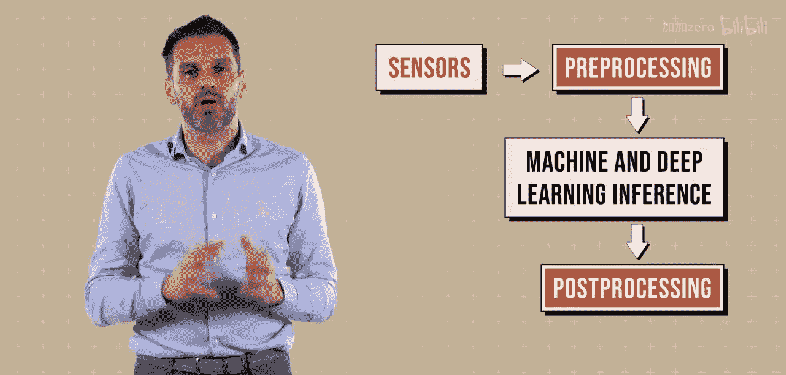

# 060：嵌入式人工智能概述

在本节课中，我们将要学习人工智能与物联网结合的核心概念，特别是如何为资源受限的物联网设备设计和部署AI应用。我们将探讨其开发流程、硬件软件架构以及关键的模型优化技术。

---

人工智能和物联网设备可能被视为技术生态系统的两个极端。AI解决方案通常对计算和内存有很高的要求，而物联网单元通常受到可用内存、计算能力和能源的严重限制。嵌入式人工智能的目标正是填补这一鸿沟，这是一个新颖且有前景的研究领域，旨在设计和开发能够在物联网单元上运行的微型机器学习和深度学习技术。

为了实现这一目标，我们将探索开发流程以及包含量化和剪枝在内的近似技术，以降低机器学习和深度学习解决方案的计算负载和内存需求，从而使其能够在嵌入式系统和物联网单元上执行。

---

## 物联网AI应用的设计流程

那么，我们如何为物联网设计AI应用呢？设计一个物联网AI应用依赖于一个基于七个不同步骤的开发生命周期。

以下是开发生命周期的七个步骤：

1.  **数据收集阶段**：旨在创建一个代表需要解决的特定应用问题的训练数据集。
2.  **模型定义阶段**：旨在为所考虑的应用确定最佳的机器学习或深度学习模型。
3.  **模型训练阶段**：在收集的数据上训练选定的模型。
4.  **应用开发阶段**：负责为物联网单元设置固件，包括数据采集和预处理步骤，以及机器学习和深度学习推理步骤。
5.  **编译与构建阶段**：为给定的硬件平台（如特定系列的微控制器）编译和构建开发好的应用程序。
6.  **部署与运行阶段**：将应用程序烧录到物联网设备中，设备随后即可运行其应用，即采集数据、通过机器学习推理处理数据并提供输出。
7.  **监控阶段**：可以激活并集成监控服务，以验证和评估物联网设备随时间推移的性能。

值得注意的是，与传统的个人计算机或基于云的应用程序开发不同，从技术角度来看，物联网上AI应用的生命周期分为两个部分。首先，模型的识别和训练通常在拥有足够计算和内存资源的云端进行。其次，受限于内存、计算和能源的物联网单元则只专注于机器学习和深度学习模型的推理阶段。

---

## 智能物联网单元的硬件与软件架构

上一节我们介绍了设计流程，本节中我们来看看这类智能物联网单元的硬件软件架构是怎样的。

这里的硬件通常包括一个带有几千字节RAM的微控制器，以及传感器和执行器。物联网传感器的例子包括环境传感器、麦克风、摄像头和惯性测量单元。

软件架构包含三个连续的步骤：

1.  **预处理阶段**：旨在采集和处理数据，使其能够被下一个推理步骤理解。
2.  **机器学习与深度学习推理阶段**：旨在将训练好的模型应用于采集和处理后的数据。
3.  **后处理阶段**：此步骤的输出（例如预测、分类或数据流中异常的检测）随后被后处理，以决定如何做出反应，例如开门、向用户发送消息或发出警报。

---

## 物联网AI应用实例

了解了基本架构后，让我们看几个具体的物联网AI应用实例。

*   **唤醒词检测**：物联网设备识别特定的语音命令以激活进一步的操作或处理，例如“打开灯”。与智能音箱不同，物联网单元通常只能识别有限（有时非常有限）的命令集。关键在于，这个识别阶段是直接在设备上进行的，不需要外部处理步骤或将语音命令发送到云端处理。
    
*   **人员检测**：通过摄像头采集图像，检测阶段直接在设备上进行。
*   **手势识别**：来自惯性测量单元的数据可用于由物联网单元直接检测和识别人体做出的手势。

---

## 应对物联网设备的技术限制

但是，我们如何设计能够适应物联网单元严苛技术限制的机器学习和深度学习解决方案呢？这是一个具有挑战性的问题，因为我们不能简单地将一个复杂的神经网络（例如，需要数百兆字节来存储其参数）压缩到一个微小的物联网单元中。

为了解决这个问题，我们需要三个不同的步骤：

1.  **重新设计模型架构**：我们需要重新设计我们的机器学习和深度学习解决方案的架构，特别是我们的神经网络。这些新的架构在设计时就会考虑通过简化和小型化模型来减少内存和计算需求。最近，该领域已经提出了新的方法来指导这种微型神经网络架构的设计，并考虑其对内存和计算的技术约束。
2.  **应用近似计算机制**：除了用于机器学习和深度学习的微型架构外，通常还会考虑近似计算机制来进一步减少内存占用和计算需求。这类机制的典型例子是**量化**和**剪枝**。
3.  **针对目标硬件平台进行优化**：量化和剪枝后的模型可以针对给定的目标硬件平台进行进一步优化。这个步骤通常依赖于硬件，通常通过集成到开发工具链中的专用编译器来完成。

---

## 近似计算：量化与剪枝

上一节提到了近似计算，本节中我们重点来看看两种具体机制：量化和剪枝。

### 量化

量化是指通过改变用于表示神经网络权重的比特数来减少其内存占用。例如，32位浮点权重可以转换为8位整数表示。这减少了神经网络的内存占用，并且还可能加速处理，因为整数运算可能比浮点运算更快。

量化可以在训练期间或训练结束时进行。在这两种情况下，减少内存占用的优势都是显著的，但这些优势可能以量化模型整体精度可能下降为代价。

**核心公式/概念**：
`32-bit 浮点权重 -> 8-bit 整数权重`
内存占用减少，可能提升推理速度，但可能影响精度。

### 剪枝

剪枝旨在通过跳过与处理链相关的某些任务的执行来减少神经网络的计算负载和内存占用。这里的优势相当明显。减少需要执行的层数可以降低计算需求和内存占用，因为与这些层相关的参数无需存储。同样，这种优势可能以模型精度可能下降为代价。

**核心概念**：
移除神经网络中不重要的连接或神经元，减少模型大小和计算量。

量化和剪枝通常被联合考虑，以进一步减少内存占用和计算需求。

---

## 总结与展望

本节课中，我们一起学习了嵌入式人工智能的基本概念。我们了解了为物联网设备设计AI应用的特殊挑战和完整开发生命周期，探讨了智能物联网设备的硬件软件架构，并介绍了几个实际应用案例。最后，我们重点学习了应对设备资源限制的两大关键技术：**量化**和**剪枝**，它们通过降低模型精度来换取更小的内存占用和更快的计算速度。

但是，还有没有其他方法可以进一步优化物联网生态系统中的AI解决方案的学习和推理呢？我们将在下一个视频中探讨。敬请关注。

🎼

