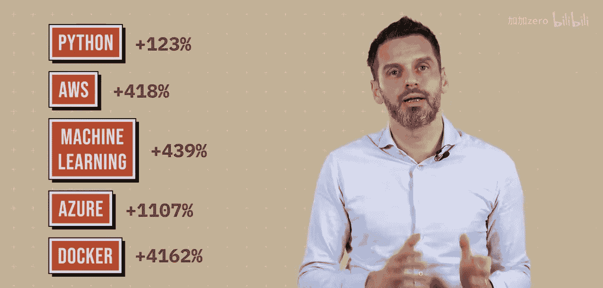
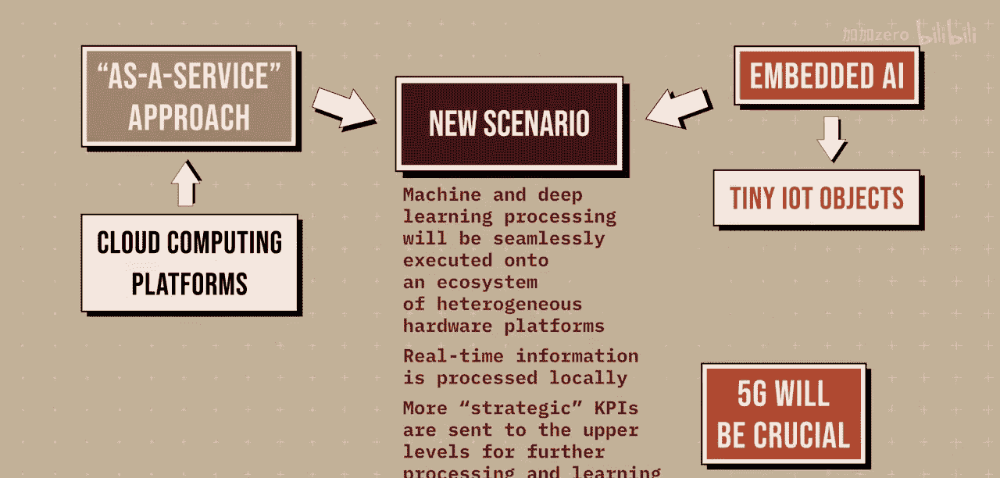
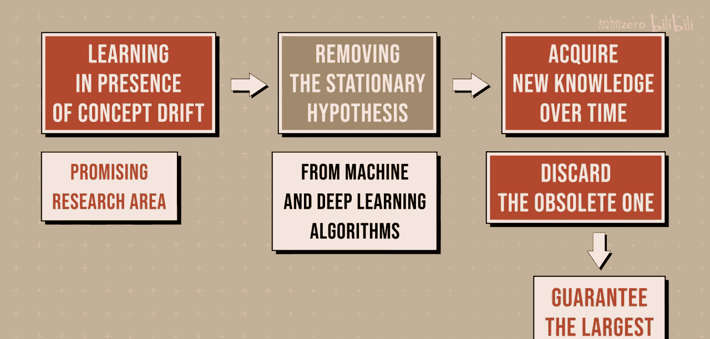

# 062：挑战与机遇 🚀

在本节课中，我们将探讨人工智能技术发展中的关键挑战与未来机遇。我们将回顾AI解决方案从大型数据中心到微型设备的部署，并分析当前市场对相关技能的需求趋势。最后，我们将深入探讨三个核心挑战：服务化与嵌入式AI的融合、动态环境下的持续学习以及用户隐私保护。

## 市场需求的增长趋势 📈

上一节我们介绍了AI解决方案的部署方式，本节中我们来看看市场对相关技能的需求变化。这反映了该领域的实际发展势头。

电气电子工程师学会旗下的《IT职业频谱》杂志发布了一份非常有趣的排名，对比了2014年与2019年美国顶尖雇主所需求的科技技能。

真正有趣的是，增长幅度最大的科技技能正是那些与机器学习和部署解决方案及技术相关的技能。

以下是几个关键例子：
*   **Python**：作为当今大多数机器学习框架的编程语言，在此排名中位列第三。前两位分别是SQL和Java。目前，约有20%的技术岗位要求Python技能，相比2014年增长了123%。
*   从2014年到2019年，对**AWS、机器学习、Azure和Docker**等技能的需求增长了**400%到4000%**。需要指出的是，这些技术点正是我们在关于“机器学习即服务”的视频中讨论过的内容。

这些惊人的数字让我们理解到，机器学习和部署解决方案与技术是当今可以把握的切实机遇。

## 落地实施的核心挑战 ⚠️

然而，要将这些机遇转化为现实，我们需要面对哪些挑战呢？以下将介绍三个关键挑战点。

### 挑战一：服务化AI与嵌入式AI的融合

我们了解到，机器学习和深度学习的“即服务”模式由云计算平台支持，而嵌入式AI则面向微型物联网设备。

这两种目前看似分离的技术，将自然地融合到一个场景中：机器学习和深度学习处理将在异构硬件平台组成的生态系统上无缝执行。实时信息在本地处理，而更具战略意义的关键绩效指标则被发送到上层进行进一步处理和学习。

在这个场景中，即将到来的5G技术将通过卸载和编排机制发挥关键作用。

但这其实我们已经能在包含微控制器和GPU的异构硬件设备中看到雏形。在全球图景中，挑战在于将这种异构硬件的设计扩展到整个普适设备生态系统中。

我们确信，“即服务”方法与嵌入式AI的融合将在未来几年发生。我们预期，一方面，云端高效能计算的部分将向边缘端延伸，以提升性能、可扩展性和可靠性。另一方面，物联网单元将成为云系统处理的第一线。

### 挑战二：动态现实环境下的持续学习

将机器学习和深度学习应用于现实世界，必须包含一个事实：现实世界会随时间变化或演进。

这可能是由于季节性、周期性效应、用户行为改变、股市演变、传感器或执行器故障等原因。

这些变化（也称为**概念漂移**）的影响是，先前学习的模型会变得过时，从而无法有效处理新数据。

从技术角度看，大多数机器学习和深度学习算法假设数据是**独立同分布**的。这个假设在现实场景中很少成立，可能对预期应用产生灾难性影响。

我们在2020年新冠疫情爆发时看到了一个相关例子。我们关于世界的认知（编码在我们的机器学习模型中）突然变得过时，我们必须学习新的模型来预测，例如，经济趋势或用户行为。

因此，在存在概念漂移的情况下进行学习是一个前景广阔的研究领域，旨在从机器学习和深度学习算法中移除静态假设，使它们能够随时间获取新知识并丢弃过时的知识，从而即使在时变场景下也能保证最高的准确性。

### 挑战三：用户隐私保护

最后，同样重要的是隐私问题。我们已经讨论过，基于云计算基础设施的技术演进，通过“机器学习即服务”的方式，满足了日益增长的机器学习解决方案需求。

不幸的是，为了有效，这种方法需要在云端处理可能敏感的用户数据，例如个人照片或视频、医疗诊断，以及可能揭示种族来源、政治观点的数据，还有基因、生物识别和健康数据。

我们在此面临的挑战是，在“机器学习即服务”的计算场景中，或者更广泛地说，在采集的信息由远程技术参与者处理的场景中，保护用户的隐私。

这是一个新颖且前景广阔的研究和技术领域，例如基于**同态加密**和**差分隐私**的机器学习和深度学习。在这个领域仍有许多工作要做，未来几年我们肯定会看到这个方向的重大进展。

## 总结与展望

本节课中，我们一起学习了人工智能技术之旅中必须面对的众多挑战中的三项。

在接下来的视频中，我们将看到两家在该领域工作的公司——意法半导体和Alcheelab——的视角。它们将帮助我们理解嵌入式AI和基于云端的社交媒体机器学习领域的下一步重大发展。敬请关注。