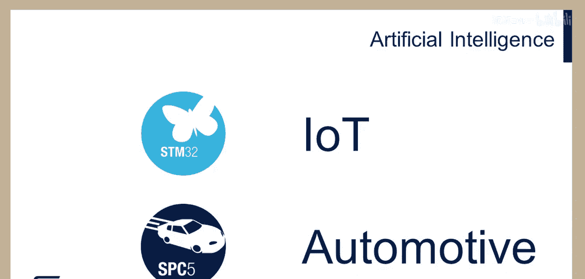
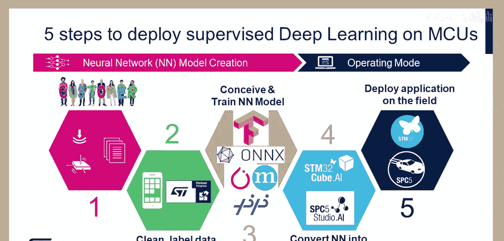
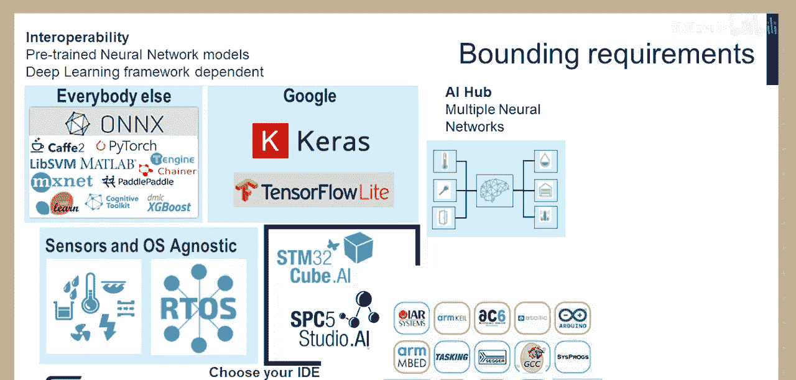
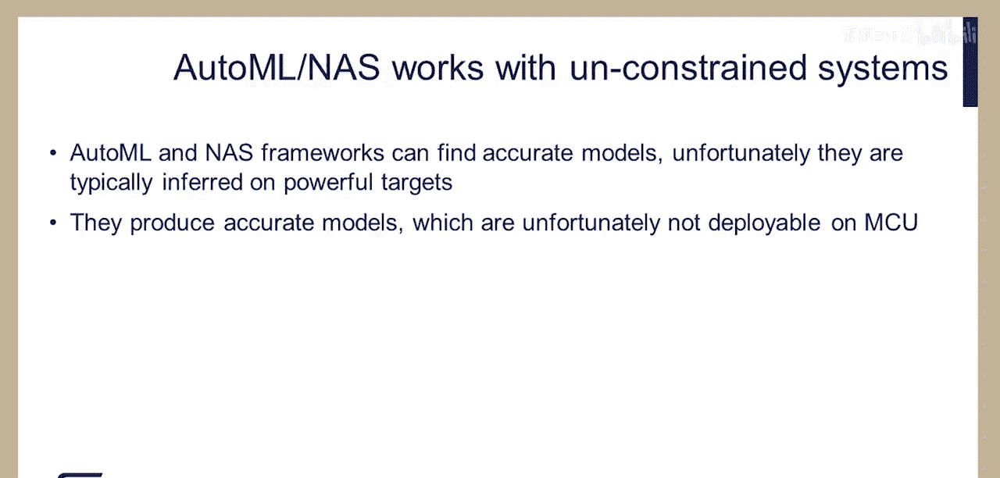
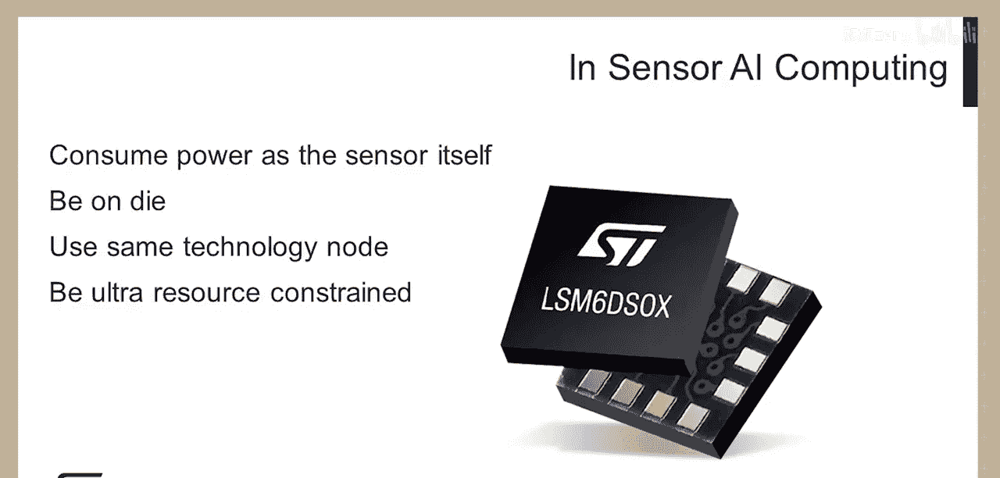

# 063：案例研究 - 技术提供商

在本节课中，我们将通过意法半导体技术专家的视角，了解人工智能在物联网和普适计算领域的实际应用。我们将探讨该公司如何将AI部署到资源受限的微控制器上，并展望未来的技术挑战。

---

物联网和普适计算是当前与人工智能相关的重要技术场景，工业界在这一领域扮演着关键角色。让我们听听一位专家的观点。

大家好，我是Danielo Pou，意法半导体的技术总监，负责为微控制器和传感器开发人工智能工具，专注于系统研究和应用。

## 意法半导体在AI领域做什么？

为了提供一些背景，意法半导体生产并销售大量微控制器：在物联网领域是STM32系列，在汽车应用领域是SC5系列。因此，在接触人工智能时，一个基本的考虑和问题是：这是一个趋势性话题还是一项技术奇点？我们得出的结论是后者，它也改变了我们塑造应用的方式。因此，我们在监督式深度学习领域引入了一个由五个步骤组成的方法论。

以下是该方法论的五个步骤：

1.  **构思应用**：这意味着选择能为应用提供数据的传感器。
2.  **获取并处理数据**：获取足够的数据，进行适当的清洗和标注，使其为第三步做好准备。
3.  **设计与训练神经网络**：AI应用开发者通常会设计神经网络拓扑结构并进行训练。他们使用流行的深度学习工具，如Keras、TensorFlow、PyTorch。训练好的模型通常会被导出为可在各种设备上运行神经网络的格式。
4.  **在微控制器上部署**：需要将预训练好的神经网络部署到微控制器上。为了能自动将它们部署到公司自产的微控制器（STM32和SC5）上，我们引入了一项独特的技术，可以自动将模型转换为高效的代码和库，以便在这些资源稀缺的微控制器上运行。这项技术已被集成到公开提供给开发者的工具中，这些工具叫做STM32Cube.AI和SC5Studio.AI。
5.  **现场验证**：由这些工具生成的库被部署到微控制器上，随后可以进行现场应用试验，以验证工具的有效性。

这些工具的设计旨在满足四个基本要求。

以下是这些工具必须满足的四个核心要求：

*   **与主流深度学习工具互操作**：能够与公开可用的深度学习工具（如Keras、TensorFlow）互操作，并能导入它们导出的标准格式模型。这一点很重要，因为它确保了流程的开放性。
*   **生成适配任何IDE的代码**：生成的代码能够适配任何集成开发环境。软件社区习惯使用多种IDE，因此我们需要再次确保与它们的互操作性，方法是生成标准的C/C++代码。
*   **与具体应用无关**：这意味着不依赖于特定的传感器选择或实时操作系统。这样可以为开发者提供自由，让他们按照自己的意愿去构思和定义应用。
*   **将微控制器用作AI枢纽**：这意味着能够实例化多个神经网络，并独立于任何软件或调度器运行它们。这样，微控制器就可以运行这些网络，服务于不同的传感器。

## 您认为什么限制了AI的广泛发展？

AI开发者通常需要手动设计神经网络拓扑结构，以便将其适配到资源有限的微控制器上。我认为未来的一个主要挑战是让他们能够使用工具，这些工具可以自动生成神经网络拓扑结构，并根据微控制器提出的约束条件同时优化其超参数。因此，未来我们需要的是**由资源约束引导的神经架构搜索和超参数优化工具**，以便同时实现网络设计的准确性和在微控制器上的可部署性。

## 在AI与微控制器之后，您认为下一个挑战是什么？

在微控制器上实现人工智能之后，下一个大趋势将是**传感器内人工智能计算**。这意味着将人工智能直接带入传感器本身，这需要满足以下要求：复杂度要足够低，以便能够集成在传感器所在的同一芯片上，共享相同的技术节点；并且功耗要足够低，与传感器本身的功耗相当，这显然意味着要进入微瓦级的功耗范围。

所以，人工智能的未来是光明且低功耗的。谢谢你，Danielo。

---

本节课中，我们一起学习了意法半导体如何通过一个五步方法论将AI部署到微控制器上，了解了其工具链的四大设计原则，并探讨了当前AI广泛部署的挑战（如自动化的神经架构搜索）以及未来的发展方向（传感器内AI计算）。这展示了工业界如何将前沿AI研究与具体的硬件和工程约束相结合，推动技术落地。