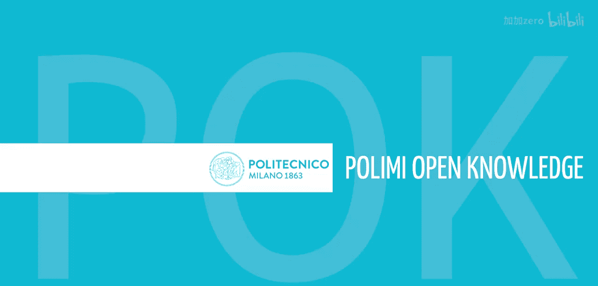
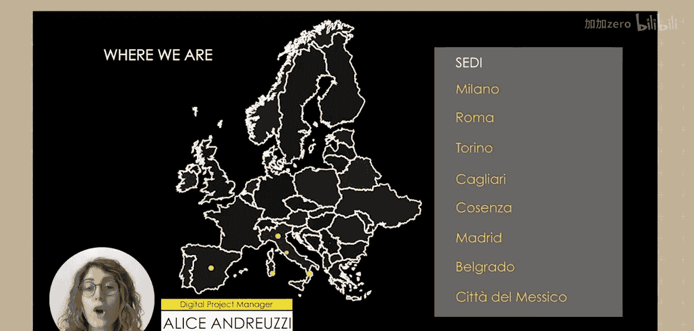
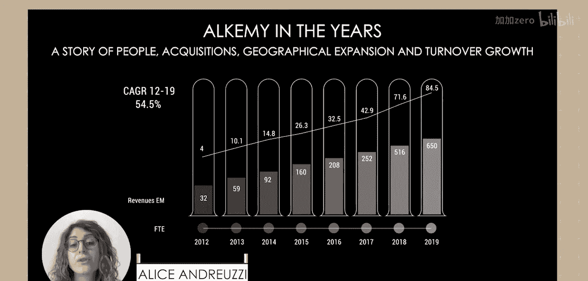
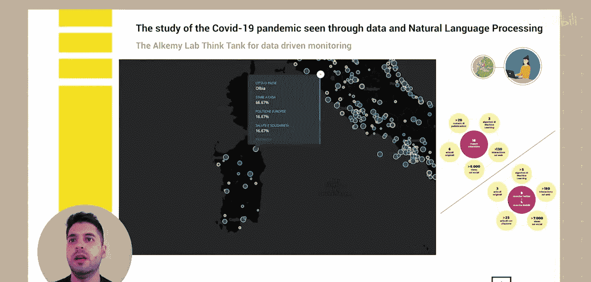

# 064：社交媒体分析的案例研究

在本节课中，我们将学习云计算和机器学习如何应用于大规模数据集的处理与知识提取。我们将通过一个具体的案例——社交媒体分析，来了解这些技术在实际场景中的应用。

---

云计算和机器学习在处理大规模数据集和提取知识方面扮演着关键角色。

该领域的一个应用场景是社交媒体分析。

让我们听听意大利公司Alchemy在该领域的见解。

---

Alchemy是一家在数字化转型市场运营的意大利公司。它通过数字化转型项目，支持大中型企业商业模式的演进。

它帮助企业通过技术和数据，重新设计战略、产品与服务。Camilla是Alchemy创新与研究部门的负责人。

---

我们都知道，2020年的新冠疫情彻底改变了我们的生活。但如何从社交媒体上的信息中获取价值呢？更具体地说，能否设计一个基于云计算的机器学习系统，来追踪和测量社交媒体上与新冠疫情相关的讨论？

---

2020年2月，Alchemy创建了一个追踪器，用于监测新冠疫情相关的数据驱动传播。其目标是追踪Twitter上的讨论进展。自然语言处理和主题建模识别算法，使得识别和追踪意大利Twitter对话中最相关的讨论成为可能。

一个基于云的Twitter数据收集平台，即“社交感知数据智能”系统，收集了超过600万条与新冠疫情相关的意大利语推文。

---

为了识别Twitter上与新冠疫情相关的主要主题，应用了自然语言处理技术。每条提取的推文文本被自动转换为数值向量，并通过主题建模算法进行分析，以识别Twitter上与新冠疫情相关的主要主题。

从2020年3月20日到6月12日，Alchemy每周识别出三个主要主题。

在2020年3月的最后一周，分析记录了超过5万条推文的峰值。到了5月，每周的对话量稳定在约2万条推文。

识别出的反复出现的主题包括：居家隔离、欧洲政策、健康与移民。其中，移民主题持续时间最长，而欧洲政策主题在2020年春季初尤为突出。

---

那么关于虚假新闻呢？我们如何设计基于云和机器学习的系统来检测虚假新闻？

最近由冠状病毒大流行引发的全球紧急状况，在人群中引发了恐慌情绪。同时，对最新信息的持续搜索，助长了虚假新闻和错误信息的传播，尤其是在即时通讯应用、博客、微博和社交媒体中。

被考虑的虚假新闻包括：病毒在意大利的传播与移民有关、新冠病毒与武器计划有关、与5G技术有关等等。

在这项工作中，我们提取了与每条虚假新闻相关的数据。我们拥有数据的文本主体，并使用机器学习和自然语言处理领域的创新技术对其进行建模，以发现有趣的特征。

该研究还涉及了意大利的虚假信息传播问题。一些分享虚假新闻的推文被识别出来。分析发现了一些在Twitter上传播的支持虚假新闻的未经核实的视频。这些研究成果已被《纽约时报》和《时代》杂志等众多媒体报道。

Alchemy与一所大学进行的进一步分析，旨在调查Twitter和Telegram上与“匿名者Q”这一国际阴谋论相关的传播。完整的网络分析显示，许多账户是自动化的，并广泛传播虚假新闻。

---

让我们在机器学习和社交数据云处理领域更进一步。

什么是社交数据智能？它如何与选举活动相关联？

数据分析是一个检查、清理、转换和建模数据的过程，目的是发现有用信息、提出结论并支持决策。社交数据智能是一种特殊形式的数据分析，专注于社交媒体数据。人们使用社交媒体写下他们对政治事件、社会现象或名人的印象、观点和感受。

从政治角度来看，社交数据智能意味着收集、分析和解读公共领域的信息。它代表了一个分析政治偏好、了解各党派如何进行竞选活动、他们如何与民众沟通以及他们在公众中引发何种情感的机会。

---

以下是可以在社交媒体上进行的两种主要分析类型：

**定量分析**
这种分析将每条提及或与候选人相关的帖子，视为投票意向的表达。它可以是地理分析，用于确定关于候选人的帖子主要集中在哪些区域；也可以是时间分析，用于分析对话如何逐日变化。

**定性分析**
这种分析考虑人们关于候选人写下的内容。它可以基于文本分析、情感分析和机器学习算法。

---

在政治领域，社交媒体智能不能取代民意调查。然而，它可以代表一种经济可持续且更快速的方式，来收集关于人们对选举、政党和候选人的真实想法的信息。

感谢这些非常有趣的见解。云计算和机器学习正在为社交媒体分析开辟新的研究领域、新技术和新视角。

---

本节课中，我们一起学习了云计算和机器学习在社交媒体分析中的实际应用。我们通过一个追踪新冠疫情讨论和检测虚假新闻的案例，了解了如何利用云平台收集数据，并应用自然语言处理和主题建模等机器学习技术来提取有价值的信息。我们还探讨了社交数据智能在政治选举分析中的作用，区分了定量与定性两种分析方法。这些技术为理解公众舆论和网络现象提供了强大的工具。