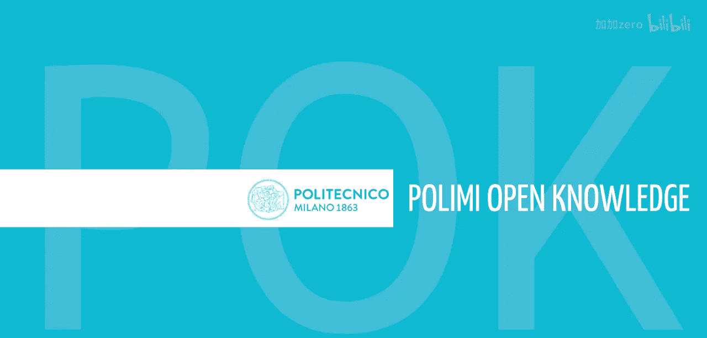
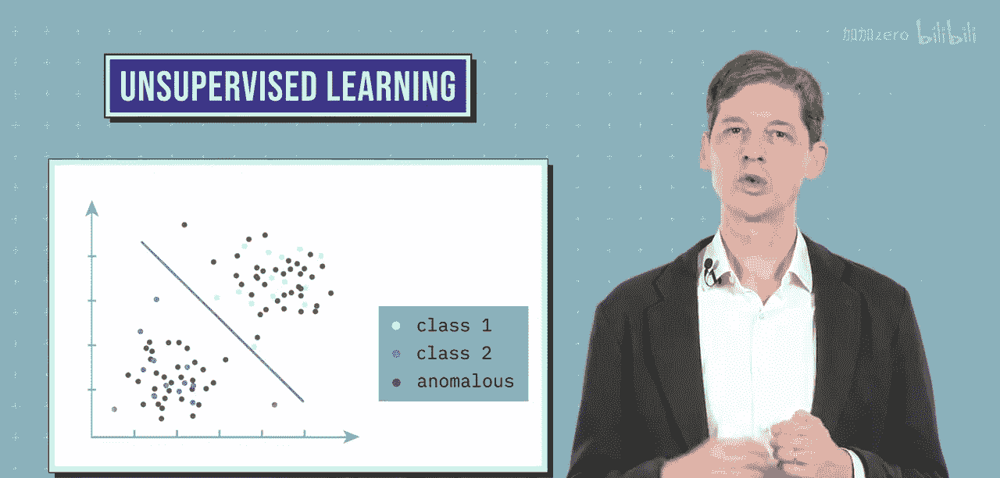
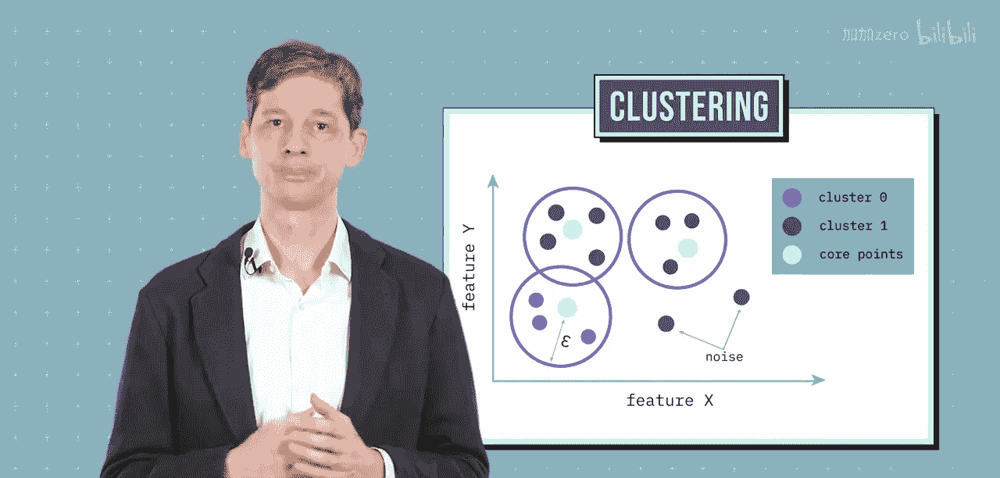
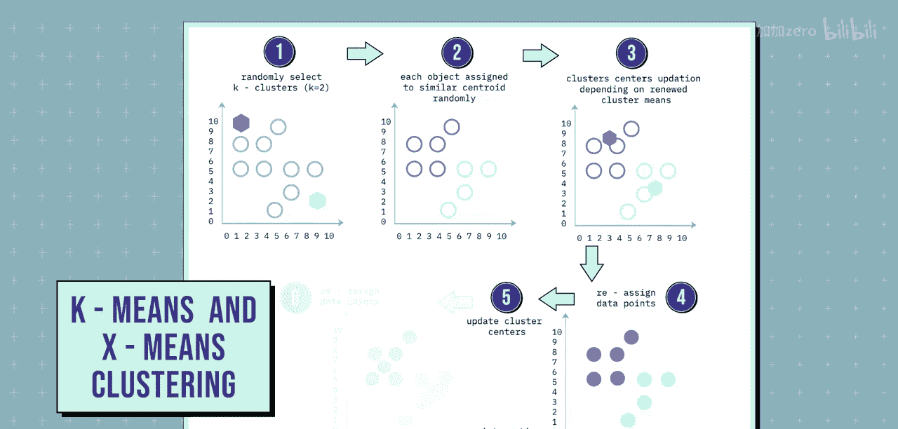
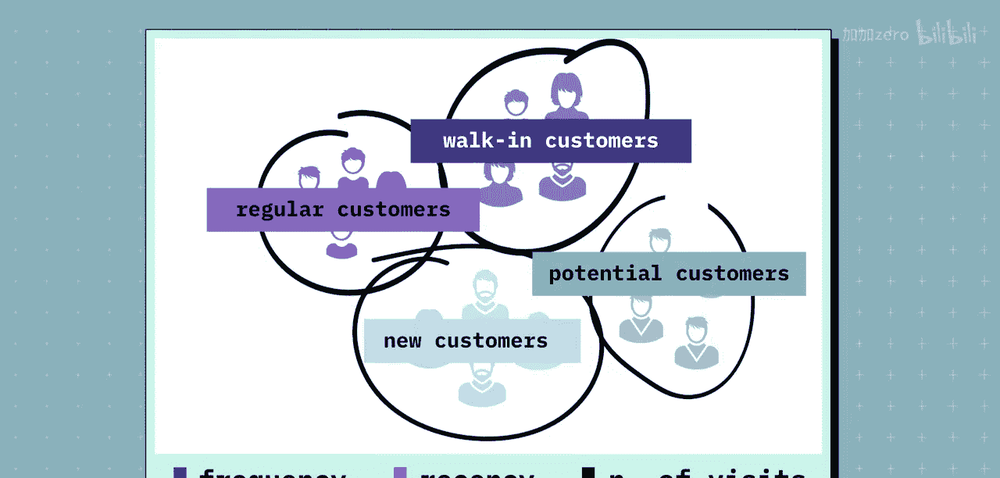
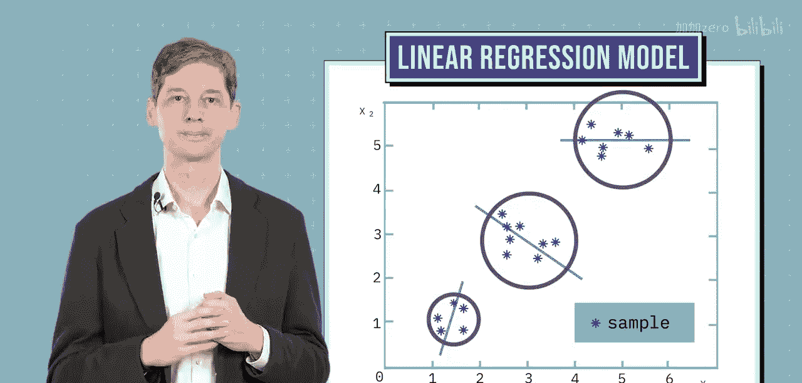

# 069：无监督学习与聚类



在本节课中，我们将要学习无监督学习的基本概念，特别是聚类任务。我们将了解它与监督学习的区别，探讨其核心思想，并详细介绍一种经典的聚类算法——K均值算法。最后，我们将了解聚类在现实世界中的多种应用场景。



## 无监督学习概述

在监督学习中，目标是学习一组输入和由监督者提供的输出之间的映射关系。而在无监督学习中，我们只有输入值，目标是揭示数据中潜在隐藏的结构。


无监督学习是一套技术，旨在为数据学习更好的表示，这对于提升下游任务的性能至关重要。


## 无监督学习的灵感来源

我们大脑中发生的大部分学习过程都可以被视为无监督学习。儿童在生命的第一年里，相对于他们所完成的学习量，获得的标记数据非常少。父母或老师不需要向孩子展示每一种狗的品种来教他们识别狗。他们可以从少数例子中学习，无需大量解释，并能自行进行归纳。


当然，在这个过程中他们可能会犯错，但对他们所观察到的事物建立良好的表示，使他们能够迅速自我纠正。



## 无监督学习的目标

为了学习而学习，心中没有特定任务，使得智能体能够发现模式，这些模式对于发展更广泛的智能可能出人意料地有用。


给定一个未标记的数据集，无监督学习算法可能会尝试将数据分组到簇中，或者尝试通过用一组新特征压缩信息来降低数据的维度，又或者尝试发现数据内部的规则或模式。

## 聚类任务

无监督学习中的主要任务之一是聚类。聚类任务是将样本分组，使得同一簇中的样本彼此之间比其他簇中的样本更相似。相似性是根据某种度量来衡量的。



由于簇的概念无法精确定义，因此存在几种聚类模型：连通性模型、质心模型、分布模型、密度模型等。针对每一种模型，都提出了许多算法。

为了明确概念，让我们考虑最流行的聚类算法之一：K均值算法。

## K均值算法详解

K均值是一种迭代算法，它使用质心模型，意味着每个簇由其中心点表示，该中心点对应于分配给该簇的点的平均值。

以下是K均值算法的步骤：

1.  **初始化**：首先，我们必须选择期望的簇数量K，并通过在数据集中随机选取一个点来初始化每个簇的质心。
2.  **分配步骤**：然后，我们取数据集中的每个样本，通过计算其到所有质心的距离并选择最近的那个，来确定它属于哪个簇。
3.  **更新步骤**：下一步是将每个簇的质心调整为其所分配样本的平均值。
4.  **迭代**：重复执行分配和更新这两个步骤，直到分配结果不再发生变化。

算法可以用以下伪代码描述：
```python
初始化 K 个质心
while 分配结果发生变化:
    for 每个数据点:
        将其分配到最近的质心所属的簇
    for 每个簇:
        将质心更新为该簇所有点的平均值
```

## 聚类的应用场景


聚类在许多应用中都有使用。新闻聚合器每天查看网络上的数万条新闻，并在无需人工干预的情况下根据主题自动对它们进行分组。




例如，考虑基因组学，特别是DNA微阵列数据分析，我们可以根据某些基因的表达程度将个体分组到不同的类别中。这是无监督学习，因为我们没有告诉算法哪些人是类型1或类型2，而是通过观察数据中的相似性来推断分组。

这类算法也用于社交网络分析、市场细分、天文数据分析等许多其他领域。此外，聚类算法的输出可以用于分类、异常检测、客户细分，甚至改进监督学习模型。


以下是几个常见的应用场景：

*   **无标签数据的分类**：一个常见的起始用例是对未标记的数据进行分类。即使你的数据没有指定类别的列，聚类算法也会尝试在你的数据集中找到异质的分组。例如，在正常邮件中找出不同的组以识别垃圾邮件。
*   **异常检测**：想象一下，我们正在处理信用卡交易，我们有一个特定用户。如果我们发现与该用户的其他交易相比，存在一个由高额交易、小额交易或在新商户处的交易形成的小簇，这就会在数据集中呈现一个异常，可能向信用卡公司表明发生了欺诈交易。
*   **客户细分**：客户细分也是一个常见的用例。例如，基于最近三个月的访问频率和平均消费金额等特征，寻找能帮助你发现业务有多少种客户类型的分组。这需要结合每一个不同的特征，并得出不同的细分市场。或者另一种常见的细分是按人口统计和参与度水平进行。例如，你可以为单身客户、新父母、空巢老人等创建分组，并确定首选的营销渠道，利用这些洞察来推动未来的营销活动。
*   **改进监督学习**：最后，另一个常见的用例是帮助改进监督学习。例如，我们可以在整个数据集上训练一个好的模型（比如一个好的线性回归模型），然后将其性能与我们在通过聚类发现的数据子集上训练的模型进行比较。或许通过观察这些不同的类别并为这些不同的分组提出不同的预测，我们能够提高性能。虽然不能保证这总是有效，但分割数据以找到这些异质组，然后为每个组训练一个模型以帮助改进分类或回归，是一种常见的做法。



## 总结与预告

本节课中，我们一起学习了无监督学习的核心概念，重点探讨了聚类任务。我们了解了无监督学习与监督学习的区别，学习了K均值这一经典聚类算法的原理和步骤，并看到了聚类在新闻分类、基因分析、异常检测、客户细分以及辅助监督学习等多个领域的实际应用。


在下一课中，我们将概述如何通过降维技术，利用无监督学习来寻找数据的压缩表示。